<!-- page 1 -->
<!-- page 2 -->
<!-- page 3 -->
<!-- page 4 -->
<!-- page 5 -->
<!-- page 6 -->
<!-- page 7 -->
<!-- page 8 -->

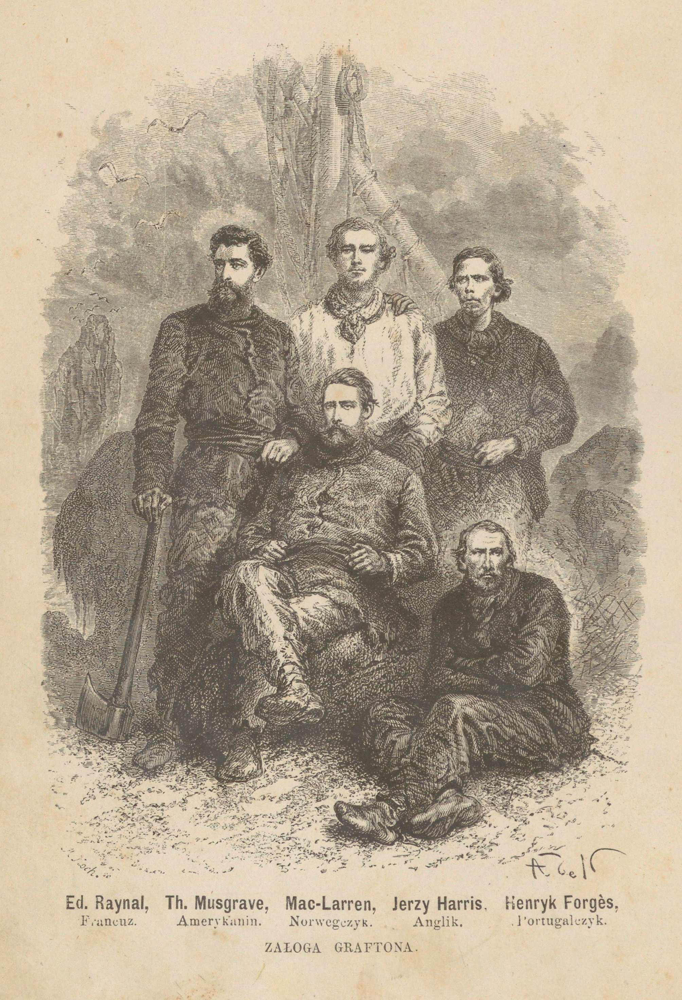

<!-- page 9 -->
<!-- page 10 -->
<!-- page 11 -->
<!-- page 12 -->

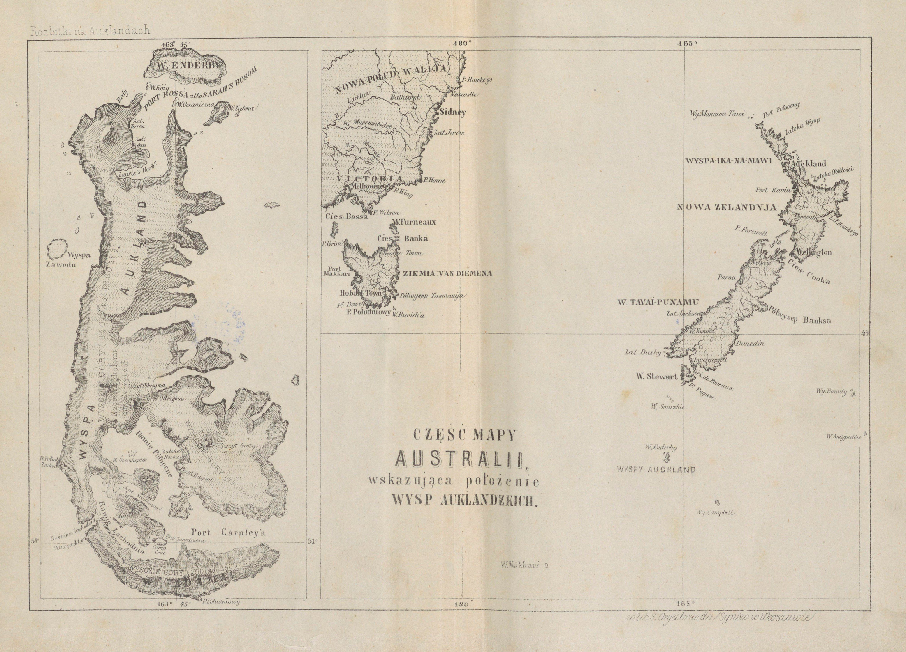

<!-- page 13 -->
<!-- page 14 -->
<!-- page 15 -->

# DO MOJEJ MATKI

Droga i kochana Matko!

Rok temu nie przypuszczałaś, bym jeszcze znajdował się na ziemi; pędziłaś życie we łzach i w boleści. Bezdzietna, gdyż ja, Twój syn pierworodny, byłem jedynym, którego Ci śmierć okrutna nie wydarła, wlokłaś Twe dni sieroce jako ciężar bezużyteczny.

Pociesz się, Matko, otrzyj łzy z oczu, porzuć Twe szaty żałobne; Bóg wysłuchał modłów Twoich i zlitował się nad nami. Na przekór wszelkim przewidywaniom syn Twój powrócił.

Znasz dobrze ogrom mej synowskiej miłości; ale, choćby ona była jak tylko być może największa, czyżby ją można było porównać z Twoją miłością macierzyńską, z owem uczuciem głębokiem, ową tkliwą opieką, owem poświęceniem bez granic, które dla moich oczu mają w sobie coś boskiego?

A jednak ja byłem w stanie opuścić Cię na lat dwadzieścia przeszło! Byłem w stanie oddzielić się od Ciebie przepaściami; prawie ćwiercią wieku i tysiącami mil! I to dlatego tylko, by szukać fortuny i przygód!

Możesz być jednak pewną, że gdy daleko, bardzo od Ciebie daleko, zwątpienie bliskiem było opanowania mej duszy, Tyś była zawsze mym dobrym aniołem stróżem. Zdawało mi się, że widzę

<!-- page 16 -->

Twój wzrok, tak poważny i tak łagodny zarazem, we mnie utkwiony, zdawało mi się, że słyszę głos Twój przemawiający do mnie: „Bądź mężnym, synu, nie upadaj na duchu, bądź człowiekiem!” I troski moje się rozpraszały, i czułem, jak odwaga na nowo we mnie wstępowała.

Książka ta mieści w sobie proste i wierne opowiadanie ostatniej z prób, które przechodziłem, próby straszliwej, pod ciężarem której upaść byłem powinien, a jednak, jakimś cudem miłosierdzia boskiego, wyszedłem z niej zwycięzko. Komuż więc, jeżeli nie Tobie, książkę tę winienem poświęcić?

RAYNAL.

<!-- page 17 -->

# DO CZYTELNIKA

Kiedym, powróciwszy do Francyi po dwudziestu latach tułaczki i po szczęśliwem wybrnięciu ze straszliwej przygody, odważył się przedsięwziąć napisanie tej książki, nie miałem, ani nawet mieć mogłem żadnej żyłki literackiej. Byłem daleko mniej obeznany z piórem niż z oszczepem, toporem lub strzelbą. Ograniczyłem się więc na skromnem i rzetelnem opowiedzeniu tego, com widział, com robił i czuł podczas jednej z najcięższych prób, na jakie tylko istota ludzka wystawiona być może.

Byłem bardzo szczęśliwy, temu zaprzeczyć nie mogę, na widok przychylnego przyjęcia, jakiego moja praca doznała od publiczności. Wczytywano się w nią, sądzono ją z pobłażaniem, otrzymywałem liczne i bardzo miłe dowody uznania. Jeżeli po tylu nieszczęściach mogłem się kiedy spodziewać jakiego wynagrodzenia, to nigdy nie mogłem pragnąć milszego nad współczucie mych spółobywateli.

Lecz zadowolenie, jakie mi sprawia powodzenie tego opowiadania, nie jest zupełnie samolubnem: cieszy mnie popyt na nie, bo sądzę, że nie pozostanie ono bez dobrego wpływu. Opisując moje i towarzyszów moich przygody, nasze cierpienia, nasze walki, nasze wysiłki i nakoniec cudowne prawie ocalenie, ożywiony byłem tem błogiem przekonaniem, że opowieść moja, prócz strawy dla ciekawości czytelników, będzie też dla nich i pożyteczną nauką.

<!-- page 18 -->

Nie sądzę, bym się mylił. Książka ta okaże dowodnie młodym czytelnikom, jak ważnem jest dla każdego, do jakiegokolwiek by stanu należał, by się kształcił, pracował, nabywał zawczasu różnych wiadomości, które później, pośród nigdy nieprzewidywanych okoliczności, mogą mu się stać największą pomocą, a bez których ani sobie samemu zaradzić, ani też innym pomocą być nie można.

Wszystkim zaś, którym przychodzi walczyć z przeciwnościami życia, opowieść moja dostarczyć może błogiej pociechy, że nawet w położeniu na pozór najokropniejszem i najbardziej rozpaczliwem, nie należy się poddawać zwątpieniu, i że przy pomocy siły woli, sprężystości i niezachwianej ufności w Opatrzność, można zawsze podołać najgorszemu losowi, a nawet wyjść z tych zapasów zwycięzko.

<!-- page 19 -->

# ROZBITKI NA AUKLANDACH

## WSTĘP

Jeżeli przygody, podobne do przypadków Aleksandra Selkirka, wsławionego przez Daniela de Foe pod zmyślonem nazwiskiem Robinsona Kruzoe, jak rozbicie na brzegu bezludnej wyspy, blisko dwudziestomiesięczny pobyt z kilkoma towarzyszami na nagiej skale; konieczność zaradzania własnemi siłami wszelkim potrzebom, stwarzania sobie środków do życia, obrony przeciw ostrości klimatu przez zbudowanie chaty i przygotowanie odzieży, przeciw głodowi przez polowanie i rybołówstwo, zaprowadzenie między sobą hierarchii, policyi dla utrzymania porządku i spokoju, to jest cywilizowanie się na nowo w najtrudniejszych po temu warunkach i nakoniec szczęśliwe wyswobodzenie, winne nie ślepemu trafowi, ale silnej woli i roztropnym usiłowaniom; jeżeli, powtarzam, tego rodzaju przygody uznają czytelnicy za zdolne do pobudzenia ich ciekawości i wywołania żywszego zajęcia, w takim razie nie mam żadnego powodu do dłuższego usprawiedliwiania się z tego, co mię nakłoniło do ujęcia pióra dla opisania tych przygód.

Zdaje mi się, że przy czytaniu mej opowieści nikt nie potrafi się oprzeć żywszemu poczuciu rozkoszy z przebywania w ojczyźnie, pośród swych ziomków, na łonie rodziny i przyjaciół, a zarazem radości z korzystania z tylu nieocenionych dobrodziejstw, jakich nam dostarczają społeczeństwo i cywilizacyja. Jeżeli się sprawdzi to moje przeczucie, będzie to dla mnie wielką pociechą, bo moja książka nie pozostanie bez dobrego wpływu.

<!-- page 20 -->

Zanim wejdę w tok opowiadania, muszę koniecznie objaśnić czytelników, skutkiem jakich okoliczności opuściłem kraj mój i rodzinę i jakie, i tak już niezwykłe przygody, poprzedziły wielką próbę, po której na całe me życie pozostały mi niezatarte ślady, i o której nie mogę nigdy pomyśleć bez głębokiego wzruszenia, bez wstrząśnienia w całem mojem ciele.

Wstęp ten będę się starał uczynić o ile możności jak najtreściwszym, pozwalając sobie jednak zatrzymać się nieco dłużej nad pewnymi szczegółami, które we wspomnieniach moich wyrobiły sobie miejsce nieco zaszczytniejsze, a o ile mi się zdaje, potrafią także obudzić i zajęcie czytelników.

Urodziłem się we wsi Moissac, w departamencie Tarnu i Garronny. Zacząłem zaledwie czternasty rok życia, gdy nagle gwałtowne niepowodzenia zmieniły zupełnie położenie moich rodziców; miejsce dostatku, w którym dotąd żyli, zastąpiła nagle niedola. Nieszczęście to było dla nich tem dokuczliwszem, że naraz zniweczyło wszelkie plany, obmyślane dla ustalenia przyszłości ich dzieci.

Wielką mi przykrość sprawiła konieczność opuszczenia kolegijum w Montauban, gdzie wówczas pobierałem nauki, gdyż już wtedy zaczynałem rozumieć konieczność wykształcenia dla każdego, kto chce rozpocząć samoistne życie na świecie. Brat mój i siostra również odebrani zostali ze szkoły, byli jednak jeszcze zbyt dziecinnymi, by się kłopotać mogli skutkami spadłego na nas nieszczęścia.

Ojciec mój, który za młodu studyjował prawo i zamierzał zostać adwokatem, dzięki skromnej swej fortunce, był później w możności porzucenia tego zamiaru i pędził życie na ustroniu według swych skromnych i prostych upodobań. Nadeszła jednak chwila, gdy się ujrzał zmuszonym wyrzec tego miłego wczasu i wziąć się do pracy produkcyjnej. Postanowił wówczas przenieść się do Bordeaux, gdzie było mu daleko łatwiej niż w małem miasteczku korzystnie spożytkować swe zdolności. Matka, kobieta dziwnej sta-

<!-- page 21 -->

łości charakteru, dawała nam wszystkim doskonały przykład rezygnacyi i odwagi.

Co do mnie, to życie śród walk z losem i niedostatku, śród którego widocznie wyczerpywali swe siły moi rodzice, natchnęło mię gorącem pragnieniem przyjścia im w pomoc. Ulżenie im kłopotów chwili obecnej i powrócenie do dawnej pomyślności było nieustannie przedmiotem mych myśli. Dla dojścia do tego celu, jeden tylko widziałem środek. Środkiem tym było siąść na okręt, zostać marynarzem, puścić się w świat, by na obcej ziemi, na końcu świata, jeśliby to było koniecznem, szukać dostatków, których Francyja nie chciała mi dostarczyć. Słyszałem nieraz o osobach, które opuściwszy w takiż sam sposób ojczyznę, wracały do niej później bogatemi, a przynajmniej nie znającemi niedostatku. Dlaczegóż więc i ja nie mógłbym być równie szczęśliwym? Może też być, iż myśl ta dlatego tak mi się uśmiechała, żem, wczytując się na kilka lat przedtem w pewnego rodzaju książki, nabrał nadzwyczajnego upodobania do podróży i przygód. Rodzice moi nie stawiali żadnych przeszkód moim zamiarom, których słuszności nie omieszkałem im bynajmniej wyjaśniać; przyszło więc do tego, żem miał wyruszyć w świat w charakterze praktykanta na majtka na okręcie la Virginie et Gabrielle, statku trzymasztowym, o stu tonnach objętości, który miał się puścić w drogę do Indyj Wschodnich pod dowództwem kapitana Loquay, dobrego przyjaciela mego ojca. Dzielny ten człowiek przyrzekł mnie wziąć w swoją opiekę, kształcić w obranym przezemnie zawodzie, a szczerze powiedzieć mogę, iż nigdy pewno żadna obietnica z większą gorliwością wypełnianą nie była. Kapitan Loquay stał się najlepszym mym przyjacielem, to też wspomnienie jego nigdy nie zatrze się w mej pamięci.

Pamiętam dobrze, było to 23 grudnia 1844 roku, gdy nadeszła stanowcza chwila wsiadania na okręt. Cóż to za data, co za okropna chwila! Pożegnanie z rodzicami, których tak serdecznie kochałem, wyrywanie się z ich objęć, rzucanie się w nie na nowo, przymusowa od nich ucieczka, a potem znalezienie się nagle śród ciemności na pokładzie statku, przygotowanego do drogi, poczucie jego ruchu,

<!-- page 22 -->

opuszczenie portu, oddalanie się od lądu i unoszenie się w nieznane krainy! Nie, zaprawdę, są to wrażenia, które się opisać nie dadzą.

Świt, a z nim powrót światła, pokrzepił moje zbolałe serce. Wirginija i Gabryjela, robiąc wciąż po osiem węzłów na godzinę, posuwała się bez przerwy coraz dalej. Wybrzeże rysowało się już tylko na widnokręgu w postaci wąskiej białawej smugi, a wkrótce nawet znikło nam z oczu zupełnie. Bezgraniczne morze otaczało mię dokoła; sklepienie nieba po raz pierwszy przedstawiło się mym oczom w całej swej rozległości; wszędzie miałem przed sobą nieskończoność. Wielkość obrazu uniosła mię swą wspaniałością; uczułem w sobie poważny i uroczysty zapał; umysł mój ogarnięty został jedyną myślą o Istocie najwyższej, sprawcy i panu wszechświata i poczułem w sobie niepohamowany pociąg błagania Jej o pomoc i opiekę, to też modliłem się gorąco. Od tej chwili, w całym przebiegu mego życia, myśl o obecności Boga, o jego potędze, nigdy mię nie opuszczała i nie przestawała być pociechą w strapieniach. Niepodobieństwem jest, ażeby marynarz, zostający zawsze pod wrażeniem nieskończoności, będący zawsze w styczności a częstokroć i w walce z niepewnemi siłami przyrody, mógł być kiedy pozbawionym uczucia religijnego.

Nie omieszkałem zaraz zapoznać się z próbkami życia marynarskiego. Nie mam tu bynajmniej na myśli owych zarówno śmiesznych jak i dokuczliwych przypadłości, będących wynikiem kołysania się statku, a które bardzo rzadko omijają nowicyjuszów. Nawyknienie, a po części i obawa stania się przedmiotem pośmiewiska towarzyszów podróży, pozwoliły mi bardzo prędko zapanować nad chorobą, ale wkrótce, bo zaraz na drugi dzień, miałem sposobność zaznajomienia się z burzą. Stary ocean postanowił widocznie odrazu mnie przyzwyczaić do wybryków swego zmiennego humoru, ażebym na przyszłość mógł uniknąć niespodzianek. W ciągu kilku chwil ponura mgła otoczyła nas ze wszech stron; wiatr zaczął dąć ze wściekłością; bałwany wznosiły się potwornymi kłębami, które co chwila szorowały po pokładzie i zabrały nam wkrótce trzy łodzie, oszczędziwszy tylko szalupę. Przyczepiony do jednej z drabinek,

<!-- page 23 -->

tylnego masztu, ujrzałem nagle z przerażeniem cieślę, zabierającego się do ścięcia wielkiego masztu. Luzowaliśmy się ustawicznie dla ciągłego poruszania pomp. Pędzony wiatrem, przewrócony na bok wskutek nieustannej nawałnicy, która mu ani na chwilę do zwykłego położenia wrócić nie dawała, okręt nasz zwrócił się w tył. Oczekiwaliśmy lada chwila rozbicia się o drobne wysepki lub rafy, ciągnące się wzdłuż francuzkiego wybrzeża; uważaliśmy się już za zgubionych.

Na szczęście burza nie długo trwała; mogliśmy wkrótce znowu rozwinąć żagle i puściliśmy się znowu ku równikowi, a pogoda wciąż nam odtąd sprzyjała. W sto cztery dni po opuszczeniu Bordeaux przybiliśmy do wyspy Bourbon, zwanej dziś wyspą Zjednoczenia. Stąd odbyliśmy, jedna po drugiej, aż dwie wyprawy do Indyj, podczas których zwiedziliśmy Pondiszery i inne główniejsze porty wybrzeża koromandelskiego, poczem wróciliśmy do Francyi. Ponieważ kapitan Loquay zatrzymał się dłużej na wyspie Ś-tej Heleny, powziąłem więc myśl nazbierać sobie pamiątek z grobu Napoleona, mianowicie zaś okruchów kamieni i gałązkę sławnej wierzby; wiedziałem, że te drobnostki będą nieoszacowanymi skarbami w oczach mego dziadka, kochanego staruszka, który ongi brał udział we wszystkich wyprawach Rzeczypospolitej i Cesarstwa, a w dniach mego dzieciństwa dramatycznemi swemi opowieściami unosił mnie niejednokrotnie nieopisanym zapałem. Dusza jego, pomimo upływu czasu i zmiany porządku rzeczy, żyła wciąż tylko wspomnieniami wspaniałej przeszłości.

Każdy łatwo sobie wyobrazi, z jakiem biciem serca, po siedemnastu miesiącach oddalenia, powitałem brzegi Francyi. Zawieszony na wierzchołku masztu, pierwszy z całej załogi ujrzałem kraj ukochany, gdzie mię rodzice z taką niecierpliwością oczekiwali. Wkrótce też powitałem ich, ale już nie w Bordeaux, tylko w Paryżu, gdzie obecnie stale osiedli. Nie czuję się zdolnym do opisania rozkoszy powitania, wzajemnych pieszczot, tkliwych wynurzeń, krzyżowania się pytań i odpowiedzi, podobnie jakem się nie poczuwał na siłach do skreślenia boleści chwili rozstania.

<!-- page 24 -->

Przez całe sześć miesięcy poiłem się rozkoszą pobytu w Paryżu na łonie rodziny. Podczas tego odpoczynku rozpocząłem na nowo przerwane nauki, nie odstępując bynajmniej ani na chwilę od dawnych zamiarów i nie tracąc żadnej sposobności do gonienia nadal za ich urzeczywistnieniem. Pewnego ranka, otrzymałem od kapitana Loquay zawiadomienie, że przedsiębiercy, w interesach których już tylekroć odbywał podróże morskie, zamierzają powierzyć jego opiece nowy okręt Dyjanę, ponieważ Wirginija i Gabryjela nie była już w stanie odbyć nowej wyprawy. Tym razem miał się puścić ku Antyllom.

Pośpieszyłem na jego wezwanie i w sześć miesięcy potem byłem na Gwadelupie, gdzieśmy się czas jakiś zatrzymali. Podczas powrotnej podróży zastanawiałem się nad mem położeniem. Czas mego terminu marynarskiego już był upłynął, ale zaledwie w odległej przyszłości mogłem przewidywać możność otrzymania dowództwa na własną odpowiedzialność, a ono tylko jedynie mogło mi zapewnić dochody, o jakich marzyłem. Postanowiłem więc porzucić przynajmniej na czas jakiś morskie rzemiosło i osiedlić się w jakiej odległej kolonii, gdzieby łatwiej a przynajmniej w daleko krótszym czasie możliwem było znaleźć środki dojścia do założonego celu. Trzeciego dnia po powrocie do Bordeaux, nie zdążywszy nawet pośpieszyć do Paryża by uściskać rodziców, rozstałem się z kapitanem Loquay, który w zupełności pochwalał me postępowanie, i wstąpiłem na pokład Syreny, pięknego trzymasztowego okrętu, świeżo spuszczonego na wodę. Tu pod dowództwem kapitana Odouard'a, miałem się puścić w drogę ku wyspie Ś-go Maurycego.

Odpływałem pełen odwagi i nadziei. Anim przypuszczał, jak długi szereg lat, po którym pozostanie wspomnienie tak małej liczby chwil powodzenia, tak licznych marzeń, a naostatek tak niezwykłej przygody, w przeszłość się zamieni, zanim znowu będę miał szczęście ujrzeć rodzinę i Francyję. Gdybym mógł przeczuć, że podczas mej nieobecności, śmierć zetnie dwie najmłodsze głowy mej rodziny, że zostawię rodziców na starość osieroconych, w rozpaczy, gdyż nie mogąc odebrać żadnej o mnie wiadomości, musieli stracić na-

<!-- page 25 -->

dzieję ujrzenia mnie; musieli przypuszczać, żem i ja zginął!... Dzięki Ci jednak Boże! który po tylu próbach pozwoliłeś mi prawie zmartwychwstać, by osłodzić mą obecnością ostatnie chwile rodziców i gorliwą opieką i przywiązaniem wynagrodzić im dwadzieścia lat opuszczenia i boleści!

Pierwszem doświadczeniem, jakie mi przyniósł początek pobytu na wyspie Ś-go Maurycego, była nauka, by na przyszłość nie bardzo wierzyć w skuteczność listów rekomendacyjnych. Nie mając czasu do stracenia, wyrzekłem się oczekiwania dobrego skutku poleceń, w które mię zaopatrzono, i sam zacząłem się krzątać około swojej sprawy. Znalazłem dla siebie miejsce w jednej z najpiękniejszych plantacyj wyspy, a kiedym po dwu latach praktyki życia plantatorskiego obeznał się dokładnie z uprawą trzciny cukrowej, i fabrykacyją cukru, ośmieliłem się, pomimo niespełna dwudziestu lat wieku, przyjąć na się obowiązki kierownika podobnego zakładu. Ciążyła na mnie wielka odpowiedzialność, to też chwile moje tylko obowiązkowi były poświęcone. Byłem zmuszony codziennie zrywać się o wpół do trzeciej z rana dla rozniecenia ogni w warsztatach, a nie mogłem udać się na spoczynek wcześniej jak o dziewiątej lub dziesiątej wieczorem, kiedy już ognie zagasły. Musiałem wszystkiego doglądać, być w polu ze żniwiarzami, w cukrowni dla doglądania warzenia, pakowania i wysyłki cukru na brzegi morza dla ładowania go na okręty; musiałem być w składach przy rozdziale strawy, w stajni, we młynie, słowem w stu miejscach, gdzie tylko byli ludzie, których pracy sam jeden musiałem doglądać. W sobotę wieczorem bywałem zawsze tak zmęczony, żem nawet często zabraniał posługującemu mi Indyjaninowi przerywać mi spoczynek, choćby nawet szło o posiłek, bo przedewszystkiem wczasu potrzebowałem. Nieraz też zdarzało mi się przesypiać bez przerwy całe dwadzieścia cztery godziny.

Pomimo tych wszystkich trudów i kłopotów z mymi kulisami (robotnikami rasy indyjskiej), ludem upartym i skorym do zwady, tak że pewnego razu byłem zmuszony staczać bójkę z jednym z nich dla skarcenia zuchwalstwa, kiedy indziej znów bronić mego życia prze-

<!-- page 26 -->

ciw napaści całej bandy buntowników, przyczem w obu razach zwycięstwo i utrzymanie mej powagi zawdzięczałem tylko swej zimnej krwi i stanowczości, do których czułem się zmuszonym: pomimo wszystkich tego rodzaju kłopotów byłem zadowolony ze swego stanowiska, z pociechą spoglądałem na coraz pomyślniejszy stan plantacyi, byłem w jak najlepszych stosunkach z właścicielem, pochodzącym ze starożytnej francuzkiej rodziny, odznaczającym się tak przymiotami umysłu jak i serca, słowem wszystko szło jak najlepiej... Wkrótce jednak spotkały mię dwie przygody, z których jedna zniechęciła mnie do położenia obecnego, druga zaś rzuciła mi w oczy złudny obraz świetnej przyszłości, a tym sposobem wpłynęły na zmianę mego trybu życia i na nowo popchnęły na niepewne losy.

Ową przygodą, co zwichnęła moje dobre usposobienia, była epidemija gorączki tyfoidalnej, tak zacięta, że podobnej nie zdarzyło mi się już przebyć. Rozpostarła się ona po kraju z niesłychaną gwałtownością, dziesiątkując biednych mieszkańców. Naszej plantacyi srodze się dała we znaki. Ubywało nam z dziesięciu ludzi na dzień, lecz nareszcie zaraza zaczęła się zmniejszać, ale mimo to, wycieńczony pracą i doznanemi wzruszeniami, ja sam dostałem się w jej szpony. Wyszedłem wprawdzie cało, ale osłabienie ciała i umysłu wcale ustąpić nie chciało, a uporczywość tego stanu przypisywałem szkodliwości klimatu wyspy.

Druga przygoda była wręcz przeciwnej natury i ukazała mi jak najzłudniejsze na przyszłość widoki. W owym czasie, a było to w roku 1852 ku końcowi trzeciego roku mego zarządu plantacyją, rozeszła się nagle po świecie wielka nowina o odkryciu kopalń złota w Australii. Na wyspę Ś-go Maurycego przyniósł ją statek, przybywający z Sydney. W tej chwili góry Błękitne, Ophir, Victoria stały się jedynym przedmiotem rozmowy, celem wszelkich zabiegów i pożądliwości. Mówiono tylko o ogromnych fortunach, zdobytych w ciągu dni kilku; o bryłach złota, ważących do pięćdziesięciu i stu funtów, znajdowanych na samej powierzchni gruntu albo w bardzo małej głębokości; o żebrakach, rolnikach, robotnikach lub majtkach, wiodących podczas powrotu stamtąd życie wielkich panów, rozsy-

<!-- page 27 -->

<!-- page 28 -->

<!-- page 29 -->

pujących złoto garściami, popełniających pod wpływem szału największe niedorzeczności, jak kąpiele w winie szampańskiem, lub zapalanie cygar pieniędzmi papierowymi, za które całe rodziny w ciągu kilku miesięcy wyżywićby się mogły. Mówiono nakoniec o niesłychanych tłumach ludzi, napływających do Australii ze wszystkich świata zakątków; o wspaniałych okrętach, pozostawianych na los szczęścia w portach Sydney'u i Melbourne'u, opuszczonych przez załogi, oficerów, a nawet samych kapitanów, bo wszystko, co żyło, biegło po złoto. Mówiono, co prawda, i o gorzkich zawodach, o przejściach okropnych, straszliwej nędzy; ale to były w oczach wszystkich słabe zaledwie ujemne strony obrazu, który wszystkich oczy zwracał ku sobie.

Po krótkiem wahaniu się postanowiłem porzucić obowiązek i opuścić wyspę Ś-tego Maurycego, by za przykładem tylu innych próbować szczęścia w Australii. I w lutym 1853 roku puściłem się w drogę na lichym statku, który po pięćdziesięciu sześciu dniach drogi wysadził mię w Port-Philipp. Skorom tylko stanął w granicach Australii, uważałem za konieczne obeznać się z językiem angielskim i przepędziłem dwa miesiące ucząc się go na jednym z pakiebotów, kursujących między Sydney'em i Melbournem. Wylądowanie moje w murach tego miasta nie odbyło się pod pomyślną wróżbą. Statek nasz, przy samem wejściu do portu, wieczorem, śród gęstej mgły, natrafił na skałę, a wskutek gwałtowności uderzenia przechyliwszy się na bok, nie mógł się podnieść. Prawie u kresu podróży, tak straszne niepowodzenie! Bałwany rozpostarły się nad nami; rzucały się wściekle na pomost, porwały nam dwu ludzi, majtka i kucharza i obu w nurtach oceanu pogrążyły. Uderzenia szły jedno za drugiem z nadzwyczajną szybkością, ogromny wyłom ukazał się na przodzie statku, który też zaczął iść na dno. Na szczęście morze nie było w tem miejscu głębokiem i część wielkiego masztu z wielkiem bocianiem gniazdem pozostała nad wodą, wystając na jakie piętnaście stóp ponad fale. Wdrapawszy się na sam szczyt masztu, przebyliśmy noc całą w takiem zawieszeniu. Owe kilka godzin wydały nam się wiekami; z niewypowiedzianą trwogą

<!-- page 30 -->

patrzyliśmy na straszne bałwany, idące do nas jakby do szturmu, lękając się co chwila, by który, żarłoczniejszy od innych, nie pozbawił nas i tego schronienia. Nareszcie dzień zaświtał, spostrzeżono nas, zabrano do łodzi i wysadzono na bruk Melbourne'u. Na trzeci dzień po tym wypadku byłem już w drodze do kopalń.

Przepędziłem jedenaście miesięcy w Australii; pierwsze trzy śród złotonośnych ziem prowincyi Victoria, osiem zaś następnych w takichże okolicach Nowej Południowej Walii, głównie nad brzegami rzeki Turon i jej dopływów. Nie mogę powiedzieć, by mi los sprzyjał mniej, niż innym towarzyszom. Znajdowałem tyle złota, że mi starczyło na opędzenie codziennych potrzeb, a nawet na zbieranie pewnych zapasów na nieprzewidziany wypadek. Z tem wszystkiem nie osiągnąłem założonego celu; nie chciałem zaś wracać na łono rodziny inaczej, jak, zdobywszy środki do życia dostatniego na jej łonie. Nieraz już traciłem odwagę; ale zawsze w chwili przystępu rozpaczy udawało mi się znaleźć ślad żyły, obiecujący zdobycie skarbów; wracała więc na nowo odwaga i wytrwałość. Może być, żem nadto był chciwy; możem mniej miał rozsądku niż jakiś dzielny majtek irlandzki, który przez cały czas mego pobytu w kopalniach Wiktoryi był mym wiernym towarzyszem i szczerym przyjacielem. Ów poczciwy Mac-Lure to tylko miał na celu, by zebrać sumę dostateczną na powrót do ojczyzny, kupno małego folwarku i zagospodarowanie się w nim na łonie rodziny. Kiedyśmy w chwilach odpoczynku siadali pod namiotem, piekąc przy ogniu kotlety baranie lub rozrywając się kurzeniem lulki, on opowiadał mi swe zamiary, kreślił obrazy przyszłego swego szczęścia. Cieszył się zawczasu myślą, jak podczas długich wieczorów zimowych, zasiadłszy przed kominem pomiędzy staruszką matką i żoną i popijając dobry grog, opowiadać będzie awanturnicze przygody dzieciom, drapiącym się na jego kolana. I dzielny Mac-Lure doprowadził do skutku swoje zamiary. W kilka lat później, przebywając w dolinach gór Błękitnych, otrzymałem od niego list, pisany z Irlandyi. Donosił mi w nim, że przyszedł nareszcie do posiadania tak upragnionego folwarczku, że matka jego pod własnym dachem pędziła spokojnie chwile

<!-- page 31 -->

starości, że znalazł żonę, jakiej pragnął, że szklanka grogu bynajmniej mu nie szkodzi i że ma niepłonną nadzieję, iż Bóg nie poskąpi mu dzieci... Był więc szczęśliwym! Umiarkowanie jego otrzymało należną nagrodę.

Z tego długiego ustępu mego życia tysiące wspomnień pozostały w mej pamięci. Same już te wspomnienia starczyłyby na spisanie sporej książki, do złożenia której może się kiedy i zabiorę. Tutaj jednak poprzestanę tylko na przytoczeniu trzech wypadków, z których każdy o mało co o śmierć mię nie przyprawił, a których opis może dać pewne wyobrażenie o niebezpieczeństwach wszelkiego rodzaju, grożących w każdej chwili poszukiwaczom złota.

Dwa z tych wypadków odnosiły się do pierwszych wystąpień moich w zawodzie górniczym. Wraz z Mac-Lurem osiadłem na piaskach kopalni Forest-Creek, u stóp góry Aleksandra, to jest na obszernej dolinie, której płaszczyzna ożywioną była licznymi białymi namiotami i pokrytą mnóstwem jam, w których pilnie pracowało ze czterdzieści lub pięćdziesiąt tysięcy górników. Pewnego razu, zmordowany grzebaniem w swej jamie i przemywaniem następnie wykopanej ziemi, trapiony przytem pragnieniem a nie mogąc go zaspokoić dla braku herbaty, zwykłego naszego napoju, a nawet wody gorącej, byłem tyle nierozsądnym, żem się aż napił ohydnej wody z kałuży. Niewstrzemięźliwość ta sprowadziła na mnie natychmiast silny atak choleryczny. Wijąc się w okropnych boleściach i przypuszczając, że użycie jakiegoś gwałtownie rozgrzewającego środka przyniesie mi ulgę albo też szybko położy kres moim cierpieniom, wychyliłem potężną szklanicę wódki, zaostrzonej łyżeczką pieprzu. Los mi sprzyjał... wyzdrowiałem. Wkrótce jednak i mnie i Mac-Lureowi zagroziło nieszczęście innego rodzaju, które byłoby dla nas daleko nieznośniejsze nawet od utraty życia. O mało co nie straciliśmy wzroku. Kiedyśmy pewnego razu zajęci byli przemywaniem złotonośnego piasku, niezliczone roje nader dokuczliwych i niezmiernie upartych much tak nas napastować zaczęły, żeśmy się nie mogli powstrzymać od opędzania ich pomoczonemi w błotnistej wodzie rękami. Kał w tej wodzie zawarty, dostawszy się do oczu, wywo-

<!-- page 32 -->

łał tak gwałtowne zapalenie, żeśmy oczu wcale otworzyć nie mogli. Chcąc niechcąc tedy, musieliśmy całe dnie i noce, przykuci do nędznych tapczanów, pozostawać w zupełnej bezczynności. Nie potrafię opisać strasznych fizycznych i moralnych udręczeń, jakie znosić musiałem, będąc przez dziewięć dni zupełnie pozbawionym wzroku. Ponieważ wypadki ociemnienia wcale nie są rzadkie pomiędzy poszukiwaczami złota, byłem przeto pewny, żem już na zawsze wzrok utracił. Widziałem się już zupełnie opuszczonym, niezdolnym do zapracowania na życie, a zatem zgubionym w tym rozległym na pół dzikim kraju, gdzie człowiekowi daleko więcej niż gdzieindziej potrzebne są wszystkie zmysły. Pragnąłem więc śmierci, a szał mój doszedł raz nawet do takiego stopnia, żem sam odebrać sobie życie postanowił. Szukałem rewolweru, który zwykle w gotowości spoczywał pod mą poduszką, i gdyby nie roztropność Mac-Lure'a, który, lękając się szalonych wybryków mej rozpaczy, wcześnie go był stamtąd usunął, byłbym niezawodnie powiększył liczbę samobójców. Serdecznie też potem dziękowałem Bogu, który używszy za narzędzie mego przyjaciela, uchronił mię od nieszczęścia stawienia się przed Jego obliczem pod ciężarem tak strasznej zbrodni.

Szczęście jednak wcale mi się uśmiechnąć nie chciało. Wkrótce spadła na mnie nowa przygoda, z której prawdziwie cudem tylko cało wyszedłem, a która wpłynęła na skrócenie pobytu mego w Australii. Byłem podówczas zajęty eksploatacyją łożyska strugi Palmers-Oackey-Creek, jednego z dopływów rzeki Turon. Pewnego razu, gdy wszyscy ludzie, których do pomocy przyjąłem, udali się na posiłek południowy, o który i mój żołądek gwałtownie się już upominać zaczynał, powziąłem nagle myśl wejścia do lochu wykopanego z mego polecenia przy samym stoku góry, dla przekonania się czy nie należałoby nowymi podeprzeć go słupami, [by] deszcz nie dostał się na dno, gdy nagle część jego sklepienia osypała się na mnie. Zostałem przewrócony i zawalony potężną masą ziemi. Krzyczałem, ile mi sił starczyło, ale niestety ludzie moi zanadto byli oddaleni, by głos mój mógł dojść ich uszu. Uważałem się już za

<!-- page 33 -->

stanowczo skazanego na śmierć w tem ciasnem więzieniu, lecz na szczęście ziemia osypana była pulchna i krucha; chwyciwszy się więc rozpacznych wysiłków, poczułem, że więzienie moje się powiększa, a zdwoiwszy usiłowania potrafiłem się po niejakim czasie wydobyć z mego grobu. Zbity, zbolały, na pół umarły, ledwo się wlokąc, zdołałem jednak dostać się do mych towarzyszów. Nie miałem wprawdzie żadnej kości złamanej, ale przez zgniecenie musiałem ulec jakiemuś wewnętrznemu szwankowi, albowiem popadłem w długą chorobę. Nie mogąc z niej wyjść, zmuszony byłem udać się do Sydney, gdzie po ośmiu dopiero miesiącach zupełnie wróciłem do zdrowia.

Taka jest w krótkich słowach historyja smutnych kolei, jakie poprzedziły straszną przygodę, stanowiącą ostatni epizod mego awanturniczego życia, a zarazem przedmiot niniejszego opowiadania.

<!-- page 34 -->

# ROZDZIAŁ I.

## CEL NASZEJ WYPRAWY. — DWUMASZTOWY OKRĘT „GRAFTON” — ODJAZD.

Było to w roku 1863. Po długiej kuracyi w Sydney zdołałem nareszcie pozbyć się skutków tylko co opisanego wypadku, ale zniechęcony zanadto skąpo wynagrodzonymi trudami jedenastoletniego pobytu w kopalniach złota, żyłem tylko myślą powrotu do Francyi na łono rodziny. Stanowczo już postanowiłem opuścić Australiję, a nawet robiłem przygotowania do wyjazdu, gdy nagle, uczyniona mi wówczas propozycyja odrazu zmieniła wszystkie moje plany i rzuciła mnie na nowe przygody.

Niejaki Karol Sarpy, z którym się jeszcze we Francyi poznałem, a spotkawszy przypadkiem w Sydney, zaprzyjaźniłem, prowadził w tem mieście wraz z jakimś negocyjantem handel bławatny. Pewnego razu zwierzył mi się on z powziętym niedawno projektem, o którym ani on, ani jego spólnik nikomu dotąd nie wspominali, a którego wykonanie czynił zależnem od przyjęcia w nim przezemnie udziału.

Miał on słuszne powody do mniemania, że na wyspie Campbell, leżącej na oceanie Spokojnym, nieco na południe Nowej Zelandyi, znajdować się muszą pokłady srebronośnej cyny. Był pewnym, że ta niewielka wyspa będzie bardzo łatwa do zbadania pod tym względem i liczył na moją wprawę w poszukiwaniu żył metalowych. Pragnął więc, bym z początkiem nadchodzącej pięknej pory puścił się

<!-- page 35 -->

małym statkiem na zwiedzenie tej wyspy, gdzie w razie niepowodzenia wyprawy pod względem górniczym, mógłbym, jak twierdził, upolować wielką liczbę fok, których tłuszcz i dosyć cenne skóry wynagrodziłyby sowicie koszta wyprawy. Moglibyśmy więc założyć na tej wyspie kolonije dla prowadzenia jednego lub drugiego z tych rodzajów przemysłu, a nawet i obu razem, jeżeliby to było możliwem. W razie pomyślnego obrotu rzeczy miałem pośpiesznie wracać do Sydney, by naprzód nie dać się wyprzedzić w żądaniu od rządu australijskiego koncesyi na eksploatowanie tej wyspy, a powtóre, by natychmiast z dostateczną liczbą ludzi i stosownemi narzędziami puścić się tam z powrotem, dla dostania się na wyspę przed nadejściem burzliwej pory roku. Wówczas miałem pozostać na wyspie dla kierowania robotami w charakterze administratora kolonii. „W razie nawet zupełnego niepowodzenia, rzekł mi w końcu Sarpy, cóż ci będzie znaczyło opóźnienie powrotu do ojczyzny o jakie dwa, a najwyżej trzy miesiące”.

Wiedząc, jak łatwo umysł Sarpy'ego zapalał się do rozmaitych przedsięwzięć, radziłem mu się dobrze zastanowić nad przedmiotem tej propozycyi. Sam zaś rozmyślałem nad nią przez resztę dnia. Jakkolwiek silnem było pragnienie ujrzenia znów rodziny i ojczyzny po siedemnastoletniem oddaleniu, jednakże upajałem się myślą osiągnięcia nareszcie rzeczywistych korzyści z tak długiego w tych stronach pobytu i zdobycia fortuny. Sarpy zresztą miał zupełną słuszność, twierdząc, że w razie niepowodzenia opóźnię tylko o trzy miesiące powrót do ojczyzny, gdy przeciwnie w razie pomyślnego obrotu rzeczy, na któryśmy prawie na pewno liczyli, powróciłbym wprawdzie do ojczyzny później o jaki rok lub nawet dwa lata, ale za to w położeniu, o jakiem od tak dawna marzyłem. Tego rodzaju rozumowania przezwyciężyły wreszcie tęsknotę za ojczyzną i postanowiłem przyjąć propozycyję.

Zaraz też nazajutrz pośpieszyłem zawiadomić o tem spólników, zwróciłem jednak uwagę ich na to, że porzuciwszy od tak dawna zawód żeglarski, obawiałem się przyjąć dowództwo wyprawy na czas pobytu na morzu, a wolałem natomiast być przez ten czas podrzędną

<!-- page 36 -->

figurą; co tem było słuszniejszem, że po założeniu kolonii, której miałem być głową, potrzebować będziemy kogoś do bezustannego krążenia między Sydney'em i wyspą Campbell, dla sprowadzania nam potrzebnych zapasów i zabierania stamtąd naszych wyrobów. Byłem więc zdania, że należy odrazu wybrać na dowódcę człowieka, któremuby zupełnie zaufać było można, i którego dla większej rękojmi możnaby nawet przypuścić do spółki w interesie.

Projektodawcy uznali moje rozumowanie za słuszne, to też bez zwłoki udaliśmy się w tym celu do pewnego, wytrawnego marynarza, nazwiskiem Musgrave. Był to trzydziestoletni Amerykanin, który obecnie osiadł w Sydney przy swoim wuju a spólniku Sarpy'ego.

Kapitan Tomasz Musgrave był dzielnym dowódcą, wybornym żeglarzem, odbywał już kilka razy drogę między Sydney'em i Nową Zelandyją, a tem samem doskonale znał te strony oceanu. Ofiarowaliśmy mu dowództwo statku potrzebnego nam bezustannie w naszem przedsięwzięciu, w charakterze czwartego spólnika, mającego mieć równy udział w zyskach. Ponieważ nie miał w tej chwili żadnego zajęcia, propozycyja więc nasza została bardzo mile przyjęta. Zaraz nazajutrz poszliśmy obydwaj szukać dogodnego dla nas statku, lecz zaledwie po trzytygodniowem poszukiwaniu znaleźliśmy jeden dosyć odpowiedni naszym wymaganiom.

Grafton, niewielka dwumasztówka, był wprawdzie przykrótki, lecz dzięki dosyć znacznej stosunkowo szerokości mógł pomieścić sześćdziesiąt pięć do osiemdziesięciu beczek towaru, nie będąc zbytecznie przeładowanym. Statek ten tylko co powrócił z wielokrotnie już powtarzanej podróży pomiędzy Sydney'em i New-Castle, służył bowiem do transportu węgla kamiennego, którego dobywanie stanowi główny przemysł okolic tego ostatniego portu, leżącego na tem samem co Sydney wybrzeżu, mniej więcej o sto dwadzieścia kilometrów na północ.

W głębi swej jamy, ponad samym tramem, Grafton mieści piętnaście beczek balastu, złożonego przeważnie ze starego żelastwa. Ponad tą komorą wisiała mocno zbudowana podłoga, która, utrzy-

<!-- page 37 -->

mując balast we właściwem położeniu, udogodniała zarazem ładowanie i wyładowywanie węgla. Wspomniony już balast był zupełnie dostateczny do zapewnienia statkowi należytej równowagi wówczas, gdy bez żadnego ładunku wracał do New-Castle'u, co zwykle co tydzień się powtarzało.

Z tem wszystkiem, przedsiębiorąc naszą wyprawę, w ciągu której mogliśmy być bardzo często narażeni na gwałtowne uderzenia ze strony wiatrów i samego morza, uważaliśmy za stosowne dodać jeszcze dziesięć beczek ładunku, na którą to objętość składały się bałwany piaskowca, nader pospolitego w Sydney'u kamienia, a nadto dwadzieścia okseftów wody, któreśmy bardzo starannie upakowali na spodzie okrętu. Oksefty te miały służyć na pomieszczenie tłuszczu z fok, którego zbieraniem, a zarazem i wyprawą skór tych zwierząt, pragnęliśmy zatrudnić naszą załogę dla pokrycia kosztów tej pierwszej wyprawy, w czasie gdy ja będę zajęty badaniem wyspy i szukaniem kopalni ołowiu.

Mieliśmy też zamiar, jeżeli czas na to pozwoli, pobieżnie rzucić okiem na wyspy Makaryjskie, Zielone i Auklandzkie, dla przekonania się, czy ilość fok, zamieszkujących te okolice oceanu jest dosyć znaczna, by z powrotem, w razie dostatku miejsca na okręcie, opłaciło się tam zawinąć dla ich połowu.

Zaopatrzywszy okręt w żywność mniej więcej na cztery miesiące i zgodziwszy dwu majtków oraz kucharza, z których ostatni miał też być naszym służącym i w razie potrzeby pomagać majtkom, Musgrave i ja pożegnaliśmy naszych spólników.

Przy tem ostatniem widzeniu się umówiliśmy się jeszcze co do bardzo ważnego dla nas przedmiotu. Puszczaliśmy się na morze bardzo niebezpieczne, prawie ciągle nawiedzane przez burze, a nadto mieliśmy zawijać do portów bardzo mało znanych, i na ogólnych mapach, w które jedynie byliśmy zaopatrzeni, bardzo niedokładnie oznaczonych, można przeto było bardzo łatwo przewidywać jakieś niebezpieczeństwa, a w szczególności burze na jakichś bezludnych wybrzeżach. Trzeba przeto było starać się o ile możności przeciw podobnym wypadkom się zabezpieczyć. Umówiliśmy się tedy, że jeżeli

<!-- page 38 -->

nieobecność nasza przeciągnie się dłużej nad cztery miesiące, wówczas nasi spólnicy będą obowiązani urządzić wyprawę dla poszukiwania nas; w razie zaś braku środków na wyekwipowanie drugiego okrętu wystąpią w tym względzie z prośbą o pomoc do zarządu Nowej Południowej Walii, który według wszelkiego prawdopodobieństwa wysłałby za nami jaki statek wojenny, albo w najgorszym razie przedsięwziąłby najwłaściwsze według niego środki do zasięgnięcia jakichkolwiek wiadomości o naszym losie.

Po przyjęciu tego żądania przez naszych spólników Musgrave udał się na pożegnanie z żoną i z dziećmi, ja zaś poszedłem już prosto na pokład Graftona, dla rozpoczęcia ostatnich przygotowań do odpłynięcia. W godzinę potem przybył i Musgrave, poczem podnieśliśmy kotwicę i pełni najlepszej otuchy skierowaliśmy się ku wyspie Campbell. Działo się to 12 Listopada 1863 roku.

Nie mogę tu pominąć jednego bardzo ważnego dla nas szczegółu. Wziąłem ja ze sobą doskonałą myśliwską dubeltówkę, która już przez długie lata była moim wiernym towarzyszem podróży. Miałem z początku zamiar pozostawienia jej w Sydney, ale zmieniłem potem postanowienie, zważywszy, że na wyspach, któreśmy zwiedzić postanowili, zdarzy mi się nieraz sposobność rozerwania się polowaniem na dzikie kaczki. Zaopatrzyłem się też we dwa funty prochu, dziesięć funtów ołowiu i odpowiednią ilość kapiszonów. Broń moja i takowa amunicyja miały mi następnie być tak przydatnemi, jakem nigdy w chwili wyjazdu się nie spodziewał.

<!-- page 39 -->

# ROZDZIAŁ II.

## TOWARZYSZE PODRÓŻY. — UDERZENIE FALI. — PRZYBYCIE NA WYSPĘ CAMPBELL.

Opuszczając nas, przewodnik portowy w te odezwał się słowa: „God speed you, gentlemen, and take care, we shall soon have a southerly burst”. (Niech was Bóg prowadzi, panowie, ale strzeżcie się, bo wkrótce od południa nadciągnie zawierucha). Jakoż w niespełna godzinę po tem pożegnaniu ujrzeliśmy czarne i groźne jej przednie straże. Zaledwie starczyło nam czasu na postawienie naszej dwumasztówki w gotowości na jej przyjęcie. W jednej chwili nikt z nas nie miał nic na głowie; czapki i kapelusze uleciały na morze jakby na wyścigi, a włosy nasze w jednej chwili zostały najokropniej potargane. Lecz po tym gwałtownym ataku wicher zostawił nas w spokoju, chociaż na południu dokazywał jeszcze przez resztę nocy i cały dzień następny.

Zawierucha przeszła, ale pozostał wiatr przeciwny naszemu biegowi, któremu statek jak mógł się opierał. Korzystając z tej chwili bezbarwnej podróży, pozwolę sobie przedstawić czytelnikom mych towarzyszów, tem bardziej, że w dalszym ciągu prawie ciągle mówić o nich będę potrzebował.

Wspominałem już o Tomaszu Musgrave'ie, dowódcy naszego statku, który, jak się to wkrótce w całej pełni pokazało, obok wszystkich przymiotów wybornego żeglarza, posiadał też wysokie i nie mniej dla nas ważne zalety umysłu i serca.

<!-- page 40 -->

Jerzy Harris, jeden z naszych majtków, dwudziestoletni Anglik, był to chłopak szczery aż do naiwności, w którym odwaga nie ustępowała bynajmniej sile. Znał on już nieźle swoje rzemiosło i posiadał jakie takie wykształcenie. Musgrave wybrał go na swego towarzysza w kolejnych dyżurach na okręcie.

Drugi majtek, Aleksander Mac-Larren, zwany przez nas Alick'iem, został moim towarzyszem dyżurów. Był to dwudziestoośmioletni milczący Norwegczyk, na którego twarzy prawie nigdy nie można było dojrzeć uśmiechu. Nie umiał on ni czytać ni pisać, ale był wybornym, bo posłusznym i chętnym do pracy majtkiem.

Henryk Forges, kucharz okrętowy, na któregośmy zawsze z angielska wołali Harry, był dwudziestotrzyletnim Portugalczykiem, małego wzrostu, krępym i bardzo brzydkim. Brzydotę swoją zawdzięczał chorobie w rodzaju trądu, która mu całą przednią część twarzy najokropniej zeszpeciła, a nos w jedną tylko bliznę zamieniła.

Bieg życia tego chłopca jest dosyć ciekawy. Przystawszy w trzynastym roku życia, jako chłopiec okrętowy do załogi amerykańskiego statku, trudniącego się połowem wielorybów, który pewnego razu zawinął do wysp Azorskich, ojczyzny Henryka, dzielił losy tego okrętu przez kilka lat następnych. Ale popadłszy w swą przykrą chorobę, na skutek prześladowań towarzyszów, którzy nie tylko że odeń stronili, ale nawet odpychali od siebie ze wstrętem, upraszał swego kapitana o wysadzenie go na ląd na jednej z wysp Polinezyi. Tym sposobem znalazł się na jednej z wysp Żeglarskich. Archipelag tych wysp, leżących jeszcze o jakie pięćset mil od przylądka York, najbardziej na południe wysuniętego punktu stałego lądu australskiego, zamieszkany jest przez dzikich, oddających się dotąd jeszcze ludożerstwu. Przebywał on tam przez lat kilka i wyszedł zupełnie ze swej fatalnej choroby. Znudzony nareszcie życiem pośród dzikich i pragnąc jak najprędzej opuścić ziemię, na której był przymuszony przebywać w charakterze niewolnika, zaczął dokładać wszelkich usiłowań, by się jak najprędzej stamtąd uwolnić.

<!-- page 41 -->

W tajemnicy przed krajowcami, na wzgórzu nad morzem powystawiał sygnały, do których od czasu do czasu pokryjomu się skradał. Podczas jednej z takich wycieczek udało mu się wreszcie zoczyć statek, wprost ku wyspie zmierzający.

Kapitan tego okrętu, dostrzegłszy przez lunetę dającego okrętowi rozpaczne znaki, spuścić kazał na morze szalupę dla zabrania go z wyspy. Nagle spostrzeżono, że ów biały rzucił się w wodę i zaczął szybko płynąć ku łodzi. Zdziwienie z powodu tego gwałtownego pośpiechu ogarnęło osadę okrętu, gdy nagle zobaczyła bandę dzikich, biegnących ku brzegowi, widocznie w pogoń za nieszczęśliwym Europejczykiem. Dzicy owi, skoro tylko dopadli do brzegu, zaczęli puszczać za nim z łuków strzały, z których jedna, utkwiwszy w łopatce zbiega, udaremniła jego pośpiech, gdy tymczasem inni, uzbrojeni w oszczepy i maczugi, puścili się wpław w ślad za nim. Widząc to, wioślarze podwoili wysilenia i potrafili jeszcze zdążyć w samą porę, wydobyli bowiem z wody biednego zbiega wówczas, gdy pogoń już tylko na kilka kroków za nim się znajdowała. Dostawszy się na łódź, Harry padł na jej dno bez zmysłów, utraciwszy zupełnie siły z powodu gwałtownego wzruszenia i dokuczliwej rany. Tymczasem majtkowie, kierujący łodzią, kilkoma zręcznemi uderzeniami wioseł i bosaków tak uczęstowali napastników, że ci straciwszy ochotę ścigania wydartej sobie ofiary, pośród wściekłych okrzyków zawrócili się ku brzegowi.

Wybawcom swoim odpłacał się Harry spełnianiem na okręcie obowiązków kuchcika, a następnie wysadzony został na ląd w Sydney, skądeśmy zabrali go na naszą wyprawę.

Było nas tedy pięciu, a każdy do innej należał narodowości, tak, żeśmy mieli na statku reprezentantów Ameryki, Norwegii, Portugalii i Francyi (tej ostatniej ja byłem przedstawicielem). Z tem wszystkiem porozumiewaliśmy się ze sobą jak najlepiej, ponieważ wszyscy umieliśmy po angielsku, i tego tylko języka wciąż używaliśmy.

Wszyscy moi towarzysze byli dobrze oswojeni z morzem, ale ja tylko jeden z pomiędzy nich prowadziłem życie górnika w kraju

<!-- page 42 -->

niecywilizowanym, jakim było wnętrze Australii, ta surowa szkoła, w której nabywa się umiejętności liczenia tylko na siebie, dochodzenia do wszystkiego własnym tylko przemysłem i walczenia na każdym kroku z dziewiczą i oporną przyrodą. A chociaż przezwyciężanie trudności, z któremi tam bezustannie walczyć przychodzi, nie może stanowić podstawy do pysznienia się ze zwycięstw, ale za to obdarza nas męską ufnością w siebie, która nas przygotowuje do stawiania czoła wszelkim przeciwnościom.

Wkrótce się okaże, jak bardzom winszować sobie był winien wszystkich prób, jakie mię spotkały. Przekonałem się wówczas, że nie dosyć nawet drogo opłaciłem doświadczenie, które tak ważnem było nie tylko dla mnie, ale, śmiało rzec mogę, i dla moich towarzyszów, pośród wyjątkowych okoliczności, w jakicheśmy się nagle znaleźli.

Lecz czas już wrócić do mego opowiadania, co w tej chwili uskutecznię przez przytoczenie kilku kartek mego dziennika, tak jak były pisane dzień po dniu.

**Piątek, 13 Listopada.** Wiatr wciąż południowy, lecz lekki.

**14.** Silniejszy wiatr północny. Pogoda piękna. Statek nasz, przebiegając po pięć węzłów na godzinę, sunie się prawie niepostrzeżenie po gładkiej jak zwierciadło powierzchni morza.

**15.** Druga godzina rano. Cisza. Na południu pojawiają się groźne oznaki, u zenitu niebo czyste, barometr opada. Istny deszcz gwiaździsty od strony P.P.Z. ku Pd.Pd.W., zacząwszy od tej pory ciągnie się do samego świtu. Widok niezrównany. O 6 rano zrywa się wicher południowy; jesteśmy zmuszeni do lawirowania (*).

**16.** Wicher P.P.W., wciąż się wzmagający. Posuwamy się, mając przód okrętu zwrócony na Pd.W. Na pokładzie wszystko dobrze.

*(\*) Lawirować znaczy prowadzić okręt po drodze wężykowatej, kiedy wiatr jest nieprzychylny, aby tym sposobem nie oddalać się bardzo od żądanego kierunku. W tym celu należy wciąż tak zwracać statek, by wypadkowa dwu sił go popychających, tj. oporu wody i działania wiatru, pędziły statek w kierunku wprost przeciwnym temu, w jakimby dążył pod wpływem samego wiatru.*

<!-- page 43 -->

**17.** Takiż sam kierunek biegu i takiż wiatr, tylko coraz mocniejszy.

**18.** Zawierucha od zachodu. Morze wzburzone; wszystkie małe żagle zwinięte, a dwa kółka ich ściągnięte pod żagiel bocianiego gniazda. Stanowisko okrętu w południe: 40°16' południowej szerokości a 152°26' wschodniej długości względem południka paryskiego.

10 godzina wieczorem. Wiatr gwałtowny. Morze mocno wzburzone. Bałwany co chwila uderzają o pokład, woda wciska się wszędzie, bo pokład naszego statku nie bardzo jest szczelny. Łóżka nasze zupełnie wilgotne.

10½ wieczorem. Niebo zupełnie czarne. Nie widać nic prócz wąskiego jasnego paska na widnokręgu, wywołanego przez fosforescencyję wzburzonego morza. Chmury, nader nisko zawieszone, przesuwają się ponad nami w szalonym pędzie. Co chwila przerzynają je jaskrawe błyskawice; mrożący deszcz leje jak z cebra. Od czasu do czasu grzmot swym przerażającym łoskotem wtóruje tysiącznym złowrogim odgłosom, którymi wiatr i wściekłe bałwany nas ogłuszają.

Odbywam dyżur. Spostrzegam w kajucie Musgrave'a siedzącego na stole, z głową opartą na dłoniach. Staję przy sterze w miejsce Alick'a, który nim kierował od początku dyżuru.

Nadeszła jedenasta. Olśniony światłem błyskawic, bez żadnej przerwy po sobie następujących, z trudnością zaledwie mogę obserwować busolę. Nagle padam jak długi, rzucony gwałtownie daleko od miejsca, gdziem się znajdował. Skutek to gwałtownego uderzenia fali, które wyrwało część parapetu i zmieniło położenie balastu. Statek przechyla się na bok, nie mogąc wrócić do zwykłego położenia. Trochę potłuczony i cały zlany do nitki, podnoszę się i biegnę schwycić na nowo drąg steru. Musgrave pnie się na maszt, Alick dąży za nim, dwaj inni, wybiegłszy z kryjówki u przodu statku, zdążają za nimi. We czterech zdołali nareszcie opanować, a następnie zwinąć wielki żagiel, a w trakcie tego okręt z początku powoli, potem zaś bardzo szybko zwraca się pod wpływem steru, którego drąg

<!-- page 44 -->

pod wiatr zwróciłem. Obecnie statek pędzi jak szalony po fali i ucieka przed burzą, robiąc po siedem węzłów na godzinę, pomimo zwinięcia wszystkich żagli; ciągle jednak pozostaje mocno pochylony na bok.

Musgrave odbiera mi ster i pozostaje sam na pokładzie, wszyscy zaś pozostali schodkami u przodu okrętu położonymi, zbiegamy na dół opatrzeni w latarnię. Co za okropny widok! Wszystko tam do góry nogami przewrócone i pomieszane bezładnie. Kamienie, beczki i wory z solą leżą w nieładzie na bocznej ścianie, która tym sposobem przedstawia dno okrętu. Całe szczęście, że piętnaście beczek żelaza, dobrze przytrzymywane przez dolną podłogę, nie mogły zmienić położenia. Inaczej bowiem i okręt musiałby wywrócić koziołka, a my wraz z Graftonem spoczywalibyśmy już dawno na dnie oceanu.

Przez resztę nocy do samego rana pracowaliśmy nad przywróceniem porządku wewnątrz okrętu. O świcie, ledwo żywi z utrudzenia, wychodzimy na pokład i znajdujemy tam Musgrave'a, przemokłego do nitki, z twarzą bladą, rękami prawie przymarzłemi do drąga, ale mimo to, żwawego i baczącego na wszystko. Jerzy zajmuje jego miejsce. Nie mogąc rozniecić ognia, bo wszystko przesiąkłe było wodą, musieliśmy wszyscy dla rozgrzania się wychylić po dobrej szklance wódki. Niedługo okręt musiał się znowu przygotować na przyjęcie wiatru.

Pierwszem naszem wówczas zadaniem było zbadać pompy, na dnie których, na szczęście, znaleźliśmy bardzo mało wody. Doznaliśmy bardzo miłej niespodzianki, spostrzegłszy, że chociaż pokład naszego statku przepuszczał trochę wody przez szpary, to za to spód jego był tak nieprzesiąkalny, jak ściany butelki.

Na owe dwie godziny, które Jerzy miał przepędzić przy sterze, Alick i kucharz, podobnie jak Musgrave i ja, rzuciliśmy się w ubraniach na nasze mokre hamaki, by, chociaż drzemiąc tylko, spróbować nieco wypoczynku.

Na zewnątrz burza huczała wciąż z tą samą gwałtownością.

**20.** Okręt ciągle przygotowany na przyjęcie wiatru. Wiatr

<!-- page 45 -->

dął już tylko w przerwach. Morze, chociaż jeszcze mocno wzburzone, zaczynało się wygładzać. Barometr idzie w górę.

**21.** 4 godzina rano. Rozwinęliśmy napowrót żagle, ponieważ statek, nie mając żadnego punktu podpory, kołysał się szalenie na mocno jeszcze wzburzonej powierzchni morza. — 8 godzina. Wiwat! Mamy wreszcie coś gorącego na śniadanie; pierwszy to od trzech dni tego rodzaju posiłek.

Południe. Wiatr dmie jednostajnie. Rozwinęliśmy wszystkie żagle, zwróciliśmy nos okrętu ku Pd.Pd.W., i zrobiliśmy obserwacyje słońca, które nas przekonały, iż znajdujemy się pod 30°8' południowej szerokości i 154°6' wschodniej długości. Tym sposobem przez czas trwania burzy zboczyliśmy prawie o sto pięćdziesiąt mil.

Od 21 do 27 pogoda, niebo pokryte prawie ciągle obłokami. Na statku wszystko idzie jak należy. Często spostrzegamy wieloryby.

**28.** Niebo zupełnie zachmurzone. Pozory wcale nie dobrowróżbne. Barometr opada.

O 6-ej rano napadła nas zawierucha od strony W.Pd.W., zmuszając nas uciekać przed sobą z godzinę; poczem znowu przygotowaliśmy się do stawienia czoła wiatrowi.

Od dwu dni słońca wcale nie widać i nie mogliśmy robić obserwacyj.

**29.** Tym razem burza nie trwała długo, nie dorównawszy też poprzedniej w gwałtowności. Wypogadza się. Uderzenia wichru następują w długich po sobie odstępach. Potem wiatr zaczyna się ujednostajniać, a morze nie jest już tak wzburzonem. Rozwinęliśmy żagle, zwróciwszy przytem okręt ku W.Pd.W.

Południe. Słońce się ukazało, można było zrobić obserwacyje, które nam dały wypadek: 52°6' południowej szerokości i 159°23' długości wschodniej.

**30.** O kwadrans na pierwszą wszedłszy na bocianie gniazdo, spostrzegłem ziemię w odległości mniej więcej trzydziestu pięciu mil.

4-ta po południu. Mgła rozpościera się nad oceanem, zakrywając nam ziemię nieprzejrzaną zasłoną. Mgła jest tak gęstą,

<!-- page 46 -->

że nie możemy rozróżniać żadnego przedmiotu na drugim końcu statku. Roztropność każe nam nieco zwinąć żagle i zwrócić się nieco ku pełnemu morzu, by przy nadchodzącej nocy nie wpaść na skały.

**1 grudnia, 7-ma rano.** Mgła opada, lecz nie widzimy już ziemi. Zwracamy statek, zmierzając znów ku wyspie Campbell.

**2**, 8 godzina. Zawijamy do portu Abraham's Bosom, położonego w Pd.W. stronie wyspy. 11-ta godzina. Zarzuciliśmy kotwicę na głębokości pięciu siągów (\*), przy końcu zatoki.

*(\*) Miara biasse, siąg od długości wyciągniętych rąk, mniej więcej 1,60 metra.*

<!-- page 47 -->

# ROZDZIAŁ III.

## BEZOWOCNOŚĆ POSZUKIWAŃ. — CHOROBA. — OPUSZCZENIE CAMPBELL.

Zaledwie zwinięto żagle, natychmiast w towarzystwie Musgrave'a wysiadłem na ląd. Nie widzieliśmy dotąd w zatoce żadnej foki; ale ponieważ byliśmy w samym środku lata, sądziliśmy przeto, że owe zwierzęta, chcąc w chłodzie przepędzić upał dzienny, pochowały się w wysoką trawę lub gęste zarośla, pokrywające wybrzeże.

Idąc wzdłuż brzegu, drapiąc się na skały i naodwrót zsuwając się z nich, szukaliśmy ich wszędzie, ale napróżno. Wszędzie spostrzegaliśmy mniej lub więcej wyraźne ich ślady, lecz ani jedna foka nie ukazała się naszym oczom.

Jasnem było, że wszystkie owe ślady nie były świeże, ale prawdopodobnie sięgały poprzedniej pory dnia. Były to niby wąskie ścieżki, idące pod górę; niepodobna nam jednak było dążyć niemi, wszystkie bowiem ginęły w niedostępnej dla człowieka gęstwinie. Nie tylko ta przecież występowała przed nami przeszkoda, spostrzegliśmy wkrótce, że owa do najwyższego stopnia poplątana roślinność zakrywała przed naszemi oczami mnóstwo dołów, szczelin i kałuży, będących dziełem tak częstych w tych okolicach deszczów, ułatwionem niezmiernie z powodu miękkiego i nawet najczęściej bagnistego gruntu.

<!-- page 48 -->

Strudzeni długiem a bezowocnem poszukiwaniem, wróciliśmy nareszcie do statku już po zachodzie słońca. Dowiedzieliśmy się wówczas od reszty osady, że w czasie naszej nieobecności widziano dwie foki, krążące około statku. Wynurzały one od czasu do czasu z wody swe wielkie głowy, wydając zarazem ryk, w którym przebijała się zarazem i dzikość i zdziwienie na widok nieznanego im potwora czyli naszego okrętu.

Z opisu naszych towarzyszów nie trudno nam było poznać, iż były to dwa lwy morskie, to jest gatunek dla nas najpożądańszy, którego bardzo licznych przedstawicieli spodziewaliśmy się tu zastać.

Opowiadanie to pocieszyło nas nieco w naszej rozpaczy, mogliśmy bowiem przypuszczać, że tak upragnione przez nas zwierzęta miały tu swe ulubione miejsca pobytu. Ułożyliśmy się tedy, że zwróciwszy główną uwagę na badanie wyspy celem odkrycia pokładów cyny, nie będziemy przytem zaniedbywali fok jako drugorzędnego celu wyprawy.

Zostawiwszy tedy naszych ludzi na brzegu, puściliśmy się nazajutrz równo ze świtem w głąb wyspy. Nie bez znacznego trudu, trzeba bowiem było nieraz, czołgając się na brzuchu, przedzierać się pod gałęziami lijan, przebyliśmy wreszcie pas nadbrzeżnej roślinności i skierowaliśmy się ku północo-zachodowi.

Dostawszy się na grzbiet góry, okrążyliśmy dokoła stożkowaty i ostro zakończony jej szczyt, obdarzywszy go zaraz nazwiskiem Tumu. Z miejsca tego mogliśmy w zupełności ogarnąć okiem zatokę, dobrze znaną wielorybołówcom pod nazwiskiem Monumental Harbour, albo przystanią pomników. Zeszedłszy z tej góry, znaleźliśmy się na skraju dosyć wysokiej skały nadbrzeżnej, a prawie w pośrodku okrągłej kotliny, otwartej od strony oceanu, która z pozoru wyglądała na ruiny jakiegoś olbrzymiego starożytnego kolizeum. Morze powyrywało, poszczerbiło i jakby na swój sposób wyrzeźbiło opierającą się jego falom skałę, uszanowawszy tylko najtwardsze jej części, które wystawały przed ogólną ścianę wybrzeża, nakształt reszek starożytnych filarów, których czas dotąd obalić nie potrafił.

<!-- page 49 -->

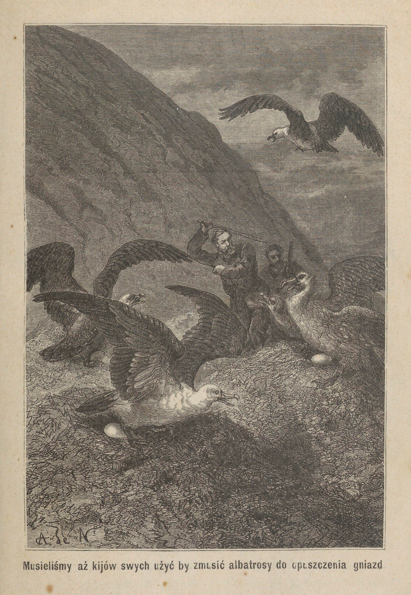

<!-- page 50 -->

<!-- page 51 -->

Nie trudno jest dostać się do tej przystani; nie przedstawia ona jednak wielkiego bezpieczeństwa z powodu bardzo mocnego uderzania w nią fali. Raz się też tu dostawszy, można być zmuszonym bardzo długo w niej pozostawać z przyczyny prawie ciągle tu panujących wiatrów zachodnich. Dlatego też zatoka ta jest bardzo mało uczęszczana, i nawet wielorybołówcy w razie nagłej tylko konieczności do niej zawijają. Potrzebując słodkiej wody, wolą oni przybijać do brzegu od strony południowo-wschodniej w przystani Abraham's Bosom (łono Abrahama).

Ponieważ utrudzająca podróż, którąśmy dotąd przebyli, mocno zaostrzyła nasz apetyt, zajęliśmy się więc roznieceniem ognia celem zagotowania garnka herbaty. Posiliwszy się, puściliśmy się dalej wybrzeżem. Tym razem byliśmy o tyle szczęśliwi, że choć w bardzo małej liczbie, zawsze jednak widzieliśmy lwy morskie; co zaś do pokładów cyny, tośmy dotąd nie znaleźli nawet najmniejszej ich wskazówki.

Poprzestając na zebraniu tych wiadomości, postanowiliśmy wracać do statku, obraliśmy jednak inną drogę. Okrążywszy Tum i spuściwszy się na równinę, spostrzegliśmy nagle u stóp góry kilka ogromnych gniazd. Gniazda te utworzone były z ziemi, przejętej mnóstwem resztek organicznych, w której, grzebiąc, albatrosy pousypywały wzgórki, mające w środku wklęsłość, wysłaną mchem. Prawie każde z tych gniazd zajęte było przez samicę, wysiadującą jedyne jajo, takiej wielkości, że mogło jak najlepiej starczyć na posiłek dwu ludziom.

Zbliżywszy się, musieliśmy aż kijów swych użyć, by zmusić albatrosy do opuszczenia gniazd, których broniły z całą dzielnością, na jaką siły ich zdobyć się mogły. Zdobyliśmy tym sposobem kilka jaj, ale jedno z nich tylko było tak świeżem, by na pokarm użytem być mogło. Ciekawi jego smaku, ugotowaliśmy je. Żółtko było wyborne, białko jednak wydało nam się nieco za gęstem; słowem, bardzo mało różniło się ono w smaku od gęsiego lub kaczego.

Po całodziennem prawie chodzeniu po gruncie wilgotnym i miękkim, który przy każdem stąpnięciu uginał się pod nogami, jak

Rozbitki na Auklandach.

<!-- page 52 -->

gąbka, przybyliśmy już nad wieczorem do okrętu niezmiernie strudzeni, tem bardziej, że bardzo często przychodziło nam się drapać na skały.

Nazajutrz Alick musiał mnie zastąpić w towarzyszeniu Musgrave'owi w nowej wycieczce, czułem się bowiem niezdrowym, a nawet miałem gorączkę. Wkrótce zmuszony byłem schronić się do kajuty i położyć się w łóżko, które ledwie za miesiąc miałem opuścić. Byłem tak mocno chory, że bardzo się już zanosiło na to, że wcale nie opuszczę wyspy Campbell. Musgrave tak dalece już zwątpił o mem wyzdrowieniu, że zaczął się kłopotać o miejsce, w któremby mnie pochować było najlepiej. Sam mi to potem wyznał, winszując mi zarazem, żem mu oszczędził tak przykrego obowiązku.

Chociaż pozbawiony wszelkich środków lekarskich i zdany jedynie na łaskę siły organizmu, przyszedłem jednak do zdrowia. Żywotność młodzieńcza i siła mej natury potrafiły się oprzeć chorobie.

Trudy podróży i wycieczek tak prędko po wyjściu z ciężkiej choroby, na skutek zawalenia się na mnie ziemi w kopalni poniesionej, a nadewszystko gwałtowne przeniesienie się z gorącego i zdrowego klimatu Nowej Walii Południowej do zimnego i wilgotnego klimatu morza australskiego, stały się niezawodnie przyczyną tak nagłego jej powtórzenia się.

Podczas mej przymusowej bezczynności Musgrave prowadził wciąż poszukiwania pokładów cyny, ale bez żadnego skutku. Albo więc nie udało mu się trafić na ich ślad, albo też ich wcale nie było.

Co zaś do lwów morskich albo innych gatunków fok, to były tu one nader rzadkimi. Przez cały miesiąc postoju naszej dwumasztówki w przystani Abraham's Bosom udało nam się ich zaledwie pięć upolować, z których jedna tylko była bardzo tłusta. Jedna owa foka dała nam przeszło sto pięćdziesiąt litrów tłuszczu. Osobliwe to zwierzę, którego ciężar wynosić musiał przynajmniej sześćset kilogramów, zajęło oczywiście ważne miejsce w naszych wspomnieniach, a w rozmowach naszych nadawaliśmy mu zawsze miano

<!-- page 53 -->

Old-Christmas (stary zwierz z Bożego Narodzenia), ponieważ w dzień Bożego Narodzenia zostało zabite.

Ponieważ dłuższy pobyt na wyspie Campbell zdawał nam się zbytecznym, postanowiliśmy przeto opuścić ją, nie puszczając się już w bardziej południowe okolice. Najrozsądniej było zwrócić się już ku Sydney'owi, poprzestając jedynie na zwiedzeniu prawie na drodze doń leżących wysp Auklandzkich.

Jakoż 29 grudnia podnieśliśmy kotwicę i pożegnaliśmy wyspę Campbell.

Jakkolwiek nie byłem jeszcze w stanie opuszczenia łóżka, postanowiłem jednak zabrać się do prowadzenia dziennika podróży, z którego przytaczam tu wyjątek.

**30 grudnia, 6-ta wieczorem.** Wiatr zachodni; silny powiew odlądowy; niebo zachmurzone; pogoda groźna.

Musgrave mi powiada, że w stronie Pn.Z. spostrzegł gromadę Auklandów, mniej więcej w odległości trzydziestu mil. Statek zwrócony był ku północy.

**31**, 2-ga rano. Zmieniliśmy kierunek biegu, zwróciwszy okręt ku Pn.Z.

1-a po południu. Trąba z zachodu. Wiatr na przemiany Pn.Z. lub Pd.Z. Nie widziałem nigdy tak wzburzonego morza; zda się ono wrzeć i ze wszystkich stron rzuca fale na okręt.

4-ta. Morze wciąż wzburzone, zdaje się jednak uspokajać.

8-ma. Deszcz, dotychczas drobny, staje się coraz ulewniejszym, mgła coraz gęściejsza i wiatr wzmaga się gwałtownie. Zwinęliśmy żagle.

**1 stycznia 1864**, 2-ga godzina rano. Zmiana pogody; rozwijamy górny żagiel przedniego masztu i główny większego.

10 rano. Umiarkowany powiew dolądowy, niebo pogodne, barometr się podnosi.

Płyniemy wzdłuż lądu. Piękna pogoda zachęca mnie do wyjścia na pokład dla odetchnięcia świeżem powietrzem i korzystania z widoku na wyspę Adama. Jestem jednak tak osłabiony, że ledwo mogę się utrzymać na nogach i ujść kilka kroków. Musgrave woła

<!-- page 54 -->

Jerzego na tył okrętu, by mu kazać przynieść mój materac i oprzeć go na drzwiczkach kajuty; potem sam mi pomaga do wydobycia się na pokład, na którym przez czas jakiś utrzymuję się na nogach, opierając się o drabinę, gdy tymczasem dobry ten towarzysz dodaje mi odwagi do dalszych wysileń, winszując tego, com już zrobić potrafił. Sił mi jednak braknie i jestem zmuszony na nowo rozciągnąć się na materacu, by z głową opartą na poduszkach bez trudu napawać się widokiem.

Co to za rozkosz czuć ogrzewający wpływ promieni słonecznych na zbolałe członki, po tak długiem przebywaniu w cieniu kajuty na twardej i wilgotnej pościeli! Jak orzeźwiająco i przyjemnie muska po twarzy lekki powiew wiatru! Co to za szczęście czuć odradzające się swe siły, jakby na nowo życie zaczynać, kiedy się już jedną nogą w zimnym grobie znajdowało! Kiedy pomyślę o tem, żem był tak bliski śmierci na tym zapadłym krańcu świata, w oddaleniu od wszystkich ukochanych, nie uścisnąwszy im nawet ręki na pożegnanie, uczuwam całą rozkosz przychodzenia do zdrowia. A jednak iluż to ludzi w ten sam sposób poginęło! I dopiero gdy po długim lat szeregu przypadek sprowadza nowego przybysza ku ich szczątkom, to zimna jego uwaga: „Zdaje się, że mię tu już inni poprzedzili”, jest jedyną mową pogrzebową nad ich grobem. Z niezrównanem też wylaniem serca składałem w owej chwili dzięki Niebu, że mi oszczędziło tak smutnego losu.

Jesteśmy zaledwie o trzy kilometry od wyspy Adama, i dobrze rozpoznać możemy olbrzymie nadbrzeżne jej skały, o które wzburzone jeszcze morze z trzaskiem rozbija swe fale. Niejedna z nich, wpadając w jakieś wydrążenie, wywołuje huk jakby armatniego strzału, którego odgłos aż do nas wiatr przynosi. W pośrodku wyspy, jak dwie olbrzymie brodawki, sterczą obok siebie dwa zaokrąglone stożki. Musgrave zamierza za pomocą sekstansu wymierzyć ich wysokość; obliczenia jego przypisują wyższemu dwa tysiące pięćset, niższemu zaś dwa tysiące dwieście stóp. Kilka potoków bieży po pochyłościach tych gór, tworząc mnóstwo iskrzących się wodospadów. Potoki te, przybiegłszy na skraj skał nadbrzeżnych,

<!-- page 55 -->

dają ostatni skok i po długim spadku dostają się do morza w postaci białej pary, w której kroplach rozkłada się światło słoneczne, ukazując naszym oczom wszystkie kolory tęczy.

Piękność obrazu i łagodność powietrza w zachwyt mię wprawiają. Krew moja, zbiedzona tak niedawno minioną gorączką, tak powolnie krąży w żyłach, że zaledwie czuję uderzenia pulsu. Nie przypuszczałem nigdy możliwości doznawania podobnej rozkoszy. Na twarzach wszystkich towarzyszów znać radość z mego pojawienia się na pokładzie; mają przynajmniej w chwili wolnej od pracy zwrócić do kogo słów kilka lub się w przechodzie uśmiechnąć.

Już i trzecia po południu. Okrążyliśmy wyspę Adama i mamy przed sobą wyspę Aukland. Po stronie północnej brzeg jej przedstawia się bardzo nieregularnie; wydaje się on mocno poszarpanym, a przy poziomie możemy odróżnić kilka pasów raf, ledwie nad wodę wystających. Woda, rozbijając się o nie, tworzy znaczne smugi piany. Smugi te zdają się ciągnąć na jakie dziesięć mil w otwarte morze, w stronę północno-wschodnią. Przed nami widać wspaniałą zatokę. Otwór jej ma ze trzy kilometry szerokości, licząc od jednego do drugiego z ograniczających ją przylądków. Zatoka owa nosi miano Portu Carnleya. Ujęci jej powabami, postanawiamy zawinąć do niej zamiast płynąć dalej do Portu Rossa, zwanego też Sarah's Bosom, i położonego na samym północnym krańcu wyspy.

<!-- page 56 -->

# ROZDZIAŁ IV.

## UKAZANIE SIĘ FOK. — WYSPY AUKLANDZKIE. — STRASZNA NOC. ROZBICIE.

Wiatr dmie wciąż od zachodu; jest on niby lekki, lecz przybiega od strony lądu i od czasu do czasu silniej uderza z zatoki. Statek jednak łatwo lawiruje, mając wszystkie żagle rozwinięte. Po kilku zwrotach dostajemy się między dwa brzegi, gdzie morze jest zupełnie spokojne. Jerzy jest przy sterze; Alick wychylony na zewnątrz i przywiązany do osady drabiny rzuca w morze od czasu do czasu sondę, gdy tymczasem Harry w kuchni gotuje nam obiad. Musgrave przy pomocy lunety śledzi wybrzeże i nagle z twarzą wesołą do mnie podchodzi:

„Dobra nowina! — zawołał — jeżeli się nie mylę, znajdziemy tu obficie to, czegośmy napróżno szukali na wyspie Campbell; z powodu wielkiej odległości nie jestem jeszcze zupełnie pewnym, ale zdaje mi się, że na nadbrzeżnych skałach widzę mnóstwo fok. Popatrz no sam.” I z temi słowy podał mi lunetę.

Ponieważ miejsce, w którem leżałem, sterczało ponad pokład, a przytem coraz bardziej zbliżaliśmy się do lądu, przeto wkrótce dobrze rozpoznałem kilka czarnych ciał, rozpostartych na skałach.

„Nie ma żadnej wątpliwości — odparłem — są to foki; oto właśnie jedna podnosi głowę. Jest ich bardzo wiele.” Obserwacyja jednak bardzo mię utrudziła, oddałem więc lunetę Musgrave'owi.

<!-- page 57 -->

Ponieważ dzień był wyjątkowo pięknym i jak na te okolice bardzo gorącym, przeto zwierzęta te, wyciągnąwszy się na słońcu, spały na urwiskach skał. Jedne z nich rozłożyły się tuż nad wodą, inne znowu na tak znacznych wysokościach, że nawet trudno było pojąć, jak takie ociężałe na pozór zwierzęta mogły się na nie dostać. Prócz śpiących po skałach dosyć fok pływało po zatoce, uganiając się za strawą.

Poruszenie wody przez nasz statek, płynący wzdłuż brzegu szmer żagli, poruszanych przez wiatr, i skrzypienie tłoków obudziły wiele fok, które natychmiast powskakiwały do wody. W jednej chwili tłumy tych zwierząt zebrały się około naszego statku, który, wnosząc z tego, musiał być przedmiotem podziwu i postrachu zarazem, albowiem wszystkie trzymały się w pewnej odległości. Uszykowały się one dokoła okrętu w pierścień, którego granicy żadna przekroczyć nie śmiała, pomimo szczególnego rodzaju ryku, wydawanego od czasu do czasu, a więc i gniewu, żeśmy śmieli przekroczyć granice ich państwa.

Przy drugim zwrocie okrętu spostrzegliśmy równie znaczną ich liczbę na brzegu przeciwnym. Widocznie więc znajdowało się ich tu bardzo wiele, co nas przejmowało wielką radością, zawczasu już bowiem projektowaliśmy sobie zatrzymać się tu tyle tylko dni, byśmy zdołali napełnić statek ich tłuszczem i posolić pewną liczbę skór. Po dokonaniu tej czynności zamierzaliśmy jak najprędzej puścić się ku Sydney'owi, by zbytnio fok nie spłoszywszy, powrócić jeszcze w to samo miejsce przed zimą z jakimiś trzydziestoma ludźmi dla zrobienia walnej na nie obławy.

Za każdym zwrotem okrętu coraz bardziej zagłębialiśmy się w zatokę, która zamiast się zwężać, przeciwnie coraz szerszą się stawała na przestrzeni sześciu do siedmiu kilometrów. Potem nagle ścieśniała się mocno z powodu półwyspu, wybiegającego z wyspy Aukland, który stanowiła góra, przynajmniej na pięćset stóp nad poziom morza wzniesiona. Nazwaliśmy go później półwyspem Musgrave'a.

<!-- page 58 -->

Za pomocą liny na czterdzieści metrów długiej i obciążonej sześcioma funtami ołowiu Alick wciąż nadaremnie szukał dna nawet na odległości sześćdziesięciu metrów od brzegu. Głębia ta niepokoiła nas trochę, wiatr bowiem coraz się zmniejszał i zdawał się zdradzać ochotę do zupełnego uciszenia się, co w nas znowu budziło chęć zarzucenia kotwicy jeszcze przed nocą.

Słońce kryło się już poza górami, to też ja powróciłem do kajuty i od dwu godzin blisko spałem owym przyjemnym snem rekonwalescenta, gdy nagle obudził mię Musgrave, śpieszący spojrzeć na barometr.

— Nie wiem doprawdy, na co się zanosi — rzekł do mnie — ale coś się zaczyna chmurzyć i robi się czarno jak w kominie. Ponieważ jednak barometr nie opada, przeto nie sądzę, by nam coś więcej od deszczu groziło. Nie mogę wszakże zaprzeczyć, że wolałbym być na otwartem morzu niż między temi dwiema wyspami. Gdybyż choć trochę wiatr powiewał, to moglibyśmy się trzymać w pośrodku zatoki aż do nadejścia dnia, albowiem dotąd nie mogliśmy zarzucić kotwicy; gdy tymczasem przy tak spokojnem powietrzu jesteśmy zupełnie na łasce przypływu.

— W samej rzeczy — odparłem — przypływ i odpływ mogą nas bardzo łatwo rzucić na jaką ostrą skałę, której śród ciemności dostrzec niepodobna.

— Jedna tylko rzecz nieco mnie uspokaja — mówił dalej Musgrave — mianowicie zaś, że huk fali o skały nadbrzeżne zdaje się jeszcze bardzo odległym; a dopóki tak będzie, możemy być prawie pewni tego, że się trzymamy na środku cieśniny.

Po tych słowach zapalił fajkę i wyszedł na pokład, skąd przez jakiś czas dochodził mnie odgłos jego kroków, tam i napowrót skierowanych.

Zaczynałem znowu zasypiać, pomimo przykrego uczucia z powodu naszego krytycznego położenia, gdy nagle na nowo zostałem zbudzony łoskotem sprawionym przez ulewny deszcz, który istnie potokami spadał na pokład. Usłyszałem też zaraz donośny głos

<!-- page 59 -->

Musgrave'a, wydającego rozkazy, skąd wnioskowałem, że wiatr na nowo się zrywał.

Deszcz lał przez całą noc bez żadnej przerwy. O świcie znaleźliśmy się na równi z półwyspem i mogliśmy widzieć długi pas wody, idący ku południowi i zwracający się potem ku zachodowi, gdy tymczasem druga część zatoki zwracała się ku północy. Myśmy obrali ten ostatni kierunek.

Zaledwieśmy dotarli do najbardziej wysuniętego punktu półwyspu, spostrzegliśmy, że i część zatoki, ku której mieliśmy się zwrócić, dzieli się także na dwie odnogi. Dążąc wciąż ku północy, wpłynęliśmy wkrótce do wspaniałego zbiornika wody, ograniczonego z trzech stron wysokiemi górami, od zachodu tylko ograniczał ją brzeg znacznie niższy, który przez niewielki, w pośrodku sterczący wzgórek, był podzielony na dwie wąskie doliny. Środkiem każdej z tych dolin płynął niewielki strumień, toczący swe wody w przepaścistą zatokę.

Cały brzeg składał się z nieregularnych skał, prawie pionowo ku wodzie spadających, ale nie mających więcej nad trzy do czterech metrów wysokości. Gdzieniegdzie na powierzchni wody zwracały na się uwagę zielonawe plamy. Były to ławy wodorostów, zdradzające obecność skał podwodnych. W samym tylko najgłębszym punkcie zatoki widać było kilka ciasnych przesmyków, pokrytych bryłami kamieni i okruszynami skał; nigdzie jednak nie było śladu piasku.

Około trzeciej po południu deszcz nareszcie padać przestał, wiatr za to wzmógł się nieco i Grafton posuwał się, wciąż lawirując. Dostaliśmy się tym sposobem do małej odnogi, którąśmy potem nazwali odnogą rozbitków, i znalazłszy nareszcie dno, zarzuciliśmy kotwicę na siedem siągów (brasses) głęboko. Było to wieczorem 2 stycznia. Był to jednak tylko chwilowy przystanek, a zaraz nazajutrz rano mieliśmy szukać innego, lepszego schronienia. Nieszczęściem jednak we dwie godziny później byliśmy zmuszeni zarzucić drugą kotwicę, aby się lepiej opierać gwałtownym uderzeniom północno-zachodniego wiatru, który się nagle zerwał.

<!-- page 60 -->

Zobaczyliśmy wkrótce, żeśmy jak najgorzej byli pomieszczeni; przynajmniej póty, póki wiatr wiał od zachodu. Niebezpieczeństwo w tym wypadku było nawet bardzo groźne, znajdowaliśmy się bowiem tak blisko brzegu, że zaledwie można się było wykręcić naokoło kotwic bez uderzenia o skały. Mieliśmy już zamiar wydobycia lin i puszczenia się na środek zatoki dla przeczekania tam końca niepogody, wkrótce jednak spostrzegliśmy, że nie można było tego dokonać bez narażenia się na większe jeszcze niebezpieczeństwo; bardzo blisko bowiem sterczała skała, na którąby niezawodnie wpadł nasz statek, zanimby się dostał na przestwór, gdzieby swobodnie mógł iść za poruszeniami steru. Woleliśmy więc czekać dnia na raz obranem stanowisku, spodziewając się przez ten czas doczekać lepszej pogody, a w ostatnim razie możności jasnego ocenienia położenia.

Gwałtowny wiatr zdawał się chwilami uspokajać, wkrótce jednak na nowo ryczeć rozpoczynał.

O pół do jedenastej, po jednej z tych przerw zwodniczych, podczas których gieniusz burzy po to tylko zdaje się na chwilę odpoczywać, by nowych sił zaczerpnąć, gwałtowna nawałnica, niosąc deszcz ulewny a może i trąbę wody słonej, w przelocie pochwyconą, zajadle natarła na okręt. W tejże chwili usłyszałem z przodu statku głos Alicka, donoszący o zerwaniu się jednego łańcucha. Wiadomość ta mocno nas przeraziła. Pozostała nam już jedna tylko kotwica, nie mieliśmy bowiem innej do zarzucenia w miejsce urwanej, ta zaś była za słabą do utrzymania nas i zaraz zaczęliśmy zbaczać ku brzegowi.

O północy poczuliśmy pierwsze uderzenie. Było ono wprawdzie lekkiem, lecz za niem poszły coraz silniejsze, w miarę zbliżania się statku do skał. Każde nowe wstrząśnienie ściskało nam serce, każde z nich bowiem było zapowiedzią coraz pewniejszą smutnego losu, jaki nas rzeczywiście czekał.

Pozostał nam jednak jeszcze promyk nadziei. Uderzenia następowały przy niskim stanie wody, przypływ zaś, który się obecnie

<!-- page 61 -->

zaczynał, coraz więcej wody przynosił nam pod okręt. Burza też mogła się uspokoić w ciągu czterech godzin przypływu, a co się tyczy Graftona, to był on tak dobrze zbudowany, spojenia jego były tak mocne, że pomimo silnych ciosów, jakie już otrzymał, ani kropla wody nie mogła się dostać do wnętrza.

Niestety jednak i ta słaba nadzieja wkrótce nas opuściła: burza, zamiast się zmniejszać, coraz bardziej się wzmagała, wiatr przeszedł w prawdziwy uragan, który w miarę przybytku wody coraz bardziej posuwał nas ku brzegowi.

Po chwili dało nam się czuć uderzenie daleko gwałtowniejsze od wszystkich poprzednich; po niem nastąpił okropny trzask. Był to cios, któregośmy się tak bardzo obawiali. Przy uderzeniu o skałę wyrwała się część dna okrętu, z której drzazgi znaleźliśmy nazajutrz na brzegu. Woda gwałtownie wdzierała się przez otwór i w krótkim przeciągu czasu wypełniła wnętrze statku, który już odtąd pozostawał nieruchomy. Wściekłe jednak fale tem gwałtowniej biły o jego boki i zamiatały po pokładzie, z którego nawet uniosły część burty. Zaledwie mieliśmy czas do zniesienia na pokład resztek naszych zapasów, oraz różnych narzędzi żeglarskich i najkonieczniejszych sprzętów. Wszystkie te przedmioty zostały jak najmocniej przywiązane do drzwiczek od kajuty, które, jako z tyłu położone, najmniej narażone były na niebezpieczeństwo. Przykryliśmy je nasmołowanem płótnem, pod którem też legliśmy i sami zmoczeni i zziębnięci, przytulając się do siebie, by tak dnia doczekać.

Ponieważ byliśmy w samym środku lata południowego, przeto po upływie niespełna godziny ujrzeliśmy pierwszy brzask jutrzenki.

Jedna godzina! Jest to rzecz bardzo małej wagi dla tego, kto ją spędza w zwykłych warunkach życia; nam jednak, zostającym pod ciągłą obawą utracenia ostatniego schronienia i dostania się w morskie odmęty, czyli, co na jedno wychodzi, utonięcia lub roztrzaskania o skały, ten czas niedługi wiekiem się wydawał.

Skoro tylko zaświtało, towarzysze moi wyszli spod płótna dla rozejrzenia się po okolicy. Wiatr dął wciąż z taką samą wściekłością; deszcz nie przestawał też lać, a raczej smagać nas w kie-

<!-- page 62 -->

runku prawie poziomym. Od czasu do czasu gwałtowna zawieja podnosiła ogromne bałwany, których pianę w postaci gęstych chmur unosiła na setki metrów w górę. Od każdego boku okrętu odbijały się wściekłe fale, by potem, odsuwając się w podskokach, rozbijać się o brzeg skalisty, odległy od nas nie więcej nad pięćdziesiąt metrów. Na tej małej przestrzeni, oddzielającej nas od lądu, woda nie była tak wzburzona; Grafton, który już teraz był nieużytecznym sprzętem, stanowił tamę dla bałwanów, i sam znosząc ich ciosy, osłaniał tym sposobem od ich wściekłości część wybrzeża.

Szalupa nasza, wątła łódź, mająca cztery metry długości, półtora szerokości, a pół metra głębokości, zbudowana z jednocentymetrowych desek cedrowych, była za pomocą grubych lin przytwierdzona ponad główną ścianą statku. Pomimo swej lekkości potrafiła się dotąd oprzeć uderzeniom bałwanów. Szło teraz o odwiązanie jej i spuszczenie na wodę, dla dostania się na brzeg. Zadanie to było bardzo niebezpiecznem, ale zarazem przedstawiało jedyny środek ocalenia się; gdyż co chwila obawialiśmy się, by Grafton nie uległ pod ciosami fal, które jak gdyby się uwzięły, bezustannem miotaniem się nań, w drobne go rozbić kawałki.

Nie doznawszy innego szwanku prócz kilku kontuzyj, towarzysze moi potrafili nareszcie przerzucić szalupę przez burtę, a w chwilę potem unosiła się już ona obok nas na fali.

Chociaż pod względem pożytku niewiele więcej wart byłem od sprzętów, które trzeba było zostawiać, towarzysze moi nie chcieli mię jednak opuścić. Po zniesieniu do łodzi najpotrzebniejszych sprzętów, przygotowanych już zawczasu na pokładzie, pomogli mi zejść do niej i sami obok mnie zajęli miejsca.

Z pomiędzy lin, zabranych ze statku, Musgrave wybrał najdłuższą i przywiązał ją do obrączki utwierdzonej w jednym boku statku, a potem, przesuwając po niej ręce, pozwolił jej się rozwijać, pókiśmy nie przybyli na dostatecznie małą odległość od skały. Wówczas przywiązał ją do tyłu łodzi, tak by ta, pomimo wiatru i fal pchających ją ku brzegowi, nie mogła posuwać się dalej. Po zrobieniu tego Alick przywiązał drugą linę do przodu łódki, a sam, przy-

<!-- page 63 -->

<!-- page 64 -->

<!-- page 65 -->

wiązawszy się do drugiego jej końca, z narażeniem życia rzucił się w wodę.

Była to ostatnia chwila straszliwej trwogi, albowiem ocalenie wszystkich zależało od siły i zręczności Alicka. W chłopcu tym jednak pod pozorną powłoką bezwładności ukrywało się dzielne serce, a jak większa część jego ziomków, był doskonałym pływakiem. Morze wzdymało się i wrzało dokoła niego, on jednak zachowywał krew zimną; pozwolił naprzód fali rozbić się o brzeg, a potem w dwu raźnych rzutach dostał się na kraniec skały, do której się silnie przyczepił. W przeciągu czasu, gdy jedna fala się cofała, a druga nie miała jeszcze czasu zmieść go z jego stanowiska, wdrapał się na miejsce nieco więcej wzniesione, do którego bałwany już nie dochodziły. W chwilę potem koniec liny był już mocno przywiązany do drzewa, stojącego blisko brzegu.

Lina ta, wyciągnięta mocno od drzewa do łódki, miała spadek dosyć gwałtowny. Potem za pomocą bloka, przywiązanego do innej liny, której jeden koniec został rzucony do Alicka, a drugi pozostał w łódce, przesunęliśmy najprzód naszemu towarzyszowi płótno, nasiąknięte smołą, a on rozpostarł je koło drzewa nakształt szałasu i poumieszczał pod niem przesłane mu tymże sposobem wszystkie inne przedmioty. Przyszła kolej i na przeniesienie mnie. Musgrave wziął mnie na barki jak barana, przywiązawszy mnie mocno do siebie, i schwyciwszy rękami blok, rzucił się w wodę.

Znacznie cięższy od każdego z poprzednio przenoszonych ładunków, mocnośmy obniżyli linę, z tem wszystkiem jednak mogliśmy się utrzymywać nad powierzchnią wody. Przebycie tej niewielkiej wprawdzie przestrzeni nie obyło się bez trudu i niebezpieczeństwa. Była chwila, gdy Musgrave, opadając z sił, o mało co nie puścił liny. Związani ze sobą bylibyśmy niechybnie zginęli w odmętach morskich, gdyby przytomny Alick nie pośpieszył nam na ratunek i nie pomógł wdrapać się na skałę.

Na ostatku Jerzy i Henryk pośpieszyli do lądu tą samą drogą. Co zaś do łódki, to, widząc ją silnie przywiązaną do liny, zostawiliśmy ją nadal na wodzie.

<!-- page 66 -->

Ponieważ w łódce bardzo mała ilość ładunku pomieścić się mogła, wzięliśmy więc ze sobą tylko rzeczy najkonieczniejszej potrzeby. Wszystkie inne przedmioty, przygotowane do zabrania, zostały na pokładzie Graftona, przywiązane do drzwiczek i przykryte kawałkiem ceraty. Było tam kilka worków soli, kufer Musgrave'a z mapami i narzędziami żeglarskiemi oraz większą częścią jego rzeczy; dalej mój kufer z sekstansem i fuzyją; skrzynka z rozmaitymi sprzętami gospodarskimi, talerzami, nożami, widelcami i tp., które służyły do zaopatrzenia naszego stołu w kajucie, i nakoniec wielki kocioł żelazny, przeznaczony pierwotnie do topienia tłuszczu zabitych fok.

Oczywiście staraliśmy się koniecznie zabrać jeszcze ze sobą wszystko, co nam pozostało z naszych zapasów, a mianowicie: baryłkę, mieszczącą w sobie ze sto funtów biskuitu, i inną, w której jeszcze pozostało z pięćdziesiąt funtów mąki; około dwu funtów herbaty i trzech funtów kawy, zamkniętych w dwu blaszanych pudłach; z dziesięć funtów cukru; niewielki zapas solonego mięsa, może ze sześć kawałków wołowiny i dwa wieprzowiny, około funta pieprzu, pół butelki musztardy, nieco soli, sześć funtów tytoniu amerykańskiego, stanowiące własność Musgrave'a i moje, które jednak poszły do równego działu, i mały kociełek blaszany, którego nasz kucharz, Harry, używał do gotowania słodkiej wody.

<!-- page 67 -->

# ROZDZIAŁ V.

## CHWILA ROZPACZY. — BUDOWA SZAŁASU. — WALKA LWÓW MORSKICH. — OBŁAWA NA JEDNO Z TYCH ZWIERZĄT.

Wiatr dął wciąż gwałtownie, a deszcz ani na chwilę nie ustawał.

Przemokli już od wczoraj, szczękaliśmy z zimna zębami. Nic więc dziwnego, że pierwsza nasza myśl zwrócona była ku rozniecęniu ognia. Żaden z nas jednak nie miał krzesiwka. Podczas daremnych nad tym przedmiotem rozmyślań, Harry wydał nagle okrzyk radości. Grzebiąc machinalnie w kieszeniach, natrafił przypadkiem na malutkie pudełko zapałek. Ale niestety woda morska dostała się aż do nich i zupełnie przemoczyła. Na radosny okrzyk Henryka Jerzy pobiegł w sąsiednie zarośla, skąd wkrótce powrócił z pękiem prawie suchego chrustu, znalezionego pod pniem jakiegoś drzewa. Wtedy Henryk zaczął nadzwyczaj ostrożnie pocierać jedną z zapałek, by przypadkiem nie obłupać przemokłej masy, ogień jednak nie chciał się pokazać. Powtórzył próbę z drugą, trzecią i czwartą; usiłowania jednak były daremne, ani jedna zapalić się nie chciała. Wszyscy, otoczywszy go w koło, z trwogą, prawie nie oddychając, staraliśmy się dopatrzeć choćby najmniejszej iskierki. Zniechęcony Henryk zaprzestał na chwilę swych usiłowań, potrzeba jednak ognia przemogła chęć oszczędzenia zapałek, to też po pewnym przeciągu czasu próby na nowo się rozpoczęły. Tym razem szczęśliwiej nam poszło; po kilku potarciach uszu naszych doszedł leciu-

<!-- page 68 -->

chny trzask; na odgłos jego serca żywiej zabiły; wszyscy skupiliśmy się koło Henryka, by utworzyć lepszą tamę przeciw wiatrowi, a tym sposobem o ile możności zabezpieczyć słaby płomyczek. Wkrótce też zajaśniało przyjemne światełko, a drewka na dobre zaczęły się palić. Alick pobiegł natychmiast po wodę słodką do pobliskiego strumyka, a za powrotem przystawił do ognia kociełek. Po upływie kwadransa ze smakiem zapijaliśmy herbatę, chrupiąc biskwity i rozgrzewając przy ogniu skostniałe członki.

Po skończeniu posiłku wszyscy moi towarzysze rozeszli się w różne strony, w nadziei wynalezienia jakiej groty albo przynajmniej wydrążenia w skale, gdziebyśmy mogli złożyć nasze zapasy, a przytem sami się schronić przed niepogodą. Przed odejściem jednak nazbierali w pobliżu spore wiązki suchych gałęzi i złożyli je przy mnie. Nie będąc z powodu osłabienia zdatnym do czego innego, miałem poruczonem podczas ich nieobecności podtrzymywać ogień, równie cenny dla nas w tem wyjątkowem położeniu, jak był niegdyś dla rzymskich kapłanek Westy. Jak dla nich wówczas, tak dla nas dzisiaj było to warunkiem bytu.

Zabierając się do mej czynności, spostrzegłem, że i ziemia pod stosem płonęła, tak że wkrótce utworzyło się pod nim wydrążenie. Zrozumiałem wówczas, a następnie stanowczo się przekonałem, że grunt wyspy stanowił rodzaj bagnistego torfowiska, utworzonego przez rozkład szczątków roślinnych, nagromadzonych na jej skalistej podstawie. Powłoka ta była miękka, gąbczasta i zawsze nasiąknięta wodą. Grubość jej na wybrzeżu wynosiła od jednego do dwu metrów, a w miarę oddalania się odeń i podnoszenia się gruntu stawała się coraz cieńsza.

Łatwo zrozumieć, jakie smutne ogarnęły mię myśli, kiedym został samotny przy ogniu. Myśl moja zwróciła się ku rodzinie, tej garstce drogich osób, dla których miłość moja zdwoiła się w tej chwili. Znajdowaliśmy się obecnie na przeciwnych krańcach ziemi. Jak i kiedy potrafię się wydostać z tej odludnej wysepki, leżącej poza granicami zamieszkanego świata? Pytanie to nieustannie przychodziło mi do głowy, a odpowiedzią na nie bywało zawsze: może i ni-

<!-- page 69 -->

<!-- page 70 -->

<!-- page 71 -->

gdy! Ogarnęła mię nadzwyczajna rozpacz; łzy gwałtem cisnęły się do oczu; płakałem jak dziecko.

Śród takich myśli zacząłem wzywać pomocy Boga i rozmyślać o tej Istocie nieskończonej, wszechpotężnej, rządzącej światem. Na wilgotnej ziemi padłem na kolana i przedstawiając Mu swą boleść, błagałem o litość nade mną i mymi towarzyszami niedoli.

Ta szczera modlitwa wzmocniła mię na duchu i wlała w me serce nieco spokoju. „Myśl sam o sobie, a Bóg Ci pomoże”, owo zdanie, które tak często zdarzało mi się słyszeć, a które i sam zapewne nieraz obojętnie powtarzałem, przyszło mi teraz na myśl, przybierając zupełnie nowe, potężne znaczenie. Poznałem, że w naszem położeniu oddawanie się rozpaczy równało się dobrowolnemu gubieniu samych siebie, skazywaniu się na śmierć niechybną.

Od tejże chwili powziąłem stałe postanowienie zwalczania i odpędzania wszelkiemi siłami ponurych myśli, a nawet zaczynałem czuć w sobie ochotę starania się o to, bym się stał jak najużyteczniejszym towarzyszom, którzy tyle dobrego dla mnie wyświadczyli.

Ożywiony tą myślą, zebrałem wszystkie siły i wyszedłem z zaimprowizowanego naprędce szałasu, w którym dotąd zostawałem pomiędzy przedmiotami, ocalonymi z okrętu. Z kociełkiem w jednej ręce, drugą zaś czepiając się gałęzi, które napotykałem po drodze, dostałem się nareszcie do strumienia. Jakkolwiek droga przezemnie przebyta nie przenosiła czterdziestu metrów, doszedłszy jednak do celu, musiałem usiąść na pniu drzewa dla odpoczynku. Następnie napełniłem kociełek, a dumny ze swego czynu, puściłem się z powrotem i postawiłem go przy ogniu, ciesząc się zawczasu przyjemnem zdziwieniem towarzyszów, gdy za powrotem poczęstuję ich gorącą herbatą i radością, z jaką biedni ludziska po zmęczeniu i zmoknięciu do niej się zabiorą.

W godzinę może zaczęli się zjawiać jeden po drugim. Z ubrania ich ściekały potoki wody, a twarze wszystkich były ponure, żaden bowiem nie znalazł nawet najlichszego schronienia.

Rozbitki na Auklandach.

<!-- page 72 -->

Kiedy już wszyscy zasiedli około ognia, cisnąc się do siebie wzajemnie z powodu szczupłości szałasu, który bezwarunkowo był za mały do pomieszczenia nas i naszych rzeczy, zaczęliśmy rozmyślać nad najlepszymi środkami wydobycia się z tak przykrego położenia.

Jerzy i Henryk stracili zupełnie odwagę i żale jedynie wylewali. Twierdzili, że lepiej by było zginąć od razu, niż idąc za natchnieniem instynktu zachowawczego, chronić się na tę skałę, do której prawie nigdy nie zawijają okręty i na której niezawodnie przyjdzie nam poginąć po długich męczarniach.

Alick, zmartwiony i bardziej jeszcze niż zwykle milczący, nie mówił ani słowa.

Musgrave, blady i ponury, widocznie starał się opanować swą boleść.

„Odwagi, bracia — odezwałem się do nich — Bóg nie opuszcza tych, którzy w nim pokładają nadzieję.”

I zwracając głównie mowę do Musgrave'a, przypomniałem mu przyrzeczenie naszych wspólników.

„Gdyby sobie nawet o nas przypomnieli — odparł tenże — to i tak kazaliby nas szukać na wyspie Campbell, lecz nie prędzej jak po trzech albo czterech miesiącach. A któż zaręczy, że zechcą nam słowa dotrzymać? Mogą przypuszczać, żeśmy znaleźli pokłady cyny, żeśmy już rozpoczęli ich eksploatacyję, a czyżby zechcieli pozwolić na to, by ktoś inny, szukając nas, dowiedział się o nich i postarał się uprzedzić nas w wyjednaniu ustąpienia wyspy? Interes własny będzie ich niezawodnie odstręczał od podobnego kroku.”

— Jakkolwiek wielką może być władza interesu nad sercem ludzkiem — mówiłem z kolei — to, według mnie, nie należy się obawiać podobnie nieludzkiego postępku. Znam dobrze Sarpy'ego, jest on przyjacielem moim z lat dziecinnych i gotówbym ręczyć za jego uczciwość. Co do jego wspólnika, to jest on przecie twoim krewnym, przywiązanie więc jego powinno być dostateczną rękojmią spełnienia obietnicy. Statek zaś, wysłany przez nich na Camp-

<!-- page 73 -->

bell, nie znalazłszy nas tam, przybędzie bez żadnej wątpliwości na Auklandy, leżące prawie po drodze.

— Jeżeli jednak inaczej się stanie! — wyjąkał Musgrave. — Ach, moja żono i moje biedne dzieci! Cóż się z wami stanie, jeśli już do was nie wrócę?

I pod wpływem rozpaczy człowiek ten, zwykle tak hartowny i spokojny wobec największego niebezpieczeństwa, ukrył twarz w dłoniach i wybuchnął głośnym płaczem.

Jerzy i Henryk zamilkli wówczas. Wszyscyśmy nawet oniemieli na widok tak wielkiej boleści towarzysza. Nie śmieliśmy podnieść ku niemu oczu, przejęci uszanowaniem i współczuciem.

Zostawiwszy mu nieco czasu na przyjście do siebie, ciągnąłem dalej rzecz swoją.

„Nie powinniśmy pozwalać — rzekłem — by ta próba tak mocno na nas oddziaływała. Jesteśmy ludźmi: starajmyż się tego dowieść. Co do mnie, mam niepłonną nadzieję, a nawet jestem tego pewny, że niedługo wytężymy wszystkie siły, by wydobyć się z kłopotu i o ile możności jak najlepiej się zagospodarować, zanim nam pomoc nadejdzie, co koniecznie musi nastąpić.”

Moja otucha podniosła nieco odwagę strapionych towarzyszów. „Próbujmy” — zawołali razem i zaraz postanowili, że zostawiwszy mnie na lądzie dla pilnowania ognia, sami spróbują dostać się raz jeszcze łodzią na pokład Graftona i zabiorą zeń żagle, liny i, o ile się da, desek, przy pomocy których starać się będziemy zbudować sobie szałas większy i dogodniejszy od służącego nam obecnie.

Puścili się też zaraz na taką wyprawę, która pomimo wiatru i fal jak najlepiej się powiodła. Powrócili ze wszystkimi niezbędnymi nam przedmiotami, a potem poszli w zarośla szukać jak najlepszego miejsca na zbudowanie baraku.

Zarośla nas otaczające były bardzo gęste, prawie niepodobne do przebycia, szczególniej zaś na wybrzeżu, gdzie, jakem to wyżej już powiedział, warstwa ziemi torfiastej była daleko grubszą. Była to nadzwyczajnie poplątana gęstwina krzaków, paproci i traw wszelkiego rodzaju, ponad którą górowały trzy gatunki roślin. Najszcze-

<!-- page 74 -->

gólniejszym z nich była odmiana żelazodrzewu (eucalyptus), z pniem na trzydzieści do czterdziestu centymetrów grubym i bardzo cienką korą. Pień ten wygina się zwykle w najdziwaczniejsze kształty, będące wynikiem nieustannej walki z wiatrami. Zdaje się, że w chwili swobody od nacisku wiatrów zaczynają one gwałtownie rosnąć w kierunku normalnym, to jest pionowym, lecz wkrótce, ulegając gwałtownej napaści, znowu się krzywią, zaczynają czołgać po ziemi, by znowu w innem miejscu raptownie się wyprostować i na nowo być przyciśniętemi do ziemi. Bardzo często drzewa tego rodzaju nie mogą się wcale podnieść do góry i czołgają się niejako po ziemi, znikając gdzieniegdzie pod wzgórkami próchnicy, uwieńczonymi bujną zielonością, gdy tymczasem części ich widzialne porosłe są przeróżnymi gatunkami mchów. Większe gałęzie doznają również smutnego losu pnia; zdradzając na każdym kroku chęć pięcia się ku niebu, muszą one na równi z pniem przyjmować kierunek poziomy. Pokrywają się jednak za to gęstym liściem, który, niby dach opiekuńczy, daje przytułek pomniejszym krzewinom i błotnym roślinom. Dwoma innymi gatunkami większych przedstawicieli państwa flory na wyspie są: sosna górska i jakieś drzewo o białej korze i szerokich, pięknej zielonej barwy liściach.

Obejrzawszy starannie okoliczne zarośla, towarzysze moi wybrali pośród nich jedno nie bardzo zarośnięte miejsce i zaraz zabrali się do zupełnego oczyszczenia go. Nie zapomnieli też sprowadzić z okrętu dwu motyk, dwu rydlów żelaznych i oskardu, w któreśmy się zaopatrzyli dla poszukiwań na wyspie Campbell. Pomiędzy rupieciami okrętowymi znalazł się jeszcze świder, jakiś stary toporek i młotek. Były to wszystkie narzędzia, jakiemi mogliśmy rozporządzać. Zrównawszy i oczyściwszy za ich pomocą wybraną miejscowość, czterej moi towarzysze rozpostarli na niej szałas.

Ja tymczasem do powierzonej mi czynności wartalki dodałem jeszcze obowiązek kucharza. Zabrałem się więc do przygotowywania obiadu, który, prawdę powiedziawszy, niewiele zachodu i znajomości sztuki kucharskiej z mej strony wymagał, ponieważ dyspozy-

<!-- page 75 -->

<!-- page 76 -->

<!-- page 77 -->

cyja do niego nie mogła obejmować nic innego prócz gotowanego pekeflejszu, biskwitów i herbaty.

Po posileniu się Musgrave wziął mię pod rękę i poprowadził do nowego mieszkania, gdy tymczasem inni zabrali się do przenoszenia wszystkich zapasów. Przed otworem szałasu buchnął wkrótce suty ogień, do czuwania nad którym w nocy każdy miał kilkogodzinny dyżur odbywać. Nie mając potem nic lepszego do roboty, każdy wyciągnął się na kilku sprowadzonych z okrętu deskach, pragnąc odpocząć nieco.

Jeszcze noc nie nadeszła; zmrok pozwalał mi nieźle rozróżniać pobliskie przedmioty, a towarzysze moi, strudzeni całodzienną pracą, zaczynali na dobre zasypiać, gdy nagle uwagę moją zwróciły liczne, dziwne, a zupełnie nieznane odgłosy. Były to nawoływania się lwów morskich, które po całodziennem uganianiu się za zdobyczą po zatoce, śpieszyły na spoczynek w zarośla. Można było wyraźnie odróżnić głosy samic, wabiących zapewne dla nakarmienia bardzo liczne o tej porze młode pokolenie, którym od czasu do czasu wtórował silny ryk samców. A niedługo dokoła nas, obok głośnego chrzęstu tratowanych gałęzi, rozległo się przeciągłe sapanie i chrapliwy kaszel.

Wkrótce jednak zgiełk ten zagłuszony został przez inny, daleko gwałtowniejszy łoskot. Nowy ten hałas pochodził z trzasku łamanych gałęzi i jakichś głuchych uderzeń, nakształt odgłosu bicia deską w wilgotną ziemię.

Wszyscy moi towarzysze na łoskot ten zerwali się na równe nogi, a Alick, który pierwszy to zrobił, pochwycił oskard. Inni, uzbroiwszy się w pałki, pobiegli za nim, a nawet i ja, ciekawością wiedziony, poszedłem za ich przykładem.

W niewielkiej odległości od naszego namiotu ujrzeliśmy dwa lwy morskie, toczące z sobą zaciętą walkę. Ukazanie się nasze nie zaniepokoiło ich wcale, wiodły bowiem bój dalej z niemniejszą zajadłością.

Każdy z tych lwów mógł mieć około półtrzecia metra długości i ze dwa metry obwodu w ramionach. W dalszym ciągu ciało ich

<!-- page 78 -->

zwężało się coraz bardziej i kończyło się dwiema niewielkiemi płetwami. Było ono pokryte krótkim, gęstym i gładkim włosem koloru czekolady. Przednie płetwy, długie na czterdzieści do pięćdziesięciu centymetrów, z wierzchniej strony porastały cieńszą i delikatniejszą, płową albo raczej bronzową sierścią, od spodu zaś pokryte były grubą, czarną i pomarszczoną skórą. Wielkie te płetwy łączyły się z kadłubem za pośrednictwem krótkich i grubych ramion. Łopatki, podobnie jak szyję i część głowy pokrywała gęsta grzywa szarożelazistej barwy, którą walczący zapaśnicy mocno najeżali i od czasu do czasu gniewnie nią wstrząsali.

Przyciśnięte jeden do drugiego dwa te potwory, o pałających oczach, rozdętych i wydających głośne sapanie nozdrzach, i wywiniętych i drżących z gniewu wargach, nacierały na siebie bezustannie groźnemi paszczami, uzbrojonemi w ogromne kły i uwieńczonemi szczecinowatym wąsem. Kąsając się zajadle, wyrywały sobie często kawały mięsa, a za każdym razem zadawały głębokie rany, z których krew strumieniami wyciekała. Śmiałość, ich siła i zaciętość prawdziwie stawiały je na równi ze strasznymi lądowymi imiennikami, królami puszcz afrykańskich.

Przypatrzywszy się przez czas jakiś temu ciekawemu widowisku, postanowiliśmy nareszcie położyć koniec tej walce, której odgłos spać nam nie dozwolił. Jerzy i Henryk powzięli zamiar iść po rozpalone głownie i rzucić je pomiędzy zajadłe zwierzęta. Środek ten okazał się wybornym. Przed tym nieznanym sobie przyjacielem obie foki cofnęły się przerażone, wydając głośne ryki, i każda w inną stronę uciekły w zarośla. Zdaje się jednak, że nienawiść ich nie mogła poprzestać na tej walce, wkrótce bowiem usłyszeliśmy nową bitwę, w takiej jednak odległości, żeśmy na nią nie potrzebowali zwracać uwagi.

Reszta nocy przeszła spokojnie. Z tem wszystkiem, z powodu twardości i wilgotności tapczanów sen nasz był przykry i przerywany ciągłemi przywidzeniami, a nazajutrz obudziliśmy się pokrzywieni, rozgorączkowani i bardziej znużeni niż dnia poprzedniego.

<!-- page 79 -->

Deszcz wreszcie ustał i wiatr cokolwiek się zmniejszył. Chmury przerzedziły się nieco i miejscami ukazywały nam przyjemny błękit nieba.

Dokoła namiotu spostrzegaliśmy ślady pobytu lwów morskich. Niektóre kotliny były nawet jeszcze ciepłe, ale lokatorowie ich już z nich poznikali, podążywszy zapewne ku morzu.

Jednakże, kiedyśmy już wracali z naszej wycieczki, lekki szelest w pobliskich zaroślach zdradził obecność jakiegoś marudera, który teraz dopiero dążył za innymi ku brzegowi. Spragnieni skosztowania smaku mięsa lwów morskich, które wkrótce stać się miało jedynem naszem pożywieniem, towarzysze moi, uzbrojeni oskardem i pałkami, rzucili się w pogoń za zbiegiem, który jednak w tej niesłychanie poplątanej sieci z roślin był w daleko korzystniejszych od nich warunkach. Kiedy ci z trudnością brnęli po wysokiej trawie, lękając się co krok wpadnięcia w jakąś jamę, albo też przestępowali ostrożnie przez pnie czołgających się drzew, o których już wspominałem, foka tymczasem łatwo przesuwała się pod krzakami i szybko zbliżała się ku morzu. Kilka razy słyszałem, jak myśliwi zadawali sobie pytanie, gdzie się podział przedmiot ich gonitwy, jak potem zatrzymywali się, nadstawiali uszu i powziąwszy jakieś wskazówki, znowu puszczali się w pogoń. Trwało to już z półgodziny; zwierzę odciągnęło ich tak daleko, że ani odgłos kroków, ani ich rozmowy dochodzić już do mnie nie mogły, gdy nagle rozległy się ich kilkakrotne głośniejsze okrzyki. Zrozumiałem wówczas, że udało im się nakoniec dopędzić i osaczyć zbiega.

Jakoż wkrótce ujrzałem ich wracających, przyczem każdy dźwigał na grzbiecie jakąś część zwierzęcia.

Ale i powrót ten nie obył się bez trudności. Chcąc się uchronić od niewygodnej przeprawy przez zarośla, postępowali oni po brzegu morza. Musieli więc to brodzić po pas w wodzie, by okrążyć pionowe skały nadbrzeżne, to znowu z ciężarem swoim wdzierać się na skały, narażając się w pierwszym razie na porwanie przez prąd, w drugim zaś na stoczenie się w jakąś przepaść. Szczęściem jednak, nic im się złego nie stało; przybyli zdrowi i cało, zgięci tylko

<!-- page 80 -->

pod swym ciężarem, zmoczeni wodą morską i zbroczeni krwią, sączącą się z ciepłego jeszcze ciała foki.

Po obmyciu się wodą ze strumienia i wysuszeniu przed ogniem zabrali się wreszcie do posiłku, który im tymczasem przygotowałem; a potem Musgrave, Jerzy i Alick, korzystając z odpływu, wybrali się na pokład Graftona po rzeczy, których dotychczas stamtąd nie mogliśmy zabrać.

Przez ten czas Henryk i ja zajęliśmy się gospodarstwem. Wynieśliśmy poza namiot wszystkie zapasy, narzędzia, co wszystko dotąd w nieładzie porozrzucane było po kątach szałasu i zmoczone wodą morską lub deszczową, i wszystko to wraz z deskami, na których spaliśmy w nocy, rozłożyliśmy dla wysuszenia na słońcu. Potem zaś na środku szałasu roznieciliśmy ogień, by wysuszyć i ziemię, a tym sposobem siedzibę naszą o ile możności jak najzdrowszą uczynić.

<!-- page 81 -->

# ROZDZIAŁ VI.

## NIEBIESKIE MUCHY. — NASZE PTAKI. — PIERWSZA PIECZEŃ Z FOKI. — PROJEKT ZBUDOWANIA DOMU. — WSPÓLNA MODLITWA.

Nieznośną plagą wysp Auklandzkich jest niezmierne mnóstwo wielkich much, niebiesko zabarwionych. Mniej delikatne od much europejskich, owady te doskonale znoszą zimno i dlatego przez cały rok wszędzie ich pełno. Nie drętwiejąc nawet na zimę i w tej porze roku składają swe jajeczka, najliczniej jednak rozradzają się w czasie silnej mgły, ulewnych deszczów lub dni wilgotnych. Ponieważ zaś na Auklandach mgły, wilgoć i deszcze panują prawie bezustannie, przeto kraj ten jest prawdziwym rajem dla much. Kawałek gnijącego drzewa, podległy rozkładowi głąb paproci, albo nawet każda roślina, o którą przechodząc otarł się lew morski, nadewszystko zaś miejsce spoczynku tych zwierząt, są ulubionemi dla tych much miejscowościami; zbierają się też w nich masami i tam się lęgną.

Obrzydłe te owady stanowiły dla nas nieznośną plagę, przeciwko której musieliśmy przedsiębrać wszelkie środki ostrożności. Naszły one w wielkiej liczbie nasz szałas i wszędzie zostawiały ślady swej obecności. Gdy Henryk poruszał wszystkie sprzęty dla wyniesienia ich na słońce, zrywały się całymi rojami; nie chciały przecież opuścić szałasu, tylko siadały na jego ścianach. Wkrótce przecież po zapaleniu ognia, pod wpływem zapewne dymu, wpadły w jakąś niespokojność, zerwały się do lotu i pokrążywszy czas jakiś

<!-- page 82 -->

wokoło ognia, przyczem wydawały brzęk bardzo niemiły, wyniosły się nakoniec na powietrze.

„Nie ma tego złego, coby na dobre nie wyszło” — powiada przysłowie, któremu w tym razie zupełną przyznać muszę słuszność. Owe bowiem dokuczliwe muchy ściągnęły pod nasz namiot wiele pięknych ptaków, których towarzystwo, a nadewszystko śpiew, sprawiały nam wielką przyjemność. Nie straszyliśmy nigdy miłych tych stworzonek, to też ustawicznie koło nas krążyły i siadały na pobliskich krzakach nie dalej jak na długość ręki.

Pierwszym z tych gości była śliczna ptaszyna niebieska z szarawą piersią, ozdobioną na środku różową plamką. Odznaczała się ona głosem czystym i dźwięcznym, lecz nie donośnym. Pewna liczba tych ptaszków zbierała się ustawicznie przed otworem naszego szałasu lub na jego krawędziach. Przechylając główki, śledziły nas one swemi bystremi oczkami, starannie obserwując wszystkie nasze poruszenia. Pożerały one chciwie muchy, chwytając je w locie, a nawet biorąc je z rąk naszych, gdyśmy im takowe w palcach podawali, albo też łowiąc je na nas samych, gdyśmy się spokojnie zachowywali.

Mieliśmy też za sąsiadki w pobliskich zaroślach małe zielone z czerwonemi główkami papużki, których obecność w zimnym i wilgotnym klimacie wyspy zdziwiła nas bardzo, ponieważ ptaki te gnieżdżą się zwykle w pasie międzyzwrotnikowym lub okolicach nie bardzo odeń odległych. Pomimo to nasze papugi zdawały się być zupełnie zdrowemi i zadowolonemi ze swego losu. Nie zdaje mi się niepodobnem, iżby obecność ich na wyspie była tylko skutkiem jakiegoś uraganu, który kiedyś przyniósł tu z Nowej Zelandyi kilka sztuk tych ptaszków, które znalazłszy na wyspie dobrą ochronę w zawsze liściem pokrytych krzakach, a przytem wielką obfitość ziarna na pożywienie, zaaklimatyzowały się na niej.

Najpospolitszym jednak, a zarazem najciekawszym ze wszystkich skrzydlatych mieszkańców wyspy jest jakiś ptak brunatny z żółtawym brzuszkiem. Jest on owadożernym i nie mniej od pierwszego na muchy łakomym. Wielkością dorównywa on kanarkowi

<!-- page 83 -->

i podobną jak tenże odznacza się wesołością. Pogoda czy słota, on się o to bynajmniej nie troszczy i zawsze śpiewa na całe gardło. Ileśmy tylko razy przedzierali się przez zarośla, zawsze ponad nami krążyło mnóstwo tych ptaków, gdy inne przyglądały się nam z gałązek. Wyprawiały nam one jakby serenady i najeżając swe piórka, oraz zwracając się jeden do drugiego, jakby się tym sposobem wzajemnie pobudzać chciały do śpiewu, wydobywały z piersi swych głośne i melodyjne pieśni. Czasami dla dodania im większej jeszcze ochoty zabawiałem się sam wygwizdywaniem im urywków jakichś melodyj, a wówczas wszystko, co żyło, przepełniało śpiewem powietrze, tak iż mogłem sądzić, że się znajduję w ptaszarni.

Spotykaliśmy też, ale daleko rzadziej, jakieś ptaki wielkości kosa. Długie pióra ich szyi tworzyły rodzaj lśniącej grzywy brunatnej barwy, jak u koguta. Powyżej piersi od przodu zwieszały im się dwa długie, lekkie i powiewne pióra, które tworzyły jakby szczególny rodzaj wyłogów i nadawały swym właścicielom pozór anglikańskich księży.

Pewien rodzaj ptaków drapieżnych, podobny do europejskich jastrzębi, a bardzo pospolity na Auklandach, tępił niemiłosiernie to biedne ptactwo. Widywaliśmy nieraz owych łupieżców siedzących parami nieruchomo, z głową wtuloną między łopatki, na martwych drzewach wybrzeża, i bystrym swym wzrokiem bacznie śledzących dokoła.

Kiedyśmy nareszcie za pomocą dymu zdołali się pozbyć chmary much z namiotu, zajęliśmy się mięsem zabitej niedawno foki. Była to roczna samica, ważąca niezawodnie ze sto kilogramów. Skóra jej, przyniesiona przez Musgrave'a, pokryta była krótką i gładką brunatną sierścią z trochę srebrzystym połyskiem. Harry za pomocą sznura zawiesił ćwiartkę tego zwierzęcia na pobliskiej pochyłej gałęzi, a ja rozpaliłem pod nią wielki ogień i poruszając ją od czasu do czasu kijem, upiekłem ją na obiad.

Koło południa towarzysze nasi powrócili z wycieczki na pokład Graftona, przynosząc ze sobą busolę, którą Musgrave stamtąd odjął, kilka żagli, dalej co się dało ocalić z naszych sprzętów stołowych

<!-- page 84 -->

i kuchennych, oraz wielki kocioł żelazny i nasze kufry. Przenieśli też na brzeg wszystkie próżne beczki, zabezpieczywszy je od zabrania przez wodę podczas przypływu.

Po niejakim czasie, zasiadłszy wiankiem naokoło naszej pieczonej foki, zabraliśmy się raźno do jej spożywania. Czarne jej i tłuste mięso wcale nie łechtało mile naszych podniebień, ale trzeba się było do niego przyzwyczaić, innego bowiem nie było. Jeżeli jednak to mięso z młodego zwierzęcia takim nas wstrętem przejmowało, cóżby dopiero było, gdyby przyszło spożywać starą fokę, a przecież można się było spodziewać, że nie zawsze będziemy w możności robienia pod tym względem wyboru.

Zaspokoiwszy głód, jeżeli nie łakomstwo, otworzyliśmy kufry dla wydobycia i osuszenia zawartych w nich przedmiotów. Szczęśliwym jakimś wypadkiem proch, znajdujący się w moim kufrze, nie zamókł wcale, ale co prawda mieścił się on w funtowych, dobrze zamkniętych pudełkach blaszanych. Chronometr Musgrave'a, dzięki mocnemu wypakowaniu kufra, również wyszedł cało i pomimo silnych wstrząśnień okrętu wcale się nie zatrzymał. Resztę narzędzi stanowiły: sekstans, barometr metalowy i termometr Fahrenheita. Wszystkie inne przedmioty, a mianowicie mapy morskie, kilka książek i odzież, której niestety wzięliśmy bardzo mało, nie licząc na długą podróż, były zupełnie przemokłe.

Fuzyja moja cała rdzą była pokryta; i gdym się zabrał do jej czyszczenia, towarzysze moi tymczasem porozkładali na pniach drzew i porozwieszali na gałęziach wszystką odzież i pościel, porozpalawszy przytem dokoła wielkie ognie.

Pod wieczór wszystkie te przedmioty zostały napowrót zebrane i złożone pod namiotem; dzięki wyprawie na okręt, mogliśmy tej nocy zakosztować miłego spoczynku, owinięci suchemi i ciepłemi kołdrami.

Ponieważ jednak zaraz w nocy deszcz na nowo zaczął padać, mieliśmy więc natychmiast sposobność ocenienia niedostateczności naszego płóciennego schronienia w tak niegodziwym klimacie, to też zaraz

<!-- page 85 -->

o świcie postanowiliśmy się zabrać do zbudowania wygodniejszego, bo drewnianego domku.

Mnie wprawdzie trudno było jeszcze chodzić, zawsze jednak czułem coraz widoczniej powrót sił i potrafiłem wraz z towarzyszami zajść aż do ujścia przepływającego w pobliżu szałasu strumienia. Wpadał on do zatoki prawie naprzeciw rozbitego okrętu. Tuż obok znajdowała się niewielka płaszczyzna, pokryta okruchami skał. Oczyściliśmy ją, o ile było można, z kamieni, by można było wyciągnąć tamtędy naszą łódź w miejsce bezpieczne od fal i przypływu. Nieco wyżej po tej samej stronie strumienia sterczał niewielki wzgórek, najwyżej na 10 metrów wyniesiony, a podobnie jak reszta wybrzeża bujną roślinnością pokryty. Ponieważ staraliśmy się jak najmniej oddalać od Graftona, przeto miejsce to uważaliśmy za najwłaściwsze, tem bardziej że jego względne wyniesienie pozwalałoby jako tako zabezpieczyć się od wilgoci. Tu więc postanowiliśmy zbudować naszą przyszłą siedzibę.

Przez trzy dni z rzędu Musgrave, Jerzy i Alick bezustannie byli zajęci ścinaniem drzew, rąbaniem ich i składaniem z jednej strony wzgórza. Harry zajmował się wciąż kuchnią, a od czasu do czasu chodził im pomagać. Ja zaś, nie mogąc się zajmować tak męczącą pracą, łatałem podartą odzież towarzyszów.

Kiedy już dostateczna przestrzeń gruntu została oczyszczona, zajęto się przez dzień następny jej wyrównaniem, a potem postanowiliśmy pomyśleć o zebraniu materyjału budowlanego. Ponieważ jednak drzewa na wyspie rosnące mogły dostarczyć samej tylko krzywizny, wcale niezdatnej na materyjał budowlany, przeto takowy zabrać trzeba było z Graftona. Ściągnięto też z niego zaraz reje i mniejsze maszty, z których miało powstać rusztowanie naszego domku.

Przez tych pięć dni z rzędu prawie ciągle mieliśmy niepogodę. Nawiedziła też nas trąba, zupełnie równa w sile swej poprzedniczce, która nas wyrzuciła na brzeg. Kiedy zaś deszcz i wiatr ustąpiły, niebo pozostało mimo to pokryte gęstemi czarnemi chmurami, które zaledwie może trzecią część światła słonecznego dopuszczały do zie-

<!-- page 86 -->

mi, sprowadzając śród białego dnia jakiś zmrok szarawy i ponury. A jednak był to sam środek lata!

Nie mając w tej chwili nic ważniejszego do opisania, ograniczę się na przytoczeniu kilku wyjątków z mego dziennika.

„Dziś, w niedzielę, lekki wiatr zachodni rozpędził chmury; pojimy się więc rozkoszą oglądania jasnego błękitu nieba. Przyroda nas otaczająca, która tak niedawno wydawała nam się najsurowszą, najdzikszą i najniegościnniejszą, kiedy uragan trzymał ją w swej potężnej władzy, rozwesela się nieco, wydaje się z gruntu przeistoczoną, łagodną i przyjemną. Może to dla nas szczęśliwa wróżba, niosąca nadzieję szczęścia i rychłego wyzwolenia?

A może tylko łaskawy Stwórca tym miłym darem chce wzruszyć nasze serca, zwrócić nam łagodnie uwagę na naszą niewdzięczność i zapomnienie o Nim? Chociaż bowiem w dzieciństwie odznaczaliśmy się wszyscy gorącą pobożnością, później jednak pod wpływem zwodniczego poczucia bezpieczeństwa, a może i fałszywego wstydu, dziecinnej obawy narażenia się na pośmiewisko, uczucie to mocno w nas przygasło, a przynajmniej przytłumionem zostało.

W tej chwili pokoju i błogosławieństwa, po surowej próbie, którąśmy tylko co przenieśli, wszyscy w głębi duszy poczuliśmy konieczną potrzebę pobożności. Jakieś szczególne, tajemnicze wzruszenie, jakaś wewnętrzna pobudka zmusza nas obecnie do wielbienia Stwórcy i ukorzenia się przed Nim.

Należymy wprawdzie do różnych wyznań, w tej chwili jednak wcale na to nie zwracamy uwagi. Wszelki rozdział został zniweczony, wszelkie odgraniczenia zniesione! Wszyscy w tej chwili wyznajemy jedną religiję, religiję samotnego człowieka, który sam na sam ze swym Stwórcą się znajduje i powierza tej nieskończonej i wszechpotężnej istocie wszystkie swe troski, potrzeby i nadzieje.

Musgrave ma Biblię; znalazł ją przypadkiem w swym kufrze, gdzie bez jego wiedzy zapewne przez żonę przed wyjazdem z Sydney włożoną została. Prosiliśmy go więc, aby nam przeczytał kilka ustępów, i posiadawszy dokoła niego przed szałasem, słuchaliśmy go z głębokiem skupieniem ducha.

<!-- page 87 -->

Jakże wzruszyły nas owe jej słowa: „Pójdźcie do mnie wszyscy, którzy cierpicie, a ja wam ulgę przyniosę!”, a owo zalecenie: „Kochajcie jedni drugich” łzy nam aż z oczu wycisnęło.

Znaliśmy oddawna te ustępy; czytywaliśmy je nieraz sami i nieraz też obijały się nam o uszy, nigdy jednak nie wydawały nam się tak wzniosłymi, tak uderzającymi i głębokimi. Zdawało nam się w tej chwili, że wprost do nas się odnoszą, że wyłącznie dla nas pisane były. Są to prawdziwie boskie słowa.

Po tem czytaniu wszyscyśmy padli na kolana i z przejęciem odmówili gorącą modlitwę.”

<!-- page 88 -->

# ROZDZIAŁ VII.

## BUDOWA RUSZTOWANIA I KOMINA PRZYSZŁEJ CHATY. — WYCIECZKA W ZACHODNIĄ STRONĘ ZATOKI I DO WYSPY POMNIKOWEJ.

Mieliśmy już materyjały konieczne do rozpoczęcia budowy dogodniejszej siedziby, szło teraz o jak najlepsze ich zużytkowanie. Pod tym względem miałem pewne doświadczenie i mogłem być dosyć pomocnym. Podczas ostatnich lat mego pobytu w Australii, kiedym był zmuszony dłużej na jednem miejscu przebywać, przywykłem zastępować namiot, który dawniej zawsze rozpinałem, przez jakąś trwalszą siedzibę. Budowałem sobie chatę z kłód drzewa, używając kory do krycia dachu. Nie zapominałem nawet o kominie, który zawsze wznosiłem z kamieni i gliny.

Ponieważ jednak byłem jeszcze za słabym, bym sam mógł przyłożyć rękę do dzieła, przeto moi towarzysze, jako zupełni nowicyjusze w tym względzie, czy to obawiając się zmarnować jakąś sztukę drzewa, czy też będąc w wątpliwości, jaki z niej najlepiej zrobić użytek, bardzo często udawali się tylko do mnie po radę. Atoli po upływie kilku dni i ja sam byłem już w stanie wziąć udział w robocie. Byłem naraz i budowniczym, i mularzem. Po upływie tygodnia stało już rusztowanie naszego domku, którego opisu pominąć tu nie mogę.

W czterech wierzchołkach prostokąta, mającego siedem metrów długości, a pięć szerokości, osadziliśmy w ziemi na głębokość jednego metra cztery mocne słupy narożne, otrzymane przez porąbanie

<!-- page 89 -->

masztów. Dla zapobieżenia głębszemu zapadaniu się ich w miękką ziemię, pod każdy z nich położyliśmy wielki kamień, a potem celem mocniejszego ich osadzenia zasypaliśmy dół drobnymi kamieniami i ziemią i mocnośmy je ubili; każdy z tych słupów wznosił się nad ziemię przeszło na dwa metry i opatrzony był u góry wrębem. Wręby te przeznaczone były do przytwierdzenia i oparcia czterech łat poziomych, przygotowanych z lżejszych sztuk drzewa, sprowadzonych z okrętu. Łaty tak pomiędzy sobą, jak i do wierzchołków słupów, zostały mocno poprzywiązywane sznurami.

Wpośrodku dwu mniejszych boków umieściliśmy, jeden naprzeciwko drugiego, dwa inne słupy, mocniejsze i dłuższe od narożnych. Użyliśmy na ten cel najgrubszej rei z naszego statku, przeciętej na dwie połowy. Dwa te słupy wystawały ponad łaty poziome jeszcze na jakie dwa metry, a lekka beleczka, oparta na ich wierzchołkach, stanowić miała górną podporę dachu. Belka ta przechodziła tedy środkiem całego prostokąta na półtora metra nad ziemią.

Na tej belce i łatach podłużnych oparliśmy dalej ukośnie parami, w jednakowej odległości (około pół metra), dwadzieścia osiem krokwi, po czternaście z każdej strony, przywiązawszy mocno ich końce do łat i górnej belki. Nie mieliśmy gwoździ, trzeba się więc było ratować linami okrętowemi.

Krokwie owe przygotowaliśmy sobie z górskich sosen, o których już wyżej wspominałem. Ponieważ chodziło o to, by były zupełnie proste, musieliśmy więc dużo czasu stracić na ich zebranie w tej okolicy, gdzie wszystkie drzewa, nie wyjmując i sosen, są mocno pokrzywione.

Lecz to jeszcze nie wszystko. Wpośrodku większej ściany domku, zwróconej ku wnętrzu wyspy, wbite zostały dwa mocne słupy, które, podtrzymując środek łaty z krokwiami, służyć miały jednocześnie za ramę do drzwi wchodowych. Urządziliśmy zaś wejście z tej strony, by nie było wystawione na wiatr od strony morza. W przeciwnej ścianie były podobneż dwa słupy, które służyć miały za podporę dla komina. Budowa tego ostatniego zajęła nam cały następny tydzień.

Rozbitki na Auklandach.

<!-- page 90 -->

Przyznać muszę, żeśmy nie bardzo byli uzdolnieni do podobnych robót, i dlatego szły nam one bardzo powolnie. Na powolność roboty wpływało jednak bardzo i mnóstwo przeszkód, które nam zwalczać przychodziło. Prócz okropnej pogody i trudności zdobycia i obrobienia materyjałów z powodu braku odpowiednich narzędzi, stawała jeszcze wciąż na zawadzie potrzeba wyprawiania polowań na lwy morskie, które dla oszczędzenia zapasów, pozostałych z okrętu, stanowiły główną podstawę naszych pokarmów, i niezliczone inne kłopoty gospodarskie, którym przecież koniecznie potrzeba było zaradzić.

Budowa zresztą naszego komina była rzeczą bardzo utrudnioną. W miejscu ogniska musieliśmy wykopać głęboki dół i wyłożyć go kamieniami, by nie dopuścić palenia się ziemi. Narożniki pieca stanowiły słupy drewniane, połączone jeszcze dla wzmocnienia łatami. Do budowy wnętrza pieca nie mogliśmy użyć drzewa, trzeba więc było uciekać się do kamieni i roboty mularskiej. Powybieraliśmy w tym celu najpłaskrzejsze z kamieni, zapełniających wybrzeże, i zniósłszy je nie bez trudu na wzgórek, urządziliśmy z nich dno ogniska i jego ściany, którym za podporę od zewnątrz służyły szeregi słupów, wbitych w ziemię.

Ponieważ nie mogliśmy wcale znaleźć gliny dla zastąpienia wapna, trzeba więc było myśleć nad wynalezieniem innego rodzaju cementu. Wybraliśmy się w tym celu na brzeg morski, zaopatrzeni w worki, które kiedyś służyły do chowania soli, i napełniliśmy je wielką ilością wszelkiego rodzaju muszel. Wypaliwszy je w ciągu nocy, mieliśmy na rano niewielką kupkę wapna. Wapno to, pomieszane z drobnymi okruchami kamieni, o które łatwo było na brzegu, dostarczyło wybornej zaprawy do naszych robót mularskich. Dobrze jednak, że nie potrzeba nam było dużo ich wykonywać, bo pomimo użycia deseczki zamiast kielni, miałem końce palców i całą rękę prawą prawie pozbawione skóry, ponieważ wapno zupełnie ją przegryzło.

Pochwały, które Musgrave oddawał mojej robocie, były mi wprawdzie bardzo przyjemne, nie mogły jednak ani na chwilę oder-

<!-- page 91 -->

wać uwagi od dotkliwego pieczenia rąk, które mi wciąż dokuczało. Moczenie w świeżej wodzie i przykładanie foczego tłuszczu wyleczyły mię nakoniec z tego przykrego bólu.

Szło jeszcze o zbudowanie kanału kominowego. W tym celu ustawiliśmy nad kominem cztery żerdzie, po dwanaście stóp długości mające, tak że utworzyły cztery krawędzie ostrosłupa ściętego. Żerdzie te połączone zostały jedna z drugą za pomocą łatek drewnianych, wyglądających jak szczeble drabiny, i tak od wewnątrz jak i od zewnątrz obite zostały blachą miedzianą.

Zdziwi się niezawodnie czytelnik, skądeśmy wzięli tę blachę. Dostarczyli nam ją dwaj nasi majtkowie, Jerzy i Alick, którzy, nie zważając na trudność roboty i jej niebezpieczeństwo, odrywali ją z boków Graftona. Mieliśmy wówczas pełnię księżyca, korzystając więc z bardzo silnych odpływów, dwaj ci śmiałkowie dochodzili do rozbitego statku i brnąc po pas w wodzie, odrywali arkusze blachy, którymi tenże był obity. Używali przy tej robocie obcęgów żelaznych od górnego żagla przedniego masztu, spłaszczywszy je nieco i zagiąwszy końce po mocnem rozgrzaniu. Gdy jeden z nich z trudem odrywał brzegi blachy, drugi tymczasem zbierał starannie wszystkie gwoździki, którymi była przytwierdzona. Te to gwoździe posłużyły nam do przybicia napowrót blachy do drewnianego rusztowania.

Jakkolwiek czas ich roboty za każdym razem nie przenosił dwu godzin, jednakże podczas trzech odpływów zdołali zebrać ilość blachy, potrzebną na pokrycie całego kanału kominowego.

Niedziela, 17 stycznia. Wieje silny wiatr północny, czas pochmurny i groźny, barometr opada.

Przez kilka dni ostatnich temperatura była bardzo przyjemna, drogo jednak przyszło nam zapłacić za te kilka dni prawdziwego lata. Na brzegach wylęgało się niezliczone mnóstwo drobnych czarnych muszek, których rozmnożeniu się ciepło bardzo sprzyjało. Muchy owe zaszły i na nasz wzgórek.

Owady te kolą równie dotkliwie jak komary i moskity. Twarze nasze i ręce były z ich powodu całkiem opuchnięte. Utrapieńce

<!-- page 92 -->

te jednak nie poprzestawały nawet na tych odkrytych częściach ciała, ale wchodziły pod ubranie, a tak były zapamiętałe w swej złości, że jak tylko która usiadła na skórze, nie można jej już było spędzić. Napróżnośmy machali rękami, dmuchali ile nam sił po temu starczyło, one stulały tylko skrzydła, by jak najmniej przedstawiać oporu, i kłuły nas dalej, wciągając w siebie zapamiętale krew naszą. Trzeba je było koniecznie gnieść na miejscu, to też nic innego nie mogliśmy robić, tylkośmy się ciągle bili po rękach i twarzach.

Wyglądaliśmy na manijaków lub epileptyków. Co chwila jeden z nas, dręczony nieznośnem swędzeniem, przestawał pracować, rzucał z gniewem o ziemię narzędzie i zaczynał się opędzać tym małym utrapieńcom, albo nawet trzeć grzbiet o jeden ze słupów rusztowania. Częstokroć wszyscy na taki widok wybuchali głośnym śmiechem, a i sam pacyjent, nie szczędząc przekleństw, nie mógł się od niego wstrzymać.

Zauważyliśmy, że muszki owe składały niezliczone swe jajeczka na szczątkach roślin, które morze na brzeg wyrzucało. Kiedyśmy się zatrzymali przy takich roślinach, albo też przechodząc potrąciliśmy je nogą, to zaraz zrywały się z nich całe chmary komarów, które nas skłaniały do gwałtownej ucieczki.

Poniedziałek, 18. Wszyscy byliśmy zajęci w zaroślach szukaniem, ścinaniem i znoszeniem na wzgórek najprostszych, jakie można było znaleźć, drewek, dla zbudowania z nich ścian naszego domku. Ponieważ drążki na to potrzebne mogły być znacznie krótsze od krokwi dachowych, przeto robota nie tak wiele stosunkowo zajęła nam czasu, bo je daleko łatwiej było wynaleźć.

Wtorek, 19. Tego ranka, pomimo wciąż pochmurnego nieba, powietrze było daleko lżejsze, a podnoszenie się barometru skłoniło nas do skorzystania z lekkiego wietrzyku wschodniego i zrobienia wycieczki wodnej w zachodnie ramię zatoki.

Zaraz też po śniadaniu zepchnęliśmy na wodę łódź naszą, zaopatrzoną w maszt z żaglem, włożywszy do niej wiosła, motyki, pręt do sondowania i busolę z małą książeczką do zapisywania spostrze-

<!-- page 93 -->

żeń. Każdy z nas zaopatrzył się na tę drogę w duży nóż z futerałem, a ja nadto wziąłem swą fuzyję.

Naprzeciw półwyspu Musgrave'a, przy wejściu do zachodniego ramienia naszej zatoki, sterczy nad wodą wysepka, albo raczej ogromna skała, pokryta bujną roślinnością. Wysepka ta ma kształt klina, którego ostrze zwrócone jest ku zatoce. Ponieważ jest ona oddzielona od lądu bardzo wąskim pasem wody, do którego wejście od strony północnej jest nadto zatamowane rafami, prawie do samej powierzchni wody dochodzącemi, przeto nadaliśmy jej nazwisko Fałszywej. Na drugim końcu cieśniny morze ma do dwudziestu metrów głębokości. Jest to miejsce dosyć dobrze osłonione, dostępne tylko wiatrom południowym, które wprawdzie wieją tu nieczęsto, ale za to bardzo gwałtownie. Przy każdym innym wietrze statek może tu znaleźć bezpieczne schronienie. Dno morskie stanowi pokład piaszczysty, przejęty mnóstwem szczątków muszel i błotnistym mułem; kotwica chwyta go się doskonale.

Busola doznała tu silnego zboczenia, skutkiem zapewne działania potężnych mas czarnych skał, złożonych w części z pirytu żelaza, rozsianego tak na wysepce, jak i na przeciwnym brzegu cieśniny.

Po zrobieniu tych obserwacyj puściliśmy się dalej ku zachodowi.

Pas wody, idący w tym kierunku, ma od dwu do czterech kilometrów szerokości, stosownie do tego, czy mniej lub więcej wrzyna się w ląd, i może z dziesięć kilometrów długości. Tak na obu brzegach, jak i w wodzie, spostrzegaliśmy liczne gromady fok. Przybywszy do samego końca tego ramienia zatoki, przejęci zostaliśmy nagle zdumieniem na widok piękności wspaniałego i dzikiego zarazem krajobrazu, jaki się tu oczom naszym przedstawił. Było to miejsce zaiste godne pędzla Salvatora Rosy.

Niech sobie czytelnik wyobrazi szyję do trzech kilometrów długą, a zaledwie na pół kilometra szeroką, zamkniętą jakby dwoma potężnymi murami ze skał, pionowo spadających ku wodzie, a dochodzących do ośmiuset, a nawet tysiąca dwustu stóp wysokości. Skały

<!-- page 94 -->

te u samej podstawy były mocno powyżłabiane, tworząc liczne groty, w które bezustannie wpadające fale wydawały odgłos głuchy, prawie do nieskończoności powtarzany na wszystkie strony przez odbicia. Ten ciasny przesmyk jest prawdopodobnie tylko ogromną szczeliną w górach i niezawodnie winien swe istnienie wybuchowi wulkanicznemu, który wydobył całą gromadę wysp Auklandzkich z łona oceanu i jednocześnie tym wąwozem oddzielił wyspę Adama od najrozleglejszego lądu. Fale, wpadające tu od zachodu, rozbijają się gwałtownie o wysepkę, która znajdując się w samym końcu już i tak wąskiego przejścia, dzieli je na dwie bardzo niebezpieczne do przebycia odnogi. Północna z nich jest niezmiernie płytka, gdy przeciwnie południowa, mająca może ze sto metrów szerokości, jest nader głęboka. Prąd jednak wody na skutek przypływu i odpływu jest tu tak gwałtowny, że robi cieśninę zupełnie niedostępną dla statków żaglowych. Jedynie tylko chyba parowiec może z jakimi takimi widokami powodzenia odważyć się na podobną wycieczkę (\*).

Wspomnionej tylko co wysepce, z powodu jej osobliwego kształtu, daliśmy nazwę Pomnikowej. Od samego dołu jest ona kwadratową i stanowi jakby umyślnie wykute w skale stopnie, na najwyższym z których spoczywa olbrzymi głaz, również o kwadratowej podstawie; wygląda ona rzeczywiście na jakiś wielki grobowiec.

Jak tylko lwy morskie, które występują w tem miejscu bardzo licznie, spostrzegły naszą łódź, natychmiast wszystkie będące w wodzie rzuciły się jakby na jej spotkanie. W bardzo krótkim przeciągu czasu wielka gromada tych potworów otoczyła nas ze wszystkich stron. Były one tym razem daleko śmielsze niż w chwili pierwszego naszego pojawienia się w porcie Carnleya. Kilka większych lwów, przepływając szybko koło łodzi, ośmieliło się nawet chwytać zębami za końce wioseł, któremi od pewnego czasu mu-

---

*(\*) Korweta kolonijalna Victoria jest jedynym statkiem, który próbował tej przeprawy. Wystawioną była podczas niej na wielkie niebezpieczeństwo i jedynie sile swej maszyny winna była ocalenie. Zaledwie przy rozwinięciu maksymum potęgi maszyny, i to z nadzwyczajną trudnością, potrafiła zwalczyć gwałtowność prądu tego przejścia.*

<!-- page 95 -->

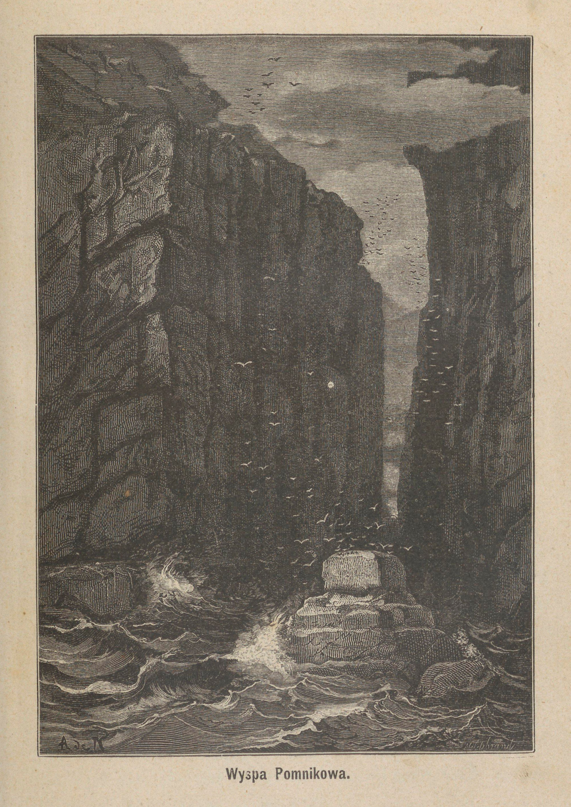

<!-- page 96 -->

<!-- page 97 -->

sieliśmy sobie pomagać, a jeden był tyle zuchwałym, że wyskoczywszy ponad wodę, chwycił za przód łodzi, lecz nie udało mu się jej przechylić. W samą porę wymierzone nań rękami Alicka uderzenie oskardu zmusiło go do puszczenia łodzi i zanurzenia się w wodzie śród wściekłego ryku. Na brzegu jednak łodzi zostały porządne ślady jego zębów. Kilka uderzeń wiosłami, danych na ślepo, skłoniło jego towarzyszów do trzymania się w nieco większej od nas odległości.

Znalazłszy w jednem miejscu brzeg bardzo wygodny do wylądowania, przybiliśmy do lądu i, wydobywszy łódź z wody, zabraliśmy się do spożycia posiłku.

W niewielkiej odległości na długim cyplu skalistym, niewiele wystającym nad wodę i wrzynającym się w zatokę po prawej stronie przesmyku, spostrzegliśmy ogromnego lwa morskiego, który, wzniósłszy łeb do góry i wsparłszy się na przednich płetwach, co go czyniło podobnym do psa, siedzącego na tylnych nogach, bacznym i śmiałym wzrokiem śledził wszystkie nasze ruchy. Postawa jego była prawdziwie okazałą, a grzywa, mocno najeżona i zwrócona ku przodowi, nosiła na sobie ślady niedawnej walki.

Po posileniu się weszliśmy na niewielką wyniosłość, bardzo bliską od wejścia do owego przesmyku, by o ile możności jak najlepiej przyjrzeć się temu wspaniałemu widokowi.

Wracając ze wzgórka, zabiliśmy dwa lwy morskie, które spały spokojnie na pniu drzewa. Były to młodziutkie lwiątka, ważące najwyżej po czterdzieści kilogramów. Zabraliśmy je ze sobą, a skosztowawszy nazajutrz pieczeni z jednego z nich, przekonaliśmy się, że była daleko smaczniejszą, niż z tych, które, przestawszy już ssać, zaczęły się karmić rybami.

Ponieważ przez cały czas podróży z powrotem, dla przeciwnego wiatru, nie mogliśmy korzystać z żagla i trzeba było tym sposobem na przestrzeni osiemnastu kilometrów wciąż popychać się wiosłami, przeto przybywszy wieczorem do naszej nowej osady, nie mogliśmy już ruszać rękami ze zmęczenia.

<!-- page 98 -->

# ROZDZIAŁ VIII.

## WYKOŃCZENIE NASZEJ CHATKI. — FABRYKACYJA MYDŁA. — NA SZCZYCIE GÓRY. — USTAWIENIE SYGNAŁU. — KORMORANY.

Nazajutrz po tej wycieczce zabraliśmy się napowrót do budowy domku.

Paliki, których znaczną liczbę, jak o tem już wspominałem, naścinaliśmy w zaroślach, pozbijane zostały w odległości trzydziestu centymetrów jeden od drugiego na liniach, łączących każde dwa słupy narożne; górne zaś ich końce poprzywiązywano do łat, podpierających krokwie. Następnie do takiej palisady poprzytwierdzaliśmy w kierunku poziomym szczeble, zaledwie na piętnaście centymetrów jeden od drugiego odległe, zrobiwszy potem to samo i z wiązaniem dachowem. Chodziło teraz tylko o pozatykanie słomą wszystkich otworów tej kratki.

Użyliśmy na ten cel grubej, długiej i mocnej trawy, rosnącej gęstemi kępami na brzegach morza i na szczytach skał nadbrzeżnych. Każdy z nas następnego dnia, zaopatrzywszy się w postronek, wyruszył od rana dla zbierania tej trawy i w ciągu dnia przyniósł pod domek po trzy lub cztery ogromne jej wiązki. Ta robota, którą niezawodnie czytelnicy poczytują za rodzaj niejakiej zabawy, połączonej z przyjemnością, w rzeczywistości bardzo nam się dała we znaki.

W kępach przez nas ścinanych, obok świeżych traw znajdowało się wiele suchych, nadzwyczaj twardych, których ostre brzegi były powyszczerbiane na podobieństwo piły. Ponieważ zaś trzeba

<!-- page 99 -->

je było naprzód pochylać, a potem dopiero podcinać od dołu, przeto wracaliśmy wieczorem od tej roboty z formalnie pociętemi i posiekanemi rękami. Wszystkie otrzymane tym sposobem ranki sprawiały nam tak dotkliwe swędzenie, żeśmy niejednokrotnie na całe dnie musieli przerywać robotę.

Po zebraniu dostatecznej ilości tej trawy, zabraliśmy się do wiązania jej w niewielkie pęczki, najwyżej grubości ręki. Po związaniu, każdy pęczek przechodził w moje ręce i zostawał w obu końcach zrównanym przez obcięcie siekierą traw, zbyt wystających.

Do pokrycia ścian i dachu naszej chatki potrzebowaliśmy około dziewięciu tysięcy takich miotełek, a do wykonania tej roboty w następujący wzięliśmy się sposób.

Zaczynając od samej ziemi, przywiązywaliśmy je jedne obok drugich do klepek poziomych, dopókiśmy dokładnie nie zapchali pierwszej luki. Skończywszy kładzenie pierwszej warstwy, braliśmy się do drugiej, która tamte w części przykrywała, potem do trzeciej i tak następnie aż do szczytu ścian, a potem dachu. Pęczki trawy miały mniej więcej po metrze długości, tworzyły warstwę grubą na trzydzieści centymetrów.

Dla zabezpieczenia ścian naszej chatki od uszkodzeń, które wiatry mogłyby spowodować, poprzytwierdzaliśmy jeszcze i od zewnątrz kilka szeregów palików, przymocowanych do wewnętrznych sznurkami, przewlekanymi przez słomę za pomocą dużej drewnianej iglicy, która wielkością wyrównywała klindze szabli. W górnej części ścian zostawiliśmy trzy małe otwory, w których szczelnie osadzone zostały okienka, dopuszczające niegdyś światło do wnętrza kajuty na Graftonie, a które znaleźliśmy nietkniętemi po rozbiciu. Tym sposobem mieliśmy i okna.

Po ukończeniu tej pracy stan naszych rąk, jeszcze raz pociętych przez ostrą trawę, zmusił nas do kilkodniowego odpoczynku. Spożytkowaliśmy go na naprawę naszej odzieży, która już zaczynała wymagać najtroskliwszej opieki. Żadne wejście w zarośla nie odbyło się bez przyniesienia jej jakiejś szkody przez zawadzenie, a ćwiartowanie fok i przenoszenie ich mięsa ku domowi wystawiało

<!-- page 100 -->

ją na okropne szwanki pod względem czystości. Daremnie każdy z nas ku ochronie czystości odzieży zrobił sobie spodnie z płótna żaglowego, które przywdziewaliśmy zawsze na wierzch, ile razy wypadała potrzeba występować w charakterze myśliwców lub drwali; nie mogliśmy jednak w zupełności zabezpieczyć się od złych wpływów. Woda też źródlana, pomimo żeśmy jej wcale nie oszczędzali, nie mogła zwalczyć coraz bardziej na jaw wychodzących skutków przykrych zajęć, do których codziennie zmuszała nas potrzeba. Byliśmy więc skazani na smutną alternatywę: wystawiania swych sił na największe próby, albo też stania się przedmiotem obrzydliwości dla samych siebie.

Wtedy to przyszła mi myśl wzięcia się do przygotowania mydła; kiedym o tem wspomniał mym towarzyszom, przyjęli mój projekt z pewnem powątpiewaniem o możności jego urzeczywistnienia i trochę drwiącemi słowami zachęty. Nie mogli pojąć, skąd potrafię sobie zdobyć potrzebne do tego materyały, gdym nigdy nie popisywał się przed nimi znajomością sposobów magicznych lub wszechwładnych słów kabalistycznych. Nic im na to nie odpowiedziałem, zachowując sobie przyjemność trafienia do ich przekonania dopiero skutkami doświadczeń, do których dnia następnego wziąć się zamierzałem.

Rozmowa ta miała miejsce pod sam wieczór; zapisałem więc tylko w dzienniku ciekawsze wypadki dnia i rozciągnąłem się obok towarzyszów na twardej naszej drewnianej pościeli.

Zapomniałem powiedzieć dotąd, że pomiędzy przedmiotami ocalonymi z okrętu, znajdowała się i buteleczka atramentu, która dla mnie przynajmniej wielką przedstawiała wartość. Każdego dnia pod wieczór, przed udaniem się na spoczynek, zapisywałem starannie w urzędowym dzienniku okrętowym, który jako pomocnik dowódcy statku prowadzić byłem obowiązany podczas podróży, obserwacyje meteorologiczne i ważniejsze wypadki dnia ubiegłego. Dołączałem do tego zwykle treściwy opis naszych przygód i czynów, a czasem pozwalałem sobie nawet upamiętniać osobiste myśli i wrażenia.

<!-- page 101 -->

Musgrave ze swej strony co tydzień albo co drugą niedzielę w osobnym swoim dzienniku prowadził treściwy opis naszych przygód (¹).

Umówiliśmy się już pomiędzy sobą, na najnieszczęśliwszy przypadek, gdybyśmy byli zmuszeni zginąć na tej odludnej wyspie, że ten, kto wszystkich przeżyje, zamknie oba te dzienniki w blaszane pudełko i ukryje takowe pod kupką kamieni przed drzwiami domku, aby na wypadek zawinięcia w te okolice jakiego statku, załoga jego mogła zabrać tę po nas spuściznę i uwiadomić naszych ziomków, choć może nie współczesnych, o smutnym losie naszego gronka.

**Piątek, 5 lutego.** — Od 30 stycznia dęły kilkakrotnie silne wiatry przeważnie od zachodu i panowały ulewne deszcze. Onegdaj, a szczególniej wczoraj, wiatr był bardzo gwałtowny; dziś ruch powietrza umiarkowany od północo-zachodu, pogoda piękna i ciepło.

Musgrave, Jerzy i Henryk poszli próbować wycieczki na górę, u stóp której obraliśmy miejsce na mieszkanie. Pragnąłem bardzo im towarzyszyć, ale uważałem, że nogi moje nie nabrały jeszcze dość siły na podołanie tak utrudzającej wyprawie. Biedny też Alick, który od paru dni niedomaga i potrzebuje spoczynku, zostać musiał razem ze mną.

Dzielny ten Norwegczyk, człowiek nader czynny i pracowity, musiał niezawodnie nadużyć swych sił w ostatnich dniach nad znoszeniem wiązek słomy, kamieni i drzewa na wzgórek, to też jego niedomaganie jest tylko prawdopodobnie wynikiem tych nadmiernych wysileń. Oby przynajmniej nie było inaczej.

Od czasu mojej ciężkiej choroby, na widok najlżejszego niedyspozycji którego z towarzyszów doznaję śmiertelnej obawy o ich zdrowie i życie. Jestem pewny, że w obecnych okolicznościach śmierć któregoś z nas bardzo zgubnie by oddziałała na stronę moralną reszty, a tym sposobem mogłaby spowodować najfatalniejsze następstwa. To też w codziennych modlitwach gorące zanoszę prośby do Pana Zastępów, iżby w tak ciężkiem utrapieniu, chociaż tej próby raczył nam oszczędzić.

---

*(¹) Ten dziennik Musgrave'a, prowadzony w języku angielskim, również ogłoszony został drukiem. — Przyp. Aut.*

<!-- page 102 -->

Jak tylko zdrowa trójka z domu odeszła, zacząłem się zabierać do urzeczywistnienia wczorajszego projektu, a mianowicie próbować fabrykacyi mydła. Naciąłem najprzód drzewa i ułożyłem zeń stos blisko na jeden metr wysoki, a potem poszedłem nad morze nazbierać suchych roślin morskich, których wrogowie nasi, owe czarne muszki, nie dały mi bezkarnie sobie wydzierać. Przy sposobności uzbierałem też pewną ilość muszel, a za powrotem do domu ułożyłem to wszystko na stosie, który podpaliłem wieczorem, pozwalając mu płonąć przez noc całą.

Nazajutrz znalazłem wielką kupę popiołów, które zebrałem w baryłkę, a powierciwszy w jej dnie mnóstwo niewielkich dziurek, ustawiłem takową dnem na dół, na dużych kawałkach drzewa. Nalałem potem w beczkę wody, dając tym sposobem początek filtracyi, na podobieństwo tej, jaką każdy codzień widuje w maszynce do kawy. Przesiąkającą wodę, nasyconą sodą, potażem i pewną ilością wapna, zbierałem w oddzielne naczynie. Do takiego roztworu dodałem później pewną ilość tranu foczego, i po zagotowaniu mieszaniny, otrzymałem wyborne mydło, które tak pod względem przyjemności noszenia czystej odzieży, jak i wpływu na zdrowie stało się dla nas nieocenionem.

Poprzedniego wieczora trzej nasi towarzysze niezmiernie strudzeni wrócili z wycieczki na górę. Pieczeń z foki na zimno, którą im natychmiast podałem i która stanowiła nasz zwykły posiłek wieczorny, wydała im się tym razem wyśmienitą potrawą. Nie mniej pobłażliwe usposobienie objawiali też i dla foczego rosołu, który od pewnego czasu, dla oszczędzenia resztki herbaty, stanowił zwykły nasz napój przy każdym posiłku; herbatę bowiem woleliśmy zostawić na wypadek choroby.

Przy posiłku z wielkiem ożywieniem mówili o tem, co widzieli podczas wyprawy na górę, z której prócz tego Musgrave złożył mi oddzielnie szczegółowe sprawozdanie.

Wydostawszy się nie bez trudności z zarośli i minąwszy pas większych drzew, mieli i tam przeprawę bardzo utrudnioną. Grunt stawał się tam coraz bardziej błotnistym, a przytem był zarośnięty

<!-- page 103 -->

mnóstwem krzaków, lijanów i traw najrozmaitszych, które z powodu poplątania się razem, tworzyły zaporę prawie nieprzebytą. Szukając sposobu przedostania się przez gęstwinę, znaleźli nareszcie tuż przy ziemi dziurę, jakby rodzaj tunelu, przez który prawdopodobnie przedostawały się w dalsze okolice niewielkie lwy morskie, chociaż i te zwierzęta musiały to czynić, wyciągając o ile możności swe ciało i spuszczając głowy. Nie było innej rady przedłużenia podróży nad udanie się tą drogą. Pokładli się nasi wędrowcy na brzuchach i z narażeniem się na spotkanie się oko w oko z jakim idącym z przeciwnej strony lwem morskim, poczęli się czołgać w tym ciasnym kanale, przebywając wciąż grunt błotnisty, a nawet niejedną kałużę. Po wydostaniu się z kanału, odzież ich była pokryta warstwą czarnego błota, którą musieli zgarniać nożami.

Nareszcie ta gęstwina krzaków i krzewin zaczęła rzednąć i w końcu zupełnie ustąpiła miejsca trawie, porastającej gęstemi kępami, podobnie jak na wybrzeżu, chociaż był to inny gatunek i liście jej nie były tak ostre; grunt podnosił się ustawicznie, roślinność rzedniała coraz bardziej, a w końcu zupełnie znikła. Pozostały już tylko szare skały, stanowiące wierzchołek góry.

Tu już trzeba było dosłownie piąć się pod górę, i to chwilami z narażeniem życia. Wędrowcy zmuszeni byli drapać się na skały, złożone z głazów najfantastyczniej poukładanych i pozawieszanych nad przepaścią. Dobili się nakoniec do samego wierzchołka, a wspaniały widok, jaki się stamtąd przed ich oczyma rozwinął, wynagrodził im sowicie trudy podróży.

Dokoła siebie widzieli same szczyty gór, ostrych kształtów, skały i urwiska. Gdzieniegdzie błyszczący lodnik wspaniale odbijał promienie słoneczne. Po stokach gór spływały rącze potoki, podsycane wodą z chmur, skupiających się ustawicznie u szczytów, a wijąc się w różnych kierunkach, wyglądały na srebrzyste wstęgi, oplatające góry.

Rozpatrując się bliżej w okolicy, poznali wyspę Adama, najbardziej ze wszystkich wyniesioną, która od południa zamykała ho-

<!-- page 104 -->

ryzont. Na zachodzie, w kierunku od północy ku południowi, ciągnął się długi łańcuch najrozmaiciej poszczerbiony i wyglądający na jakąś olbrzymią fortecę. Każda szczerba w jej murach była głęboką przepaścią. Ku północy widać było kilka poprzecznych gałęzi, wybiegających z głównego pnia i coraz bardziej malejących, tak że w końcu zbiegały się na wschodzie z nadbrzeżnemi urwiskami. Odnogi te dzieliły grunt wyspy na kilka głębokich bruzd, w które mniej lub więcej daleko wlewać się musiało morze, tworząc zatoki, których jednak dojrzeć nie było można. Jedną najbliższą z tych bocznych gałęzi gór wieńczyły dwa szczyty, wznoszące się jeden przy drugim, były to góry zwane Szczytem i Grobem Olbrzyma. Jeszcze bliżej od nich na wschodzie widać było odosobnioną skałę z wydrążoną u samego szczytu jaskinią.

Na dalszem tle obrazu, u północnego krańca wyspy Aukland, dosyć wyraźnie odznaczało się kilka oddzielnych wysp, z których największa i dość płaska musiała być wyspą Enderby.

Na północo-wschodzie morze rozbijało się o liczne rafy, któreśmy spostrzegli zaraz po przybyciu na wyspę. Kilka smug białawej piany, ciągnąc się na jakie dziesięć mil w otwarte morze, zdradzało obecność tych wrogów żeglugi.

Nakoniec dalej jeszcze oko ginęło w bezgranicznym obszarze oceanu, po którego falach próżno błądziły oczy wygnańców, nie mogąc nigdzie wyśledzić ani jednego żagla.

„Widok tego morza — rzekł w końcu Musgrave — tego bezgranicznego i pustego morza, wielki ból obudził w mem sercu.” Zamilkł z temi słowy, aleśmy doskonale pojmowali, ile smutnych myśli cisnęło mu się do głowy podczas tego milczenia.

„Niezawodnie — odezwał się nieco później, zwracając mowę do mnie — wierzę tak jak i ty w opiekę Opatrzności, ale mam też przekonanie, iż ona jednych ludzi powierza staraniu drugich, chcąc, by każdy człowiek pracował dla tych, których losy odeń zawisły. A ja, biedny, cóż mogę zrobić tu dla swoich i co się z niemi stanie?”

Pocieszałem go tonem silnego przekonania, że ich jeszcze zobaczy, że w końcu nadejdzie dzień naszego wyzwolenia.

<!-- page 105 -->

„No — rzekł wreszcie z odcieniem pokrzepienia na duchu — w takim razie nie zaniedbujmy niczego, coby się mogło przyczynić do naszego oswobodzenia. Zapomnieliśmy dotąd o jednej bardzo ważnej rzeczy, to jest o umieszczeniu gdzieś sygnału, któryby mógł zwrócić na się uwagę okrętów, wskazując miejsce naszego pobytu. Nie jeden okręt mógłby się przesunąć koło tej wyspy, a załoga jego wcaleby na myśl nie wpadła, że tu ktoś potrzebujący pomocy znajdować się może.”

Wszyscy najzupełniej podzielaliśmy jego przekonanie, to też nie puszczając tej sprawy w odwlokę, postanowiliśmy zaraz nazajutrz się zabrać do wykonania myśli Musgrave'a.

Mieliśmy jedną próżną butelkę; Musgrave tedy jeszcze przed udaniem się na spoczynek zredagował odpowiednią odezwę z dodaniem wszelkich potrzebnych dla odnalezienia nas szczegółów; wsunął to pismo w butelkę, którą następnie zalepił odrobiną smoły, zebraną z pokładu Graftona.

**Sobota, 6 lutego.** Niebo pochmurne i groźne; wiatr północny coraz bardziej się wzmaga. Barometr znacznie opadł w nocy; byłoby więc nierozsądkiem puszczać się łodzią na zatokę.

Podczas gdy ja zajęty byłem fabrykacyą mego mydła, Musgrave z dwoma zdrowymi towarzyszami udał się na pokład rozbitego statku, dla dobycia zeń jak największej liczby desek. Przy pomocy żelaznych szczypców trójka ta wyrwała przegrodę, przedzielającą kajutę od spodniej jamy okrętu, i zdobyła tym sposobem pewną liczbę gwoździ, które mogą nam być bardzo przydatne przy sporządzeniu mebli do naszej chatki. Zabrała też wszystko, co jeszcze pozostało z wąskich a długich balów, stanowiących burtę okrętową, z przeznaczeniem ich na podłogę, konieczną dla uczynienia zdrową naszej nowej siedziby.

**Niedziela, 7 lutego.** Lekki wiatr zachodni, czas pogodny, barometr się podnosi. Zaraz rano spuściliśmy łódź naszą na wodę, i udaliśmy się na zatokę w zamiarze zatknięcia sygnału na brzegu

<!-- page 106 -->

półwyspu Musgrave'a, położonego naprzeciw głównego otworu portu Carnleya. Alick, który już zupełnie przyszedł do zdrowia, towarzyszył nam także w tej wyprawie.

Na jednym z cyplów półwyspu, a prawie na środku zatoki, znaleźliśmy miejsce wyniesione ponad największą wysokość przypływu i zupełnie odkryte, które nam się wydało bardzo odpowiednim naszym zamiarom. Wbiliśmy tu tedy w miękką ziemię do znacznej głębokości długą i mocną tykę, z przywiązaną u wierzchu flagą z płótna żaglowego. Tyka ta wzmocnioną jeszcze została przez przywiązanie jej czterema sznurami do wbitych w tym celu w ziemię kołków. Poniżej flagi przywiązaliśmy butelkę, zawierającą informacyję zredagowaną na dwa dni przedtem przez Musgrave'a.

Podczas tej wycieczki tego ostatniego omal co nie spotkał fatalny przypadek. Kiedyśmy weszli w zarośla, celem wyszukania tyki, odpowiedniej do podtrzymywania flagi, spostrzegliśmy na drodze śpiącego lwa morskiego. Była to bardzo młoda samica, która, zbudzona odgłosem naszych kroków, zaczęła szybko uciekać. Puściliśmy się za nią w pogoń.

Bywaliśmy zwykle zaopatrzeni w pałki, skorośmy się puszczali w zarośla, tym jednak razem Musgrave zamiast pałki wziął moją fuzyję, nabitą przed kilku dniami, której nigdy nie zostawiałem w domu, gdyśmy się wybierali na wodę.

Podczas pościgu za foką, znalazłszy się w odpowiedniej od zwierzęcia odległości, Musgrave strzelił do niego. Pierwsza lufa wypaliła, ponieważ jednak nabita była szrutem, przeto nie wyrządziła foce żadnej krzywdy; widząc to, Musgrave pociągnął za drugi cyngiel, nabój jednak się nie zapalił. Zbiwszy napróżno trzy pistony, zniechęcony strzelec miał zamiar oprzeć kolbę na ziemi, by nabić pierwszą lufę, gdy nagle druga wypaliła. Kula przebiła rondo jego kapelusza tuż przy czole. Z twarzą osmoloną prochem i rysami zmienionymi z powodu nagłego wzruszenia, Musgrave rzucił broń, oparłszy się na chwilę o pień stojącego za nim drzewa. Myśląc, że jest raniony, opuściliśmy polowanie i wszyscy zbiegliśmy

<!-- page 107 -->

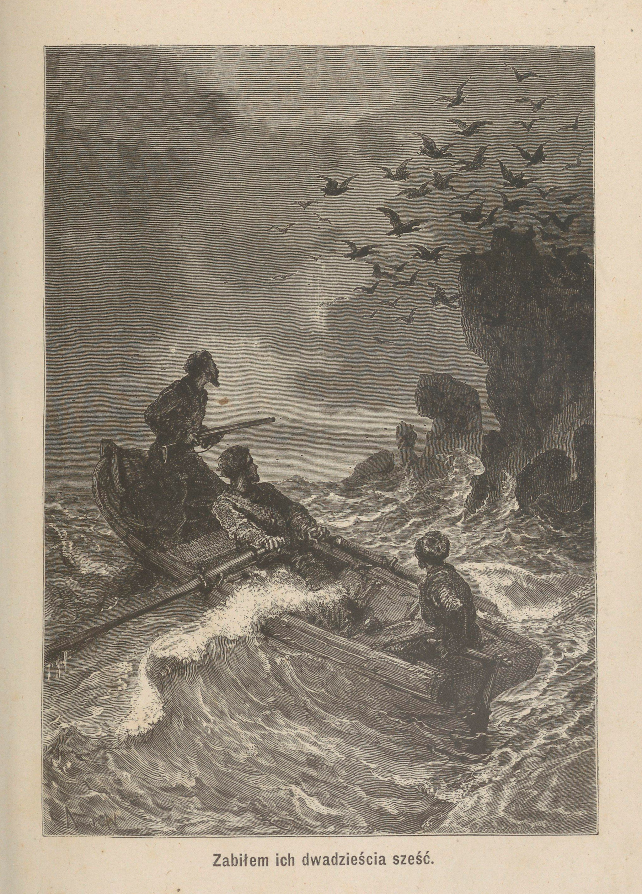

<!-- page 108 -->

<!-- page 109 -->

się do niego, a foka tymczasem, korzystając z zamieszania, dobiegła spokojnie do brzegu i uszła przed pogonią, rzucając się w morze.

Po ustawieniu sygnału wzięliśmy się do obejrzenia miejscowości, gdyż tak Musgrave jak i ja przy każdej wycieczce na morze mieliśmy zwyczaj zdejmowania planu odpowiedniej części portu. Przyjęliśmy w tym celu system trójkątowania, którego podstawą była nasza busola. Nie zaniedbywaliśmy też nigdy zabierać ze sobą sondy, dla mierzenia głębokości morza.

Podczas powrotnej żeglugi na jednym z cyplów spostrzegliśmy wielkie stado kormoranów. Ptaki te, mające prawie tę samą wielkość co kaczki, bardzo często dają się spotykać na Auklandach. Prawie zawsze siadają one na najniższych ze skał, wysuniętych w zatokę, albo też unoszą się ponad samą powierzchnią fali, polując na sardynki, które stanowią bardzo pożądaną dla nich strawę (\*).

Pragnąc nieco urozmaicić jednostajną naszą strawę, wystrzeliłem dwa razy do kormoranów i zabiłem ich dwadzieścia sześć. Mięso ich, pomimo zbytniego przejęcia tłuszczem, wydało nam się daleko smaczniejszem niż lwów morskich.

Płynąc ciągle wzdłuż pobrzeża, mieliśmy sposobność robienia spostrzeżeń nad budową wyspy. Wydała nam się ona złożoną z bazaltu, trapu, szarawych żużli wulkanicznych, nie bardzo gąbczastych i bardzo twardych, oraz niewielkiej liczby żył jakiegoś zielonawego, miękkiego kamienia. Gdzieniegdzie na brzegach morskich znajdowaliśmy bryły zlepków, złożonych z drobnych kamieni, spojonych ze sobą lawą, która w odłamie miała piękny kolor purpurowy, wpadający czasem w fijoletowawy. Przez cały czas pobytu naszego na Auklandach nie znaleźliśmy nigdy śladu piaskowców, łupków, gliny ani też kredy.

---

*(\*) I my próbowaliśmy kilkakrotnie połowu sardynek i fabrykowaliśmy w tym celu sieci z szarpi z płótna żaglowego, ale za każdym razem lwy morskie, chciwie uganiające się za temi rybami, rwały nam sieci; musieliśmy się więc wyrzec tego przysmaku.*

Rozbitki na Auklandach.

<!-- page 110 -->

Na północnem wybrzeżu półwyspu Musgrave'a zauważyłem kilka warstw granitu szaro-żółtawego, gruboziarnistego, grubych blisko na dwa metry i pochylających się ku południo-wschodowi pod kątem 22 stopni.

Nieco dalej poza międzymorzem, łączącem półwysep z głównym lądem, wybrzeże przybierało nagle pozór gwałtownie ściętego wzgórza i wyginało się w łuk koła, w samym środku którego nadbrzeżne urwiska dochodziły aż do stu metrów wysokości. W tem to miejscu na dosyć rozległej przestrzeni znać było ślady zawalenia, sprawionego niezawodnie przez ostatnie deszcze.

Zacząwszy od tego miejsca wiatr zachodni stawał się coraz silniejszym, tak że byliśmy w końcu zmuszeni zwinąć żagiel, a wziąć się do wioseł. Przykra ta konieczność ustała dopiero wówczas, gdyśmy się zbliżyli do zatoki Rozbicia, do której dopłynęliśmy już po południu.

Po spożyciu z wielkim apetytem posiłku, przyrządzonego nam przez Henryka, zużyliśmy resztę dnia na skubanie kormoranów, któreśmy następnie pozawieszali parami na najwyższych gałęziach drzew okolicznych, dla uchronienia ich o ile możności od much, które, według dokonanych przez nas spostrzeżeń, nie latały nigdy bardzo wysoko, zapewne z przyczyny wiatrów. Pod tym względem osiągnęliśmy jak największe powodzenie, ale za to wkrótce spostrzegliśmy inną niedogodność takiego ich pomieszczenia, która nam przedtem wcale nie przyszła do głowy. Bystrookie jastrzębie natychmiast spostrzegły przynętę, którąśmy jakby umyślnie dla nich tam umieścili, i tłumnie się do niej zbiegły. Posiadawszy na sąsiednich drzewach, pożądliwem okiem zdawały się spoglądać na naszą zwierzynę, jakby oczekując tylko stosownej chwili do rzucenia się na tak łakomy kąsek. Pośpieszyliśmy się więc ze zdjęciem ptaków z gałęzi, przez co ci rabusie pozbawieni zostali zdobyczy, którą już pewno za swoją uważali.

Za zbliżeniem się jastrzębi wszyscy pięknopiórzy śpiewacy, którzy zwykle zgromadzali się w bliskości naszej siedziby, uprzyjemniając nam prace swymi popisami, usunęli się gdzieś w najgęstsze

<!-- page 111 -->

zarośla, skąd nas tylko dochodziły jakieś ostre a krótkie ich krzyki, wydawane jakby dla wzajemnego ostrzeżenia się o obecności srogiego nieprzyjaciela. Te to okrzyki ostrzegły nas jeszcze dość wcześnie o niebezpieczeństwie.

<!-- page 112 -->

# ROZDZIAŁ IX.

## RZEŹ NIEWINIĄTEK. — NASZE SPRZĘTY DOMOWE. — PRZYJĘCIE STAŁEGO TRYBU ŻYCIA. — NAUKA WIECZORNA. — ZABAWY.

**Poniedziałek, 8.** Cały ranek spędziliśmy na wycinaniu śród zarośli i znoszeniu na wzgórek sztuk drzewa, potrzebnych nam na podłogę, którą zamierzyliśmy ułożyć w naszej chatce. W południe zaczął padać ulewny deszcz, który ustał dopiero wieczorem; ale od czasu pokrycia dachu na domku, mogliśmy wygodnie w jego wnętrzu prowadzić dalej roboty, które poprzednio każdy deszcz nam przerywał.

Przez resztę dnia potrafiliśmy jednak zdążyć obrobić belki na pokład naszej podłogi, ułożyć je na płask, a nawet zaczęliśmy przybijać do nich bale z burty Graftona. Około ósmej wieczorem deszcz przestał padać, niebo się wypogodziło i powietrze aż do rana pozostało spokojnem.

**Wtorek, 9.** Niebo zamglone, obłoki zaczynają się skupiać przy górach i obwijają je aż do samego dołu. Deszcz na nowo padać zaczyna, tylko drobny, ale za to gęsty i bez najmniejszej przerwy. Muchy korzystają z tak miłej dla siebie pory i wszędzie składają swe jajeczka; w chacie naszej nagromadziły się całemi rojami i brzęczą tak nieznośnie, że dla przepędzenia ich zmuszeni byliśmy rozniecić na kominie wielki ogień. Deszcz się wzmaga i leje bez przerwy, nie dając nam się ruszyć z domu aż do wieczora czwartkowego.

<!-- page 113 -->

**Piątek, 12.** Wiatr rozpędził chmury. Musgrave pomaga mi w robocie drzwi do chaty, Henryk w szałasie gotuje nam śniadanie, Alick zaś i Jerzy kopią dokoła domku rów, dla zabezpieczenia go o ile możności od wilgoci. Ponieważ jednak rów ten musi wpłynąć nieco na osłabienie ścian, przeto postanawiamy popodpierać naszą budowę po rogach a nawet i w środku ścian pochyło wkopanemi w ziemię kłodami, naśladującemi szkarpy. Dla większej mocy podstawy tych szkarp mają się oprzeć na tęgich kłodach drzewa, zawczasu zapuszczonych w ziemię w pewnej od domku odległości.

Pomimo takiego wzmocnienia domek nasz nie przybrał bynajmniej pozoru twierdzy, lecz przeciwnie bardziej jeszcze niż poprzednio wyglądał na to, czem był w istocie, to jest na nędzną strzechę lub nawet budkę; trzeba jednak było przyznać, że dobrze odpowiadał swemu celowi, mógł się bowiem oprzeć burzom i dać nam bezpieczne przed niemi schronienie.

W sobotę po południu towarzysze moi uzbroili się w pałki, ja zaś w swą fuzyję i puściliśmy się wzdłuż zatoki w stronę północną, ku wysepce, którą oddawna zamierzaliśmy zwiedzić, ale dotąd z powodu nawału roboty i częstej niepogody, zamiaru tego nie mogliśmy doprowadzić do skutku.

Znaleźliśmy po drodze bardzo piękną, prawie kwadratową buchtę, przy otworze nieco rozszerzoną. W dwu jej kątach uchodziły do morza obfite strumienie. Spostrzegliśmy w tem miejscu kilka dzikich kaczek, które w porównaniu z innymi ptakami wyspy okazywały nadzwyczajną bojaźliwość. Wnosiliśmy z tego, że muszą one mieć jakichś wrogów, za których poczytywaliśmy lwy morskie. Wkrótce jednak przekonaliśmy się o fałszywości naszego przypuszczenia, albowiem pojawiło się naraz kilka fok, które bujając po zatoce, nie zaczepiały kaczek i żadnej bojaźni w nich nie wywoływały. Tymczasem za naszem zbliżaniem się ptaki te natychmiast odlatywały dalej.

Ukryliśmy się zatem na czas jakiś w zaroślach, spodziewając się tym sposobem zachęcić kaczki do zbliżenia się ku nam, i nie napróżno na nie oczekiwaliśmy. Po bardzo bowiem krótkim przeciągu

<!-- page 114 -->

czasu wróciły nad zatokę i zaczęły plądrować dziobami przy ujściu jednego ze strumieni, polując na drobne zwierzątka wodne. Podsunąłem się wtedy ku nim ostrożnie na odległość strzału i kiedym wypalił, aż trzy padły bez życia. Nie warte były jednak tak kosztownego w naszych warunkach bytu naboju prochu, należały bowiem do bardzo drobnego gatunku. Przyrzekłem też sobie odtąd na lepszą sposobność chować niewielkie zapasy amunicyi.

Przebywszy z łatwością strumień z powodu słabego przypływu, przy czem zamoczyliśmy się zaledwie do kolan, przybyliśmy w dalszym ciągu pochodu na dosyć rozległą równinę, pokrytą żwirem, która była pierwszą w tym rodzaju, napotkaną przez nas na wyspie. Pole to ciągnęło się wzdłuż jednego brzegu zatoki na przestrzeni może ze dwustu metrów.

Mogliśmy więc choć raz zrobić kilkaset kroków po gruncie płaskim i równym. Dotychczas zaś od samego dnia rozbicia zawsze nam przychodziło wchodzić pod górę, zsuwać się na dół, drapać się na skały lub przedzierać się przez pnie drzew, tutaj zaś po raz pierwszy mogliśmy się posuwać swobodnie, bez wysileń, słowem iść, we właściwem tego wyrazu znaczeniu. Trudno opisać przyjemność, jaką nam sprawiało przebieganie tej równiny krokiem pewnym i jednostajnym. Jakiegoż to niewysłowionego powabu nabierają najzwyczajniejsze rzeczy, gdy się ich jest przez długi czas pozbawionym!

Kiedyśmy doszli na drugi koniec równiny, ujrzeliśmy nagle wielkiego lwa morskiego, wynurzającego się z wody i śpieszącego wprost ku nam z głośnym rykiem. Na tak niespodziewany napad poodsuwaliśmy się jeden od drugiego, a foka zatrzymała się natychmiast, jakby rozmyślając, na którego naprzód się rzucić. Jerzy, stojący najbliżej zwierza, korzystając z chwili gdy tenże zwrócił oczy na mnie, podsunął się doń w zamiarze uderzenia pałką. Lew, zdziwiony śmiałością naszego towarzysza, zwrócił się natychmiast ku niemu i już był gotów do poczęstowania go zębami, gdy Jerzy wymierzył mu potężny cios pałką między same oczy. Ogłuszone zwierzę upadło plackiem na żwir; przez chwilę mocno biło w ziemię

<!-- page 115 -->

<!-- page 116 -->

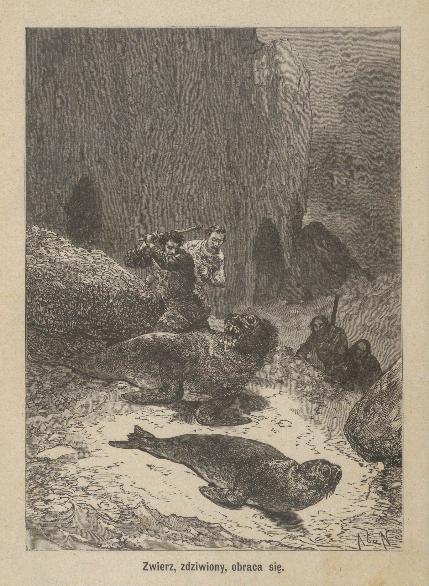

<!-- page 117 -->

przedniemi płetwami, ale wkrótce zaprzestało tych ruchów, skończyło bowiem życie.

Mając zamiar zabić lwa morskiego, jakeśmy się o tem później przekonali, nie tyle starać się należy o moc jak o trafność uderzenia. Należy zawsze wymierzać cios w miejsce najsłabsze, a mianowicie między oczy, jak to bardzo zręcznie uczynił tym razem Jerzy.

Faktem dobrze znanym naturalistom, który jednak nas z początku bardzo dziwił, jest niezmierna obfitość, i to bardzo gorącej, krwi u fok. Kiedyśmy postanowili upuścić krew z naszej zdobyczy, wytrysnął z jej rany potężny strumień krwi, który przez długi czas sączył się po żwirze ku morzu i na znacznej przestrzeni zarumienił wody zatoki.

Zaledwieśmy się z jedną sztuką załatwili, ujrzeliśmy naraz aż trzy samice, wychodzące z wody i wydające przeciągłe ryki, na których odgłos odezwało się zaraz z pobliskich zarośli kilka słabych beków. Usłyszawszy to, opuściliśmy natychmiast starą fokę, a poszliśmy natomiast w zarośla za głosem młodych i wkrótce spostrzegliśmy wszystkie trzy, spoczywające razem pod pochyłym pniem drzewa. Jedna z nich, wychyliwszy się prawie zupełnie ze swej osłony, odpowiadała z całych sił na wołanie matki, gdy tymczasem dwie inne, bojaźliwsze nieco, wysuwały tylko zza niej swe głowy. Zobaczywszy nas, wszystkie trzy cofnęły się najprzód pod przykrywający je pień, lecz nagle pod wpływem instynktu zachowawczego, słusznie uważając nas za swych wrogów, opuściły śpiesznie swe schronienie i zaczęły uciekać, jak tylko mogły najprędzej. Pomimo dość znacznej szybkości ich biegu, potrafiliśmy je w niedługim czasie dogonić, ponieważ zarośla były w tem miejscu dość rzadkie i nie tamowały nam swobody ruchów. Nie zapomnę nigdy żałosnego i prawdziwie wzruszającego wyrazu oczu tych zwierząt. Odgadując niezawodnie nasze zamiary, zatrzymały się razem u stóp jednego z większych drzew i spoglądały na nas jakimś łzawym wzrokiem, jakby istotnie chciały w nas obudzić litość i wyjednać sobie przebaczenie. Zostaliśmy rzeczywiście temi spojrzeniami

<!-- page 118 -->

wzruszeni i mieliśmy wielką ochotę darować im życie, lecz niestety potrzeba pokarmu kazała nam słuchać rozumu, nie uczucia. Nie bez przykrego jakiegoś uczucia, a nawet rzec by można, nie bez wyrzutów sumienia, spełniliśmy tę przykrą egzekucję, prawdziwą rzeź niewiniątek.

Niepodobieństwem byłoby zabrać odrazu na barki starego lwa i trzy młode, a ponieważ pierwszy wydzielał z siebie woń prawie odrażającą i nie zapowiadał przez to wielkiego przysmaku ze swego mięsa, poświęciliśmy go więc dla młodych, które nas na kilka dni uwolniły od kłopotania się o pożywienie.

**Poniedziałek, 22.** Wiatr północno-zachodni. Wczoraj mieliśmy bardzo gwałtowną zawieruchę, połączoną z ulewnym deszczem. Dziś niebo nie jest jeszcze zupełnie czystem, chmury przesuwają się po niem z różną szybkością, a nawet kilka razy spadł deszcz ulewny w połączeniu z drobnym gradem.

Podczas ostatniej swej wycieczki na Graftona, Musgrave, Alick i Jerzy, oprócz desek, które były głównym celem ich podróży, przywieźli też ze sobą kwadratową skrzynię, tak od zewnątrz jak i od wewnątrz obitą blachą żelazną i podzieloną na dwie przegrody. Skrzynia ta przytwierdzona była do jednej ze ścian kajuty i służyła nam do chowania mąki i biskwitów przed kilkoma szczurami, które nam towarzyszyły w podróży. Dwa wieka, osadzone na zawiasach, przytwierdzonych z drugiej strony do przegrody skrzyni, i stanowiące razem płaszczyznę nieco większą od powierzchni samej skrzyni, tworzyły po przykryciu ceratą wyborny stół.

Sprzęt ten umieściliśmy przy północnej ścianie chatki pod jednem z trzech okienek. Miał on służyć za biurko dla mnie i dla Musgrave'a. Ponad tak zaimprowizowanym stołem umieściliśmy chronometr, narzędzia żeglarskie i biblijoteczkę. Ostatni wyraz wydać się może nie pretensyjonalnym; ponieważeśmy posiadali trzy tylko czy cztery tomy, a mianowicie: Pismo Święte, Raj utracony Miltona i jeden czy dwa romansy angielskie, którym do całości brakło niejednej stronnicy. Dwa dzienniki, przez nas spisywane, zajęły miejsce obok książek. Do ozdoby mieszkania przyczy-

<!-- page 119 -->

niło się jeszcze zwierciadło, a raczej małe lusterko w mahoniowych ramach, zawieszone przy oknie.

Po obu stronach biurka, w rogach izby, Musgrave i ja poustawialiśmy swoje łóżka, pierwsze od strony drzwi, drugie obok komina. Muszę przyznać, że były one bardzo grubym wyrobem, stanowiły je bowiem poprostu dwie podłużne skrzynie, osadzone na czterech nogach, dla przewiewu powietrza od spodu. Skrzynie te były napełnione suchym mchem, któryśmy od czasu do czasu odświeżali. Nie wyrównywając bynajmniej pościeli z pierza lub włosia, mech ten stanowił jednak powłokę nieskończenie miększą od desek, które nam służyły za posłanie pod namiotem.

Alick, Jerzy i Henryk ustawili swoje podobneż łóżka po drugiej stronie izby wzdłuż trzech ścian. Na samym środku chaty stał drugi stół, zrobiony podobnie jak drzwi z najrówniejszych i jak najmniej popękanych desek. Miał on po sześć nóg z każdej strony wzdłuż, a po trzy wszerz. Po bokach stołu, w kierunku jego długości, stały dwie ławki w podobny sposób zrobione.

Pod ścianą przy drzwiach, obok łóżka Alicka, umieściliśmy jeszcze jeden niewielki stolik, przeznaczony do robót kuchennych, a na dwu półkach, ponad nim do ściany przytwierdzonych, poustawialiśmy nasze statki, — to jest naczynia gospodarskie, które potrafiliśmy ocalić z okrętu, a zarazem i lampy. Lampy owe były przyrządami najpierwotniejszej konstrukcyi. Zrobiliśmy je z pudełek blaszanych od konserwów; knoty splecione były z przędzy, wyskubanej z płótna żaglowego, olej zaś zastępował tłuszcz fok.

Aby nie zanadto zastawiać wnętrze domku, urządziliśmy po rogach cztery półki trójkątne, na których pomieszczone zostały resztki żagli i sznurów z Graftona.

Nie mogę też pominąć jednego jeszcze szczegółu. Zanim zapasy ze statku zupełnie się wyczerpały, odłożyłem na bok kilka funtów mąki, która miała być używana tylko jako lekarstwo, i wraz z niewielką ilością gorczycy stanowiła całą naszą apteczkę. Przyjąwszy na siebie nadzór nad tymi przedmiotami, przywiązałem je do krokwi nad mojem łóżkiem.

<!-- page 120 -->

Wszystkie te drobne roboty ukończone zostały przed południem w sobotę, 5 marca. Reszta dnia zeszła nam na sprzątaniu namiotu i znoszeniu z niego wszystkiego, co tam dotąd pozostawało, a rozpaliwszy suty ogień na kominie, pokładliśmy się spać zaraz z wieczora.

Lecz nie dosyć było troszczyć się tylko o potrzeby materyjalne, należało również pomyśleć i o moralnych. Jakkolwiek zaprzeczyć nie można, że od czasu rozbicia żyliśmy w jak najlepszej harmonii i zgodzie, rzec nawet można w najzupełniejszem braterstwie, jednakże zdarzało się czasem niejednemu pod wpływem złego humoru powiedzieć drugiemu coś nieprzyjemnego, co oczywiście wywoływało nie mniej dosadne odwzajemnienie się. Lecz zagnieżdżenie się pomiędzy nami swarów i nieporozumień mogłoby mieć najsmutniejsze dla nas następstwa.

Wszyscy potrzebowaliśmy się bardzo nawzajem! Najlepszym tego dowodem była budowa domku, przy której każdy spełnił coś takiego, czegoby drugi nie potrafił. Widocznem więc było, że cała nasza siła spoczywała na jedności i zgodzie, oraz że nieporozumienia i kłótnie mogłyby nam bardzo wiele złego wyrządzić. Ale człowiek jest tak słabym, że rozum, godność osobista, a nawet interes własny częstokroć nie potrafią zapobiec niedopełnianiu przezeń obowiązków. Konieczna zatem, by jakaś ustawa zewnętrzna, jakaś obawa kary wspierały chwiejną jego wolę.

Tego rodzaju myśli cisnęły mi się do głowy przez długi czas, kiedym się dnia tego spać położył; to też nazajutrz zaraz rano zakomunikowałem je towarzyszom, wraz z projektem, jaki ułożyłem celem zabezpieczenia porządku i spokoju w naszem małem kółku. Zamiarem moim było wybranie jednego z pomiędzy nas nie na pana, ani zwierzchnika, ale niejako na głowę rodziny, któryby powagę prawną i niezaprzeczoną władzy łagodził przychylną pobłażliwością ojca, albo raczej starszego brata.

Główne obowiązki tego głowy rodziny miały być następujące:

**1-o.** Postępowaniem łagodnem, nie wykluczającem jednak stanowczości, utrzymywać porządek i zgodę pomiędzy członkami naszego kółka.

<!-- page 121 -->

**2-re.** Przez rozsądne swe pośrednictwo usuwać z pod rozpraw wszystkie przedmioty, któreby mogły nas poróżnić.

**3-cie.** W razie zajścia jakiego ważnego nieporozumienia podczas jego nieobecności, sprawa taka zaraz za jego przybyciem byłaby mu przedstawiona; on zaś, przybrawszy do rady osoby w nią niewmieszane, był obowiązany osądzić ją bezstronnie, upominając przytem winnego. Na wypadek oporu winnego przeciw takiemu wyrokowi i obstawania przy swojem, służyło głowie prawo wyłączenia go z koła i skazania na życie w innej części wyspy, na krótszy lub dłuższy przeciąg czasu, stosownie do ważności przekroczenia.

**4-te.** Głowa rodziny kierowałby wyprawami na polowanie i innemi pracami; rozdzielałby robotę, nie będąc bynajmniej zwolnionym od dawania przykładu gorliwością w dokonywaniu przypadłej mu w udziale.

**5-te.** W ważnych okolicznościach nie mógłby sam nic postanowić, bez zgody wszystkich członków kółka, a przynajmniej ich większości.

Takowy projekt ustawy przyjęty został przez towarzyszów, którzy podobnie jak ja czuli potrzebę uorganizowania naszego małego społeczeństwa, i jednogłośnie zatwierdzony z uzupełnieniem go wszakże jeszcze jednym następującym artykułem:

**6-te.** Kółko ma prawo pozbawić władzy raz obranego głowę i wybrania innego w razie nadużycia przezeń władzy lub też używania jej w widokach osobistych lub otwarcie samolubnych.

Poprawka takowa była bardzo roztropnem ograniczeniem głowy w razie okazywania przezeń zachcianek despotycznych, opanowujących bardzo często umysł przewodników, wybranych na skutek zaufania równych mu współobywateli; zastosowanie zaś tego środka było bardzo łatwem, a skuteczność jego niezawodna, ponieważ przełożony naszej małej rzeczypospolitej nie mógł posiadać siły zbrojnej do popierania swych zachcianek. Uważam jednak za konieczne nadmienić przy tej sposobności, że przez cały czas nasze-

<!-- page 122 -->

go pobytu na wyspie, nigdy nie byliśmy zmuszeni stosowania tego artykułu w praktyce.

Bez żadnej zwłoki ustawa powyższa spisana została na jednej z czystych kartek papieru, wklejonych w Biblię Musgrave'a. Miała ona być odczytywana w każdą niedzielę przed wspólną modlitwą, teraz zaś wszyscy po kolei, kładąc rękę na świętej księdze, przysięgaliśmy na posłuszeństwo i szanowanie naszej konstytucyi. Akt ten został dopełniony z największą powagą i przejęciem się ważnością chwili, nie był on bowiem żadną czczą formalnością, ale uroczystem zatwierdzeniem tego dobrowolnego naszego zobowiązania się, do którego braliśmy Boga na świadka.

Pozostawało jeszcze dopełnić obioru zwierzchnika. Ja zaproponowałem powierzenie tej godności Musgrave'owi, jako najstarszemu z nas wszystkich, na co też inni bez żadnego namysłu się zgodzili.

Od tej chwili zabierał on zawsze pierwsze miejsce przy stole i został zwolniony od spełniania kolejnych dyżurów przy kuchni, które tym sposobem stały się udziałem Alicka, Jerzego, Henryka i moim, i spełniane być miały przez każdego po tygodniu.

Pragnąc złożyć dowód dobrej woli i dać przykład posłuszeństwa nowemu porządkowi rzeczy, zażądałem rozpoczęcia kolei odemnie i rzeczywiście wziąłem się do pełnienia obowiązków gospodarskich przez ciąg pierwszego tygodnia, gdy tymczasem Musgrave z fuzyją na ramieniu, w towarzystwie trzech pozostałych towarzyszów, uzbrojonych w pałki i noże, wybrali się na polowanie. Gdy przyszła kolej na śniadanie, zabrałem się do mycia statków i nakrycia do stołu.

Mówiąc o myciu statków, nie przesadzam bynajmniej, i, choćby mi przyszło narazić się na śmiech czytelnika, gotówem jeszcze powtórzyć, żem spełniał swe zadanie z największą starannością i uwagą. Przejęcie się tą czynnością będzie może łatwiej zrozumianem, skoro się czytelnicy dowiedzą, żeśmy posiadali tylko pięć talerzy fajansowych, z których jeden był pęknięty i dostawał się zawsze sprawującemu obowiązki gospodarza. Strata więc choćby jednego

<!-- page 123 -->

tylko talerza nie mogła być powetowaną, szczególną zaś przykrość przyniosłaby swemu sprawcy. Z tego powodu nigdy chyba żaden, choćby najkosztowniejszy, serwis sewrski lub saski nie doznawał tak troskliwej opieki jak nasz fajans. Muszę też przyznać się do wysokiego stopnia zadowolenia, nie wolnego zapewne od pewnego udziału dumy, na myśl: że czterech ludzi mogło kolejno po tygodniu trzy razy dziennie myć owe pięć talerzy przez półdwudziesta miesiąca, żadnego z nich nie uszkodziwszy.

Nie tyle staranności wymagało zabezpieczenie reszty naszych sprzętów gospodarskich, składającej się z kilku łyżek i widelców żelaznych, trzech również żelaznych kociełków, licząc w to już i wielki kocioł, o którym wyżej wspomniałem, kilku filiżanek z emaliowanej blachy, piecyka do smażenia i małego samowara. Nie mam nawet potrzeby mówić, żeśmy byli zmuszeni obywać się bez obrusa; ale dzięki częstemu użyciu mydła i wody stół nasz był utrzymywany zawsze w nieposzlakowanej czystości.

Podczas zajmowania się obowiązkami gospodarskimi myślałem i o tem, by do zwykłych naszych potraw dodać czasem i rybę, to też postanowiłem spróbować rybołówstwa. Miałem nieustannie na myśli sprawienie jak największej przyjemności swym towarzyszom podczas pełnienia obowiązków kucharza, a znalazłszy kiedyś w kuferku kilka zardzewiałych haczyków i wędę, która czasami w Sydney skracała mi wlokące się w bezczynności chwile, wziąłem je ze sobą i przewiesiwszy worek przez plecy, wyszedłem na niedaleki od domku cypel, na który odtąd bardzo często robiłem wycieczki dla połowu ryb. Ta gorliwość moja o dogodzenie podniebieniom towarzyszów skłoniła ich nawet do nazwania owego cypla przylądkiem Raynala.

Ponieważ miejsce było bardzo dogodne, a pora przyjazna, udało mi się przeto od pierwszego razu ułowić kilka ryb, głównie dorszów, które się tu chroniły pomiędzy skały przed fokami, i kilkaset jadalnych ślimaków, zwanych kosmatkami (mytilus).

Myśliwi, powróciwszy z wyprawy, zachwycili się na widok tak niezwykłej obfitości. Tym razem nawet spowszedniały już

<!-- page 124 -->

wszystkim kawałek pieczeni z lwa morskiego został prawie nietknięty, a moja smażona ryba i gotowane ślimaki nadzwyczaj wszystkim smakowały i wszystkie zniknęły. Za mało posiadam skromności, bym potrafił zataić, że niemała ztąd chwała przypadła w udziale autorowi obiadu.

Wieczorem Musgrave, śmiejąc się, zaproponował obmyślenie nazwiska dla naszej nowej siedziby. Wkrótce zamiast jednego znalazło się aż pięć, przyczem każdy starał się dowieść wyższości proponowanego przez siebie nad innemi. Dla położenia końca rozprawom zaproponowałem wypisanie każdego z nazwisk na oddzielnej karteczce, pozwijanie następnie tych karteczek, wrzucenie w kapelusz i wyciągnięcie jednego losem. Po spisaniu karteczek i wrzuceniu ich do zaimprowizowanej naprędce urny, Jerzy, jako najmłodszy ze wszystkich, wyjął pierwszą lepszą, po otworzeniu której wyczytaliśmy na niej nazwę Epigwait, podawaną przez Musgrave'a. Wyraz ten, zapożyczony z języka czerwonoskórych mieszkańców Ameryki Północnej, odpowiada mniej więcej naszemu pobrzeżu, a raczej oznacza miejsce, położone nad brzegiem morza. Nazwa ta została tedy przyjęta i dlatego w dalszym ciągu używać jej będę, mając na myśli nasz domek, lub raczej wzgórze, na którem został wzniesiony.

Wieczór ten był bardzo obfity w nowe pomysły. Przewidując, że szczególniej w porze zimowej będziemy zmuszeni przepędzać długie godziny w naszym domku z powodu krótkości dnia i ostrego klimatu wysp Auklandzkich, rozmyślaliśmy zawczasu o pożytecznych sposobach przepędzania czasu. Już teraz, chociaż to było lato, z powodu małych rozmiarów okien, byliśmy zmuszeni bardzo wcześnie zapalać lampy, przyczem zamykaliśmy zawsze starannie drzwi dla ochronienia się od napływu much. Po naprawieniu więc uszkodzeń w naszej odzieży, mieliśmy jeszcze do rozporządzenia bardzo wiele czasu, który trzeba przecież było czemkolwiek zapełnić. Wyjawiłem też towarzyszom myśl, która mi już i dawniej przychodziła, by urządzić szkołę wieczorną, czyli o ile możności wzajemnie udzielać sobie wiadomości. Henryk i Alick nie umieli ni czytać, ni pisać,

<!-- page 125 -->

zadaniem więc reszty było nauczyć ich tego; oni znowu, dla wywzajemnienia się, mieli nas uczyć swoich ojczystych języków, których my nie znaliśmy. Jerzy, który odebrał jakie takie początkowe wychowanie, miał dalej pod naszym kierunkiem uczyć się matematyki. Ja znowu oddzielnie miałem wszystkich uczyć języka francuskiego. Propozycyja moja przyjęta została z takim zapałem, że natychmiast trzeba się było zabrać do jej urzeczywistnienia, to też zaraz od dnia tego staliśmy się wszyscy wzajemnie nauczycielami i uczniami. Te nowe stosunki jeszcze bardziej zbratały nas ze sobą, a podnosząc jednych i czasowo zniżając drugich pod względem poziomu wykształcenia, zaprowadziły między nami najzupełniejszą równość.

Do pożytku postanowiliśmy jeszcze dołączyć i przyjemność; zdawało nam się bowiem, że pewne rozrywki nie będą wcale rzeczą zbyteczną przy naszem jednostajnem życiu, to też postanowiliśmy sobie urządzić jakieś gry, co rzeczywiście uskuteczniliśmy dnia następnego.

Z kawałka deski, przez wyświdrowanie kilku dziurek i wstawienie w nie artystycznie wystruganych kołków, Musgrave przygotował nam rzecz niezbędną do tak zwanej gry w samotnika. Ja znowu na nieco większym kawałku deski narysowałem warcabnicę i pomalowałem następnie jej pola na czarno i na biało, użyszy do tego wapna i sadzy roztartych z tłuszczem fok. Potem z dwu cienkich klepek, białej i czerwonej, przy pomocy swego scyzoryka, wykroiłem i same warcaby.

Skorom już wspomniał o swym scyzoryku, to trzeba i coś więcej o nim powiedzieć! Jest to dług wdzięczności, koniecznie mu odemnie należny, ten bowiem stary towarzysz oddał mi bardzo wiele usług. Nie rozstawałem się z nim nigdy przez cały czas trudnienia się poszukiwaniem złota, a tym sposobem przebiegł on wraz ze mną znaczną przestrzeń lądu australskiego. Znalazłem go potem pewnego dnia w stanie opłakanym w kuferku, do którego się dostał podczas pobytu w Sydney. Był cały rdzą pokryty. Od chwili jednak znalezienia go rdza ani na chwilę nie mogła się już na nim pokazać, nie było bowiem dnia, a nawet rzec można godziny, w ciągu

<!-- page 126 -->

którejby pozostawał w spoczynku, posługując nawet czasem do niełada jakiej roboty. Był on zaopatrzony w małą piłkę, która także rzadko kiedy próżnowała. Przy budowie domku, robocie łóżek i innych sprzętów przerzynała ona takie deski, z jakiemi pewno nigdy nie spodziewała się mieć co do czynienia; a jednak przebyła szczęśliwie te ciężkie próby, nie straciwszy ani jednego zęba. Ileż to jednak innych posług prócz krajania i piłowania ów poczciwy scyzoryk był używany! Służył on mi za nóż ogrodniczy, za tasak, za nożyczki, za pilnik, szydło, i któżby zliczył, na jakie jeszcze użytki? Miał do czynienia z najrozmaitszymi materyjałami, a jednak wyszedł zwycięzko ze wszystkich prób i nie został wcale uszkodzony. Jakże doskonale musiał zostać zahartowanym ów kawałek stali, z którego był wyrobiony! Teraz przecie zszedł nakoniec na chleb łaskawy, tak słusznie należny wszystkim dobrym sługom; spoczywa bowiem w jednej z szuflad mego biurka wraz z kilkoma innemi pamiątkami moich podróży. Od czasu do czasu jednak oglądam go, mam dziwną przyjemność w pobawieniu się nim trochę, otwieraniu i zamykaniu jego ostrzów. Bez żadnej wątpliwości nie ustąpiłbym go za dziesięć, a choćby za dwadzieścia razy więcej ważącą bryłę złota.

<!-- page 127 -->

# ROZDZIAŁ X.

## OSEŁKA. — KARTY. — POKUSA. — ZWIEDZENIE WYSPY ÓSEMKOWEJ. — PATRYARCHA FOK.

Podczas pierwszego tygodnia, gdym codziennie budził towarzyszów o szóstej rano, mruczeli wszyscy zrazu na mą niewczesną gorliwość; wstawali jednak wszyscy, a wkrótce dobry ten zwyczaj stanowczo został wprowadzony.

Podczas gdym ja krzątał się około śniadania, oni tymczasem wychodzili na dwór ścinać i zbierać drzewo na całodzienną potrzebę. Zużywaliśmy znaczną ilość drzewa, bo czy to dla utrzymania ciepła w izbie przez noc całą, czy do pieczenia lwów morskich, trzeba było mieć zawsze suty ogień na kominie.

Pierwszeństwo przed każdem innem drzewem oddawaliśmy pewnemu gatunkowi żelazodrzewu, o którym już wyżej mówiłem. Nie widziałem też nigdy lepszego odeń materyjału opałowego. Świeże czy suche, zapala się ono bardzo łatwo, wydaje wiele ciepła a bardzo mało dymu. Popiół z niego pochodzący zawiera wielką ilość potażu i krzemionki, które przy paleniu się przechodzą w stan szklisty i tworzą masę bardzo trudną do rozbicia po ostudzeniu.

Przez rąbanie tego drzewa siekiera nasza tak się poszczerbiła, żeśmy jej już prawie używać nie mogli. Codzienna tedy poranna pańszczyzna stawała się coraz uciążliwszą; musieliśmy się codzień bardziej mozolić nad wykonaniem małej stosunkowo roboty. Koniecznem więc było wynaleźć sposób na zaradzenie złemu.

Rozbitki na Auklandach.

<!-- page 128 -->

Po daremnem szukaniu pomiędzy nadbrzeżnemi skałami jakiegokolwiek kamienia, zdatnego do ostrzenia, przypomniałem sobie kiedyś kawały piaskowca, zrzucone przed wyjazdem z Sydney'u na dno Graftona jako balast. Skorzystałem więc zaraz z pierwszego znaczniejszego odpływu, aby zrobić jeszcze jedną wycieczkę na rozbity statek. Przy pomocy pozostałej tam jeszcze liny, dostałem się na dno okrętu i tam, do połowy pogrążony w wodzie, szukałem przez długi czas napróżno upragnionego przedmiotu, albowiem podczas przypływu i odpływu morza, fale, przenikając do wnętrza statku, naniosły tam taką ilość błota, że poszukiwania moje zostały bardzo utrudnione. Potrafiłem jednak nareszcie znaleźć jeden kawał dla mnie odpowiedni; przywiązałem go do liny, a wydostawszy się sam po niej na pokład, wyciągnąłem tam następnie i upragnioną bryłę, którą potem zaniosłem na brzeg i do domu.

Przed opuszczeniem ofiary burzy wyrwałem jeszcze z jednej ze ścian pręt żelazny, który z powodu zardzewienia bardzo słabo trzymał się w drzewie. Rozgrzawszy ów pręt do czerwoności, nadałem mu następnie przy pomocy płaskiej strony siekiery kształt dłuta, a następnie tem narzędziem i młotkiem obrobiłem ów kamień nakształt kółka szlifierskiego. Najtrudniejsza sprawa była z przebiciem przez środek otworu, dla osadzenia owego koła na drewnianej osi, do której przytwierdziłem korbę. Byłem zmuszony bardzo lekko i ostrożnie uderzać młotkiem, aby przypadkiem nie rozłupać kamienia i nie zniszczyć tym sposobem w mgnieniu oka dzieła kilku dni. Udało mi się jednak w końcu pomyślnie dokonać tej roboty, a wówczas osadziłem mocno koło na osi i zawiesiłem ten przyrząd na pniach dwu, bardzo blisko siebie rosnących młodych drzewek niedaleko od domu. Tym sposobem dostarczyłem naszemu gospodarstwu osełki, na której mogliśmy wygodnie ostrzyć siekierę i wszystkie ostre narzędzia.

Przejęci ciągle myślą wprowadzenia ładu do naszego sposobu życia, umówiliśmy się, że co poniedziałek rano prać będziemy naszą odzież. Co dzień znowu po powrocie z polowania, jeżeli takowe miało miejsce, ubranie miało być łatane i cerowane; bardzo zaś rzad-

<!-- page 129 -->

ko w takich razach naprawa nie była konieczna. To też nic dziwnego, że po pewnym przeciągu czasu stroje nasze przybrały pozór bardzo dziwaczny.

Materyja, z której pierwotnie odzież była zrobiona, znikła prawie zupełnie pod mnóstwem łat, ją przykrywających, lub też zastępujących jej miejsce, a suknie nasze składały się z kawałków tkanin różnego rodzaju i wszelkich barw, z widoczną jednak przewagą płótna żaglowego. Wkrótce przecież ujrzeliśmy się w smutnej konieczności oszczędzania i tego ostatniego, przewidując, że może kiedyś przyda się nam, gdy wypadnie konieczność zrobienia żagla.

Powoli zaczęły się sypać rozmaite próby naszej pomysłowości. Do samotnika i warcabów przybyło wkrótce domino; później znów, jakby na dowód, że człowiekowi na drodze do rozrywek i zbytków bardzo trudno się zatrzymać, przyszła mi myśl zrobienia kart. Nie zastanowiłem się jednak, że mogą one, jak to często bywa na świecie, rzucić pomiędzy nas ziarno niezgody; i rzeczywiście o mało co do tego nie przyszło. Spostrzegłem wkrótce, że Musgrave, pomimo wielkich pod każdym innym względem przymiotów umysłu, był bardzo słabym graczem. Zdawało mu się jednak, iż rzecz się ma zupełnie przeciwnie; a jakkolwiek postanowionem zostało, iż grać będziemy zupełnie bezinteresownie, z czego, co prawda, nie bardzo mogliśmy się chełpić, nie posiadając nic zgoła, pomimo to jednak przegrywając, gniewał się bardzo i wpadał w szczególne rozdrażnienie.

Ponieważ ja byłem sprawcą wszystkiego złego, mnie też przeto wypadało wynaleźć na nie lekarstwo. Pewnego więc wieczora, gdy z powodu gry pomiędzy Musgrave'm i mną przyszło aż do przemówienia się, doczekałem tylko do końca partyi, a potem, nic nikomu o tem nie mówiąc, rzuciłem karty w ogień. Owa, zniszczona teraz, kość niezgody zrobiona była przezemnie z kartek dawnego dziennika okrętowego, przy pomocy klajstru z mąki.

Przypominam sobie przy tej sposobności, że resztą klajstru, pozostałą na dnie naczynia, podzieliłem się z Musgrave'm, i przyznać

<!-- page 130 -->

muszę, że nigdy w życiu żadne łakocie nie wydawały mi się równie smacznemi. Klajster ten prawie zupełnie przypominał smak chleba.

Zostałem wprawdzie srodze ukarany za moje łakomstwo, albowiem przez kilka dni następnych czułem wciąż w ustach przedziwny ów smak i tantalowe cierpiałem męki na widok woreczka z mąką, wiszącego nad mojem łóżkiem. Zwalczać musiałem bezustannie pokusę zrobienia z niej chleba lub lemieszki i dogodzenia tym sposobem choć raz żołądkowi; ale był to przedmiot nietykalny i pomimo pokus potrafiłem go uszanować. Gdybym był przeciwnie uległ pokusie, to ów dowód mej słabości mógłby za sobą pociągnąć najsmutniejsze następstwa. Byłbym przez to niezawodnie stracił szacunek towarzyszów, dając im przykład samolubstwa i łakomstwa, i zasiałbym śród naszego gronka ziarno niezgody i upadku.

W sobotę wieczorem nie tylko żem zdał gospodarstwo Jerzemu, jako memu następcy w kolei dyżurowej, w zupełnym porządku, tak co do liczby sprzętów, jak i wzorowej czystości stołów i podłogi, wymytych świeżo wodą z mydłem, ale nadto postanowiłem olśnić towarzyszów świetną niespodzianką, i w tym celu przed spaniem oświadczyłem im możność użycia ciepłej kąpieli. Miejsce wanien zastępowały połowy rozciętego okseftu. Nie przesadzam bynajmniej, twierdząc, że niespodzianka ta z wielką przyjemnością i wdzięcznością dla jej sprawcy została przyjętą.

**Wtorek, 15 Marca.** Czas, dosyć brzydki przez cały przeszły tydzień, zmienił się na nieco przyjemniejszy. Obecnie mamy wiatr Pn.Z., ale słaby. Spuściliśmy łódź na wodę i przy pomocy wioseł dostaliśmy się na wyspę Ósemkową.

Przybiwszy do brzegu i wyciągnąwszy łódź na ląd, weszliśmy w zarośla, opatrzeni w swoje nieodstępne pałki. Po chwili dostaliśmy się do małej polanki, w samym środku wyspy położonej, i uderzeni tam zostaliśmy odrazu dosyć wprawdzie dawnymi śladami obozowiska. Nie mieliśmy odtąd żadnej wątpliwości, że odnoga Carnleya była czasami nawiedzaną przez wielorybołowców. Przekonanie takie sprawiło nam żywą przyjemność; ukazało nam bowiem promyk nadziei, że kiedyś możemy się dostać na pokład jakiego statku, tru-

<!-- page 131 -->

<!-- page 132 -->

<!-- page 133 -->

dniącego się podobnym połowem. Załoga, która tam ongi obozowała, zawinęła aż tutaj niezawodnie dla fok. W jednem miejscu jama, w torfiastej ziemi wyżłobiona, wskazywała miejsce ogniska, przy którem grzali się owi myśliwcy; z głębokości zaś wydrążenia mogliśmy wnosić, że bawili tu oni ze dwa tygodnie.

Przepatrując starannie ziemię, spostrzegłem na niej coś różowawego, czego nie omieszkałem podnieść. Był to pilnik trójkątny, pokryty grubą warstwą rdzy, najwymowniejszy i niezaprzeczony dowód pobytu niegdyś w tem miejscu ludzi cywilizowanych.

Schowawszy do kieszeni ową cenną zdobycz, podążyłem za towarzyszami, którzy już weszli napowrót w zarośla, szukając lwów morskich. Kroki nasze kierowaliśmy w stronę, skąd nas dochodziły głosy tych zwierząt, dające się już wyraźnie rozpoznać.

Dostawszy się nie bez trudu na brzeg wyspy, spostrzegliśmy nagle mnóstwo owych zwierząt. Drzewa, daleko rzadsze w tem miejscu niż gdzieindziej, pozwalały młodym lewkom igrać swobodnie pod okiem matek, z których większa część zajęta była karmieniem młodego pokolenia. W samym środku gromady rozpierał się poważnie, spoglądając spokojnem okiem na wesołe pląsy rozigranej dokoła niego młodzi, ogromny stary samiec, zapewne władca tych okolic. Wyglądał on na szanownego patryjarchę, napawającego się rozkosznym widokiem licznego potomstwa.

Za każdym razem, gdy ziewając, otwierał swą ogromną paszczę, mogliśmy wyraźnie dostrzec prawie zupełny brak zębów w jego szczękach, w których gdzieniegdzie tylko z dziąseł wyglądały czarne pieńki. Widocznie więc był to egzemplarz nadzwyczaj stary. Wzrok jego był daleko łagodniejszy niż u wszystkich samców, któreśmy dotąd widzieli. Nadewszystko jednak uderzyły nas dwie białe blizny na jego ciele, jedna przy początku szyi, druga zaś na prawym boku. Wspaniały ten okaz przezwaliśmy królem Tomem.

Podstąpiliśmy po cichu aż na skraj tej drugiej polanki i przez czas jakiś zachowywaliśmy się zupełnie spokojnie, przypatrując się temu niezwykłemu widowisku.

<!-- page 134 -->

Wkrótce stary ów lew podniósł do góry głowę i, zacząwszy mocno parskać, z niespokojną miną rozglądał się dokoła, badając zapewne, skąd pochodziła nieznana woń, którą czułe jego nozdrza poczuły rozchodzącą się po powietrzu.

Oko jego pałało. Uniósł dumnie w górę potężne swe cielsko i, dobywszy całej siły swej ogromnej piersi, wydał donośny ryk, który nagle zwrócił uwagę wszystkich samic i sprawił niesłychane zamieszanie w całej gromadzie. Natychmiast młode lewki porzuciły zabawę i przeraźliwym krzykom matek zaczęły wtórować jakiemś szczególnem beczeniem, tuląc się z trwogą do ich boków.

W tej chwili wpadliśmy nagle w sam środek całej gromady i, korzystając z popłochu, jaki sprawiło nasze nagłe pojawienie się, wymierzyliśmy kilka ciosów śmiertelnych w delikatne czaszki najmłodszych lewków. Padło ich aż siedem na placu, a my pośpieszyliśmy się z usunięciem tych trupów sprzed oczów gromady. Musgrave, Alick i ja, oddawszy nasze pałki Henrykowi, porwaliśmy ich aż po dwa, po jednemu w każdą rękę, za tylne płetwy; Henryk zaś, korzystając z jednej ręki swobodnej, dźwignął siódmego. Wkrótce dostaliśmy się na wybrzeże, dwu z nas pobiegło po łódź, a po jej nadpłynięciu i złożeniu w nią zdobyczy puściliśmy się z powrotem ku Epigwait.

Tymczasem jednak rozpaczliwe krzyki matek, które nie mogły znaleźć swych dzieci, wraz z przeraźliwymi rykami starego lwa, doprowadzonego do wściekłości pod wpływem zapachu krwi, dochodziły aż do nas, obudzając w sercach naszych niekłamany żal, że nieubłagana konieczność zmusiła nas tak srodze dać się we znaki biednym zwierzętom.

Wkrótce potem spostrzegliśmy samice, które widocznie biegły w ślad za nami, ukazujące się z tej strony wyspy w towarzystwie owego starego lwa. Cała ta gromada rzuciła się do wody w tem samem miejscu, gdzieśmy wylądowali, i popędziła wpław za nami. Przez długi czas zażarte lwice ścigały łódź, unoszącą martwe ich potomstwo. Jedna z nich, rozwścieczona przez podrażnienie miłości macierzyńskiej, zaczęła się rzucać ku łodzi, jakby chciała dostać się

<!-- page 135 -->

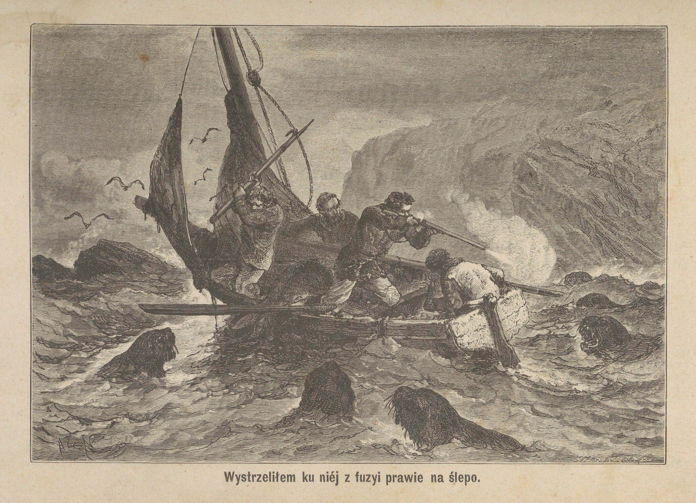

<!-- page 136 -->

<!-- page 137 -->

jej wnętrza, a woda, podrzucana przez ciężkie jej ciało, zaczęła nas na dobre oblewać.

W obawie, aby jej się przypadkiem nie udało dostać do łodzi, a przez to naruszyć jej równowagę, wystrzeliłem ku niej z fuzyi prawie na ślepo. Niespodziewany huk wystrzału tak przeraził foki, że cała gromada zawróciła się i przestała nas ścigać.

Przychylny wiatr przyspieszał naszą podróż, to też w niespełna godzinę przybyliśmy z powrotem do odnogi Rozbicia.

<!-- page 138 -->

# ROZDZIAŁ XI.

## URZĄDZENIE DRUGIEGO SYGNAŁU. — NOWA POTRAWA. — DLACZEGO WYRZEKŁEM SIĘ PIWA. — NASZE PAPUGI. — PSY NA WYSPIE.

Polowanie nasze poszło nader pomyślnie, mieliśmy więcej zwierzyny, niżeśmy jej spożyć mogli, zanim psuć się zacznie. Pomyśleliśmy więc o odpowiedniem zakonserwowaniu połowy naszej zdobyczy, tem bardziej, żeśmy nie byli pewni, czy za nadejściem zimy nie będziemy czasem czuli niedostatku żywności.

Użyliśmy w tym celu część ocalonego z okrętu zapasu soli. Z siedmiu naszych lewków cztery zostały poćwiartowane i poprzekładane następnie solą w próżnej beczce. Po kilku dniach zaś, gdy już dobrze przeszły solą, porozwieszaliśmy je u krokwi wewnątrz domku.

Byliśmy podówczas w peryjodzie równonocy i przez cały tydzień mieliśmy jak najgorszą pogodę. Gwałtowny wiatr dął ustawicznie, a deszcz, pomieszany z drobnym gradem, lał prawie bez przerwy. Od czasu do czasu jaskrawa błyskawica rozjaśniała ponure tło nieba, a tysiąckrotny odgłos grzmotu wstrząsał za każdym razem ściany naszego domku. Wichry wstrząsały gwałtownie drzewami i pomimo wytrzymałości ich liści, zrywały je gromadnie, unosząc je jakby chmury aż na wody zatoki, które były zupełnie ich warstwą pokryte. Z szelestem liści, które potrafiły wytrzymywać dłużej tę ciężką próbę, mieszał się głośny chrzęst gałęzi.

<!-- page 139 -->

Fale z wściekłością biły w nadbrzeżne urwiska, zostawiając na nich za każdym razem ślady białej piany. Czasami jaki ogromny odłam skały, oderwany przez piorun z pod szczytu góry, spadał w podskokach po jej pochyłościach na kształt śnieżnej lawiny; potem z głuchym łoskotem biegł dalej przez nadbrzeżne zarośla, wyorywując naw skroś nich głęboką bruzdę i uprzątając wszystko, co tylko śmiało stawać mu na zawadzie, aż nakoniec i sam ginął w wodnej otchłani.

Zdawało nam się, że jesteśmy świadkami jakiegoś ogólnego buntu przeciwko mądrym prawom, nadanym przez Stwórcę, wszystkich żywiołów przyrody, mających zamiar na nowo świat w chaos pogrążyć.

Przez cały tydzień byliśmy jakby uwięzieni w swojem mieszkaniu. Chatka nasza dzielnie opierała się burzy, albowiem prócz nic nieznaczących uszkodzeń żadnego nie poniosła szwanku. Cieszyliśmy się niezmiernie z przezorności, dzięki której nad samym brzegiem zostawiliśmy pas drzew dla łagodzenia uderzeń wiatru, a nadto popodpieraliśmy sam domek podpórkami od zewnątrz. Niemniej uciechy sprawiało nam nagromadzenie przed burzą zapasu żywności; tylko bowiem szczęśliwej myśli zakonserwowania części mięsa zabitych fok, zawdzięczaliśmy ochronę od strasznych cierpień głodowych.

Pod koniec następnego tygodnia, jak tylko można było z jakiem takiem bezpieczeństwem odważyć się na wycieczkę po odnodze, zaczęliśmy się przygotowywać do wyprawy na półwysep Musgrave'a dla przekonania się, czy też pozostał jeszcze jakikolwiek ślad z ustawionego tam sygnału. Możliwości oparcia się przezeń burzy nie przewidywaliśmy bowiem wcale.

Rankiem 24 marca, zostawiwszy w domu Norwegczyka, na którego w tym tygodniu przypadała kolej służby wewnętrznej, spuściliśmy łódź na wodę i rozwinęliśmy żagiel, a ponieważ wiatr był przychylny, przeto bardzo prędko dostaliśmy się do celu wyprawy.

Z sygnału naszego znaleźliśmy tylko żerdź, stojącą, jakeśmy ją umocowali, lecz flagi ani śladu nie było; widocznie wiatr gdzieś

<!-- page 140 -->

daleko ją poniósł. O kilka kroków dalej, leżała butelka, prawie zupełnie zagrzebana w ziemi, ale niestłuczona.

W przewidywaniu konieczności naprawy sygnału, a nawet urządzenia nowego, wzięliśmy ze sobą kilka desek, zbitych ze sobą w kształcie tarczy i pobielonych wapnem, rozrobionem w oleju z fok.

W samym środku pola tej tarczy, farbą z sadzy namalowałem wielką literę N, mającą wskazywać kierunek północny, w jakim należało się udać dla odszukania nas nad zatoką Rozbicia.

Tarcza ta została mocno przytwierdzona do dwu tyk naprzeciw głównego wejścia do zatoki Carnleya. Pokryta piękną roślinnością góra, na stoku której takowy sygnał był osadzony, ciemnem swem tłem przyczyniała się wiele do uwydatnienia go, i czyniła go widzialnym z bardzo wielkiej odległości.

Zawiesiwszy jeszcze ponad tarczą ową szczęśliwie ocalałą butelkę, powróciliśmy do Epigwait.

Nazajutrz, ponieważ wiatr był również bardzo pomyślny, postanowiliśmy korzystać z niego i odbyć powtórną wycieczkę na wyspę Ósemkową, w celu zaopatrzenia się na nowo, jeżeliby to się dało uskutecznić, w zapasy żywności, z których nam już tylko resztki pozostały.

Łowy nie tylko że i tym razem poszły pomyślnie, ale nadto uprzyjemnione zostały śmieszną wprawdzie przygodą, która jednak mogłaby była przybrać bardzo niebezpieczny obrót, gdyby mi się nie było powiodło w porę temu zapobiec.

Kiedyśmy, o ile można było najciszej, dostali się do polanki, uważanej przez nas niejako za rezydencyję króla Toma, zastaliśmy ją, jak poprzednio, zajętą przez liczne grono młodych fok, oraz pewną liczbę samic pod opieką samego sędziwego monarchy. Poważna ta postać, jak tylko nas spostrzegła, ośmieliła się posunąć naprzeciwko nam, wyszczerzając swe mocno nadwerężone zęby, jakby nas do walki wyzywać chciała. Nie czyhając bynajmniej na jego życie, a będąc tu daleko swobodniejszymi w ruchach aniżeli w zaroślach, potrafiliśmy uniknąć niepotrzebnej walki przez ominięcie go i, nie zważając na jego oburzenie i ryki, sprawiliśmy porządne spustoszenie mię-

<!-- page 141 -->

dzy młodą rzeszą. Podczas jednakże, gdyśmy ciągnęli nasze ofiary ku łódce, stary lew i towarzyszące mu samice nacierały na nas zbliska daleko odważniej niż za pierwszym naszym napadem, tak dalece, że Jerzy, obciążony ogromnym łupem, znalazł się nagle w ciasnem przejściu oko w oko z ogromną lwicą. Niepodobna mu było z powodu ciasnoty usunąć się ani na prawo ani na lewo, a nie czas już było cofać się w tył dla obrania innej drogi. Idąc za instynktownym popędem, Jerzy rzucił nagle swą zdobycz, uchwycił się wielkiej gałęzi, sterczącej mu ponad głową, i jednym susem dostał się na nią, zanim rozwścieczone zwierzę potrafiło go uchwycić ostrymi zębami. Lwica jednak, widocznie gorąco pragnąc się pomścić, z głową do góry wyniesioną i oczyma utkwionemi w swego wroga, usadowiła się spokojnie pod gałęzią. Kilka minut trwała ta wzajemna obserwacyja człowieka z foką, podczas której żaden z zapaśników nie zrobił najmniejszego ruchu, ale nie wiem doprawdy, jakby biedny Jerzy potrafił się spuścić ze swego napowietrznego stanowiska, gdybym szczęśliwym strzałem z fuzyi nie był powalił o ziemię rozjuszonego zwierza.

Po tej przygodzie dostaliśmy się już szczęśliwie na wybrzeże, do którego fokom, z powodu jakby wału z okruchów skał, nie bardzo łatwo było się dostać; powrzucaliśmy nasze lwy do łodzi, która zaledwie pomieścić je mogła, było ich bowiem jedenaście, i puściliśmy się w kierunku Epigwaitu.

Dziewięć z owych jedenastu fok zostało posolone i zachowane na czas krótkich i niepogodnych dni zimowych, których nadejścia rychło śmy się spodziewali; dwie zaś pozostałe zostały natychmiast skonsumowane.

Lecz wyłącznie zwierzęce pożywienie, na które byliśmy skazani, oprócz odrazy, jaką w nas obudzało skutkiem swego oleistego smaku, było niezdrowem dla Europejczyków, przyzwyczajonych od dzieciństwa do pokarmów mieszanych, śród których chleb, potrawy mączne i roślinne bardzo ważną odgrywają rolę; to też cierpieliśmy na tem bardzo. Kilkakrotnie już próbowaliśmy urozmaicać naszą strawę korzonkami roślin, zapełniających wyspę, żadna z nich jednak

<!-- page 142 -->

nie przypadała nam do smaku. Ileż to razy zdarzyło mi się słyszeć pragnienie Henryka, aby mógł zebrać choć wszystkie obierzyny od kartofli, które w czasie podróży wyrzucał w morze jako zupełnie niepotrzebne.

Nie zrażając się jednak niepowodzeniem, ciągle zajęci byliśmy myślą wyszukania na wyspie jakiej jadalnej rośliny. Jakoż pewnego dnia spostrzegliśmy w miejscu bagnistem jakiś krzew o lejkowato zwiniętych okrągłych liściach, wielkości zwykłego talerza, pokrywających bardzo gęsto szczególniej wierzchołki długich, rurkowatych łodyg. Pień tej rośliny nie wznosił się pionowo, ale czepiał się ziemi licznymi korzonkami przybyszowymi. Z pośród gęstwiny liści na wiosnę występowała długa szypułka, uwieńczona bukietem licznych, białych, trzypłatkowych kwiatów, których miejsce nieco później zastępowało zbite grono czarnych nasion. Rdzeń łodygi tej rośliny składał się z soczystego i słodkiego miąższu, przerośniętego jednak drzewiastemi włóknami, wymagającemi pewnych przygotowań dla zrobienia użytku na pokarm z miąższu. Roślinie tej nadaliśmy nazwę cukrówki (sacchary).

Postanowiłem tedy z kawałka blachy żelaznej, oderwanej z pokładu Graftona, z miejsca, gdzie stały piece kuchenne, zrobić tarkę, przez wybicie w niej pewnej liczby dziur i nadanie jej kształtu powierzchni walcowej. Dla większej wygody przybiłem jeszcze brzegi takowej tarki do boków odpowiednio przyrżniętej deseczki.

Przy pomocy tego narzędzia starliśmy na miazgę kilka kawałków łodygi naszej cukrówki, a następnie przesmażyliśmy ją na tłuszczu z fok.

Nowa ta potrawa, dosyć zresztą w smaku zbliżona do trocin, której podanie odbyło się z pewną uroczystością, na nieszczęście nie urzeczywistniła pokładanych w niej nadziei. Mogliśmy ją spożywać zaledwie po nalaniu wrzątkiem, a pomimo tej niebardzo wygodnej operacyi przewaga części drzewiastych czyniła ją bardzo niestrawnym posiłkiem. Pomimo tego wszystkiego kilku z nas obstawało za jej utrzymaniem, a nawet z czasem potrafiło się do niej

<!-- page 143 -->

przyzwyczaić. Co do mnie jednak, to nie mogłem przemóc pod tym względem swej natury.

Za to jednak starałem się wyciągnąć inne korzyści z cukrowych własności tej rośliny. Utarłem jej raz dosyć znaczną ilość i, wrzuciwszy do kociełka z wodą gorącą, wystawiłem ów odwar na fermentacyję.

Towarzysze moi, niezmiernie zaciekawieni temi przygotowaniami, bezustannie dręczyli mnie pytaniami co do celu tych przygotowań. Musiałem się w końcu przyznać do zamiaru fabrykacyi piwa. Wyjawienie sekretu wystawiło mię na różne złośliwe z ich strony żarciki; ale gdy nazajutrz spostrzegli, że ciecz zaczyna fermentować, wystąpili z propozycyją przedystylowania jej celem przygotowania wódki. Jedna z luf mej dubeltówki, przytwierdzona do szyjki kociełka, i po owinięciu płótnem, zlewana bezustannie zimną wodą, zastąpiła im miejsce wężownicy.

Wyrzucałem sobie wówczas zachciankę przygotowania piwa, gdyż, jeżelibyśmy zamiast poprzestać na tym niewinnym trunku, potrafili byli dojść do otrzymania spirytusu, wówczas bylibyśmy nieuchronnie wcześniej lub później wystawieni na smutne następstwa używania zbytniej ilości wódki.

Dla uniknięcia tego niebezpieczeństwa, z niechęcią wprawdzie, wyrzekłem się jednak mego zamiaru. Wystawiłem tedy umyślnie płyn na dłuższą kwaśną fermentacyję pod pozorem niedostatecznego jeszcze jej rozwinięcia się dla dystylacyi i tym sposobem zostaliśmy w końcu zmuszeni do wylania przygotowanego z takim kłopotem płynu; a zapewniając następnie, pomimo wprost przeciwnego przekonania, że pomyślny skutek podobnej operacyi jest niemożebnym, potrafiłem odstręczyć towarzyszów od powtarzania doświadczenia.

Pośród życia tak jednostajnego i tak zupełnie pozbawionego wszelkich rozrywek, jakiem było nasze, najdrobniejszy wypadek, przerywający zwykłą jednostajność, wydawał nam się bardzo ważnem zdarzeniem. Z tego też jedynie powodu nie mogę się powstrzymać od opowiedzenia historyi naszych papug.

<!-- page 144 -->

Pewnego dnia, gdyśmy wszyscy zajęci byli poszukiwaniem nowych ziół na pokarm, Henryk spostrzegł w jednem drzewie dziuplę, do której bardzo często wlatywała papuga, by ją znowu za chwilę opuścić. Uważając przez czas jakiś, że papuga zwracała się zawsze w jedną stronę, Henryk podczas jej nieobecności postanowił przyjrzeć się przypuszczalnemu jej gniazdu. Nie omylił się w swem przypuszczeniu, albowiem zapuściwszy rękę we wspomnioną dziuplę, wyjął z niej trzy młode papużki, prawie zupełnie już opierzone. Zrobiwszy to odkrycie, zajął się natychmiast przygotowaniem klatki z gałązek, bardzo zręcznie w tym celu przez się obstrugiwanych, a za nadejściem nocy, gdy już klatka była gotową, poszedł wybrać pisklęta z gniazda i przyniósł je do Epigwait.

Daliśmy im do jedzenia nasion naszej cukrówki, starannie najprzód pogniecionych i pomieszanych z trochą siekanej foczej pieczeni. Jedno z piskląt bardzo prędko zdechło; ale dwa pozostałe przyzwyczaiły się do nowej żywności i żyły przez całą zimę. Była to jak raz para, samiec i samiczka. Po pewnym przeciągu czasu zniszczyły zupełnie klatkę wskutek ciągłego gryzienia jej prętów, a że z nową musiałoby być to samo, pozwoliliśmy im przeto bujać swobodnie po całej chatce. Co dzień przynosiliśmy im świeżą gałąź, starając się zawsze o to, by była dosyć obfitą w ziarna i liście. Gałąź ta była zawsze stawiana w nogach Henrykowego łóżka i służyła im zawsze za nocne schronienie.

Samiec wyuczył się wkrótce wymawiać kilka wyrazów angielskich i od samego rana zaczynał swe szczebiotanie, które nas bardzo bawiło.

Co dzień w godzinie obiadowej obie papużki zwykłe były używać kąpieli. W tym celu stawialiśmy im zawsze pod gałęzią pudełko blaszane, napełnione wodą. Ptaki te jednak były bardzo wybredne. Woda musiała być zawsze świeża i zupełnie czysta; inaczej nie chciały wcale używać kąpieli. Po wyjściu z kąpieli zbliżały się do komina dla wysuszenia się przy ogniu. Łażąc po brzegu ogniska, obracały się to w tę, to w ową stronę z najpoważniejszą we świecie miną, a po wysuszeniu się, co zwykle następowało jeszcze przed

<!-- page 145 -->

skończeniem przez nas obiadu, przelatywały obie na nasz stół, i Boss, takie bowiem było imię samca, doskonałą angielszczyzną domagał się przynależnej im porcyi pieczeni.

Lecz niestety! Pewnego razu sam Henryk, spiesząc się bardzo, postawił pełen wody kocioł na nieszczęśliwego Bossa i zgniótł go na miazgę, a w tydzień później i samiczka zdechła z tęsknoty za nim. My sami byliśmy również niewymownie zmartwieni stratą tych pięknych ptaków, któreśmy bardzo polubili.

Pod tą samą datą mam w dzienniku moim zapisany wypadek, który nas wprawił w niezmierne zdziwienie i był przyczyną najrozmaitszych wniosków. Kilkakrotnie w rozmaitym czasie dochodziły uszu naszych odgłosy, bardzo podobne do szczekania psów w znacznej odległości. Skoro słychać było szczekanie, musiały być zatem na wyspie psy; jeżeli znowu były, to jakżeby sobie obecność ich wytłumaczyć? Czy przypadkiem nie należały do załogi okrętu, który się zatrzymał w jednej z przystani pobliskich portowi Carnleya lub nawet w Porcie Rossa, położonym na samym północnym krańcu wyspy? To ostatnie przypuszczenie oczywiście było dla nas niezmiernie ułudnem, i wielką mieliśmy ochotę przekonać się o jego słuszności lub błędzie. Przed doprowadzeniem jednakże do skutku podobnej wycieczki, trzeba się było dobrze zastanowić nad trudnościami, jakie co chwila stawały na przeszkodzie przy zwiedzaniu wyspy, które nawet przy najbardziej przyjaznych warunkach było prawie niepodobnem. Trudnoż było puszczać się na tak daleką wyprawę po tak burzliwem morzu, i to na tak wątłej jak nasza łodzi. Wyprawa podobna byłaby szaleństwem, to też trzeba jej się było wyrzec.

Zresztą więcej prawdopodobieństwa miało za sobą przypuszczenie, że psy owe, jeżeli rzeczywiście znajdowały się na wyspie, były tu niegdyś zostawione przez wielorybołowców, których ślady pobytu znaleźliśmy na wyspie Ósemkowej, albo też przez osadę rybacką na Enderby przy Porcie Rossa, która z powodu niepowodzeń opuściła tę wyspę w 1850 roku.

<!-- page 146 -->

Jeżeli jednak pochodzenie owych psów pozostało na zawsze dla nas zagadką, to istnienie ich zostało jak najpewniej stwierdzonem, albowiem widzieliśmy je na własne oczy.

Pewnego razu, gdy nasz zapas świeżego mięsa miał się już ku końcowi, a brzydka pogoda nie pozwalała nam puścić się łodzią na wyspę Ósemkową, gdzieśmy prawie na pewno mogli się spodziewać obfitej zdobyczy, postanowiliśmy puścić się pieszo wybrzeżem ku północo-zachodowi, aż do miejsca, w którem kiedyś udało mi się zabić dwie kaczki, spodziewając się i tym razem spotkać z kilka lwów morskich, drzemiących pośród bujnej trawy wybrzeża.

Alick i Henryk, najpierwej się wybrawszy, poszli przodem, Jerzy miał pozostać w domu na gospodarstwie, Musgrave zaś i ja zamierzaliśmy właśnie wychodzić z domu, zaopatrzeni w fuzyję, gdy nagle od drzwi spostrzegliśmy Henryka, dążącego ku domowi z największym pośpiechem. Był on nadzwyczaj wzruszony i zmęczony, powiedział nam wszakże, że, idąc z Alickiem po nad brzegiem morza, spotkali dwa psy. Jeden z nich był pięknym psem owczarskim, w łaty czarne i białe, i z wielkim kiściastym ogonem; drugi zaś mieszańcem kundla i buldoga. Alick pozostał na miejscu dla czuwania nad psami, on zaś przybiegł po kawał mięsa, chcąc spróbować znęcić do siebie tych nowych towarzyszów i po sznur dla uwiązania ich, jeżeliby na to pozwoliły; o czem wszakże wątpił, zdawały się bowiem bardzo zdziczałymi.

Zaopatrzeni w te niezbędne przedmioty, puściliśmy się wszyscy trzej wybrzeżem, ale wkrótce spostrzegliśmy Alicka, wracającego już ku nam. Opowiedział nam, że po odejściu towarzysza starał się zbliżyć do psów, łagodnie odzywając się do nich, ale że głos jego zdawał się je bardzo przestraszać, a po kilku krokach, ku nim zrobionych, uciekły w zarośla, gdzie niepodobna było dążyć za nimi.

Zbliżywszy się do miejsca, w którem zniknęły, dostrzegliśmy na miękkiej ziemi wyraźne ślady ich nóg; jedne z nich były większe, drugie znacznie mniejsze.

Podążyliśmy ich tropem, kierując się wciąż za większymi śla-

<!-- page 147 -->

dami, i byliśmy już prawie pewni zdobycia dwu nowych towarzyszów, wiernych przyjaciół, z których będziemy mieli pomoc i rozrywkę, gdy nagle ślady zniknęły. Na szczęście jednak reszta dnia pełna była pomyślnych przygód, tak że wkrótce zapomnieliśmy zupełnie o pierwszem niepowodzeniu. Napotkaliśmy lwicę ze lwiątkiem i zabiliśmy oboje, upolowawszy prócz tego dwanaście sztuk ptactwa. Z powodu wielkiego ciężaru fok byliśmy zmuszeni poćwiartować je na miejscu, po dokonaniu czego i podzieleniu łupów na równe części, podążyliśmy ku Epigwait, gdzieśmy niezmiernie strudzeni dopiero pod wieczór stanęli.

Rozbitki na Auklandach.

<!-- page 148 -->

# ROZDZIAŁ XII.

## NOC SPĘDZONA NA DWORZE. — PRÓBA GARBOWANIA SKÓR FOCZYCH.

**1 Maja.** Zima coraz bardziej się zbliża i chłód zaczyna nam mocno dokuczać. Lwy morskie coraz rzadziej napotykać się dają, a stąd przyszłość zaczyna nam się przedstawiać w coraz smutniejszych barwach, ukazując w oddali widmo głodu, który coraz szybciej zbliżać się zdaje. Gdybyż przynajmniej pogoda była znośną! Moglibyśmy jeszcze dalej zapuścić się w naszych poszukiwaniach. W obecnych jednak okolicznościach ukradkiem tylko można spróbować wycieczki na zatokę.

Dzisiaj postanowiliśmy zostawić w domu Henryka, na którego przypada tygodniowy dyżur, sami zaś powzięliśmy zamiar puścić się piechotą dla zbadania południowego brzegu wyspy, któregośmy do owego czasu wcale nie znali. Niepodobna nam było postępować brzegiem morza, który tworzą wysokie skały, ścięte prawie pionowo i zachodzące bardzo głęboko w wodę, trzeba więc było puścić się górą, pokonywając rozliczne przeszkody.

Już około południa dotarliśmy do małego międzymorza, łączącego z wyspą półwysep Musgrave'a. Był to cel naszej wyprawy, grunt tu był niski, łatwo dostępny, spodziewaliśmy się zatem spotkać tu dosyć lwów morskich.

Spocząwszy chwilę na pniu drzewa, rozpoczęliśmy obławę po całej okolicy. Nie było zakątka ziemi, któregobyśmy drobiazgo-

<!-- page 149 -->

wo nie przejrzeli, trud jednakże był daremny, nie znaleźliśmy ani jednej foki.

Zarówno zmęczeni jak i zniechęceni bezowocnem poszukiwaniem, rozpoczęliśmy naradę nad tem, co nam przedsięwziąć wypada. Pierwszym naszym zamiarem było puszczenie się z powrotem dla dostania się jak najprędzej do Epigwait; ale nawet przy największym pośpiechu nie mogliśmy zajść tam przed nocą. A potem, na cóż się zdało wracać z próżnemi rękoma? Zaszedłszy więc już tak daleko, trzeba było puścić się na drugą stronę półwyspu i zobaczyć, czy tam czasem nie uda nam się znaleźć tego, czegośmy dotąd napróżno szukali.

Niedługo ujrzeliśmy przed sobą wspaniałą, okrągłą zatokę. Ogromne głazy zajmowały całą długość jej brzegów, oprócz niewielkiej przestrzeni w samym środku zatoki, gdzie się znajdowała równina, żwirem pokryta, mająca może sto metrów długości. Po przeciwnej, naprzeciw nas leżącej stronie tego pola, sterczały ogromne, strome urwiska, które nam zasłaniały wejście do zatoki.

Kręcąc się wszędzie, potykając się raz wraz o wielkie kamienie, zaglądając wszędzie i wytężając słuch na najmniejszy szelest, posuwaliśmy się wciąż naprzód, nigdzie jednak nie można było dostrzec najmniejszego śladu pobytu fok. Tym sposobem dostaliśmy się wreszcie na ową żwirem pokrytą płaszczyznę, gdzieśmy mogli kroczyć z daleko większą swobodą.

W tem miejscu, z kwaśnemi minami i zupełną próżnią w żołądku, usiedliśmy skromnie u podnóża skał, czekając, by odpływ o tyle zniżył wodę, byśmy, wszedłszy w nią, mogli poodrywać od skał pewną liczbę ślimaków.

Z godzina może upłynęła, zanim mogliśmy to zrobić; a nazbierawszy wówczas dosyć znaczną liczbę mięczaków, pożarliśmy je chciwie bez żadnej przyprawy. Biedny Musgrave srodze przypłacił tę ucztę dzikich, dostał bowiem strasznych boleści.

Noc się zbliżała, ciemności i zimno coraz groźniejszemi się stawały. Niepodobna było myśleć o powrocie do domu pośród naj-

<!-- page 150 -->

zupełniejszej ciemności, tem bardziej, że drogę tę pierwszy raz dopiero zdarzyło nam się przebywać. Trzeba więc było pozostać na miejscu i cierpliwie dnia oczekiwać. Przytuliwszy się do siebie, by tym sposobem wzajemnie chronić się nieco od zimna, doskwierającego nam coraz bardziej, myśląc wciąż o Henryku, który sam pozostał w domu i bardzo musiał być o nas niespokojny, coraz bardziej upadając na siłach i umyśle, z Musgrave'm cierpiącym nieznośne boleści, przepędziliśmy tak całą, długą, bo szesnastogodzinną noc jesienną na powietrzu, za jedyną osłonę mając skałę, oddzielającą nas od morza, a tym sposobem łagodzącą nieco działanie wiatru.

Przeszła nareszcie ta noc okropna i między siódmą a ósmą rano dostrzegliśmy pierwszy brzask jutrzenki. Wiatr ustał, lecz za to otoczyła nas nadzwyczaj gęsta mgła, do której wkrótce przyłączył się drobny, lecz zimny deszczyk. Głód, głód nieopisany, zaczął nas trapić na nowo, a my, nie mogąc się oprzeć jego wszechwładnym rozkazom, zziębnięci i przemokli, opuściliśmy nasze schronienie, by, korzystając z niskiego stanu wody, zdobyć trochę ślimaków. Tym razem byliśmy jednak daleko umiarkowańsi i po zaspokojeniu pierwszego tylko głodu puściliśmy się z powrotem ku domowi.

Musgrave i ja szliśmy przodem, dwaj majtkowie za nami. Mówiliśmy bardzo mało; myśli krążące po naszych głowach nie mogły pokrzepić innych na duchu, nic więc dziwnego, żeśmy nie mieli ochoty zwierzać się z niemi. Już eśmy dochodzili do głazów, gdy nagle lekki szelest w zaroślach zwrócił uwagę naszą w tę stronę. Zatrzymaliśmy się na chwilę dla lepszego zmiarkowania się, skąd szmer ten pochodził. Jerzy i Alick, przyśpieszywszy kroku, wkrótce też przy nas stanęli. Szelest na jakiś czas ustał, tak żeśmy już sądzili, że nas słuch omylił, gdy nagle rozległ się na nowo. Ja trzymałem fuzyję w pogotowiu, towarzysze podnieśli pałki. Po niejakim czasie naprzeciw nas ukazała się z gęstwiny głowa młodej lwicy, zamierzającej zapewne zejść do wody. Musiała ona dopiero w nocy wyjść na brzeg, gdyż dnia poprzedniego nie mogliśmy znaleźć najmniejszego śladu. Spostrzegłszy nas, foka zatrzymała się na chwi-

<!-- page 151 -->

lę, jakby wahając się, czy ma iść dalej naprzód, czy też schronić się napowrót w zarośla. Obawiając się, by nie wybrała zarośli i nie zniknęła nam z oczu, dałem ognia, a kula przeszyła jej głowę.

Może w półgodziny potem, rozradowani zdobyczą, choć uginając się pod jej ciężarem, z którego na każdego przypadło po ćwierci, nie czując nawet znużenia, ruszyliśmy dobrym krokiem w kierunku Epigwait, i doszliśmy tam około południa, po trzydziestogodzinnej nieobecności. Henryk, zobaczywszy nas, zapłakał z radości, biedny ten chłopak przepędził bowiem noc w najokropniejszej trwodze, przechodząc po kolei myślą wszystkie nieszczęścia, jakich ofiarą stać się mogliśmy.

Zaledwieśmy jednak zadosyćuczynili jednej naglącej potrzebie, chociaż wprawdzie najgorszej, bo ciągle się odnawiającej potrzebie pokarmu, gdy nagle zjawiła się inna, również prędkiego wymagająca starania. Wspominałem już o tem, że opuszczając Sydney w ciągu lata i to na niedługą podróż, nie zaopatrzyliśmy się w odpowiedni zapas ubrania. Odzież moich towarzyszów już w chwili wyjazdu z Sydney była na pół zużytą, i ja tylko jeden miałem wówczas zupełnie nowy garnitur, do którego należała piękna para butów z wysokiemi cholewami, prawie zupełnie nienoszona z powodu długiej choroby i przymusowego podczas rekonwalescencyi odpoczynku. Zbliżał się więc czas, gdy moi towarzysze, którzy tak na wyspie Campbell, jak i na Auklandach drapać się musieli ustawicznie po skałach i zaroślach, ujrzeć się nakoniec musieli bez obuwia. Lecz jak było temu zaradzić? Próbowali oni już nieraz zastąpić swoje buty łapciami z foczej skóry, ale robota takowych wcale im się nie powodziła. Skóra taka, jako wcale nieprzygotowana, będąc ustawicznie wystawioną na wpływ wilgoci, miękła, nasiąkała wodą i gniła, a ostre skały nadbrzeżne zdzierały ją w ciągu kilku dni. Trzeba by więc było tak często odświeżać podobne obuwie, że skóry zwierząt przez nas zjadanych na przygotowanie go wystarczyćby nie mogły.

Przyszła mi więc myśl garbowania tej skóry przed użyciem. Po zbadaniu w tym celu własności kory rozmaitych drzew, na wys-

<!-- page 152 -->

pie rosnących, doszedłem do przekonania, że kora żelazodrzewu była do tego najodpowiedniejsza. Jej własności mocno ściągające zdawały się świadczyć o znacznej ilości garbnika, w skład jej wchodzącej, pomimo tego, że kora ta, jakem, zdaje się, już o tem wspominał, wcale nie była grubą. Zdarłem więc sobie znaczną ilość tej kory, posiekałem ją drobno, zagotowałem w wodzie, i gdy już odwar wydawał mi się dosyć mocnym, napełniłem nim beczkę, stojącą obok tej, w której filtrowałem mydło. W innej beczce przygotowałem roztwór wapna, otrzymanego z muszel, i pogrążyłem w takowej kąpieli kilka skór foczych, wybrawszy do tego zarazem najgrubsze i najcieńsze ze wszystkich, jakieśmy posiadali. Za pomocą zawartych w tym roztworze alkaliów zamierzyłem zniszczyć materyje tłuste, któremi te skóry mocno były przejęte, zanim jeszcze przystąpię do właściwego garbowania.

Potrzymawszy je przez dwa tygodnie w wapiennej kąpieli, wyjąłem je stamtąd dla zupełnego oczyszczenia, które bardzo łatwo uskuteczniłem na warsztacie, zrobionym z pozostałych nam jeszcze desek, przybitych mocnymi kołkami do trzech mocnych poprzecznic. Tym sposobem najgrubsze skóry odarliśmy zupełnie z sierści, nie tykając takowej bynajmniej na cieńszych, z których zamierzaliśmy sobie później porobić ubranie, mające zastąpić łachmany, obecnie na ciele dźwigane. Z tłuszczów skórnych, przez połączenie się z wapnem, utworzył się na nich pewien rodzaj osadu mydlanego, któregośmy się łatwo pozbyli przez moczenie skór przez kilka godzin w bieżącej wodzie strumyka. Następnie po wydobyciu z nich resztek wapna, skóry włożone zostały pod prasę, którą stanowiły deski, obciążone kamieniami. Po kilkakrotnem powtórzeniu tej ostatniej operacyi, wszystkie skóry pogrążone zostały w kąpieli garbnikowej. Pomimo, żeśmy się jak najczęściej starali odmieniać płyn, grubsze skóry zostały dopiero pod koniec zimy, to jest we cztery miesiące, dobrze wygarbowane.

**20 maja.** Przez ostatnie trzy tygodnie byliśmy dosyć szczęśliwi pod względem żywności. Tego dnia nadewszystko z powodu nader niskiego stanu wody ułowiliśmy dosyć ślimaków i nieco ryb,

<!-- page 153 -->

zostawionych przy odpływie na skałach, a prócz tego zabiliśmy trzy foki, które wybrały się na nocleg w okolice Epigwaitu.

Pogoda jest niestała, ale w ogóle czas zimny i wilgotny. Termometr zwykle w południe pokazywał trzy stopnie ponad zerem, a w nocy i w cieniu opadał często i poniżej zera.

W cieniu! Co za szyderstwo! Czyż nie zawsze jesteśmy w nim pogrążeni? Słońce ukazuje się na chwilę zaledwie raz albo dwa razy na tydzień. A przytem cóż to za słońce? Takie blade i chłodne, że zaledwie je widać zza obłoków. Zdarzało się też czasem, że upłynęły i dwa tygodnie, a słońce ani razu przez ten czas się nie ukazało. Ah! Jakże to przykro, mieć zawsze ponad głową ponure szare niebo, jakby ciężki sufit z obłoków, które wiecznie opadać się zdają! Ani odrobiny błękitu! Ani odrobiny nieba!

Była jednakże jedna rzecz, która tak na mnie, jak i na moich towarzyszów wywierała jeszcze przykrzejsze wrażenie, jakiś szczególny rodzaj trwożliwego przygnębienia. Mam tu na myśli jednostajny i wiecznotrwały łoskot fal, rozbijających się o wybrzeże, w niewielkiej odległości od naszej chatki, tem bardziej, że łączy się on zawsze z szumem wichru, wstrząsającego liście drzew okolicznych, i bezustannie przywodzi nam na myśl nasze srogie przeznaczenie. Skutkiem tych bezustannych łoskotów mieliśmy bardzo często nerwy mocno rozdrażnione; częstokroć zdawała się nas opanowywać jak najczarniejsza melancholija, zarazem gwałtowna i ponura, i jestem pewny, że bylibyśmy już dotychczas ulegli jakimś głuchym porywom hipokondryi, gdyby nie ustawiczna praca, do której nas okoliczności zmuszały, tak, żeśmy nie mieli czasu myśleć o naszem nieszczęściu.

Praca! Wówczas dopiero poznałem całą jej wartość i zasługi. Jakież to dobrodziejstwo Boga! Jakie szczęście dla człowieka, że, posiadając rozum, wyobraźnię i tyle ustawicznie czynnych władz, zmuszony jest pracą zarabiać na wyżywienie! Gdyby nie ten hamulec, na jakież rozdroża musiałby się zabłąkać? Gdyby nie ta osłona, stałby się niezawodnie łupem albo głupiej i ohydnej mar-

<!-- page 154 -->

twoty, albo najsromotniejszych występków. Wszyscy podziwiają wzniosłe prawa rządzące wszechświatem; ja nierównie więcej uwielbiam inne prawo, nie mniej od tamtych wzniosłe, prawo potrzeb, zmuszających człowieka do bezustannej pracy, czyniącej zadość potrzebom, a którego naturalnym wynikiem jest życie zdrowe, uczciwe, słowem szczęście człowieka. Uwielbiam je z bezstronnego stanowiska obserwatora, kocham je i błogosławię mu, bo tylko jemu zawdzięczam ocalenie.

<!-- page 155 -->

# ROZDZIAŁ XIII.

## ŚNIEG. — LWY MORSKIE EMIGRUJĄ. — ŚMIERĆ JEGO KRÓLEWSKIEJ MOŚCI KRÓLA TOMA. — ZORZA POŁUDNIOWA. — TRZĘSIENIE ZIEMI.

**Poniedziałek, 23 maja.** Gruba powłoka śniegu pokrywa ziemię; liście zawsze zielone flory południowej giną pod warstwą nagromadzonych kłaczków śnieżnych; drzewa, krzewy, zioła przeobraziły się w białe bukiety. Przyroda przystroiła się jakby na uroczystość, ale jakżeż ponurym jest strój ten oślepiający! Można by powiedzieć, że to uroczystość śmierci.

Cisza nadzwyczajna panuje na ziemi i wodzie. Powierzchnia zatoki zaledwie się marszczy pod lekkim powiewem wiatru. Fale o szczytach zielonych przestały się poruszać i wieńczyć białą koroną piany. Morze, gładkie jak zwierciadło, odbija wszystkie przedmioty otaczające, urwiska i drzewa nadbrzeżne, zarówno jak i góry osłonięte białymi płaszczami, które przez działanie optyczne wydają się o połowę niższymi.

Atmosfera jest tak przejrzystą, że dokładnie rozróżnić można horyzonty oddalone, które zwykle uchodzą naszemu wzrokowi; odległości zdają się być skrócone, przedmioty wszystkie dziwnie zbliżone.

Burza, monarchini tych miejsc, złożyła swą władzę. Chwilami cisza jest bezwzględnym panem tych samotni. W pewnych od-

<!-- page 156 -->

stępach czasu daje się jedynie słyszeć słaby, lękliwy krzyk ptaka, lub ryk oddalony jakiej foki.

Zmiana, która się dokonała w nocy, była tak nagła, tak zupełna, obraz który się przedstawia naszym oczom jest tak nowym, że rozpatrując go, staliśmy długo nieruchomi, osłupiali.

Nagle dziwne występuje zjawisko: powierzchnia zatoki, dopiero co tak spokojna, w kilku miejscach zaczyna się burzyć, pienić, a jednak niema wiatru, przynajmniej nic nie czujemy; gdyby wir jakikolwiek zsunął się z góry, porwałby i uniósł w swem łonie liczne kłaczki śnieżne pochwytane z ziemi lub gałęzi, coby uczyniło przejście jego widocznem, a myśmy nic nie widzieli. Nie, są to widocznie potwory morskie, rozpoczynające swe igrzyska.

W istocie, podczas gdy staramy się przeniknąć oczyma tajemnicze to zjawisko, objaśnia się ono samo przez się, zbliżając się ku nam, i wkrótce przesuwa się w pobliżu brzegów kilka zastępów lwów morskich, szybko płynących i od czasu do czasu wyskakujących z wody, jakby to czyniła gromada delfinów, przepływających koło brzegu.

Widząc tak znaczną liczbę tych zwierząt, które od niejakiego czasu stały się nader rzadkiemi, tak, żeśmy się obawiali, aby zupełnie dla nas nie znikły, uczuliśmy wielką radość; ale niestety! Radość ta nie była długotrwałą.

W kilka chwil później łatwo nam było zrozumieć z ich ruchów, że zwierzęta te ziemnowodne zbierają się przed opuszczeniem zatoki. Przekonaliśmy się o tem, gdy różne te zastępy, połączywszy się w jeden, posunęły się w kierunku głównego wejścia do portu.

Lwy morskie emigrowały! Nie mogę wypowiedzieć, jak na ten widok serce się nam ścisnęło. Podpora to życia naszego, pokarm nasz codzienny, od nas się oddalał.

Szybko, jakby jednym rzutem, poskoczyliśmy ku brzegowi, wiosłowaliśmy szybko, aby się dostać do wyspy Ósemkowej, w nadziei, że zastaniemy tam jeszcze kilku opieszalców, gdyż zasób nasz mięsa świeżego był niemal wyczerpanym. Ale poszukiwania nasze były daremne, brzeg był pusty; nawet król Tom się nie zjawił i przypu-

<!-- page 157 -->

szczaliśmy, że opuścił ulubione swe schronienie. Trzeba nam było wrócić do Epigwait z pustemi rękoma.

Byliśmy smutni, zgnębieni. Widzieliśmy przed sobą kilka miesięcy głodu i nędzy. Czy zdołamy to przenieść?

Trzeba było przedewszystkiem żywność rozdzielić na racyje, gdyż jesteśmy zmuszeni od jutra napocząć kilka kawałków mięsa wędzonego, któreśmy zawiesili w chatce. Sól i dym dobrze przechowały to mięso, ale tłuszcz w niem zawarty zjełczał i nadawał mu smak ryby zepsutej, co je też czyniło niezdrowem. Nie mieliśmy wyboru i musieliśmy używać tego mięsa, jakkolwiek zdrowie nasze na tem cierpiało; wznieciło to w nas obawy najżywsze o przyszłość.

Częściej niż kiedykolwiek staraliśmy się dodawać do tego mięsa ślimaki, ryby, a niekiedy i kormorany, zabijane na skałach wystrzałami z fuzyi; ale, jakem to już powiedział, pogoda nie pozwalała nam często wychodzić na rybołówstwo, a co do ptaków, bardzo tylko rzadko do nich decydowaliśmy się strzelać, aby jak najwięcej oszczędzać małą ilość prochu, jaka nam pozostawała: nie wiedzieliśmy, czy pomoc, jakiej oczekiwaliśmy, nie da zadługo na siebie czekać, czy zgoła nadejdzie. Położenie nasze było nader nieszczęśliwe.

**Środa, 1 czerwca.** Jest bardzo zimno; termometr wskazuje 2 stopnie niżej zera. Od 23 zeszłego miesiąca mieliśmy prawie bezustanną niepogodę. Deszcz obfity, sprowadzony powiewem wiatru północno-wschodniego, stopił śnieg, wyjąwszy szczyty gór, gdzie woda zmarznięta dodała nową warstwę do lodników wieńczących wierzchołki.

Nakoniec niebo się nieco rozjaśniło; tarcza słońca ukazuje się niekiedy wpośród chmur białawych, które się lekko unoszą ponad górami. Światło jego bardzo jest blade; jednak, gdy przyświeca, wszystkie lodniki się rozjaśniają i tryskają tysiącem iskier: powiedziano by, że to dyademy z brylantów.

Przez wszystkie te dni żyliśmy małą ilością zjełczałego mięsa foki i tą rośliną niestrawną, którąśmy nazwali sacchary. Jesteśmy słabi i schorzali; położenie nasze staje się coraz rozpaczliwszem.

<!-- page 158 -->

Dziś, gdy wiatr się nieco uspokoił, skorzystaliśmy z tej chwili przerwy, aby puścić się łódką na morze i zobaczyć, czy w odnodze zachodniej nie będziemy mogli napotkać choć kilku lwów morskich.

Zatoka, której niedawno nigdy nie przebywaliśmy bez dostrzeżenia kilku tych zwierząt, jest obecnie całkowicie pustą. Wiosłowaliśmy powoli, gdyż nie mieliśmy wiele siły; nakoniec przybyliśmy do początku odnogi. Zatrzymaliśmy się chwil kilka na wyspie Zwodniczej, aby odetchnąć i nieco wypocząć.

Podczas, kiedy Alick przywiązywał łódź do głazu w skale sterczącego, Musgrave, który od chwili zdawał się bacznie przysłuchiwać, rzekł mi nagle: „Czy to nie krzyk foki, który słyszę? Jakieby to było szczęście, gdybyśmy mogli naszą sprawę tu załatwić!”

Nie mogło nam się w istocie wydarzyć nic szczęśliwszego, gdyż nie potrzebowaliśmy już płynąć dalej, a w tej porze roku dnie są tak krótkie, że zaledwie zdołaliśmy dojść przed wieczorem do przejścia zachodniego. Nadzieja zaś przepędzenia drugiej nocy z dala od Epigwait nie była zgoła przyjemną.

Głuche mruczenie daje się słyszeć ponad nami. Musgrave się nie omylił. Gdzieś tu, w pobliżu, znajduje się jakiś lew morski.

Schwyciwszy broń naszą, fuzyje i kije, wyskakujemy lekko na ziemię i za chwilę znajdujemy się w obecności trzech fok. Jest to stara nasza znajomość, jego królewska mość król Tom, w towarzystwie dwu samic, swych połowic bez wątpienia, tak jak i on starych.

Tak więc król Tom nie odpłynął. Nie mógł się zdecydować na opuszczenie tych miejsc, tak mu znanych, albo też, zarówno jak i dwie stare lwice, nie czuł się na siłach do pociągnięcia za tłuszczą emigrantów. Złożył swą władzę na korzyść młodego jakiegoś lewka, swego następcy, który powiódł swój lud w okolice szczęśliwsze, niedostępne człowiekowi, wrogowi jego rasy, mordercy jego dzieci. Co do niego, on zostanie tutaj, gdzie żył, gdzie rządził tak długo i gdzie śmierć ma go niezadługo zabrać. Co go to wszystko obchodzić może? Tak mało dni pozostało mu do życia!

<!-- page 159 -->

Takie uwagi przyszły mi na myśl na widok starego monarchy, w czasie krótszym, niż mi trzeba było na ich wypisanie.

Król Tom nas poznaje; pozostawia za sobą dwie swe towarzyszki i zbliża się na nasze spotkanie, wydając jak zazwyczaj nieufne swe ryki.

Żal nam zabijać biedne te zwierzęta, zwłaszcza starego lwa, któregośmy zawsze oszczędzali; ale potrzeba nas nagli, głód nam grozi, nie możemy się cofać. W kilka chwil później, troje zwierząt rozciągniętych jest bez życia na dnie naszego statku.

Nieco przed czwartą dobiliśmy do Epigwait. Była już noc.

Tego wieczora, gdyśmy zakończyli swoje nauki (gdyż nie wyrzekliśmy się swej szkoły) i gdyśmy się zabierali do gry, Jerzy, który wyszedł na chwilę, wrócił natychmiast, wołając: „Chodźcie, chodźcie prędko, zobaczcie!”

Poszliśmy za nim i znaleźliśmy się wobec cudownego widoku. Była to zorza południowa w całej swej wspaniałości. Zimno było silne, wiatr wieczorny się uspokoił, białe chmury się rozproszyły, niebo było jasne na całej przestrzeni. Gwiazdy bladły wobec snopów różnobarwnego ognia, które wynurzały się spod poziomu i tryskały ku zenitowi, szybkie jak błyskawice, ale następujące po sobie bez przerwy. Na południu zorza trwała bez ustanku: był to wielki łuk koła, utworzony z bladawego światła, zkąd promieniowały na wszystkie strony niby węże ogniste.

Nie mogliśmy się oderwać od patrzenia i podziwiania. Jakżeż widok takich blasków uspokaja, jaką sprawia błogość! Jakżeż tu się zapomina o sobie i swych nędzach, wobec tych wspaniałych objawów wielkości przyrody i potęgi Stwórcy!

Podczas nocy ukazało się inne zjawisko, nie mniej podziwienia godne od pierwszego. Zostaliśmy gwałtownie obudzeni wstrząśnieniem ziemi. Ruch odbywał się od płn.płn.wschodu ku płd.płd.zachodowi. Towarzyszył mu szmer szczególny; można by go porównać z toczeniem tysiąca wozów po spadzistości kamienistej. Trzęsienie trwało 10 do 15 sekund; nasze łóżka, stoły, cały dom silnie się wahał. Byliśmy zlodowaciali ze strachu.

<!-- page 160 -->

Kilka głowni rozpalonych zostało wyrzuconych z ogniska na podłogę; pośpieszyliśmy się umieścić je na miejscu.

Już nie położyliśmy się powtórnie. Oczekiwaliśmy dnia, siedząc dokoła kominka. Wzięliśmy Biblię i odczytaliśmy kilka stronic. Wybraliśmy te, które mówią o łaskawości Boga, jego dobroci dla wszystkich istot, nawet najnędzniejszych, którym on zapewnia istnienie, a zwłaszcza dla człowieka, jego tworu uprzywilejowanego, który kocha miłością ojcowską.

„Przedwieczny jest litościwy i łaskawy, powolny w swym gniewie, a szczodry w miłości.

„Nie obszedł się z nami wedle grzechów naszych i nie zapłacił nam wedle naszych występków;

„Gdyż o ile niebo jest wyżej nad ziemię położone, tak dobroć jego jest niezmierna względem tych, którzy go się obawiają” (¹).

„…Kobieta czyż może zapomnieć o dziecku, które wykarmiła, i nie mieć czułości dla syna swych wnętrzności? Gdyby ona mogła o nim zapomnieć, ja o tobie nie zapomnę” (²).

„…Choćby góry zmieniły swoje położenie i pagórki się wstrzęsły, dobroć moja nie odwróci się od ciebie, a przymierze moje nie będzie naruszonem, wyrzekł Przedwieczny, który się lituje nad tobą” (³).

Wyrazy te, stosujące się tak dobrze do niebezpieczeństwa, z któregośmy uszli, wróciły spokój i nadzieję w serca nasze.

---

*(¹) Psalm CIII, 8, 10, 11.*
*(²) Jezajasz XLIX, 15.*
*(³) Jezajasz LIV, 10.*

<!-- page 161 -->

<!-- page 162 -->

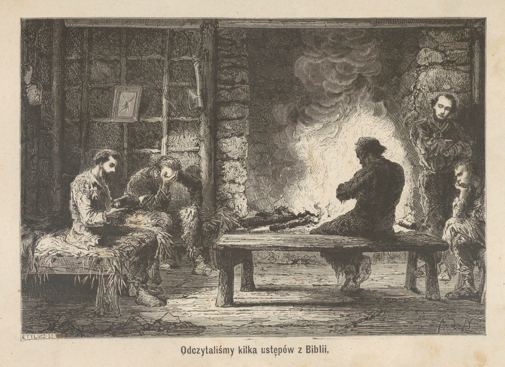

<!-- page 163 -->

# ROZDZIAŁ XIV.

## WYCIECZKA DO ODNOGI ZACHODNIEJ. — ODKRYCIE DAWNEGO OBOZOWISKA. — SZCZĄTKI OKRĘTU.

Doszliśmy już prawie do dni najkrótszych w roku. Słońce nie wschodzi przed wpół do dziewiątej, a zachodzi między trzecią a czwartą po południu.

Zwolna też od kilku tygodni zwyczaje nasze uległy zmianie. Zamiast wstawać, jakeśmy to dawniej robili, o szóstej, aby się zaopatrzyć w codzienny zapas drzewa przed śniadaniem, pozostawaliśmy w łóżkach do wpół do ósmej. Ten tylko z pomiędzy nas, na którego wypadała kolej tygodniowa, wstaje przed innymi, aby rozpalić ogień i przyrządzić pierwszy posiłek.

**Poniedziałek, 13 czerwca.** Zimno jest bardzo dotkliwe, poranek piękny, morze dosyć spokojne.

O piątej rano Alick, obudziwszy się wcześniej niż zazwyczaj, podniósł się i wyszedł, aby rozpoznać stan pogody. Następnie, rzuciwszy kilka drewek w komin dla rozpalenia prawie wygasłego ognia, przywołał Musgrave'a i zawiadomił go o pomyślnym stanie powietrza, który umożliwiał wycieczkę na zatokę.

Chodzenie to naszych towarzyszy, głosy ich ożywione, ogień, który połyskał rozkosznie na kominie i rozsypywał tysiące iskier, płomień, który z sykiem wdzierał się w rurę komina, wszystkie te szmery przyśpieszyły nasze rozbudzenie.

<!-- page 164 -->

— Wstawajcie, dzieci — rzekł Musgrave, który się podniósł i sam się przekonał o stanie pogody — wstawajcie i w drogę! Jest ładnie; sposobność jest przyjazna dla spuszczenia łodzi. Udamy się do odnogi zachodniej; tam mamy najwięcej widoków pomyślnego polowania i odnowienia naszych zapasów. Wiecie, że czas już o tem pomyśleć, jeżeli nie chcemy dojść do ostateczności.

Wyskoczyć z naszych łóżek zasłanych mchem, wdziać suknie, ukończyć nasz ubiór przy strumyku i połknąć nieco bulijonu z dnia poprzedniego, który Alick odgrzał, wszystko to było sprawą kilku chwil, poczem zeszliśmy na brzeg.

Alick i Jerzy dźwigali wielki kocioł żelazny, napełniony gorącym popiołem, na którym umieściliśmy kilka głowni rozpalonych. Gdy go złożyli w łodzi, udali się po wielki kawał jednego z żagli Graftona, który miał nam służyć za namiot w razie, gdybyśmy mieli jeszcze jedną noc przepędzić z dala od swego mieszkania.

Musgrave to powziął wyborny ten pomysł zabrania ognia. Poranek był bardzo zimny, a małe to ognisko było dla nas wielką pomocą.

Lekki wiatr północny daje się uczuć; witamy go z radością: pozwala nam rozwinąć żagiel i uwalnia nas od wiosłowania.

Dzień zajaśniał już zupełny. Wpływamy w wąskie przejście, dzielące małą wysepkę od lądu; potem, okrążywszy mały cypel, tworzący niby półwysep, wchodzimy do odnogi zachodniej.

Wkrótce, w odległości jakich dwustu sążni od cypla, któryśmy opłynęli, posuwając się wzdłuż brzegu północnego odnogi, odkryliśmy małe przejście, w które wpływamy. Ponieważ wiatr wychodzący z cieśniny jest nam przeciwny, zwijamy żagiel i używamy wioseł. Po upływie 10 minut przybywamy do małej, rozkosznej zatoki, ochronionej ze wszystkich stron, i gdzieby dwa lub trzy okręty znalazły zupełne bezpieczeństwo. Przy wejściu do cieśniny głębokość wody wynosi siedem sążni, grunt dna jest tu piaszczysty, następnie głębokość maleje stopniowo aż do trzech sążni w pobliżu brzegu, który stanowi tył zatoki; wpływają tam dwa czyste strumyki.

<!-- page 165 -->

Wysiadamy, wciągamy łódkę na ląd i na brzegu przeciwległym wejściu do zatoki znajdujemy gaj przerzedzony, dosyć wielki, pokryty tu i ówdzie gałęźmi, pniami drzew, ściętymi w pobliżu gruntu; widocznie siekiera tylko mogła te drzewa wyrąbać i ludzie tu przebywali. Przedzieramy się przez zarośla i odkrywamy w środku lasku szczątki dwu chat rozwalonych, spleśniałych, zniszczonych wilgocią. Ślady te są dawniejsze niż ślady, odkryte przez nas na wyspie Ósemkowej.

Wróciwszy na brzeg, idziemy nim aż do ujścia jednego ze strumyków. Żaden ślad foki nie przedstawia się oczom naszym, ale oto ukazuje się mała gromada ptaków; podobne są do dzikich kaczek, z dzioba tylko przypominają kormorany. Wystrzał fuzyi zabija ich cztery; śniadanie nasze jest zapewnione.

Podczas gdy Alick poszedł do łodzi po rozpaloną głownię dla rozniecenia ognia i upieczenia naszych ptaków, a Jerzy przyrządzał zwierzynę, z Musgrave'm posunęliśmy się wzdłuż strumyka.

Zaledwieśmy zrobili kilka kroków na brzegu, Musgrave potknął się i o mało nie upadł. Zawada, o którą noga jego potrąciła, jest przedmiotem białawym, na pół zagrzebanym w torfie; rozpatrując go bliżej, poznajemy, że to cegła. Nieco dalej leży na ziemi mały stos takich cegieł, u stóp wielkiego drzewa, ale tak dobrze zakryty torfem i liśćmi, że nie bylibyśmy go dostrzegli, gdyby nie wypadek Musgrave'a. Cegły te pozostawione zapewne zostały przez podróżników, którzy obozowali w sąsiednim lasku i którzy musieli tu założyć piec dla topienia tłuszczu fok. Mogą się nam one w danym razie przydać: zabieramy je więc ze sobą.

Dajemy tej zatoce nazwę Camp-Cove, to jest przystań obozowa.

Załatwiwszy się z kaczkami, które się nam wydają wyborne, rozwijamy żagiel i przebiegamy odnogę zachodnią. Dotąd nie napotkaliśmy ani jednej foki, ale zbliżając się do wyspy Pomnikowej, spostrzegamy fokę, płynącą obok wyspy Adama, o kilkaset metrów od cieśniny.

Jest to stary samiec, również szanowny jak król Tom. Z ruchów jego pojmujemy, że szuka miejsca, przyjaznego do wydostania się

Rozbitki na Auklandach.

<!-- page 166 -->

na ląd. Z obawy, aby go nie przestraszyć, zwijamy szybko żagiel i zatrzymujemy bieg statku, opierając się na wiosłach.

Zwierzę wychodzi z wody, przesuwa się lekko między dwiema skałami i zwraca się ku wysokim ziołom, rosnącym przy brzegach lasu i oznaczającym granice wielkich przypływów morza. Wybrzeże jest nierówne, kamieniste, foka wydaje się zmęczoną i zatrzymuje się dla wypoczynku. Nagle, podniósłszy głowę i spojrzawszy ponad wysoki kamień, dostrzega nas, robi lekki ruch wsteczny: czyż chce wrócić do morza i ujść przed nami?

Nabiłem broń swoję bez szmeru, mierzę do lwa. Wyczekiwanie, obawa malują się na twarzach mych towarzyszów. Foka jest jakby niezdecydowaną, już to zwraca głowę ku brzegowi, dokąd roztropność każe jej wrócić, już to spogląda w stronę wielkich ziół, które ją wzywają do spoczynku.

„Nie spiesz się, wyceluj dobrze!” Jest to głos Musgrave'a, który szepcze mi te wyrazy do ucha.

Czy mam strzelać? Odległość jest tak wielka! Ale jeżeli będę czekał, zdobycz może mi ujść. Daję ognia, lew jest rażony, nie został zabity, ale ma szczękę strzaskaną, jest zupełnie ogłuszony; to dosyć, aby zyskać czas na wylądowanie.

Kilka silnych uderzeń wiosłami doprowadza nas do brzegu, blisko miejsca, gdzie zwierz się rzuca. Wyskakujemy na ląd, rzucamy się na niego i zanim odzyskał zmysły, dobijamy go swemi pałkami.

We czterech ciągniemy go do łodzi, zaledwie możemy go tam dowlec. Jestem pewny, że nie ważył mniej nad czterysta kilogramów.

Nie możemy opuścić tego miejsca, nie spojrzawszy raz jeszcze, ze szczytu skały, na wspaniały obraz, jaki przedstawia cieśnina, a który już opisałem. Schodząc, napotkaliśmy kurkę wodną, którą Jerzy zabija bardzo zręcznie rzutem kamienia. Na brzegu znaleźliśmy znowu kawałek rei i ściany okrętowej z drzewa sosnowego.

<!-- page 167 -->

Zkąd pochodzą te szczątki? Zostały one tu przyniesione zupełnie świeżo przez przypływ morza, gdyż podczas pierwszych naszych odwiedzin nie widzieliśmy ich w tem miejscu.

Być może, miało tu miejsce nieszczęście. W tem przypuszczeniu rozpalamy wielki ogień, dym gęsty podnosi się ku niebu: jeżeli rozbitkowie znajdują się w pobliżu, zobaczą go niezawodnie. Co do wystrzałów z fuzyi, byłby to nakład stracony; szum bałwanów i bezustanne wybuchy, powodowane przez fale, rozbijające się w pieczarach urwiska, nie dozwoliłyby ich usłyszeć. Rozpatrujemy okolice we wszystkich kierunkach, nie napotykamy nikogo.

Dzień upływa, nie możemy nieroztropnie dłużej się opóźniać. Odpływamy i pomimo wszelkiego pośpiechu przybywamy do Epigwait dopiero o czwartej, po zapadnięciu nocy.

Zkąd pochodziły szczątki okrętu, któreśmy widzieli na brzegu? Czy ze statku, który nawałnice uszkodziły, czy też z rozbicia, jakeśmy to z początku przypuszczali? Nigdyśmy się tego nie dowiedzieli. To tylko pewna, że wypadki są częste w tych okolicach, gdyż liczne statki idące z Australii do Europy przechodzą wszystkie w pobliżu Auklandów, położonych na ich drodze.

Otóż nie mogę się z tego powodu powstrzymać od uwagi, jakby to było ważnem, aby te wyspy, położone w strefie kuli ziemskiej najbardziej wystawionej na burze, nie były zupełnie pozostawione żywiołom, które się tam srożą, i że należałoby tam umieścić latarnię morską, stacyję, odwiedzaną od czasu do czasu, gdzieby nieszczęśliwi rozbitkowie znajdowali pomoc natychmiastową. Chciałbym, abym zdołał na ten punkt zwrócić uwagę rządu angielskiego, zarówno troskliwego o interesy swego handlu, jak i o bezpieczeństwo swych poddanych.

Oby nasz przykład, wraz z przykładami Invercauld'a i Generała Grant'a, które tak samo jak Grafton w krótkim przeciągu czasu rozbiły się na tych brzegach, mogły posłużyć do tak szczęśliwego rezultatu!

<!-- page 168 -->

Jakaż to pociecha dla tych, co cierpieli, a nawet dla tych, co cierpią, jeżeli mogą sobie powiedzieć, że ich nieszczęście nie będzie jałowem, ale że wyda owoce dobroczynne, które dla innych staną się użytecznymi. Gdyby tak było! Sądzę doprawdy, że byłaby radość w cierpieniu.

<!-- page 169 -->

# ROZDZIAŁ XV.

## NĘDZA. — NA DNIE OTCHŁANI. — POWRÓT OBFITOŚCI. — CHWILA SZCZĘŚCIA.

Wkrótce potem byliśmy znowu doprowadzeni do tego, żeśmy gryźli ostatni nasz kawałek wędzonki zjełczałej i nie wiedzieli, zkąd zdobędziemy posiłek na jutro.

Przez całe trzy dni napróżno przebiegaliśmy okolice Epigwaitu, przetrząsając krzaki, szukając napróżno czego do jedzenia. Co do mnie, udałem się na cypel Raynala, aby spróbować połowu ryb, ale szczęście mi nie posłużyło; wróciłem z workiem prawie pustym, zdobycz moja była nieznaczna: dwa lub trzy dorsze. Co do ślimaków, nie podobna było ich nic ułowić, czas wielkich przypływów jeszcze nie nadszedł, morze nie obniżało się dostatecznie.

Ach! Jakżeż smutno po podobnych dniach schodził wieczór. Lekcyja się nie wiodła; byliśmy zbyt zgnębieni, zbyt zamyśleni, aby na nią zwracać dosyć uwagi. Mniej jeszcze odwagi mieliśmy do gry. Grać, gdy się przewiduje śmierć głodową! Kładliśmy się wcześnie, a żeśmy bywali strudzeni, spaliśmy mocno. Przez ten czas przynajmniej nie myśleliśmy o naszej nędzy.

Przy końcu trzeciego dnia głodu, przed udaniem się na spoczynek, zwróciliśmy wspólnie pokorną prośbę do Najwyższego, do Pana wszech rzeczy, przedstawiając mu swoje nędze i składając z ufnością los nasz w Jego ręce.

<!-- page 170 -->

Nazajutrz ze świtem udałem się na polowanie. Wziąłem ze sobą fuzyję, zamierzałem zabijać kormorany. Na nieszczęście, te ptaki, które nas już znały i lękały się, rzadko tylko spoczywały na otaczających skałach, a te, które tam siadały, odlatywały, skoro nas spostrzegały. Zdołałem jednak zabić trzy takie ptaki, które koło południa odniosłem do domu z twarzą dosyć stroskaną: kosztowały mnie dwa wystrzały z fuzyi, było to bardzo drogo.

Wydały nam się wybornymi; miały tylko jedną wadę: były zbyt małe. Alicka nie było, pozostawiliśmy dlań jego część.

On także udał się od rana dla przetrząśnięcia strony północnej brzegu. Skończyliśmy właśnie zbyt skromną swą ucztę, gdyśmy go ujrzeli wracającego. Zsuwał się z urwiska, niekiedy prędzej, niżby chciał; dźwigał znaczny ciężar na plecach. Pobiegliśmy do niego. O radości! Polowanie jego było pomyślnem.

Dźwigał on młodego lewka, mającego siedem lub osiem miesięcy i ważącego około 150 funtów. Z podobnym ciężarem wracał ze skały, położonej nad zatoką, i to jakiemi drogami! Norwegczyk był dzielnym i śmiałym chłopcem, a jeżeli mówił mało, umiał dobrze działać.

Opowiedział nam, że o milę poza zatoką kaczek dostrzegł świeży ślad na gruncie, pokrytym lekką warstwą śniegu. Poszedł nim aż w gęstwinę i znalazł się nakoniec wobec starej samicy i jej młodego. Ściganie ich było niewypowiedzianie uciążliwem, zdołał jednak je dognać i zabić oboje. Matkę zostawił na miejscu, a młode przynosił.

Puściliśmy się natychmiast w drogę po samicę pod dowództwem Alicka, który, jakkolwiek zmęczony, poszedł z nami, aby nam drogę pokazać. Harry pozostał w domu; miał nam przygotować dobrą ucztę na wieczór.

Musgrave z Norwegczykiem szli przodem. Postępowałem za nimi w odległości stu metrów, a Jerzy szedł ostatni, o jakie pięćdziesiąt kroków za mną.

W połowie prawie drogi, nieco przed zatoką kaczek, znajduje się urwisko, które zachodzi ostro w morze. U jego podnóża

<!-- page 171 -->

leżą szczątki ostrych skał; morze, okrywające je w czasie wysokich przypływów, uczyniło je śliskiemi, pozostawiając na nich warstwę roślin morskich.

Aby uniknąć trudnego tego przejścia, wszedłem w gęstwinę, gdzie Jerzy posunął się za mną. Musgrave i Alick postępowali dalej brzegiem morskim.

Z drugiej strony urwiska znajduje się małe bagno, zasilane strużką wody, spływającą z góry w wąskiej i głębokiej rozpadlinie. Rozpadlina ta, utworzona bezustannem działaniem wody w pokładzie kamienia zielonawego i miękkiego, pokryta jest w miejscu, gdzie dochodzi do bagniska, na długości dwudziestu metrów, rodzajem sklepienia czyli mostu: są to korzenie drzew, przechodzące od jednego brzegu do drugiego i na których wytworzyła się gruba warstwa torfu. W tej części pokrytej, którąśmy nazwali mostem, rozpadlina jest szeroka prawie na dwa metry, a głęboka na dziesięć.

Nieco wyżej, wzdłuż ścian urwiska zwieszają się liczne długie i omszone korzenie, a otwór jest prawie zupełnie zakryty znaczną ilością roślin szerokolistnych, kępami paproci i plątorośli, które rosną na brzegu.

Wstępując wyżej jeszcze, widzimy, że dwa te szeregi roślinności, niżej rozdzielone, zlewają się w jedną masę i nie dostrzegamy już wydrążenia, jakie ona pokrywa; ponad nią drzewa gęstwiny krzyżują swe gałęzie i tworzą sklepienie z listowia, które przepuszcza słabe tylko półświatło; jest to jedno z najniebezpieczniejszych przejść w tej stronie wybrzeża.

Zbliżałem się ku temu miejscu, za mną szedł Jerzy. Przekraczając pnie drzew, przesuwając się między paprociami, usuwając plątorośle i wielkie liście, obciążone kroplami wody, posuwaliśmy się jak można najprędzej, aby dopędzić Musgrave'a i Alicka z drugiej strony urwiska.

Nagle, o kilka kroków odemnie, szelest uciekającego zwierzęcia ściąga moję uwagę. Zatrzymuję się, ale na sekundę tylko. Spostrzegłem zwierzę; jest to lew morski, młody samiec, mogący mieć dwa lata; z kijem w ręku rzucam się za nim w pogoń.

<!-- page 172 -->

Biegłem z całą szybkością, do jakiej byłem zdolny; kilka razy znajdywałem się już blisko foki i już miałem ją uderzyć, ale wstrzymałem się, obawiając się chybienia z powodu zawad, jakie mi przeszkadzały, i woląc czekać chwili, w której będę pewny swego uderzenia. Zmieszane ze strachu, zwierzę uciekało, jak mogło najlepiej.

Nagle usłyszałem spadek ciała znacznej objętości na dwa kroki przedemną. Foka ta zniknęła w rozpadlinie, głębokiej w tem miejscu na 15 stóp. Z trudnością zaledwie powstrzymałem swój rozpęd i uniknąłem spadku w przepaść jedynie tylko przez uczepienie się z całej siły pęka paproci, które rosły na brzegu.

Podniósłszy się jak najprędzej, gdyż nagłe zatrzymanie biegu powaliło mię na ziemię, zawołałem na Jerzego, aby pobiegł strzec wyjścia wąwozu: lew, który hałaśliwie pluskał się w wodzie na dnie przepaści, zwrócił się w tym kierunku.

Po upływie dziesięciu minut usłyszałem głos Jerzego, który ze swego stanowiska donosił mi, że jeszcze niczego nie dostrzegł. Sądząc, że zwierzę zatrzymało się pod mostem, postanowiłem zejść tam sam i zmusić je do wyjścia.

Zarzuciwszy na szyję rzemień swego kija, czepiając się obu rąk korzeni i plątorośli, które zwieszały się w przepaść, w miejscu gdzie foka spadła, ześliznąłem się na kilka stóp od dna i puściwszy się, dostałem się na dno bez żadnego wypadku.

Byłem w ciemności. Macając ściany rowu, nogi mając zanurzone w wodzie zlodowaciałej, szedłem za śladem zwierzęcia. Po upływie kilku chwil, zacząłem widzieć nieco jaśniej. W pobliżu mostu, jak to już zauważyłem, przepaść była szersza i znacznie głębsza niż w miejscu, gdzie zstąpiłem. Znalazłem tam splot plątorośli i wiszących korzeni, które zamykały jakby zasłoną wejście do tego ścieku. Schyliłem się, aby przejść pod tym splotem i zrobiłem kilka kroków naprzód. Byłem w zupełnej ciemności; przenikał tylko tam słaby blask przez otwór wąski i niski, który wychodził na bagno. Przestrzeń była tu znacznie obszerniejszą i dwie ściany, zbliżone ku górze, na dole znacznie się rozchodziły. Wpośrodku hałaśliwie spływała po pochyłości mała strużka przezroczystej wo-

<!-- page 173 -->

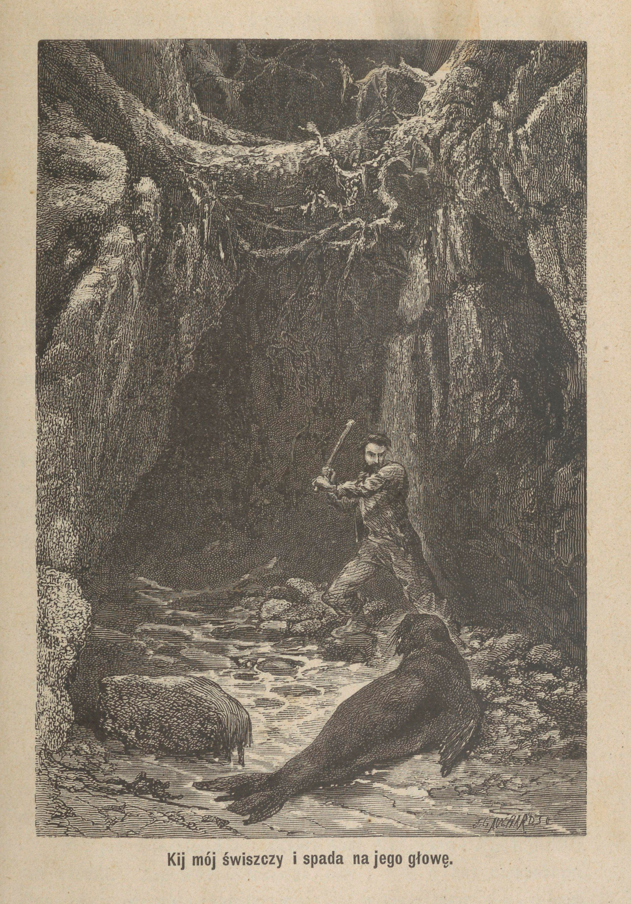

<!-- page 174 -->

<!-- page 175 -->

dy, zdążając do wyjścia, u którego na jednym z brzegów dostrzegłem lwa nieruchomego: zapewne widział on Jerzego, który strzegł wyjścia i miał się na ostrożności.

Było tam dosyć światła, abym mógł pilnować ruchów swego przeciwnika, który, skoro tylko usłyszał me kroki, obrócił się, wydał ryk gniewny i rzucił się na mnie wściekle. Na szczęście byłem od strony cienia i miałem przez to wyższość nad nim. W każdym razie rozumiałem, że mogłem raz tylko uderzyć i że należało uderzyć celnie; inaczej, nie zostawiłby mi czasu do nowych uderzeń i byłbym na jego łasce.

Trzymając oburącz kij na wysokości swych barków, z oczyma zwróconemi na niego, czekałem, dopóki się dostatecznie nie zbliży. Oto jest! Z paszczą rozdziawioną rzuca się na mnie... uderzam, kij mój świszczy i spada na jego głowę.

Wymierzyłem dobrze. Wydając głębokie westchnienie, foka osunęła się na dno jaskini, jakiś czas miotała swemi płetwami, nakoniec pozostała nieruchoma. Dobiłem ją nożem i pociągnąłem ku wyjściu rozpadliny, co nie było łatwem, gdyż ważyła około 200 kilogramów; ale stoczyłem ją do strumyka, a woda dopomogła mi ją przenieść aż do otworu, przez który, przy pomocy Jerzego, wypchnąłem ją na zewnątrz.

To zrobiwszy, byłem sam zmuszony położyć się na brzuchu w zlodowaciałej wodzie strumyka i przesunąć się tąż samą drogą. Gdy się podniosłem, woda ściekała ze mnie jak z trytona, trząsłem się, zęby mi dzwoniły, a pod działaniem ostrego wiatru mokra odzież lepiła mi się do ciała.

Wyciągnąwszy zwierzynę naszą z bagniska, którego powierzchnia pokrytą była cienką warstwą lodu, rozcięliśmy ją rychło na cztery ćwierci, z których dwie zawiesiliśmy na gałęziach drzewa; obładowani dwiema innemi, wróciliśmy do Epigwait.

Noc już nadeszła, a towarzysze nasi, Musgrave i Alick, jeszcze nie wrócili. Zapewne oczekiwali nas i byli o nas niespokojni. Zmieniwszy suknie i zaopatrzywszy się w małą latarnię o szybach rogowych, którąśmy przynieśli z Graftona, poszliśmy na ich spo-

<!-- page 176 -->

tkanie. Przybywszy do zatoki kaczek, niedaleko od pierwszego strumyka, usłyszeliśmy krzyk: oni to na nasz widok, a raczej na widok zapalonej latarni naszej, wydali okrzyk radosny. Pomimo całego pośpiechu, ciemność ich zaskoczyła, a obawiając się narażać na skałach urwiska lub w zaroślach gęstwiny, postanowili przepędzić noc w tem miejscu. Pokazali nam miejsce, gdzie mieli usiąść po złożeniu swego ciężaru, pod ogromnym pniem wydrążonym, prawie wywróconym, któryby w czasie deszczu mógł stanowić pewną osłonę.

Ponieważ byli na wskroś przejęci zimnem, zapaliliśmy pęk krzaków; a skorośmy wszyscy się nieco rozgrzali, ruszyliśmy drogą ku domowi, z Jerzym na czele, który niósł latarnię; przybyliśmy dopiero o dziewiątej.

Otwieramy drzwi, wchodzimy do pokoju: jakiż widok radosny otwiera się przed naszym wzrokiem! Jakaż sprzeczność z tem, cośmy dopiero opuścili! Na zewnątrz noc, zimno gwałtowne, wiatr północny wyje i szczypie; wewnątrz światło i ciepło. Wielki ogień płonie na kominie, sypiąc dokoła iskrami; ciepła atmosfera otacza nas i przenika; wszystkie lampy zapalone wesołą jasnością napełniają wnętrze chaty.

Na stole wieczerza jest przygotowana ze starannością troskliwszą niż zazwyczaj. Naczynia nasze, jakkolwiek są pospolite, błyszczą czystością bez zarzutu. Wśrodku wznosi się gorący kawał młodego zwierza, którego Alick zabił rano; Harry, nasz gospodarz, postarał się wszystko ugotować na właściwą chwilę.

Dzielny Harry! Widocznie chciał on nadać cechę uroczystości temu dniowi, gdy po niedostatku i nędzy, obfitość i zabezpieczenie do nas wróciły. Zadowolenie, jakie nam sprawia widok tych przygotowań, a które on czyta w naszych twarzach, zdaje się go zachwycać.

Ale niedługo pozostaliśmy biernymi widzami tego zachwycającego obrazu; otaczamy stół, siadamy z pośpiechem, z widelcami i nożami w rękach, zabieramy się do dzielnego zaatakowania pieczeni... Musgrave tylko, poważny, niemal uroczysty, pozostał stojącym. Pojmujemy go i podnosząc się natychmiast, łączymy się

<!-- page 177 -->

z nim w dziękczynieniach, jakie zasyła Opatrzności, która tak widocznie wysłuchała wczorajszych modłów naszych. W istocie, czyż mogła udzielić odpowiedź prędszą, prostszą, szczodrobliwszą na naszą prośbę? Serca nasze przepełniają się wzruszeniem i wdzięcznością.

<!-- page 178 -->

# ROZDZIAŁ XVI.

## PIECZARA. — JESTEŚMY ZASKOCZENI PRZEZ MGŁĘ. — ZWIEDZENIE ZATOKI ŚRODKOWEJ. — PORZECZKI. — POMYSŁ NIEWYKONALNY.

Trzy dni silnego mrozu, następnie trzy dni bezustannej burzy, uraganu, wiejącego kolejno ze wszystkich okolic nieba z gwałtownością przerażającą, na szkodę biednych drzew wybrzeża — oto historyja ostatniego tygodnia.

Dziś rano, 9 sierpnia, gdy niebo się uspokoiło i rozjaśniło, chciałem wraz z Alikiem spróbować wejścia na górę, położoną poza naszem mieszkaniem, co już dokonali nasi towarzysze, ale w czem my obaj udziału przyjąć nie mogliśmy.

Przybywszy, po niewypowiedzianych mozołach, na szczyt góry, zachwyceni zostaliśmy wspaniałym widokiem, który nam był Musgrave opisał. Był to cudowny zamęt cyplów, wierzchołków, skał urwistych, poprzerzynanych wąwozami, dolinami, przepaściami, otoczonemi ze wszech stron spokojnym bezmiarem oceanu.

Naprzeciwko nas i w małej odległości sterczał szczyt, w którym zagłębioną była ciemna pieczara; towarzysze nasi nie mieli czasu jej zwiedzić; myśmy doszli do niej po pochodzie długim i dosyć niebezpiecznym, po wąskiej krawędzi góry.

Pieczara ta, widziana zbliska, wydała się nam dawnym kraterem, którego jedna ściana upadła, druga pozostała, pochylona, niby półsklepienie ponad otchłanią. Naokoło rozrzucone są żużle, a na brzegu najmniej wyniesionym rozróżnić jeszcze można łożysko po-

<!-- page 179 -->

<!-- page 180 -->

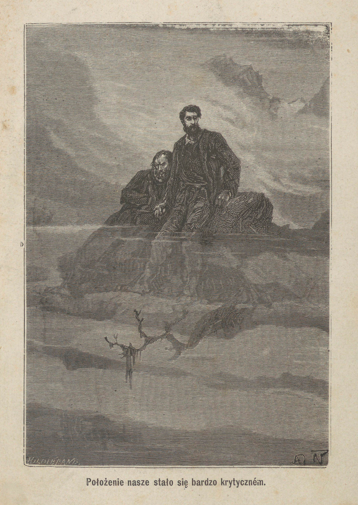

<!-- page 181 -->

toku lawy, które dochodzi do głębokiej doliny, położonej u podnóża stoku przeciwległego temu, który się znajduje naprzeciw portu Carnleya.

Zszedłszy wewnątrz pieczary, mogliśmy ją do woli obejrzeć; szkliste wejrzenie jej ścian nie pozostawiło nam żadnej wątpliwości co do jej wulkanicznego pochodzenia.

Aż dotąd nie napotkało nas żadne istotne niebezpieczeństwo i byliśmy bardzo z tej wycieczki zadowoleni, ale powrót nasz nie był zgoła tak szczęśliwym. Opuściliśmy pieczarę i byliśmy już prawie w połowie drogi, która ją oddziela od pierwszego szczytu, gdy nagle zaszła gęsta mgła; znaleźliśmy się jakby we wnętrzu chmury. Położenie nasze stało się bardzo krytycznem. Nie śmieliśmy uczynić ani kroku, gdyż krawędź góry była bardzo wąska, a najmniejszy ruch niewłaściwy mógł nas strącić w jakową przepaść. Z drugiej strony, z powodu zimna, pozostanie w spokojności było równie niebezpiecznem jak i przykrem: gdyby odrętwiałość, która zaczynała nas opanowywać, doszła aż do zupełnego sparaliżowania, gdybyśmy wpadli w ten sen fatalny, do oparcia się któremu niezdolne są wszystkie wysiłki woli, byliśmy zgubieni, byliśmy skazani na zagładę na tym pustym wierzchołku. Towarzysze nasi przybędą zapewne nas szukać i nakoniec nas znajdą, ale kiedy? Jutro prawdopodobnie, a wtedy już będzie zapóźno.

Pozostaliśmy około godziny w białej ciemności tej pary zgęstniałej, oddani na łup najstraszniejszym obawom, opłakując swoję nieroztropność. Nakoniec zaczął dąć wiatr południowo-zachodni i po kilku chwilach uniósł otaczającą nas chmurę.

Zimnym był bardzo, ostry ten wicher, ale z jakąż radością czuliśmy, jak nam ścinał twarz, gdyśmy widzieli, że w tym samym czasie rozdziera i unosi szmatami mgłę, która nas trzymała w niewoli! Odkąd zaczęliśmy jasno widzieć, ruszyliśmy w drogę z pośpiechem, który wrócił wkrótce ciepło i giętkość naszym członkom. Zejście z góry odbyło się bez przypadku; była już noc, gdyśmy wrócili do chaty, gdzie oczekiwała nas wieczerza.

<!-- page 182 -->

Nazajutrz padał deszcz ustawiczny; następnego dnia opuściliśmy łódź na morze, aby się udać do zatoki Środkowej, którejśmy dotąd nie zwiedzili.

Jest to najmniejsza z trzech odnóg morskich, które stanowią jakby rozgałęzienia portu Carnleya. Woda jest tam głęboką, równie jak i w dwu innych, wyjąwszy krańca, gdzie tworzy zagięcie, zwracające się ku południowi. Kilka okrętów mogłoby tam znaleźć wyborne pomieszczenie, w wodzie głębokiej na 7 sążni, ponad dnem, utworzonem z piasku mulistego, zmieszanego ze szczątkami muszel.

Do małego tego portu uchodzi kilka strumieni, które przy niskim stanie morza wyżłabiają bruzdę głęboką na brzegu płaskim, żwirowatym, dosyć znacznej rozległości. Jeden z tych strumieni, mianowicie południowy, bierze początek ze szczytu sąsiedniego, któremu, z powodu podobieństwa do pomnika o szerokich stopniach, nadaliśmy miano wieży Babel.

Po wylądowaniu i wyciągnięciu statku na ziemię, rozejrzeliśmy wybrzeże. Towarzysze moi szli przedemną, a ja postępowałem o kilka kroków za nimi, gdy wzrok mój uderzył przedmiot barwy czerwonej, położony na kraju gęstwiny, w zagłębieniu. Zbliżyłem się i z wielkiem zdziwieniem znalazłem krzak, wysoki na metr mniej więcej, cały pokryty drobnymi czerwonymi owocami, które mi się wydawały dojrzałymi. Liście jego, twarde, bardzo gęste i małe, podobne są nieco do liści bukszpanu.

Byłem silnie zdziwiony, widząc owoce, owoce dojrzałe w pełni zimy. Zjadłem jeden z nich, następnie kilka: były wyborne. Miały one niemal wielkość, postać i smak porzeczek, nie były jednak zebrane w grona; każdy owoc utwierdzony był oddzielnie za pomocą krótkiego ogonka w kącie między łodygą a liściem. Były one tak obfite, że zdaleka cały krzew miał pozór wielkiej kuli czerwonej, upstrzonej punktami ciemno-zielonymi.

Spiesząc się zawiadomić towarzyszów o tem odkryciu i zaprosić ich do podzielenia mej uczty, miałem pobiedz i zawołać ich, ale za-

<!-- page 183 -->

trzymałem swój zapęd i głos, aby nie przerwać sceny, która się odbywała w małej odległości od miejsca, w jakiem się znajdowałem.

Oni także dokonali odkrycia. Gdym ich opuścił, aby się zapuścić w gęstwinę, i gdy nie słysząc mych kroków, odwrócili się, aby zobaczyć, czy idę za nimi, spostrzegli lwa morskiego, jeszcze ociekającego wodą, który się zbliżył do łodzi i z wielką uwagą rozpatrywał jej wnętrze. Gdy zaspokoił swą ciekawość, nie czując się zapewne bezpiecznym w takiem sąsiedztwie, odwrócił się w stronę wody, wciągając powietrze z miną zagniewaną, i jednym skokiem zanurzył się znowu.

Atoli Musgrave, schyliwszy się i prawie się czołgając po ziemi, zbliżył się zwolna ku łodzi. Gdy z kraju gęstwiny dostrzegłem tę scenę, był przyczajony za statkiem, trzymając wymierzoną moję strzelbę, i gotów do strzału, skoroby tylko foka przedstawiła mu stosowną sposobność.

Ale ta, zamiast się zbliżać ku brzegowi płaszczyzny, pragnęła się raczej od niego oddalić. Ruchy jej były osobliwe; chodziła w jedną i drugą stronę, biegła w zygzak naprzeciw statku, jakby się od niego oddalała z żalem; widziano ją nawet od czasu do czasu, jak wychylała głowę i barki z niegłębokiej wody, opierając się i wznosząc na przednich płetwach, aby spoglądać jeszcze na ten przedmiot nadzwyczajny.

Musgrave, obawiając się, aby się zbyt nie oddaliła, wybrał chwilę, gdy foka, wystawiwszy głowę, oddawała się ulubionemu rozpatrywaniu, wymierzył i dał ognia, kula przeszła jej przez czaszkę: foka znikła w wodzie.

W sekundę później byliśmy wszyscy czterej w barce, wiosłując z natężeniem; długa czerwonawa plama na powierzchni morza wskazywała miejsce, gdzie leżała foka, tracąca swą krew; ponieważ było tam tylko trzy lub cztery stopy głębokości, wyłowiliśmy ją szybko, a nie mogąc na miejscu wciągnąć na statek tak znacznego ciężaru bez narażenia się na niebezpieczeństwo wywrócenia, pociągnęliśmy ją aż do brzegu.

<!-- page 184 -->

Po ukończeniu tej wyprawy, powiodłem swych towarzyszów w gęstwinę i pokazałem im swoje porzeczki, które znalazły niezmierne powodzenie. Uraczyli się niemi, jak mogli najlepiej. Kilka podobnych krzewów, któreśmy odkryli w pobliżu, zostało w kilka chwil zupełnie ogołoconych. Nigdyśmy nie mieli tak zbytkowego podwieczorku.

Zabrałem kilka ziarn tego krzewu, aby je dać, jeżelibym miał szczęście ujrzenia swej ojczyzny, towarzystwu aklimatyzacyjnemu lub ogrodowi botanicznemu. Bez wątpienia, zdaje mi się, przy niewielkich trudach uprawy mógłby on powiększyć liczbę roślin użytecznych i przyjemnych, z jakich już korzystamy.

Wracając na brzeg, Harry zabił kijem młodego żaglościga (albatrosa), któregośmy przyłączyli do swego łupu; wróciliśmy uradowani do domu: dzień był dobry...

Też same przemiany nędzy i względnej obfitości, a tem samem zniechęcenia i nadziei, powtarzały się i w ciągu następnych tygodni. Wrzesień przeszedł w ten sam sposób. Sceny polowania i rybołówstwa, które go wypełniły, różnią się mało od scen, które już tyle razy miałem sposobność opowiedzieć. Niepogoda jednak, która nas prawie bezustannie trzymała jak więźniów w mieszkaniu, uczyniła nam ten miesiąc nader uciążliwym, wydawał nam się też nader długim. Gwałtowne wichry, deszcze, grady, mgły, wszystkie demony atmosfery, zbiegły się jakby na schadzkę w tej porze porównania dnia z nocą i w tych stronach niegościnnych, aby tu obchodzić straszne swe saturnalije.

Nakoniec nadszedł październik i podniósł nieco naszą odwagę. Najtęższa zima przeszła, była to epoka, w której można było, w której należało wysłać z Sydney okręt na poszukiwanie nas, czyto by ta pomoc wyszła od naszych spólników, czy też od rządu.

Oczekiwanie nasze było jak najżywsze. Musgrave proponował nawet ustawienie straży na półwyspie, noszącym jego nazwisko; skoroby tylko dostrzegła okręt wpływający do portu, miała zapalić przygotowany naprzód stos na najbardziej wyniesionym wierzchoł-

<!-- page 185 -->

ku; ogień ściągnąłby uwagę załogi, a wtedy spuszczonoby natychmiast łódź na morze dla zabrania tego z nas, któryby był wówczas na straży, i któryby wtedy jako sternik powiódł okręt do Camp Cove, gdzieby był bezpiecznym, poczem udałby się do Epigwait dla zawiadomienia swych towarzyszów, ci wsiedliby na pokład okrętu, i wtedy wszyscy razem rzucilibyśmy pożegnanie, wieczne pożegnanie, Auklandom.

Czwartego listopada, z umysłem wypełnionym tym projektem, czyli raczej tem marzeniem, udaliśmy się na łodzi szukać miejsca, gdzieby jeden z nas mógł się umieścić. Okrążywszy półwysep i przekonawszy się, że sygnał nasz jeszcze istnieje, poszliśmy wzdłuż skalistego wybrzeża, które się znajduje naprzeciw wejścia do portu. Tam, po małej przystani, której obeszliśmy brzegi, przybyliśmy do urwiska schodzącego w zatokę. Położenie było przedziwne. Wdarliśmy się na urwisko, z którego widziano nie tylko port Carnleya, ale poza nim, pomiędzy dwoma przylądkami, sterczącemi u wejścia, i pełne morze.

Znaleźliśmy więc miejsce; ale teraz, gdy szło o wykonanie naszego zamiaru, przedstawiły się nam nieprzezwyciężone trudności, o których w zapale nie pomyśleliśmy. Miejsce to było bardzo odległem od Epigwait; trzebaby często przynosić żywność temu, ktoby stał na straży; ponieważ jeden z nas koniecznie musiał pozostawać w domu, byłoby nas tylko trzech dla zajmowania się polowaniem i dla zaopatrywania naszej strażnicy: nie nastarczylibyśmy temu. A gdyby jeszcze niepogoda uczyniła żeglugę niemożliwą?

Nadto, trzebaby było wystawić chatę, lepiankę jakąkolwiek, dla ochrony naszego towarzysza, a z doświadczenia już znaliśmy trudność, powolność podobnej roboty. Musielibyśmy więc tu przychodzić, tak daleko od swego obozu, codziennie w ciągu kilku tygodni. A któżby podtrzymywał nasze istnienie, gdy wszystkie chwile w tej porze niedostatku wystarczały zaledwie do zapewnienia naszego bytu?

Oczywiście, był to plan niewykonalny; było to urojenie, powzięte w chwili złudzenia; należało się go wyrzec.

Rozbitki na Auklandach.

<!-- page 186 -->

Powrót nasz był posępny. Zaufanie nasze w ludzi i rzeczy zmniejszyło się. Jeżeliby żaden okręt nie przybył nam na pomoc! Jeżeli mamy być skazani na pozostanie tutaj, zapomnieni przez wszystkich, długo, zawsze, dopóki nakoniec głód lub rozpacz nie zakończą bytu pięciu nieszczęśliwych, którzy codziennie czuli mniej sił i odwagi do walki!

<!-- page 187 -->

## ROZDZIAŁ XVII.

### MOJE ĆWICZENIA NA CZELADNIKA SZEWCKIEGO. — PRZYPUSZCZENIA ROZPACZLIWE. — POWRÓT POGODNEJ PORY ROKU. — MOJE BADANIA GEOGRAFICZNE.

Jakimkolwiek był stan naszych umysłów, nowe potrzeby, powstające bezustannie, wywoływały działalność naszych zdolności i naszych ramion, a to, jakem to już powiedział, było naszem zbawieniem.

W ciągu to tegoż samego miesiąca listopada skończyła się robota garbarska, rozpoczęta temu cztery miesiące. Skóry, nasycone garbnikiem, przybrały barwę czerwonawą; wskutek ściągnięcia, jakiego doznały, były nieco skurczone, a siatka krzyżujących się we wszystkich kierunkach zmarszczek rysowała się na ich powierzchni.

Śpieszyliśmy się zrobić z nich użytek, aby zastąpić obuwie ze skóry zielonawej i miękliwej, wydającej woń nieprzyjemną, jakie towarzysze moi oddawna zmuszeni byli nosić, a do których i ja niezadługo miałem być zmuszony się uciec; było to obuwie niewygodne i nader niedostatecznie osłaniające nogi przeciw wilgoci i przeciw chropowatości gruntu, wszędzie kamienistego.

Skóry zostały wyjęte z kąpieli, w której były zanurzone, i przez jakiś czas pozostawione na pniu drzewa dla osuszenia. A zanim oschły zupełnie, zanieśliśmy je do chaty, gdzie ciepło nadało im nieco giętkości, co nam pozwoliło rozciągnąć je na murze za pomocą <!-- page 188 --> małych kołków drewnianych. W kilka dni później były zupełnie suchemi, największe zmarszczki poznikały: mieliśmy więc wyborne skóry wyprawne.

Żądze wzrastają z powodzeniem. To, cośmy osiągnęli, przewyższyło tak dalece nasze nadzieje, że podało mi pomysł zrobienia, nie już sandałów, a istotnych trzewików.

Do tego trzeba nam było właściwych narzędzi; nie mieliśmy ich; przedewszystkiem więc należało się postarać o ich sporządzenie. Z igły do żagli, osadzonej w kawale twardego drzewa, które się silnie opierało uderzaniu i nie pękało, zrobiliśmy szydło; miało nam ono posłużyć do przebijania podeszew, aby w nie wprowadzić ćwieczki drewniane, przeznaczone do szczepiania ich z górnemi częściami obuwia.

Przez kilka wieczorów byliśmy wszyscy zajęci wyrabianiem tych ćwieczków. Między rzeczami pozostałemi po rozbiciu Graftona, znalazłem kawał deski z jodły norwegskiej, twardej, czerwonawej, żywicznej, o włóknach prostych i regularnych, łatwo dającej się łupać. Za pomocą małej piłki mego noża kieszonkowego podzieliłem ją na wielką liczbę kawałków długości cala, a podczas gdy Alick za pomocą swego noża składanego łupał te kawałki drzewa, najpierw w jednym, następnie w drugim kierunku, na patyczki grubości linii, jakby miał robić zapałki, towarzysze nasi wykończali te ćwieczki, ścinając je w jednym końcu w ostrze czworościenne, jak w wierzchołek obelisku.

Gdym im dostarczył dosyć roboty i gdy byli nią zajęci, zacząłem próbować wyrobienia pary kopyt. Użyłem do tego celu drzewa białego, które rosło na wyspie (jeden z trzech gatunków, o których mówiłem), wybierając je głównie z drzew niedawno obumarłych, aby je mieć zarazem prawie suchem i łatwem do obróbki.

Wyrób tych kopyt kosztował mnie dużo pracy. Rozpocząłem od zepsucia dwu par; przy trzeciej dopiero próbie udało mi się: tak sądziłem przynajmniej, doświadczenie nauczyło mnie następnie, żem się mylił.

<!-- page 189 -->

<!-- page 190 -->

<!-- page 191 -->

Pomyślałem następnie o zaopatrzeniu się w nici i smołę. Udałem się do szczątków okrętu, zkąd przyniosłem smoły suchej, zeskrobanej mym nożem z jego boków: smoła ta dobrze się nadawała do mego celu. Co do nici, takowe otrzymałem z rozszarpanego włókna żaglowego, złączyłem je po kilka i każdą nitkę zakończyłem włosem wziętym z grzywy foki: w ten sposób nadałem końcom nitek cieńkość i sztywność, które miały mi ułatwić szycie.

Ponieważ szydło, które sobie zrobiłem dla przebijania podeszew, było nieco za grube, sporządziłem sobie drugie, cieńsze, z innej igły żaglowej, której grubość zmniejszyłem na osełce. Ostatnie to szydło miało mi posłużyć do zszycia różnych części przyszwy.

Skoro wszystkie me przygotowania były skończone, wziąłem się do dzieła, — rozpocząłem pierwszą swoją parę trzewików.

Po tygodniu pracy zrobiłem to, coby drwal mógł przyjąć od kiepskiego łatacza wiejskiego na obuwie do pracy. I jeszcze drwal musiałby posiadać spory zasób naiwności. Niemniej wszakże dzieło moje sprawiło mi dosyć żywe zadowolenie.

Niestety, rozwiało się ono wkrótce. Gdy szło o wydobycie kopyt, nie mogłem tego żadną miarą dokonać, opierały się wszystkim moim usiłowaniom. Utwierdzone były do podeszew znaczną liczbą ćwieczków drewnianych, które w nich utkwiły nader silnie. Zresztą i otwór trzewików był zbyt wązki, aby dopuścił ich wyjście. Musiałem się więc zdecydować na odcięcie górnej części przyszwy. Nakoniec przez silne i długie szarpanie udało mi się je wyciągnąć, co wszakże osłabiło moc mego dzieła.

Nauczony doświadczeniem, starałem się odtąd unikać tego błędu. Rozciąłem kopyto na dwie części, tak, abym mógł najpierw wydobyć piętę, następnie część przednią. Był to postęp, ale niedostateczny. Trzeba było wymyślić sposób, któryby kopytu tak podzielonemu nie pozwolił zmieniać położenia, poruszać się w trzewiku. Udało mi się to, przez wycięcie na szczycie obu części głębokiej rynienki, w którą wprowadzałem kawałek drzewa dokładnie ją wypełniający. Gdy wkładałem ten klin, były złączone i stanowiły <!-- page 192 --> jedną całość, gdy go wyjmowałem, stawały się jedna od drugiej niezależnemi. Rzemień osadzony w dziurze wyświdrowanej w każdej z nich pozwolił mi łatwo je chwytać i wyciągać.

Co do przeszkodzenia przybijaniu podeszwy do kopyta, nic nie było łatwiejszem. Trzeba nam było tylko ćwieczki nasze robić krótszymi.

Dzięki tym stopniowym ulepszeniom miałem nakoniec na nogach parę wybornych trzewików. Towarzysze moi poszli zaraz za moim przykładem i wkrótce wszyscy pięciu mieliśmy nowe obuwie.

Nie będę utrzymywał, że nasze obuwie mogłoby figurować między świetnemi wystawami pierwszych szewców paryzkich; ale nam bynajmniej nie szło o wytworność. Zrobiliśmy dla nóg naszych doskonałą osłonę przeciw wilgoci, zimnu i dotkliwej chropowatości skał: cel nasz w zupełności był osiągniętym.

Powiedziałem, żeśmy też wygarbowali kilka skór fok młodych, były to skóry cieńsze, których nie ogołociliśmy z sierści. Zrobiliśmy sobie z nich odzież, dla zastąpienia naszej, która pomimo łat, jakieśmy bezustannie dodawali, była tak zużytą, że najsłabsze potarcie o drzewo, ciężar, któryśmy dźwigali, a nawet wicher, gdy wiał gwałtownie, rozdzierały ją na szmaty.

Wkrótce dwaj majtkowie i kucharz byli już odziani wyłącznie skórami fok, od stóp do głowy. Musgrave i ja poprzestaliśmy na skrajaniu sobie paltonów, któreśmy wkładali na wierzch naszych sukien, gdy deszcz padał.

Tymczasem dnie upływały, a okręt, któregośmy oczekiwali, nie przybywał. Według naszych obliczeń powinien był wypłynąć z Sydney w początkach października, zaraz po niepogodach równonocy wrześniowej. Nie mogliśmy się powstrzymać od robienia przypuszczeń, najbardziej przerażających dla nas, a najsmutniejszych dla honoru naszych spólników. Czyżby mieli zapomnieć o zobowiązaniu, jakie w najuroczystszy sposób względem nas przyjęli, a które kazało wypełnić i najprostsze pojęcie poczciwości, nie mówiąc już <!-- page 193 --> o przyjaźni? albo też, czyżby się znaleźli w niemożności spełnienia swych przyrzeczeń, a rząd Nowej Walii, do którego musieli się zwrócić, miałby, pogardzając względami ludzkości, odrzucić ich żądanie?

Z pomiędzy nas Musgrave z największą niecierpliwością znosił okrutne te przypuszczenia. „Gdyby szło tu tylko o mnie! mówił mi więcej niż sto razy, ale moja żona, moje dzieci, których stanowię jedyną podporę; są one ofiarami mego nieszczęścia, każdy dzień opóźnienia pogarsza ich położenie i utwierdza ich w bolesnem przekonaniu o mej śmierci i o ich opuszczeniu.” Chwilami rozpacz jego była tak silną, że umysł jego wpadał w obłąkanie i rzucał się w najszaleńsze postanowienia. Oświadczał, że chce, nie uważając na nic, opuścić wyspę, że sam jeden wsiądzie na łódź i wróci do Australii. A gdy mu przedstawiałem, że podobna próba byłaby po prostu samobójstwem, odpowiadał: „A więc, cóż to znaczy, jeżeliśmy skazani na śmierć tutaj, lepiej jest umierać natychmiast. I na cóż zresztą żyć, do czego tutaj służy moje życie?”

Jednak przypuszczenia mniej zniechęcające wracały niekiedy nadzieję i samemu Musgrave'owi. Czyż nie mogło być, że wysłano za nami okręt, ale że ten w drodze doznał uszkodzeń. W takim razie musiał zapuścić kotwicę w jakim porcie, w Nowej Zelandyi być może.... A więc, dlaczegóż rozpaczać? Było to opóźnienie kilkodniowe tylko, kilkotygodniowe najwyżej.

Szczęśliwa okoliczność skłaniała nas do cierpliwości, lwy morskie wracały. Pewnego ranka (w początkach listopada) zobaczyliśmy gromadę tych zwierząt, — ze dwadzieścia samic, igrających w zatoce naprzeciw Epigwait, i następnie, ciągnących dalej ku wyspie Ósemkowej.

Następnego tygodnia nowe, liczniejsze gromady, między któremi znajdywały się i samce, zaludniły wody portu Carnleya, a zwłaszcza zatoki Północnej. Powrót ten był dla nas nietylko rękojmią przeciw głodowi, był też i tem, czem dla krajów europejskich jest powrót jaskółek: zapowiedzią lata.

<!-- page 194 -->

W istocie z powrotem Grudnia dnie pogodne (względnie do innych można je tak nazywać) nastąpiły nakoniec. Deszcze i burze stały się mniej częstemi. Mgły, mniej gęste, dozwalały nam częściej oglądać błękit niebieski i słońce. Tylko niekiedy zachodziło dziwne zjawisko: temperatura, dosyć łagodna, oziębiała się nagle; termometr opadał na zero, potem się podnosił i wracał do poprzedniego stanu z równąż nagłością. Gwałtowne te przeskoki temperatury zależne są od wielkich lodowców, które w początku lata odrywają się od ławic bieguna południowego. Popychane wiatrami i prądami, lodowce te przechodzą niekiedy w pobliżu Auklandów.

Jeżeli mamy mieć szczęście wrócić kiedyś między ludzi, trzeba, aby pobyt nasz na Auklandach nie był prostą przygodą osobistą i nie pozostał bez korzyści dla nauki. Uważaliśmy za swój obowiązek korzystać z pogody dla przeprowadzenia kilku obserwacyj słonecznych i księżycowych, dla oznaczenia, o ile można najściślejszego, położenia geograficznego tej grupy wysp. Ale poziom naturalny, zamknięty górami zatoki, nie mógł nam służyć do tego celu i uciekliśmy się do poziomu sztucznego, utworzonego ze smoły płynnej, rozlanej na talerz, która przedstawiała wyborną płaszczyznę odbijającą, daleko wyższą nad zwierciadło wody, którą wiatr marszczył i kołysał. Biorąc średnią szeregu obserwacyj, które się bardzo mało między sobą różniły, otrzymaliśmy jako wynik: szerokość południowa 50° 43' 30", długość względem południka paryzkiego 163° 55' 21".

Plan portu Carnleya, któryśmy postanowili zdjąć, był już prawie ukończony. Dla oznaczenia względnych położeń różnych punktów wybrzeża wewnętrznego użyliśmy, jakem to już powiedział, systemu trójkątowania, przeprowadzanego za pomocą busoli.

Zarys wybrzeża zachodniego, którego mi brakowało dla wykończenia mej karty, został mi dostarczonym później przez kapitana Normana, komendanta korwety parowej la Victoria i jego oficerów, którzy zdjęli jego rysunek w czasie swej podróży do Auklandów. O wyprawie tej będę miał sposobność pomówić.

<!-- page 195 -->

Obserwacyje, jakich mi udzielili, tyczące się położenia portu Carnleya, zgadzają się prawie zupełnie (z różnicą około dwóch mil) z moimi. Schodzą się także z obserwacyjami, jakie dokonał sir James Clark Ross, w Port-Ross, 1840 roku. Według tych nowych danych grupa Auklandów położoną jest o 50 mil więcej na zachód, aniżeli to wskazują: Laurie w swej karcie, ogłoszonej w roku 1853, Norie w swym Zbiorze Żeglugi i Findlay w swym Sterniku Oceanu

<!-- page 196 -->

## ROZDZIAŁ XVIII.

### ZAMIAR OSWOBODZENIA. — WYKONANIE MIECHA KOWALSKIEGO. — POŚWIĘCENIE KAŻDEGO DLA OGÓLNEGO DOBRA.

Otóż mamy 25 Grudnia, dzień Bożego Narodzenia, dzień świętej radości dla wszystkich chrześcian, tkliwej uciechy dla wszystkich rodzin.

Żaden dzień nie był dla mnie trudniejszym do przebycia, bardziej wypełniony bolesnemi wrażeniami. Niepodobna mi było wziąć się do jakiejkolwiek pracy, zająć swój umysł rzeczywistością. Myśl moja ulatywała zawsze i przenosiła się poza morza do mej ojczyzny. Wszystkie sceny, związane z tą wielką uroczystością przedstawiały mi się z nadzwyczajną dokładnością przed memi oczyma.

Widziałem ulice napełnione tłumem ożywionym; dzwony brzmiały rozgłośnie; z kościołów wychodziły śpiewy święte, pomieszane z dźwiękami organów; wszystko tworzyło koncert, radosny i uroczysty zarazem, którego pomieszanej harmonii słuchałem uporczywie, cierpiałem jednak z tego, czułem bowiem, że nie jestem jego uczestnikiem, że jestem od niego oddzielony otchłanią nieprzybytą.

Potem, gdy nadszedł wieczór, milczenie zapanowało na zewnątrz, ulice były puste, wszystkie okna domów się oświetliły, w każdem mieszkaniu nakrytym był stół, promieniejący światłem, a cała rodzina, od dziadka do wnuków, tłoczyła się naokoło. Wesołe słówka się krzyżowały, mieszane z wybuchami śmiechu, radość rozlaną była na wszystkich twarzach.

<!-- page 197 -->

Ale nagle czarujące te obrazy rozwiały się, aby ustąpić miejsca innemu obrazowi; ten był bardzo rozdzierający. W małej izdebce, smutnej, cichej, dwie osoby siedziały jedna obok drugiej, w pobliżu ognia, któremu dozwoliły wygasnąć: byli to ojciec mój i moja matka. Włosy ich były białe, rysy wywiedłe; nosili odzież żałobną. Dla nich nie było święta radosnego, nie było uczty rodzinnej. Z głową spuszczoną, nie rozmawiali z sobą, płakali... opłakiwali swego syna, którego uważali za zmarłego.

Aby się nakoniec wyrwać bolesnym tym widzeniom, otrząsnąłem zdrętwienie, które nademną ciążyło. Podniosłem się z ławki, na której od kilku godzin siedziałem, z łokciami na kolanach, z głową ukrytą w rękach, i spoglądałem naokoło siebie. Towarzysze moi byli pochyleni na ziemi, obok swych łóżek, niemi, z twarzą powleczoną głębokim smutkiem. I oni widocznie byli łupem tych samych gorzkich udręczeń, tej samej rozpaczy, co i ja.

Spoglądałem przez chwil kilka na ten widok, następnie, w czasie krótszym, niż go potrzebuję na opowiedzenie tego, uczułem, że we mnie zaszła zupełna przemiana, po zgnębieniu nastąpił pewien rodzaj uniesienia; głosem silnym, drżącym, wykrzyknąłem:

„Nie, to nie może tak dłużej trwać; jestto nierozsądnie, jestto podle. Na cóż się przydadzą nasze skargi i nasza rozpacz? Ponieważ ludzie nas opuszczają, do nas samych należy siebie ocalić. Niepodobna, abyśmy przy dobrej woli, energii i wytrwałości nie doszli do celu wyswobodzenia się ztąd! Powinniśmy to módz, powinniśmy w każdym razie tego próbować. Odwagi więc i do dzieła!”

Towarzysze moi podnieśli głowy i patrzyli na mnie ze zdziwieniem, ale wezwanie moje nie wywarło na nich silnego skutku, zapał mój ich nie rozgrzał. Zapytali się, co chcę powiedzieć.

Wyłożyłem im wtedy pomysł, który się przedstawił memu umysłowi, a który, podczas gdy mówiłem, przyjął w umyśle moim ścisłość projektu ustalonego.

„Chcę powiedzieć, odparłem, że ponieważ łódź nasza jest zbyt mała i zbyt wątła, abyśmy na niej przedsięwziąć mogli długą po<!-- page 198 -->dróż, trzeba nam wybudować statek większy i mocniejszy, na którym opuścimy tę wyspę i dostaniemy się do Nowej Zelandyi.”

Pomimo wpływu, jaki zdołałem sobie zdobyć na swoich towarzyszach, zaufania, jakie we mnie pokładali, zaufania, które zawdzięczałem powodzeniom, jakie od czasu rozbicia miały prawie wszystkie moje przedsięwzięcia, nie przyjęli mego przedstawienia tak, jakem się spodziewał. Jedni zbledli i umilkli wobec przerażającej perspektywy puszczenia się na morze bezustannie miotane burzą, drudzy odwołali się do nieprzezwyciężonych trudności, jakie, według nich, sprzeciwiały się wykonaniu podobnego przedsięwzięcia.

Nie nalegałem, ale postanowiłem zaraz zabrać się do pracy, sam, bezzwłocznie, sądząc, że początek powodzenia będzie argumentem najpotężniejszym na przekonanie moich towarzyszy.

Nazajutrz plan mój był obmyślany. Dla zbudowania barki trzeba było naprzód zaopatrzyć się w dostateczne narzędzia (gdyż, jakem to wyżej powiedział, posiadaliśmy tylko młotek, siekierę, na pół zużytą, świder i stary toporek prawie nieużyteczny), a dla wyrobienia nowych narzędzi nie mogłem się obejść bez kuźni. Przedewszystkiem więc powinienem się był zająć wystawieniem kuźni, to jest ogniska, kowadła i miecha. Miech był narzędziem najbardziej złożonem i najtrudniejszem do wykonania: od niego też rozpocząłem.

Z samego rana udałem się do Graftona, czyli raczej do tego, co zostało z biednej goeletty. Części górne były zniszczone, ocalało tylko pudło wpół otwarte, ale jeszcze silnie osadzone między skałami. Za pomocą cęgów oderwałem kilka arkuszy blachy miedzianej, dosyć znaczną liczbę gwoździ o szerokich główkach i kilka desek, już wstrząśniętych falami. Uczucie zimna, jakiego doświadczyłem w piersi wśród zapału pracy, ostrzegło mnie, że morze przypływa i że czas wracać na brzeg i cofnęłem się, unosząc szacowną swoją zdobycz.

Musiałem poświęcić aż ośm dni na wyrobienie jakiej takiej machiny, która mogła spełniać przeznaczenie miecha kowalskiego. Machina ta składała się z trzech ścianek drewnianych, półkolistych z jednej strony, a wyrżniętych w ostrze z drugiej. Zrobione były <!-- page 199 --> z desek ważkich i połączone między sobą listwami za pomocą kołeczków drewnianych. Mała piłka mego noża kieszonkowego posłużyła mi do wyrżnięcia desek, a świder do wywiercenia dziurek, w których osadzone były kołeczki. Spojenia były pozatykane kłakami, pochodzącemi ze szczątków sznurów.

Z trzech ścianek, ta, która miała zajmować środek, była najdłuższą i kończyła się rurą miedzianą, zwężającą się od podstawy ku końcowi. Zrobiłem tę rurę przez skręcenie blachy miedzianej na pręcie żelaznym, który mi służył za cęgi, brzegi zaginając podwójnie, na wzór blacharzy. Osadziłem następnie jej podstawę w dwóch kawałkach drzewa wyżłobionego wewnątrz, które zbliżone stanowiły rodzaj kółka, a które za pomocą kołeczków utwierdziłem na końcach każdej ścianki.

Dwie inne ścianki, nieco krótsze od pierwszej, zostały z nią połączone stroną zaostrzoną, za pomocą dwu zawias ze skóry foki. W ten sposób były ruchome, mogły się do woli podnosić i obniżać na części środkowej, która miała pozostawać nieruchomą, gdy miech zostanie ustawionym na swem miejscu, między dwiema belkami poza ogniskiem. W środku dwu ścianek, spodniej i środkowej, wyrżnąłem dwie dziury okrągłe, przystosowałem do nich dwie klapy skórzane, które się miały otwierać przy wpływaniu powietrza do miecha, a zamykać przy jego wytłaczaniu na zewnątrz.

Nakoniec cały przyrząd otoczyłem na bokach skórą foki, stosownie skrajaną i przybitą do brzegów każdej z trzech ścianek.

Na początku tygodnia następnego przedstawiłem moim towarzyszom prawdziwy miech kowalski o dwu przedziałach, to jest o podwójnem działaniu, mogący dostarczać stały wytrysk powietrza, a którego potęga, gdyśmy go spróbowali, przewyższyła wszystkie nasze oczekiwania.

Jakem się spodziewał, rezultat ten widoczny i dotykalny był wymowniejszym od wszystkich rozumowań, których mogłem użyć dla przekonania swych towarzyszów. Wobec tego pierwszego powodzenia wątpliwości ich się rozwiały, nadzieja wstąpiła w ich serca. Skorzystałem z tej pierwszej chwili dla zapytania się, kto mi zechce <!-- page 200 --> dopomagać. Okrzyk jednogłośny mi odpowiedział; wszyscy zgodzili się pracować dla wspólnego dzieła, wszyscy spieszyli wynagrodzić czas stracony przez swe niedowiarstwo i chwiejność.

Odtąd porządek naszych zatrudnień musiał być zmienionym. Przedstawiał nam się przyrost pracy, trzeba więc było podzielić zajęcia i każdy z nas wziął w nich udział, stosownie do swoich sił i swego uzdatnienia.

Czytelnik przypomina sobie, że gdyśmy budowali swój dom, pozostawało nam jeszcze nieco zapasów ocalonych z rozbicia. One to pozwoliły nam oddać się tej pracy bez potrzeby zbytniego zajmowania się polowaniem na lwy morskie. Ale następnie, dzięki tylko zbiorowym usiłowaniom nas wszystkich mogliśmy zdobywać środki do życia. Teraz, jeżeliśmy zamierzali doprowadzić do końca nasze przedsięwzięcie, potrzeba było, aby dwu z nas wzięło na siebie zaopatrywanie potrzeb wszystkich. Zadanie to przyjęli na siebie ochotnie Jerzy i Henryk, najmłodsi z pomiędzy nas. Na nich to wyłącznie spadła praca polowania, rybołówstwa, zarówno jak i kuchnia, pranie, utrzymywanie odzieży i zajmowanie się gospodarstwem. Praca niezmierna, przygniatająca, jaką prowadzili przez siedm miesięcy, przez które trwała budowa barki, z poświęceniem, które nie osłabło ani na chwilę. Wyjąwszy dwu lub trzech okoliczności, w których polowanie ich było bezowocnem i musieliśmy im iść na pomoc, wystarczali sami trudom, które aż dotąd pochłaniały wszystkich pięciu.

Alick, nasz Norwegczyk, nie lepszy otrzymał udział. Miał on dostarczać węgli drzewnych do naszej kuźni, która ich wymagała bardzo znaczną ilość. Było to zajęcie przykre, wymagające czujności bezustannej, w nocy jak i we dnie. Musiał najprzód rąbać drzewa, budować stos od sześciu do ośmiu metrów sześciennych, potem pokrywać ten stos warstwą torfu, utrzymywać ciągły ogień w jego wnętrzu i czuwać nad paleniem się. Była tu wielka trudność do przezwyciężenia. Jeżeli warstwa torfu była za grubą (a nie mieliśmy innej ziemi do swego rozporządzenia), ciepło wywiązywało z niego znaczną ilość pary wodnej, która go rozmiękczała i rozmy<!-- page 201 -->wała w błoto: tworzył on wtedy osłonę zbitą, hermetyczną, której powietrze nie mogło przenikać i ogień gasł. Trzeba więc było, aby warstwa torfu była cienką, ale wtedy wysychała prędko i pękała, a wiatr, wdzierając się przez szczeliny, zbyt przyśpieszał palenie, drzewo płonęło płomieniem, a nazajutrz, zamiast węgli, znajdowaliśmy popiół. Był tylko jeden sposób zapobiegania tej niedogodności, należało czuwać bezustannie nad stanem powłoki torfowej, a skoro tylko tworzyły się szpary, zalepiać je natychmiast kilku szuflami nowego torfu.

Taką była twarda daremszczyzna, która przypadła biednemu Alickowi: pracować przez cały dzień, a podczas gdy inni wypoczywali, spać tylko jednem okiem, podnosić się dwadzieścia razy na noc. Podołał temu jednak aż do końca, nigdy się nie żaląc. Podobne zaparcie się jest wyższe nad wszelkie pochwały.

Co do Musgrave'a, miał mi pomagać w budowie barki, zarówno jak w pracach kowalskich.

Rozpoczęliśmy od wybudowania we dwu, obok naszej chaty, szopy, pokrytej blachą miedzianą, wziętą z boków goeletty. Pod tą ochroną umieściliśmy miech kowalski, a przed nim szeroki murowany trzon do rozpalania ognia, którego platforma zrobiona była z cegieł, znalezionych w Camp-Cove.

Niedostawało mi już tylko kowadła. Pomyślałem najprzód o użyciu płaskiego kamienia, jakem to często robił w Australii, gdy, posunąwszy się w głąb, zdała od miejsc zamieszkanych, musiałem sam naprawiać swe narzędzia, wyszczerbione lub strzaskane w pracach hutniczych. Ale kamienie łatwo pękają, a konieczność częstego ich zmieniania kosztowała nas wiele czasu. Raz jeszcze uciekłem się do Graftona i pomiędzy piętnastu beczkami żelastwa, jakie się znajdowały na spodzie okrętu, miałem szczęście znaleźć kawałek żelaza długi na czterdzieści centymetrów, szeroki i gruby na dziesięć, gładki na czterech ścianach. Potrzebowałem go tylko osadzić w grubym klocu drewnianym, aby mieć wyborne kowadło.

<!-- page 202 -->

## ROZDZIAŁ XIX.

### WYRÓB NASZYCH NARZĘDZI. — PRZYJĘCIE NOWEGO PLANU.

Szesnastego Stycznia, od samego rana, kuźnia nasza zaczęła działać po raz pierwszy. Węgiel palił się iskrząc, a miech, poruszany przez Musgrave'a wydawał szmer dźwięczny, który był dla nas najmilszą w świecie muzyką.

Zająłem się naprzód wyrobieniem pary cęgów płaskich, postaci nożyc, dla trzymania i obracania na kowadle kawałów rozpalonego żelaza, które będę potrzebował kuć. Ale ileż mozołów przebyłem, zanim mi się ten przyrząd udał! Rozpoczynałem przeszło dwadzieścia razy. „Odwagi! mówił mi Musgrave, widząc twarz mą zniechęconą, ocalenie nasze zależy od twej wytrwałości. Próbuj jeszcze, jestem pewien powodzenia.”

Rozgrzałem na nowo dwa kawałki żelaza; były to dwie stare nitable, całkiem zjedzone rdzą. Usiłowałem tym razem uniknąć błędów, popełnionych przy poprzednich próbach; po upływie godziny zawziętej pracy ukończyłem parę cęgów, które mało pozostawiały do życzenia. „Brawo! wykrzyknął Musgrave, zwycięstwo przy nas! Oto jesteś majstrem kowalskim. Do dzieła! kujmy żelazo, póki gorące!” Zwyciężony zmęczeniem i wzruszeniem, opuściłem młot i oparłem się o jeden ze słupów szopy; nie wstydzę się wyznać: łzy radości płynęły z mych oczu.

<!-- page 203 -->

Zwolna stawałem się wprawniejszym, a przed końcem miesiąca wyrobiłem trzy pary cęgów różnych wymiarów, trzy formy do robienia gwoździ, parę kleszczy, nożyce do przecinania żelaza, wielki młot do klepania żelaza, dwa mniejsze do jego kucia i pewną ilość drobniejszych przedmiotów, które, jak przewidywałem, mogły mi być potrzebne.

W ciągu pierwszego tygodnia lutego, nauczony doświadczeniem, wykonałem więcej roboty, niż w ciągu dwóch tygodni poprzedzających. Z okuć stalowych, jakie były u drągów, któreśmy zabrali do kruszenia kamieni przy zamierzonych robotach górniczych, wyrobiłem kilka nożyc i dłut ciesielskich. Z doskonale zahartowanego ostrza rydla wyciąłem żelazko hebla. Resztę ostrza użyłem na wyrobienie ostrego kraju do siekiery i dwóch siekierek.

Obręcz beczki, rozciągnięta w ramach drewnianych, stała się piłą, której zęby, wycięte za pomocą nożyc, zostały następnie osadzone; z taśmy miedzianej, utwierdzonej pod kątem prostym do łaty drewnianej, zrobiłem sobie węgielnicę. Na innej taśmie tegoż samego metalu, długiej około metra, nakreśliłem sto podziałów w równych odległościach między sobą. Przyrząd ten miał mi posłużyć do mierzenia.

Dla uzupełnienia mych narzędzi rzemieślniczych brakło mi już tylko świdra dosyć długiego, dla przewiercania wielkich sztuk drzewa, które miały wchodzić w skład części barki, wystających po nad wodą. Jużem prawie ukończył to ostatnie narzędzie, lecz gdy trzeba było zakręcić ostrze w liniję spiralną, tak, aby mogło wkręcać się w drzewo, nie mogłem tego dokazać. Przez całe dwa dni rozpoczynałem na nowo to działanie, ale bezużytecznie; za każdym razem paliłem swe żelazo i zamiast dokończyć dzieła, niszczyłem takowe.

Musiałem się uznać zwyciężonym wobec trudności, która szydziła ze wszystkich mych wysiłków, i wyrzec się dzieła niemożliwego. Łatwo sobie wyobrazić można, ile mi to sprawiło zmartwienia. Niepowodzenie to miało ważne następstwa, ale które, jak to zobaczymy następnie, nie były nieszczęśliwymi. Zmuszony byłem <!-- page 204 --> zmienić swój plan pierwotny i przyjąć inny projekt, o którym rozmawiałem długo z Musgravem i który zyskał jego uznanie.

Zgromadziłem innych swoich towarzyszy i udzieliłem im wynik naszych rozmyślań, do rozważenia których ich wezwałem. Przedstawiłem im, że pierwszy mój zamiar, jakkolwiek nie był niewykonalnym, połączony był jednak z licznemi trudnościami, których w pierwszym zapale sam dobrze ująć nie zdołałem; że wybudowanie barki od dziesięciu do piętnastu beczek objętości,— a nie można było myśleć o zrobieniu mniejszej,— wymagało niezmiernej ilości materyjału, tak w drzewie, jak i w żelazie, że bylibyśmy zmuszeni wytwarzać wszystkie sztuki z mozołem niesłychanym, gdyż deski Graftona nie miały już dostatecznej wytrzymałości, ani zwłaszcza dostatecznej giętkości, drzewa zaś wyspy, z powodu swego ukształtowania, mało się nadawały do dostarczenia nam nowych; że zaledwie słabe mamy wyobrażenie o liczbie gwoździ, nitabli, ćwieczków, okuć wszelkiego rodzaju, któreby nam trzeba było wyrobić; że nakoniec najwięcej przerażał mnie czas, jakiegoby wymagała podobna robota: w warunkach, w jakich się znajdowaliśmy, nie mogłem go ocenić niżej półtora roku, dwóch lat być może... Czyż byliśmy pewni, że zdołamy wyżyć aż do tego czasu, że zdołamy się oprzeć nędzy, niedostatkom wszelkiego rodzaju, jakieby za sobą sprowadziła druga, a prawdopodobnie i trzecia zima na Auklandach?

Pośpieszyłem dodać, że bynajmniej nie wyrzekłem się zamiaru oswobodzenia, że tylko, zgodnie z Musgravem, proponowałem go zmienić w następny sposób: użyjemy swojej małej łodzi, która nam oddała już tyle usług i która będzie w stanie oddać nam jeszcze wiele innych, jeżeli ją wzmocnimy i powiększymy; weźmiemy ją przeto na warsztat, dodamy belkę na spodzie okrętu, co nam pozwoli przedłużyć łódź o metr w jej części tylnej, podwyższymy jej brzegi przynajmniej o stopę, dla uczynienia jej głębszą; nakoniec dodamy jej pomost. Praca ta nie byłaby po nad nasze siły, i zdawało mi się, że możnaby ją dokonać w ciągu czterech lub pięciu miesięcy. Nowy nasz projekt był niekorzystnym, pierwszy to wyznawałem i bolałem nad tem: trzeba będzie porzucić uroczą myśl, iżbyśmy <!-- page 205 --> mogli wszyscy pięciu razem odpłynąć, statek bowiem będzie w stanie zabrać najwyżej trzech z nas. Ale w rzeczywistości czyż to było klęską i czyż ta kombinacyja nie była roztropniejszą? Jeżeliby ci, którzy wsiądą na statek, zginęli na morzu, — a niepodobna było ukrywać przed sobą, że się na to było bardzo wystawionym, inniby przynajmniej ocaleli i mieliby widoki doczekania się wcześniej lub później jakiego okrętu, któryby ich zabrał. Jeżeliby przeciwnie żegluga była pomyślną, gdyby się udało dostać do Nowej Zelandyi lub innego jakiego lądu zamieszkałego, pierwszem staraniem tych, którzyby to szczęście osiągnęli, byłoby wysłanie statku po towarzyszy pozostałych na Auklandach.

Towarzysze moi słuchali mię w milczeniu. Zdawali się zmieszani, zgnębieni. Henryk nakoniec przerwał milczenie. „Spodziewałem się tego, wyrzekł tonem gorzkiego smutku, że te piękne zamiary nie doprowadzą do niczego. Co do mnie, wolę pozostać tutaj; nie wsiądę zapewne na waszą łupinę orzecha.” Dwaj inni, jakkolwiek zdawali się żałować naszego pierwotnego zamiaru, do którego się przywiązali, uznali, że drugi był praktyczniejszym: Alick zwłaszcza szczerze do niego przystąpił i oświadczył, że niczego tak nie pragnie, jak odpłynięcia, skoro tylko łódź będzie wykończoną. Propozycyja przeto moja została przyjętą.

Następnego zaraz dnia wzięliśmy się do pracy gorliwie. Jerzy i Henryk pozostali dostarczycielami gminy; Alick wziął się na nowo do przygotowywania węgli, a Musgrave i ja prowadziliśmy dalej rzemiosło cieśli i kowala.

Stosując się do nowego swego planu, ścięliśmy rano kilka drzew, których pnie przenieśliśmy na brzeg. Ociosawszy je z gruba siekierą, ułożyliśmy je na ziemi, równolegle do brzegu, jeden za drugim w odległości stopy, jak belki posadzki.

Umieściliśmy swój warsztat na krańcu wielkich przypływów, wskazanym na brzegu przez liniję zeschłych roślin morskich, w miejscu, którego pochyłość mogła dozwolić barce zsunąć się łatwo aż do morza, gdy będzie gotową do spuszczenia.

<!-- page 206 -->

Z jednej z najlepszych desek, jakieśmy mogli znaleźć między szczątkami Graftona, urządziliśmy nową belkę spodnią w łodzi, dłuższą od dawnej i stale utwierdzoną za pomocą czterech wielkich gwoździ, zagiętych na wewnątrz. Następnie umieściliśmy łódź na warsztacie, przodem obróconą ku zatoce, i nadaliśmy jej położenie poziome za pomocą klinów, wsuniętych między jej dno a ułożone pnie, które posiadały coraz większą grubość, w miarę jak się zbliżały ku przodowi. Sześć podpór, trzy z każdej strony, podtrzymywały pudło i nie dozwalały mu się kołysać.

Gdyśmy kończyli ustawianie ostatniej podpory, Jerzy przybył do nas na brzeg, aby nam donieść, że chronometr wskazuje już dziewiątą. W istocie, noc zapadała, a że ciemność nie pozwalała nam już pracować w miejscu otwartem, opuściliśmy warsztat okrętowy dla kuźni, gdzie przy blasku czerwonawym ogniska, którego płomień podsycał miech, kuliśmy żelazo przez kilka godzin.

Począwszy od tej chwili, pragnąc gorąco ukończyć szybko naszą pracę, abyśmy mogli wsiąść na statek przed najgorszemi miesiącami zimy, podwoiliśmy usilność. Wstawając o szóstej z rana, braliśmy się natychmiast do roboty i oprócz krótkich przerw, wywoływanych koniecznością przyjmowania posiłku, porzucaliśmy ją dopiero o dziesiątej lub jedenastej wieczorem. Przez cały dzień pracowaliśmy w ogólności jako cieśle koło statku; wieczorem zajmowała nas stale kuźnia, gdyż trzeba było przygotować materyjały niezbędne nazajutrz, gwoździe większe i mniejsze, ćwieczki i t. d. Niekiedy Jerzy i Henryk zastępowali Musgrave'a przy miechu i pomagali mi kuć żelazo; w tym czasie Musgrave wyrabiał nowe żagle ze starego płótna Graftona lub przygotowywał inne porządki statku.

Praca ta marynarska, która go wracała jego usposobieniom i zdolnościom, była jego tryjumfem, celował w krajaniu i szyciu żagli. Ale gdy szło o władanie siekierą lub heblem, był mniej biegłym i zdarzały mu się często w roli cieśli przypadki i utrapienia, z których nie mogłem się powstrzymać od śmiechu.

Przypominam sobie, że raz pracowałem sam w szopie: byłem zajęty kuciem gwoździ średniej wielkości, dla przybicia do łodzi no<!-- page 207 -->wych części, któreśmy właśnie wyrobili. Musgrave pozostał przy warsztacie, gdzie za pomocą świdra wiercił dziury w przygotowanych sztukach drzewa, przed ułożeniem ich na miejsce. Nagle ujrzałem go wstępującego po pochyłości i zmierzającego ku mnie. Szedł powoli, twarz miał bladą jak przestępca, który popełnił zbrodnię, rękę jedną trzymał ukrytą poza sobą.

„Co się stało?” zapytałem go żywo, przerażony jego wejrzeniem zrozpaczonem.

„Wszystko stracone, odpowiedział mi głosem ponurym, strzaskałem świder!” I wyciągając rękę, ruchem tragicznym wskazał mi narzędzie.

Jakkolwiek przyszło mi na myśl wspomnienie wielkiego świdra, u którego nie mogłem wyrobić zakończenia, i nie było bynajmniej tego rodzaju, aby mnie mogło rozweselić, parsknąłem śmiechem.

Trudno mi bardzo przyszło uspokoić mego biednego towarzysza i zmniejszyć ciężar wyrzutów, jakiemi obarczał swoje sumienie. Zaledwie zdołałem go pogodzić z samym sobą, gdy, obejrzawszy narzędzie, oświadczyłem mu, że nieszczęście jest mniejszem, niż sądził.

W istocie, koniec tylko kolca świderka był złamany. Za pomocą kamienia szlifierskiego zdołałem dorobić nowy.

<!-- page 208 -->

## ROZDZIAŁ XX.

### WYKOŃCZENIE I SPUSZCZENIE BARKI. — ROZSTANIE.

Ku końcowi marca dodaliśmy nowy szkielet w tyle okrętu. Potężna sztuka drzewa, oparta na końcu belki spodniej, kończyła spód zewnętrzny statku i wznosiła się o dwie stopy po nad dawną krawędź. Podtrzymywała krótką i grubą listwę poprzeczną, u której miały się kończyć deski pokładu.

Cztery taśmy żelazne, silnie utwierdzone, dwie z każdej strony belki spodniej, łączyły pod spodem nowy ten szkielet z dawnym i dawały w tym punkcie barce wytrzymałość dostateczną do opierania się uderzaniu bałwanów.

Przód został wykończony w ten sam sposób. Sztuka nowego drzewa, mająca dwie stopy wysokości, została dodaną nad spodnią częścią ostrogi statku. Była ona ujętą w dwie długie taśmy żelazne; te znów, zlutowane w wierzchołku, podtrzymywały pierścień z tego samego metalu, przez który miał przechodzić maszt. Następnie zbiegały równolegle z każdej strony przodu okrętu aż do belki spodniej, wzdłuż której ciągnęły się jeszcze na dosyć znacznej przestrzeni.

Szło następnie o podwyższenie brzegów statku, cośmy zrobili za pomocą dwudziestu czterech nowych wielkich klepek, po dwanaście z każdej strony, opartych na desce spodniej i na dawnem pudle łodzi, po nad które wychodziły na długość dwóch stóp. Blisko <!-- page 209 --> swego końca górnego podtrzymywały dwanaście listw poprzecznych, połączonych między sobą małemi sztukami drzewa, a na których miała się wspierać podłoga pomostu.

Pozostawało już tylko urządzić pomost na statku.

Przez ośm dni blisko, Musgrave przebiegał z siekierą w ręku zarośla wybrzeża, szukając między małemi sosnami górskiemi, które tam rosły, najstosowniejszych do przerobienia na deski. Pnie proste, mające przynajmniej sześć stóp długości i sześć cali średnicy, były rzadkie. Gdy znajdował jaki stosowny, ścinał go i przynosił na brzeg, obok warsztatu, gdzie urządziłem nasz zakład do piłowania drzewa.

Każdy pień był najpierw ociosany w kwadrat, następnie przepiłowany wzdłuż na trzy lub cztery deski, grube na cal a szerokie na pięć. Przy pile takiej jak nasza, krającej źle i prędko się zużywającej, robota postępowała powoli. Nadto dnie stawały się tak krótkie, żeśmy nie mogli pracować przy warsztacie dłużej nad siedm lub ośm godzin na dobę.

Natomiast, wieczory były długie, przepędzaliśmy je w kuźni nad robotą gwoździ. Te wymagały więcej mozołu, niżby to można było sądzić. Nie były to gwoździe zwykłe, okrągłe i zakończone kolcem. Długie na trzy cale, były prawie kwadratowe od strony główki, następnie stawały się coraz cieńszemi aż do przeciwległego krańca, gdzie się kończyły ostrzem; były podobne do małych klinów, cieńkich i wydłużonych. Ponieważ zagłębialiśmy je w poprzek włókien drzewnych, nie narażaliśmy ich na złamanie; układ ten nadto pozwalał im mocno się trzymać.

Zadaniem naszem było wyrabiać pięćdziesiąt gwoździ przez wieczór; nie kładliśmy się przed dokonaniem tego, młot też nasz nie poprzestawał pospolicie uderzać o kowadło przed jedenastą wieczorem. Niekiedy nawet była już północ, kiedyśmy gasili ogień i opuszczali kuźnię, aby się udać na spoczynek.

Nakoniec, w pierwszych dniach maja, uważając, że już mamy dostateczny zapas materyjałów, mogliśmy przystąpić do układania pomostu. W każdym razie ostrożność jedna zdawała nam się nie<!-- page 210 -->zbędna: było to wystawienie naszych desek na działanie pary wodnej dla nadania im większej giętkości, przed przybiciem ich do boków okrętu. Kociołek przeto napełniony wodą został umieszczonym na trzonie zbudowanym z kamieni płaskich, wszystko zaś zostało pokrytem beczką pozbawioną dna, której za nakrywę służyła skóra foki, przytrzymywana obręczą żelazną. Wszystkie deski były kolejno zamykane w beczce i pogrążane w kąpieli wrzącej pary.

Barka została zupełnie obitą i otrzymała pomost dopiero w połowie miesiąca czerwca.

Urządzenie steru nie kosztowało mnie wiele pracy, było to dziełem roboty dwudniowej. Ale zużyłem daleko więcej czasu na wyrobienie i umieszczenie trzech par zawias, które go połączyły silnie z belką tylną i pozwalały mu ulegać najsłabszemu poruszeniu.

Trzeba było także pozatykać spojenia desek. Uzbrojony tłuczkiem i cienkiem dłutkiem, wypełniłem je kłakami, wyrobionemi dnia poprzedniego przez Henryka i Jerzego ze starych sznurów. Nie mając smoły, pokryliśmy je warstwą mastyksu, złożonego z wapna i tłuszczu foki. Działanie to przeciągnęło się aż do końca czerwca.

Statkowi naszemu brakło już tylko masztów i żagli. Kloc sosny norwegskiej, który służył za drąg dla wielkiego żagla goeletty, dostarczył nam wybornego masztu; dodaliśmy jeszcze maszt na przodzie statku. Co do reszty, było to zadaniem Musgrave'a, któremu mógł pomagać Alick, zwolniony od obowiązków węglarza.

Co do mnie, zająłem się zaopatrzeniem nas w pompę, bez której byłoby zbyt nieroztropnem puszczać się na otwarte morze. Na szczęście przypominałem sobie, że zeszłej zimy, podczas jednej z naszych wypraw myśliwskich, zauważyłem na brzegu, pomiędzy innymi przedmiotami wyrzuconymi tam przez fale, coś, co mogło być jedną ze starych pomp drewnianych Graftona. Nie myliłem się. Znalazłem pompę na temże samem miejscu. Była bardzo uszkodzoną, ale że miała dziesięć stóp długości, odciąłem z niej część przeszło na metr długą, z której można było korzystać. Ścieńczyłem ją, <!-- page 211 --> przez odcięcie siekierą warstwy drzewa od zewnątrz, dla uczynienia jej dogodniejszą; u jej podstawy umieściłem klapę; drugą urządziłem na końcu tłoka, zakończonego z drugiej strony pretem żelaznym, do którego dorobiłem rączkę kwadratową — i mieliśmy bardzo dobrą pompę, którąśmy ustawili na statku, nieco za masztem.

Uciekliśmy się jeszcze do innej ostrożności, która się może wyda czytelnikowi nadmiarem przezorności, ale która—jak to potwierdziło doświadczenie, była niezbędną: mogę powiedzieć, że jej zawdzięczamy życie. Na naszym pomoście, między pompą a sterem, były trzy małe otwory do schodzenia na spód statku, mające nieco więcej nad metr kwadratowy: na listwach skrajnych przybiliśmy rodzaj pokrowców, zrobionych z płótna żaglowego. Mogliśmy w ten sposób wprowadzać nogi nasze w te otwory, siadać na brzegach i podnosić pokrowce aż pod nasze ramiona, które pozostawały wolne do roboty; pokrowce te były utrzymywane dwiema taśmami płóciennemi, przechodzącemi przez nasze ramiona jak szelki. Przez to urządzenie założyliśmy sobie cel podwójny: przywiązać się, aby nie być uniesionymi przez uderzenia morza i nie dozwolić falom zalać wnętrze barki.

Nadto, ponieważ nieuniknioną musiała być zmiana miejsca od czasu do czasu dla zastąpienia przy rudlu zmęczonego sternika, i ponieważ ruch ten w nocy, przy morzu wzburzonem, mógł być niebezpiecznym, utwierdziliśmy około pomostu ośm słupków, wysokich na stopę i przedziurawionych przy wierzchołkach, a przez otwory przeciągnęliśmy mocny powróz, który miał nam służyć za poręcz.

Nie zaniedbaliśmy też umieścić na spodzie okrętu zbiornika wody słodkiej. Była to połowa beczki, umieszczona między czterema deskami, które ją utrzymywały w miejscu. Zamknęliśmy ją pokrywą dobrze przystosowaną i przybitą, aby woda przy ruchach barki nie mogła się rozlewać. Otwór urządzony we środku pokrywy i zamknięty małą klapą o zawiasie pozwalał wprowadzać tam kubek blaszany.

<!-- page 212 -->

Nakoniec busola Graftona została umieszczona na pomoście, między dwoma otworami prowadzącemi na spód statku, niedaleko steru.

Dzieło nasze było skończonem i przedstawiało wzrokowi, przynajmniej swych stwórców, widok dosyć okazały. Była to barka opatrzona pomostem, długa na siedmnaście stóp, szeroka na sześć a głęboka na trzy. Objętość jej wynosiła dwie beczki i pół. Była opatrzona w dwa żagle trójkątne i jeden żagiel tego rodzaju, jakie bywają na szybkich dwumasztówkach, który można było ściągać w trzy fałdy poprzeczne. Należało teraz ją spuścić.

Czynność ta jest wielkiej wagi i nie mogliśmy jej przedsięwziąć bez żywego uczucia obawy, gdyż wypadek mógł wywrócić wszystkie nasze projekta i unicestwić w jednej chwili owoc usiłowań siedmiomiesięcznych bezustannej pracy. Szczęściem odbyła się z zupełnem naszem zadowoleniem.

W przeddzień spuszczenia, podczas odpływu morza, zbudowaliśmy na brzegu, przed warsztatem, rodzaj pokładu z desek; były one przybite do małych listw poprzecznych, utrzymywanych w dwóch końcach kołkami pogrążonemi w żwirze. Pudło statku miało się przesuwać po tym pokładzie i posuwać się w ten sposób bez uderzenia, dopókiby nie dostało się na wodę dosyć głęboką, po którejby mogło pływać.

Było to 22 lipca w czasie przypływu. Fale zbliżały się, pluskając, do końca warsztatu. Pokład był cały zanurzony w wodzie. Za pomocą silnych drągów drewnianych, rozpoczęliśmy od podważenia przodu statku dla usunięcia klinów, na których spoczywał, jak również pali, które podtrzymywały jego boki. Potem, trzymając w rękach te pale, Musgrave i Henryk umieścili się z jednej strony, Jerzy i Alick z drugiej, dla utrzymywania statku w równowadze, gotowi, za najmniejszym mylnym ruchem, do podtrzymania go na nowo, podczas gdym ja, stojąc z tyłu, udzielał mu od czasu do czasu lekki popęd drągiem.

W ten to sposób zwolna, niemal krok za krokiem, statek wstąpił zwolna w żywioł wodny, który go wkrótce uniósł na swą po<!-- page 213 -->wierzchnię. Ale lekki i głęboki, kołysał się na wodzie chwiejnie, grożąc co chwila utratą równowagi i wywróceniem się na bok. Nie było ani chwili do stracenia, trzeba było szybko obciążyć go balastem.

W tem przewidywaniu, nagromadziliśmy na brzegu pewną ilość starego żelastwa. Opierając się na kawałku drzewa, który miałem w ręku, aby zbyt nie ciążyć na brzegu statku, wdrapałem się na pomost i zstąpiłem przez otwór na spód statku. Natychmiast towarzysze moi, wszedłszy w wodę i utworzywszy łańcuch, podawali mi balast, który umieszczałem wzdłuż pudła, od przodu ku tyłowi.

Gdyśmy widzieli, że już tego było dosyć, niemal beczka objętości, okryliśmy go deskami, które zostały przybite do nowych części szkieletu statku. Nadto, między tą podłogą a deskami pomostu umieściliśmy w niejakich odległościach kawałki drzewa prostopadłe. W ten sposób niepodobna było, aby ten balast się poruszał. Zobaczymy dalej, jak ta ostrożność była niezbędną.

Tak obciążona, barka pogrążała się w wodzie więcej niż na dwie stopy i pół. Nie widziano już wcale dawnej łódki, zupełnie zanurzonej; nowy tylko brzeg był widzialny powyżej linii zanurzenia, po nad którą wystawał na wysokość czterdziestu centymetrów.

Tego dnia pozostawiliśmy statek przywiązany do szczątków goeletty, od strony lądu, tak, że był nieco ochroniony od kołysania się bałwanów; ale nazajutrz, gdy zawiał silny wiatr zachodni, skorzystaliśmy z tej okoliczności, aby go wypróbować przejeżdżając się po zatoce. Próba wypadła zupełnie zadawalniająco, statek nasz był dostatecznie szybkim.

Musieliśmy następnie zająć się gorliwie polowaniem, aby zaopatrzyć się w zasób mięsa fok i być gotowymi do odjechania natychmiast, skoro tylko wiatr, który wiał wciąż ku południowi, obróci się na północ.

Zmiana ta nie dała długo na siebie czekać; 19 lipca zaczął wiać wiatr południowo-zachodni. Pogoda była piękna, było zimno (byliśmy w połowie zimy). Godzina odjazdu nadeszła; mieliśmy <!-- page 214 --> się rozstać z dwoma towarzyszami, z Jerzym i Henrykiem, którzy od dziewiętnastu miesięcy dzielili z nami codziennie walki i cierpienia, z którymi żyliśmy po bratersku. Byliśmy wszyscy głęboko wzruszeni.

Zebrawszy się po raz ostatni w pięciu w naszym domku, błagaliśmy Boga razem, wzywaliśmy pomocy Jego dla tych, którzy na wątłej łódce odważali się stawiać czoło morzu burzliwemu, i dla tych, którzy pozostawali na tej skale, samotni odtąd, aby walczyć z nędzą i zgryzotą.

W chwilę potem, uściskaliśmy się na brzegu, a Musgrave, Alick i ja rozwinęliśmy żagle.

<!-- page 215 -->

<!-- page 216 -->

<!-- page 217 -->

## ROZDZIAŁ XXI.

### MĘCZARNIE GŁODOWE. — LĄD! — WYLĄDOWANIE W PORT-ADVENTURE. — PRZENIESIENIE DO INVERCARGILL.

Około jedenastej rano byliśmy między dwoma przylądkami, które stanowią wejście do portu Carnleya. Skorośmy je tylko przebyli, wiatr zimny, ostry, idący prosto od lodów bieguna, nadął żagiel naszej barki, która się zaczęła posuwać szybko, jak mewa, po wielkich falach oceanu Spokojnego.

Żeglując wzdłuż lądu, dostaliśmy się do północnej części grupy o trzeciej po południu i przebyliśmy bez wypadku liniję raf, która tworzy w tem miejscu przegrodę dosyć niebezpieczną do przebycia. Poza tym punktem, biorąc pod uwagę prądy, które w tych morzach wieją ku wschodowi, zwróciliśmy przód statku ku płn.-płn.-zachodowi, jakkolwiek Nowa Zelandyja znajduje się wprost na północy dotychczasowego naszego kierunku.

Robiliśmy sześć węzłów na godzinę. Wiatr był dobry; wiedzieliśmy, że w tej porze bardzo łatwo mógł on się stać silniejszym, ale spodziewaliśmy się dojść poprzednio do celu. Przestrzeń, jakąśmy mieli do przebycia, wynosiła około trzystu mil morskich (sto mil francuskich); przy dobrym wietrze spodziewaliśmy się ją przepłynąć w pięćdziesiąt, a co najwyżej w sześćdziesiąt godzin.

Barka nasza, bardzo mała, zbyt wątła na podobną podróż, zachowywała się dzielnie. Odpowiadała wszystkim naszym oczekiwaniom. Przez spojenia nabierała ona nieco więcej wody, niż<!-- page 218 -->byśmy mogli sobie życzyć, co zmuszało jednego z nas do bezustannego niemal pompowania, podczas gdy dwaj inni byli zajęci trzymaniem rudla lub poruszaniem żagli, ale zresztą dawała ona dowody przymiotów, które nas przejmowały zaufaniem.

Na nieszczęście, pogoda zepsuła się wieczorem; wiatr się powiększył i wkrótce przyjął rozmiary uraganu. Powierzchnia morza pokryła się niezmiernemi bałwanami; unosiły nas one na swym ogromnym grzbiecie, aby się następnie z pod nas wymykać i pogrążać w swych ruchomych otchłaniach. Bieg nasz stał się tylko ciągiem wznoszeń i spadków, które sprawiały zawrót głowy. Jakkolwiek wszyscy byliśmy marynarzami, uczuliśmy napady choroby nieznośnej, która przygnębia całą naszą istotę, która unicestwia wszystkie nasze siły. Niepodobna nam było pomyśleć o przyjęciu pokarmu; ograniczaliśmy się na kilku łykach wody.

Noc nadeszła; wiatr coraz gwałtowniejszy sprowadził nam silny grad i śnieg, które pogorszyły nasze położenie. Musieliśmy jeszcze zmniejszyć żagiel, na którym już poprzednio ściągnęliśmy dwa fałdy.

Dzień następny nie był lepszy. W każdym razie, po trzydziestu godzinach postu, chcieliśmy nieco zjeść, ale kawałki foki pieczonej, któreśmy ze sobą zabrali, a które były przyrządzone przed kilku dniami, zamokły w workach płóciennych, w których były przechowane, i zepsuły się tak dalece, żeśmy ich nie mogli wziąć w usta i należało je wyrzucić w morze.

Około szóstej wieczorem morze stało się tak niebezpiecznem, że nam niepodobna było posuwać się dłużej przed wiatrem z tyłu wiejącym. Fale stały się potwornemi, rozwijały się około nas z przerażającym szmerem i olśniewały nas swą pianą fosforyzującą. Musieliśmy zwrócić rudel pod wiatr i przyjmować je o ile można na przód statku, któryby inaczej był wystawiony na strzaskanie.

Byliśmy zaledwie od półgodziny w tem położeniu, gdy fala, wznosząc się nagle po nad nami, opadła na łódkę, otoczyła ją swemi zwojami i zwinęła ją jak szmatę, obracając nią kilkakrotnie w kółko. Potrójny okrzyk przerażenia rozległ się w pośród huku fal.

<!-- page 219 -->

<!-- page 220 -->

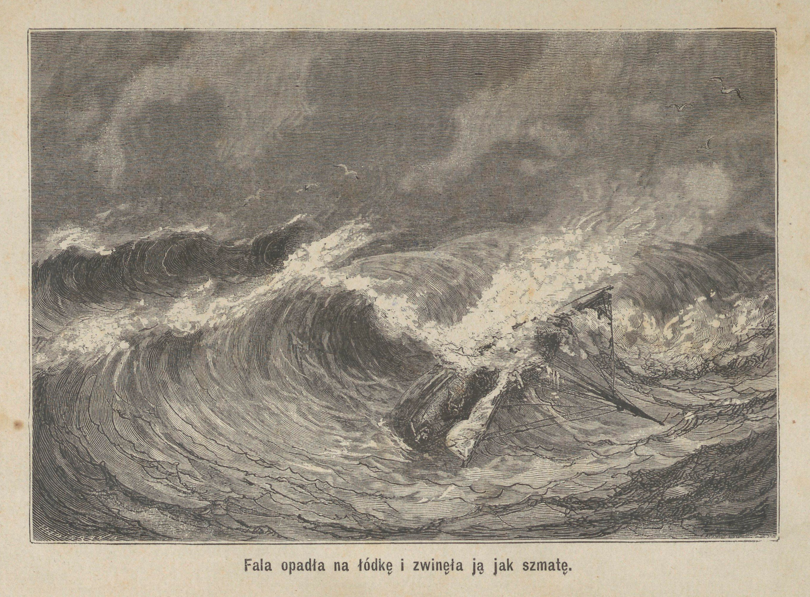

<!-- page 221 -->

Sądziliśmy, że nadchodzi ostatnia nasza chwila. Zginęlibyśmy w istocie, gdybyśmy nie byli uwiązani w swoich pokrowcach płóciennych.

Gdy bałwan przeszedł, ciężar balastu, który się nie poruszył, sprowadził pudło statku na dół i nadał barce położenie pierwotne. Byliśmy na pół uduszeni, ale wkrótce, znalazłszy się w powietrzu i oddychając pełnemi płucami, wróciliśmy do siebie.

Dwudziestego pierwszego takaż sama burza, męczarnia trwa dalej. Pomiędzy dwoma napadami wiatru ruszyliśmy z miejsca i przebyliśmy nieco drogi. Noc była straszna, między dziesiątą a jedenastą zostaliśmy, jak dnia poprzedniego, pochwyceni i skręceni falą, i tym razem dwukrotnie, w odstępie półgodziny.

Czwarty dzień nie położył jeszcze kresu naszym cierpieniom. Nie zdarzył się nam nowy wypadek, ale byliśmy w stanie opłakanym, zmoczeni wodą morską, która przeniknęła naszą odzież i której działanie gryzące dawało się boleśnie uczuwać, przeniknięci zimnem, złamani znużeniem, gdyż nie zamknęliśmy oka ani na chwilę, a zwłaszcza wyczerpani brakiem pożywienia, gdyż woda, którąśmy pili, łudziła tylko nasz głód. Jedną z najokrutniejszych naszych męczarń było może bezustanne badanie widnokręgu, zapuszczanie tam wzroku z niepokojem gorączkowym, spodziewając się zawsze dostrzedz ląd, a widząc wciąż tylko ocean wzburzony, rozciągający przed nami do nieskończoności swe fale wzburzone.

Pomimo wszystkiego, nie przestawałem utrzymywać swego dziennika. Miałem kilka arkuszy papieru zgiętych w mały format i kawałek ołówka. W dzień, gdy deszcz ustawał na chwilę, i w nocy, przy blasku lampy płonącej na spodzie statku, a która kilkakrotnie była wywróconą i zgaszoną, spisywałem swe spostrzeżenia, stan pogody i drogę, jakąśmy przebyli.

Nakoniec, rankiem dnia piątego ląd ukazał się oczom naszym. Wyspa Stewart, najmniejsza i najbardziej południowa z trzech wysp składających archipelag Nowej Zelandyi, była o kilka mil przed nami. Byliśmy w takim stanie cierpienia i zgnębienia, że co najwyżej <!-- page 222 --> doznaliśmy wrażenia radości, szybkiego i znikomego jak błyskawica. Zresztą wiatr ustał zupełnie, nie mogliśmy się już wcale posuwać, a morze, wciąż rozkołysane, miotało nami w tę i ową stronę, według woli swoich prądów. Mieliśmy wprawdzie wiosła, ale nie mieliśmy już siły ich używać: przewidywaliśmy, że będziemy uniesieni wiatrem i zginiemy przed portem.

Na szczęście, ku wieczorowi podniósł się lekki wiatr, wiejący z południa, natychmiast rozwinęliśmy wszystkie żagle i zbliżyliśmy się ku brzegowi, ale ciemność nie pozwoliła nam tam wylądować i zmuszeni byliśmy przepędzić piątą jeszcze noc na morzu.

Za dnia, połączyliśmy wszystkie swe wysiłki dla rozwinięcia na nowo żagli i o jedenastej rano wpłynęliśmy do Port-Adventure. Było to 24 lipca 1865.

Z początku widzieliśmy około siebie tylko brzegi puste; żadnych wskazówek bytności człowieka. Fala, która wchodziła do portu i wracała gwałtownie po rozbiciu się o brzeg, zmuszała nas do lawirowania; posuwaliśmy się tylko zwolna i z największym mozołem. Ręce nasze były nabrzmiałe i popękane przez podwójne działanie wody morskiej i zimna, nie mogliśmy uchwycić sznurów bez uczucia dotkliwych bóli; byliśmy zresztą zbyt wycieńczeni, aby nadawać ruch statkowi. Jeszcze kilka godzin, a pozostawało nam tylko położyć się na pokładzie statku i oczekiwać śmierci. Nakoniec gdyśmy skręcili około wystającego cypla, przedstawiła się oczom naszym mała przystań, otoczona chatami i ogrodami. Widok ten, tak pożądany, zdołał nam wydrzeć okrzyk radości.

Był to w istocie obraz zachwycający, ideał życia spokojnego i szczęśliwego. Na brzegu przechadzał się człowiek biały; wielki pies z rasy ternewów, którego głaskał od czasu do czasu, postępował obok niego. Na progu jednej z chat, grupa Maorysów (krajowców Nowej Zelandyi) w różnych postawach rozmawiała gestykulując. Kilka kobiet barwy brunatnej, w towarzystwie swych dzieci, rozciągało sieci na palisadzie dla wysuszenia ich.

Gdyśmy przyglądali się z zachwyceniem tej scenie, nagle pies dostrzegł nas i zaczął szczekać. Człowiek biały zwrócił głowę

<!-- page 223 -->

<!-- page 224 -->

<!-- page 225 -->

w nasze stronę i zrobił ruch zdziwienia na widok naszej barki i widm, które w niej siedziały. Przybiegł na brzeg morza, do miejsca, ku któremuśmy zmierzali; krajowcy, mężczyźni, kobiety i dzieci, podążyli za nim.

Jeszcze kilka chwil i przybijamy do ładu. Otaczają nasz statek. Energija gorączkowa, która nas podtrzymywała w tej walce zrozpaczonej, opuszcza nas. Alick zemdlał. Musgrave i ja mamy zaledwie siłę do wyszemrania kilku odpowiedzi na pytania do nas zwrócone.

Pomagają nam wyjść z barki, podtrzymują nas pod ramiona, gdyż nogi odmawiają nam swej służby, prowadzą nas do mieszkania Europejczyka, położonego o sto kroków od morza. Postępujemy w milczeniu, ale co do mnie, radość niezmierna, wdzięczność głęboka, wypełniają me serce.

Przybywamy, przechodzimy mały ogródek, w środku którego znajduje się dom naszego gospodarza. Z tyłu rozlega się plac obszerny, otoczony palisadą, w którym rośnie kilka drzew owocowych, młodych jeszcze; po bokach i środku jarzyny, a głównie ziemniaki. Wszystko tu oddycha spokojem, pomyślnością, szczęściem. Sam widok tego dobrobytu wzmacnia nas, odradza.

Nie zapomnę nigdy wybornego przyjęcia, jakieśmy znaleźli w tym przyjaznym domu. P. Cross, podczas gdy jego żona z czułą gorliwością zajmowała się przyrządzaniem dla nas ciepłej kąpieli z wody słodkiej, rozpytał się o nasze przygody i sam się nam w kilku wyrazach przedstawił: Anglik z urodzenia i żeglarz z powołania był jedynym białym, który zamieszkiwał Port-Adventure. Pojął młodą kobietę z tej wyspy, łagodną i uprzejmą, która mu już dała troje pięknych dzieci. Po ożenieniu się przestał podróżować i osiadł w tem miejscu, gdzie żył szczęśliwie. Zajmował się uprawą swego pola, zwłaszcza w epoce siejby i żniwa; sąsiedzi jego i przyjaciele, Maorysowie, gdy nie mieli własnej pracy, pomagali mu i otrzymywali w zamian proch, rum, tytun i inne towary tego rodzaju. Ale przez resztę roku, mając dosyć wolnego czasu i chcąc go zużytkować, oddawał się rybołówstwu. Posiadał mały kuter, mający pię<!-- page 226 -->tnaście do szesnastu beczek objętości, który nazwał Flying Scud i na którym puszczał się na połów wybornych ostryg i różnych gatunków ryb, bardzo obfitych na wybrzeżach wyspy Stewart; następnie na ich sprzedaż udawał się do Invercargill, miasteczka położonego na krańcu południowym wyspy środkowej grupy Nowej Zelandyi, z drugiej strony cieśniny Foveaux, w odległości około czterdziestu mil od Port-Adventure.

Podczas gdy po kąpieli przywdziewaliśmy, z żywem zadowoleniem, suknie suche i czyste, których nam gospodarz użyczył w miejsce naszych rzeczy nędznych, napojonych wodą morską i zesztywniałych od soli, która w nich wykrystalizowała, pani Cross przygotowywała ucztę, która była dla nas przeznaczona i której woń rozkoszna budziła w nas dziki apetyt. Po upływie kilku chwil zajęliśmy miejsce w około stołu, na który podała kotlety z wieprzowiny, przyrządzone pośpiesznie w piecu, talerz ryb, piramidę kartofli dymiących, których popękana skórka odkrywała wnętrze żółte i mączyste, i chleb, chleb gorący, dopiero co wyszły z pieca! Jakżeż pożądliwy wzrok rzucaliśmy na ten bankiet przepyszny! Zdawało mi się, że sam zdołam wszystko pochłonąć. Myliłem się. Żołądek nasz osłabiony długim postem, uczuł się prędko nasyconym i pomimo gorących napomnień dobrej naszej gospodyni, musieliśmy poprzestać na kilku kęsach. Zaledwieśmy je przyjęli, owładnął nami sen głęboki, nieprzeparty.

Obudziłem się dopiero po upływie dwudziestu czterech godzin. Gdzież byłem? Wśród miłej senności, w której pozostałem przez kilka chwil, czułem się kołysanym jakby na łonie fal. Otworzyłem oczy; spoglądając dokoła siebie, poznałem wnętrze statku i sądziłem, że to sen trwa jeszcze. Towarzysze moi, jeszcze uśpieni, spoczywali obok mnie na materacu. Widocznie, nie śniłem.

Zbierając myśli swe nieco pomięszane, podniosłem się, i podczas gdy szukałem wyjścia z miejsca, w którem się znajdowałem, towarzysze moi obudzili się z kolei. Również jak i ja zdziwieni ze znajdowania się w podobnem miejscu, szybko się podnieśli i wyszli wraz ze mną na pokład, gdzieśmy otrzymali wkrótce wyjaśnienie zagadki.

<!-- page 227 -->

Byliśmy na pokładzie Flying-Scud'a, który z rozwiniętemi żaglami wpływał do cieśniny Foveaux. Łódź nasza, przywiązana na linie, szła za kuterem. Młody Maorys trzymał ster, a p. Cross przechadzał się wzdłuż i wszerz na pokładzie małego statku.

Skoro nas tylko spostrzegł, gospodarz nasz zbliżył się do nas i przyjacielsko zapytał o zdrowie. Wyznałem mu, że co do siebie, czułem jedynie cierpienie głodu i bardziej pragnąłem nawet zaspokojenia swego głodu niż swej ciekawości. „Przypadek ten jest przewidziany, rzekł do nas, chodźcie!” I sprowadził nas do kajuty, gdzie rozłożył wkrótce na stole bogate zapasy, przygotowane na naszą intencyję przez jego żonę przed wyjazdem.

Po tej uczcie, z której tym razem lepiej skorzystaliśmy, miarkując się wszelako jeszcze nieco, połączyliśmy się z gospodarzem na pokładzie. „Teraz, rzekł do nas, winienem wam wytłomaczyć, jakim sposobem tu się znajdujecie, co, wyznaję, winno was bardzo zadziwiać. Sądziłem, w waszym interesie, że powinienem was zawieść do Invercargill, gdzie znajdziecie niezbędną pomoc lekarską, której brak zupełny w Port-Adventure, i gdzie będziecie mogli znaleść środki potrzebne dla oswobodzenia dwóch waszych towarzyszy, pozostałych na Auklandach. Sam też byłem zmuszony udać się dziś do tego miejsca, gdzie sprawy moje zatrzymają mnie kilka dni; inaczej, nie przyśpieszałbym tak bardzo tej podróży. Chciałem doczekać się waszego przebudzenia i was się poradzić, ale trzeba nam było koniecznie odpłynąć z samego rana, aby dojść do ujścia New River w czasie przypływu, a to dla raf, które nam należy przebyć. Przeniosłem was więc, przy pomocy kilku krajowców, uśpionych na pokład swego kutera, co zresztą w niczem nie zamieszało waszego snu, pięknego snu, mówiąc nawiasem, a którego wam winszuję. Spodziewam się, że ze względu na zamiar wybaczycie mi samowolność mego czynu.”

Podziękowaliśmy wybornemu temu człowiekowi, który się z nami obchodził zbyt dobrze, abyśmy go mogli podejrzywać, iż się chciał nas pozbyć, a którego postąpienie, zresztą, posługiwało wybornie naszym zamiarom.

<!-- page 228 -->

Wkrótce kuter przepłynął cieśninę Foveaux i przygotowywał się wpłynąć na New-River. Przy wejściu był szereg szkopułów podwodnych, stanowiących niebezpieczne przejście. Jakkolwiek godzina przypływu dosyć już dawno minęła, P. Cross wolał je przebyć, aniżeli czekać dnia następnego, i stanął sam u steru dla kierowania ruchami statku. Flying-Scud uderzył spodem o dno piaszczyste. W tejże samej chwili, fala, przesuwająca się obok, obróciła go prawie na bok i o mało nie wywróciła. Na szczęście, szedł dobrą drogą i przed nadejściem następnej fali przeszedł przeszkodę.

Nie tak szczęśliwie poszło biednej naszej barce. Uderzenie zerwało linę, która ją wiązała z kuterem; uniesiona prądem, wpadła na skały, które rozbiły ją w drzazgi. Tak w oczach naszych, w jednej chwili, zniszczonem zostało dzieło, które nas kosztowało tyle pracy i któremu zawdzięczaliśmy swe ocalenie. Nikt nie będzie się dziwił, żem nie mógł na widok ten spoglądać bez łez.

Płynęliśmy dalej w górę rzeki i w godzinę później dobiliśmy do debarkaderu miasta Invercargill.

<!-- page 229 -->

## ROZDZIAŁ XXII.

### MUSGRAVE WRACA NA AUKLANDY I SPROWADZA DWU NASZYCH TOWARZYSZÓW. — SPRAWOZDANIE Z TEJ PODRÓŻY. TRUP W PORT-ROSS.

Historyja nasza szybko rozgłosiła się po całem mieście i skoro tylko została poznana, znaczna liczba mieszkańców zaczęła nas odwiedzać i okazywać swe współczucie, wyprzedzano się w oddawaniu nam usług. Przyjęliśmy gościnność u p. Collyer, jednego ze znakomitszych mieszkańców, który kazał nam przygotować trzy pokoje w swym domu. Doktór Innes przybył do nas i nie chcąc przyjąć innego wynagrodzenia oprócz naszych dziękczynień, ofiarował nam najgorliwsze swe usługi.

Choroba, którą przebyłem na początku naszej podróży i która o mało nie pozbawiła mię życia na wyspie Campbell, pozostawiła mi niewielką nabrzmiałość nóg. Od tej chwili, a zwłaszcza podczas ostatnich miesięcy pobytu naszego na Auklandach, różne prace, któremi musiałem się zajmować, a zwłaszcza prace kowalskie, zmuszające mnie do bezustannego prawie pozostawania na nogach, nie przyczyniły się do mego wyleczenia. Nakoniec pięć dni i pięć nocy, jakieśmy przepędzili na statku, zmoczeni, zlodowaciali, sprowadzeni do zupełnej prawie nieruchomości, pogorszyły jeszcze chorobę. Zaledwie mogłem zrobić kilka kroków, wspierając się na kiju.

Musgrave i Alick, którzy byli budowy bardzo silnej i którzy mniej cierpieli, potrzebowali tylko nieco wypoczynku dla odzyskania swych sił.

<!-- page 230 -->

Nazajutrz po naszem przybyciu do Invercargill Musgrave udał się do oficerów, przedstawiających rząd prowincyi, dla oddania im, według praw morskich, właściwej deklaracyi o rozbiciu Graftona i dla zażądania współcześnie szybkiego wysłania pomocy dwom naszym towarzyszom, pozostałym na Auklandach.

Nie mieliśmy najmniejszej wątpliwości co do powodzenia naszych starań. Myliliśmy się. Odmówiono zadosyć uczynienia podaniu Musgrave'a. Odpowiedziano mu, że rząd w tej chwili nie jest w możności wysłania okrętu, że uczyni to później, skoro tylko będzie można. Później! a tymczasem nieszczęśliwi nasi towarzysze będą może łupem męczarń głodowych; liczyliby dnie, godziny, a rozpacz owładnęłaby nimi. Później — byłoby już za późno!

Wtedy jeden ze znakomitszych mieszkańców miasta, p. MacPherson, pochodzenia szkockiego, pewny, że szlachetne jego uczucia znajdą odgłos w sercu współobywateli, zwołał meeting, na którym natychmiast otwartą została subskrypcyja. Następnego już dnia zebrano summę dostateczną na pokrycie kosztów wyprawy do Auklandów.

Na nieszczęście nie było w tej chwili na rzece innych statków, oprócz Flying-Scuda i kilku kuterów rybackich, mniejszych i gorszych od niego. Oczekiwano wprawdzie kilku goelet, ale skoroby przybyły, potrzebowałyby jeszcze pewnego czasu na wyładowanie towarów przed rozpoczęciem nowej podróży.... a jakżeż się zdecydować na podobne opóźnienia?

Komitet przeto wybrany przez meeting postanowił po naradzie, do udziału w której zostaliśmy zawezwani, że Flying-Scud, pomimo zbyt małej na pełne morze objętości, ale z uwagi na jego trwałość i wyborne przymioty, jako statku żaglowego, zostanie przygotowany i wysłany do Auklandów. Natychmiast został zaopatrzony na dwa miesiące, nietylko w zapasy jadalne ale i w odzież, w kołdry wełniane, w lekarstwa, we wszystko, co uważano za potrzebne.

P. Cross był żeglarzem praktycznym, umiał doskonale manewrować swym kuterem i unikać niebezpieczeństw, dopóki nie tracił z widoku wybrzeży, ale był niezdolnym — sam to pierwszy wyzna<!-- page 231 -->wał — do puszczania się na otwarte morze. Trzeba więc było koniecznie dodać mu oficera doświadczonego. To wytworzyło znowu trudność dosyć ważną i nie było nikogo, coby mógł spełnić to zadanie.

Nikogo, oprócz Musgrave'a, który w tej okoliczności dał dowód odwagi i poświęcenia, do której niewielu ludzi byłoby zdolnych. Zaledwie wypocząwszy po swem zmęczeniu, cierpiący jeszcze na wrzód, jaki miał niedawno na ramieniu, ofiarował się sam objąć sternictwo małego statku i udać się na oswobodzenie dwóch biednych jeńców.

Ulegając uczuciu ludzkości, szlachetne to serce umiało przytłumić gorące życzenie, jakie je pędziło do jego rodziny ukochanej, a zaledwie wyszedłszy z uścisków śmierci, był gotów znów na nią się narażać dla spełnienia tego, co uważał za święty swój obowiązek! Każdy inny wyraz, oprócz bohaterstwa, byłby niegodnym do oznaczenia tego postępowania, a użycie go w tem miejscu wywołuje żywą we mnie radość.

W pięć dni po naszem wylądowaniu ściskałem rękę mego przyjaciela, a przeniknięty wzruszeniem, które z trudnością powstrzymywałem, widziałem go odjeżdżającym na Auklandy na małym statku, wpośród okrzyków rozentuzyjazmowanego tłumu, który mu towarzyszył i który zapełniał wybrzeże.

Dwa tygodnie, trzy tygodnie upływają. Podtrzymywany z jednej strony przez Alicka, który mi podaje ramię, z drugiej wspierając się na lasce, codziennie przepędzam większą część dnia na debarkaderze, gdzie za pomocą dalekowidza rozpatrujemy każdy punkt biały, jaki się zjawia na widnokręgu, w nadziei rozpoznania Flying-Scud'a, i każdego wieczora wracamy smutniejsi do naszego gospodarza, p. Collyer'a.

Cały miesiąc przeszedł w ten sposób, potem znów dwa tygodnie, i znów cały tydzień. Było wiele burz: czyżby się miało przytrafić nieszczęście małemu statkowi i naszym dzielnym przyjaciołom? Mieszkańcy miasta dzielą nasz niepokój; ci, co rozwinęli najwięcej gorliwości w tej sprawie, żałują gorzko, że zezwolili Mus<!-- page 232 -->grave'owi iść za szlachetnym jego popędem. Niektórzy mówią już o uorganizowaniu drugiej wyprawy, mającej się zająć zbadaniem losu pierwszej.

Zaczęto już przedsiębrać środki konieczne, gdy pewnego ranka strażnik, stojący na skale przy wejściu do New-River, sygnalizuje o nadejściu kutera. Zbliża się.... to Flying-Scud.

Pomyślna wiadomość rozchodzi się po mieście. Po smutku, który ciążył na wszystkich umysłach, następuje radość powszechna, a tłum, jak w dniu wyjazdu, udaje się gromadnie na wybrzeże, aby ujrzeć przybywający mały statek i uczcić okrzykami powrót odważnego naszego przyjaciela.

Oto jest, wylądowuje; Jerzy i Henryk są z nim razem!

Nie, nigdy nie zapomnę niezmiernej radości, jakąśmy uczuli, znajdując się znowu w pięciu, zdrowi i nienaruszeni, na gościnnej ziemi. Rzuciliśmy się z uniesieniem nawzajem w swoje objęcia; mogliśmy zaledwie wymawiać jeden tylko wyraz: ocaleni, ocaleni!

Chciano obnosić Musgrave'a w tryjumfie, ale również skromny jak dzielny, sprzeciwił się temu energicznie, i w towarzystwie licznego orszaku udaliśmy się do mieszkania p. Collyer'a, gdzie wieczorem miało miejsce zebranie. Z niecierpliwością oczekiwaliśmy od Musgrave'a szczegółów o jego podróży; oto jego opowiadanie:

„Przypominacie sobie, powiedział nam, żeśmy rozwinęli żagle przy wietrze pomyślnym, wiejącym z płd.-zach., ale zaledwieśmy się nieco oddalili, gdy wiatr, skręcając najpierw na zachód, potem na południe, stał się nam zupełnie przeciwnym. Zmuszeni byliśmy zatrzymać się w Port-Adventure, gdzieśmy pozostali przez ośm dni.

„Mogliśmy nakoniec podnieść kotwicę i posuwać się szybko ku grupie wysp Snares, którąśmy już rozpoznawali na widnokręgu, gdy znów podniósł się silny wicher i zmusił nas do powrotu. Wskutek zboczenia busoli Flying-Scud'a zbłądziliśmy. W chwili, gdyśmy powinni byli dotknąć wyspy Stewarta, znaleźliśmy się od niej odlegli o 60 mil. Gdy słońce ukazało na chwilę swą tarczę z poza chmu<!-- page 233 -->ry mniej gęstej, zdołałem za pomocą sekstansu dosyć ściśle oznaczyć nasze położenie; zwróciłem przód statku na wschód i schroniliśmy się do Paterson's Inlet, — jestto długa przestrzeń wody, tworząca dobry port na brzegu wschodnim wyspy Stewart. Tam zaopatrzyłem się w busolę, która mi chętnie pożyczył p. Lavrie, Szkot z pochodzenia, osiadły w tem miejscu, gdzie buduje i sprzedaje statki rybakom okolicznym. Poznałem tam też ciekawą osobistość, Toby Maorysa, którego ziomkowie uważają za swego naczelnika i przyznają mu władzę najwyższą nad wyspami Stewart i Roebuck. Dziki ten, o skórze miedzianej, o wzroście atlety, ma charakter bardzo łagodny i daje dowody wybitnej inteligencyi. Przeważnie mieszka na mniejszej ze swych dwu wysp, na Roebuck, gdyż lubi towarzystwo misyjonarzów, którzy przed kilku laty założyli tam osadę, złożoną z plebanii, kaplicy i szkoły. Jakkolwiek już ma lat czterdzieści pięć, nauczył się po angielsku i dosyć łatwo mówi tym językiem. Zrozumiał wyższość tych Europejczyków i korzyść, jaka może on i plemię jego osiągnąć, jeżeli się będą względnie obchodzili z tem szczupłem towarzystwem ludzi dobrych, spokojnych, cnotliwych, wykształconych w sztukach i naukach, przedstawicieli cywilizacyi, której doniosłości nie pojmuje, ale przed którą skłania się z naiwnym podziwem.

„Podczas pięciu dni, któreśmy przepędzili w Patersons-Inlet, zatrzymani niepogodą, Toby, jakkolwiek przyzwyczajony do dzikiego życia wpośród lasów, szukał naszego towarzystwa. Często odwiedzał nas na pokładzie kutera, albo wieczorem u p. Lavrie. Przysłuchiwał się rozmowie naszej z zaostrzoną uwagą; niekiedy mieszał się do rozmowy i byłem uderzony słusznością jego uwag, wypowiadanych zawsze stylem obrazowym i malowniczym.

„Znając cel mojej podróży, udzielił mi kilka uwag szacownych. Powiedział mi, że zwiedził niegdyś wyspy Snarskie w celu połowu fok i zapewnił mnie, że na brzegu wschodnim największej z tych wysp znajduje się mała przystań, gdzie okręt niewielkich rozmiarów, jak nasz, mógłby w razie potrzeby znaleść wyborne schronienie. Gdyby burza zaskoczyła nas znowu, mielibyśmy tam, w poło<!-- page 234 -->wie drogi, port ochronny, coby nas oswobodziło od potrzeby cofania się aż na wyspę Stewart.

„Gdy wicher się uspokoił, wstrzymywała nas cisza zupełna, to znów wiatr południowy. Nakoniec, dwudziestego dnia po opuszczeniu Invercargill, wiatr, przyjawszy kierunek z północy, pozwolił nam pożeglować ku Auklandom. Trzeciego dnia przebyliśmy liniję szkopułów, która ogranicza grupę od północo-zachodu, i żeglując wzdłuż brzegu, skierowaliśmy się ku portowi Carnleya. Podczas tej drogi zdawało nam się, iż widzimy lekki obłok dymu na grzbiecie jednej góry, panującej po nad skałami brzeżnemi. Przez chwilę obawiałem się, czy Jerzy i Harry, porzuciwszy chatkę, nie zapuścili się aż tam, coby nam utrudniło ich odszukanie. Ale możeśmy się mylili; cośmy wzięli za dym, może było tylko pozostałością mgły, uczepioną u jakiego urwiska górskiego.

„Wejście nasze do zatoki Carnleya było zaciętą walką z wiatrem, istnem pasowaniem się, które trwało trzy długie godziny. Silne powiewy, przepełnione szronem i drobnym gradem, biczowały nas po twarzy. Mały jednak Flying-Scud rozwinął znakomite przymioty, jako szybki statek. Żeglował wśród wichru z zadziwiającą chyżością. Przód jego wyrywał snopy wody, które nas obryzgiwały i oślepiały. Byliśmy wszyscy na pokładzie, każdy na swem stanowisku; ja stałem na przodzie, gotów do dania rozkazu zmiany kierunku statku. P. Cross był u steru, a dwaj majtkowie, stanowiący naszą załogę, trzymając sznury w rękach, gotowi byli w każdej chwili do spuszczenia żaglów, gdyby nawałnica zbyt gwałtowna groziła strzaskaniem masztu, który się giął jak trzcina, albo wywróceniem kutera, który chwilami był prawie zupełnie na bok przechylony. Nakoniec, wyczerpani zmęczeniem, dosięgnęliśmy Camp-Cove i byliśmy uszczęśliwieni, gdyśmy mogli zapuścić kotwicę na spokojnych wodach przystani.

„Nazajutrz rano, gdy burza się uspokoiła, dostaliśmy się do zatoki Rozbicia, gdzieśmy się zatrzymali wobec szczątków starego Graftona. Okrążywszy dopiero cypel Raynal'a, dostrzegliśmy chatę. Lekki dym unosił się po nad rurą komina, — widok ten oswo<!-- page 235 -->bodził nas od wszystkich obaw: towarzysze nasi byli przy życiu i nie opuścili Epigwait.

„Mała łódź kutera została spuszczoną na morze; zająłem w niej miejsce wraz z p. Cross, a kilka uderzeń wiosłem doprowadziło nas do brzegu. Henryk dostrzegł nas pierwszy. Podniósł ręce ku niebu, wydał okrzyk dla wezwania swego towarzysza i padł na ziemię, zemdlony. Jerzy wyszedł z chaty, zobaczył nas z kolei i przybiegł do nas. „Mój kochany kapitanie, mój kochany Musgrave, powtarzał, jak jestem szczęśliwy!” I nie mógł się oderwać od rąk moich. Miał oczy przepełnione łzami. Widocznie toczyła się w nim jakby walka o pierwszeństwo między jego sercem a radością, — czyż nie tak, Jerzy?

„Wkrótce jednak dzielny chłopiec przyszedł do siebie i pomógł mi zająć się Henrykiem, którego omdlenie wciąż trwało, jakkolwiek p. Cross skropił mu twarz wodą słodką, zaczerpniętą z pobliskiego strumyka w kapelusz z płótna woskowanego. Długo usiłowania nasze były bezowocne; nakoniec biedny Henryk wydał westchnienie, otworzył oczy i odzyskał mowę. Pozostał jednak osłabionym przez kilka dni wskutek tego gwałtownego wstrząśnienia.

„W kilka chwil później byliśmy wszyscy na pokładzie statku, w drodze do Camp-Cove, gdzie w pół godziny później staliśmy spokojnie na kotwicy.

„Istotnie rozkosznym, zapewniam was, był widok dwu naszych biednych towarzyszów, którzy podczas drogi przywdzieli nową odzież, jak zajadali chciwie suchary i ziemniaki, które kucharz kutera przyrządził na wieczerzę. Gdy się nasycili, rozmawialiśmy. Powiedzieli nam, że są zarówno zdziwieni jak i uszczęśliwieni, widząc nas, że uważali nas za zgubionych; — natychmiast po odjeździe naszym na barce, nastąpiła gwałtowna nawałnica; sądzili, iż niepodobna nam było uniknąć zatonięcia. Co do nich, straciwszy wszelką nadzieję pomocy, byli bardzo nieszczęśliwi, nigdy tyle nie cierpieli; umysł ich, obłąkany cierpieniem, podsuwał im najdziwaczniejsze postanowienia....”

<!-- page 236 -->

Tu Jerzy podniósł się nagle i przerwał Musgrave'owi.

„Nie powiedział wam wszystkiego, wykrzyknął, rumieniąc się aż po oczy. Kłóciliśmy się i raz biliśmy się nawet. Chcieliśmy się rozdzielić i prowadzić życie odosobnione. Ale to z mojej winy, wyznaję, i z największą goryczą wspominam o tem, co zaszło.”

„Wcale nie tak, inaczej się rzecz miała, dodał natychmiast Henryk, podnosząc się z kolei i ściskając rękę swego przyjaciela. Ja to byłem w gniewie i ja rozpocząłem bójkę.”

Anglik utrzymywał, że on sam tylko był winien, Portugalczyk przeczył mu i oskarżał się dalej; oboje tych wielkich dzieci, jednakowo szlachetnych, rozpoczynało znów sprzeczkę, aby nam dowieść, że każdy z nich był pierwszym winnym. Zaczęliśmy się wszyscy śmiać i nieco zmieszani, zasiedli znowu, pozwalając Musgrave'owi kończyć jego opowiadanie:

„Pospieszając wrócić do Invercargill, podnieśliśmy nazajutrz kotwicę, choć pogoda nie bardzo sprzyjała. Za zbliżeniem nocy, gdy wiatr ochłódł, a barometr opadł, uważaliśmy za stosowne zatrzymać się w Port-Ross czyli Sarah's bosom. Byłem zresztą dosyć zadowolonym ze sposobności zwiedzenia tej zatoki. Długa i wązka, kieruje się ona naprzód ku południowi, na długości siedmiu do ośmiu mil, potem zwraca się nagle pod kątem prostym ku zachodowi. W tej to ostatniej części, której nadał swe nazwisko kapitan Lawrie, zarzuciliśmy kotwicę.

„Nazajutrz zbadaliśmy wybrzeże i znaleźliśmy szczątki osady, założonej przed siedmnastu laty przez pp. Enderby z Londynu i opuszczonej w dwa lata później. Wpośród lasku, niedaleko od brzegu, widzieć można pewną ilość chat drewnianych, zapadniętych, na pół rozwalonych. Każda z nich znajduje się wpośrodku małej przestrzeni gruntu, otoczonej zniszczoną palisadą, która była zapewne ogrodem. Pomiędzy roślinami zdziczałemi, które owładły gruntem, można rozróżnić niektóre okazy naszych roślin warzywnych, których nasiona, jak sądzę, zostały sprowadzone niegdyś z Europy przez kolonistów. Biedne te rośliny w klimacie tak niewdzięcznym <!-- page 237 --> zupełnie się wyrodziły, wróciły do stanu dzikości; są twarde, łykowate, bez smaku; soczysta miazga prawie cała zamieniła się w włókna drzewiaste.

„Przebiegając te rozwaliny, przybyliśmy przed chatę mniej zniszczoną od innych: dach jej widocznie zapadł się niedawno. Zaledwieśmy tam weszli, cofnęliśmy się z przerażenia, albo raczej ze zgrozy. W jednym kącie zabudowania, dostrzegliśmy trupa. Był to trup mężczyzny, którego śmierć mogła nastąpić przed kilku miesiącami.

„Pokonawszy pierwsze uczucie wstrętu, zbliżyliśmy się. Ciało tego nieszczęśliwego złożonem było na łóżku z desek, pochodzących widocznie z pudła okrętu; złożone były na kilku krąglakach i pokryte warstwą mchu, stanowiącą materac. Ramiona wyciągnięte wzdłuż ciała i palce rąk, które pozostały wydłużonemi, zdawały się wskazywać śmierć spokojną i jakby zrezygnowaną. Jedna noga zwieszała się nieco z łóżka, druga spoczywała na niem w całej długości. Stopa prawa obuta była w trzewik, lewa, prawdopodobnie zraniona, owinięta była bandażem. Ubiór był majtka; nadto, kilka sukien, między któremi leżało okrycie ceratowe, leżało rozciągniętych na ciele w miejsce kołdry.

„W pobliżu łóżka, na ziemi, widziano zbiór skorup mięczaków z rodzaju Patella, tych mięczaków tak pospolitych, które się znajdują przy odpływie morza uczepione do skał. Obok umieszczone były dwie butelki szklane, jedna napełniona jeszcze wodą słodką, druga próżna.

„Nakoniec na samem łóżku znaleźliśmy kawałek łupku, na którym napisanych było kilka wierszy; obok leżał klucz, który służył do ich skreślenia. Próbowaliśmy odcyfrować te wiersze, ale nie mogliśmy dojść do końca. Były starte przez deszcze i wiatry. Zresztą musiały być napisane drżącą ręką umierającego. Jeden tylko wyraz był nieco czytelny: było to imię James, stanowiące część podpisu; część druga, uzupełniająca go, odpowiadała dosyć dobrze kształtem i liczbą lasek nazwisku Right, ale nie możnaby tego twierdzić na pewno. Sprowadziłem ten łupek; pokażę go wam.

<!-- page 238 -->

„W jakiż sposób trup ten tam się znajdował? Mogliśmy rozwiązać to pytanie jedynie tylko przypuszczeniami. Niezawodnem było, że statek jakiś rozbił się w Port-Ross lub w okolicach. Być może, załoga cała, z wyjątkiem jednego tylko człowieka, zatonęła: ztądto pochodziły te suknie, które pozostały przy życiu zebrał i nagromadził na sobie dla ochronienia się od zimna. Albo też kilku rozbitków dostało się do brzegu i nie znalazłszy w Port Ross czem się żywić, posunęli się w głąb wyspy; dym, któryśmy dostrzegli na górze, mógł być wskazówką ich obecności. Jeden z nich, ranny w nogę, zmuszony był pozostać za nimi, sam jeden; osiadł w jednej z chat, której dach nie był jeszcze zawalonym; nie mogąc polować na lwy morskie, żył jakiś czas mięczakami i nakoniec umarł z głodu.

„Biedne te, opuszczone zwłoki przejmowały nas żywą litością. Odnieśliśmy ten wypadek bardzo naturalnie do siebie; pomyśleliśmy, że los tego nieszczęśliwego mógł być i naszym udziałem. Nie chcieliśmy pozostawić ciała bez pochowania. Nazajutrz wykopaliśmy dół i pogrzebaliśmy je. Odmówiwszy kilka modlitw nad grobem, postawiliśmy tam krzyż drewniany.

„Nakoniec w różnych miejscach wznieśliśmy stosy świeżego drzewa, któreśmy zapalili, w nadziei, że wywiązujące się ztąd kłęby dymu ściągną uwagę innych rozbitków, jeżeliby się znajdowali w okolicach; aleśmy nie osiągnęli żadnego rezultatu. Jednakowoż nie jestem przekonany dostatecznie, czy nikogo nie ma na wyspie; nie mogliśmy przeprowadzić należytych poszukiwań i wyznaję, że wątpliwość ta mię dręczy. Myśl, że istnieją tam nieszczęśliwi, którzy cierpią toż samo, cośmy przecierpieli, ściga mnie bez ustanku.

„Nareszcie, gdy wiatr zwrócił się na południe, podnieśliśmy kotwicę, i czterdziestego dziewiątego dnia po naszym wyjeździe z Invercargill, wspierani, jakeście widzieli, silnym przypływem, wpłynęliśmy na New-River.”

<!-- page 239 -->

# ROZDZIAŁ XXIII.

**ODJAZD DO SYDNEY. — WYPOCZYNEK W PORT-CHALMERS. — WYTŁOMACZENIE TAJEMNICY Z PORT-ROSS. — POWRÓT MÓJ DO FRANCYI.**

Następnego zaraz dnia po swym powrocie do Invercargill, Musgrave zdał raport urzędowy rządowi prowincyi, który tym razem uważał za swój obowiązek wysłanie statków dla zbadania Auklandów. Przesłano natychmiast do Otago rozkaz przygotowania parowca South-Land, który się znajdował na kotwicy w tym porcie. Ale wyprawa ta opóźniła się tak dalece, że, jak to zobaczymy dalej, dała się wyprzedzić innej, wysłanej z Melbourne.

Rano poprowadził mnie Musgrave na pokład Flying-Scuda; miał on, jak mówił, coś mi pokazać, jakąś dla mnie niespodziankę. Byłem w istocie zdziwiony i zachwycony, zobaczywszy swój miech kowalski, który mój szlachetny przyjaciel mi przywiózł; kosztował mnie on tyle wysiłków i czyż w znacznej części nie był sprawcą naszego oswobodzenia? Przeniesiono go na ląd. Wszyscy mieszkańcy Invercargill odwiedzili go; nigdy miech nie odbierał tylu honorów.

Miałem już tylko jedno życzenie, ujrzenia swego kraju i swej rodziny i spoczęcia między swymi po tylu przygodach, po tylu trudach. Właśnie goeleta Sword-fish, należąca do P. Mac-Pherson i dowodzona przez kapitana Rappa, rodem holendra, złożyła swój ładunek i przygotowywała się do opuszczenia Invercargill <!-- page 240 --> i powrotu do Melbourne. P. Mac-Pherson był łaskaw ofiarować nam miejsce na swym okręcie: pośpieszyliśmy przyjąć jego ofiarę, przynajmniej Alick, Henryk i ja, gdyż Jerzy wolał pozostać w Nowej Zelandyi, w zamiarze zwiedzenia bogatych łożysk złota, które tam niedawno odkryto. Co do Musgrave'a, to on obrał parowiec z portu Bluff, bliskiego New-River, a którego kapitan, jeden z dawnych jego przyjaciół, znaglił go do jechania ze sobą.

Odjechałem więc z Henrykiem i Alickiem na Sword-fish. Droga, przynajmniej z początku, była bardzo nieszczęśliwą. Powinna się była odbyć w ciągu dwu tygodni, trwała zaś trzy miesiące. Gdyśmy wypływali z cieśniny Foveaux, zostaliśmy napadnięci przez wiatr zachodni bardzo gwałtowny, który nas zmusił do cofnięcia się i schronienia do portu William, położonego na północy wyspy Stewart. Zmuszeni byliśmy zatrzymać się tam cały tydzień. Gdyśmy rozwinęli żagle, aby się wydobyć na pełne morze, ulegliśmy temuż losowi, trzeba było na nowo cofnąć się przed uraganem. Majtkowie uważali goeletę za zaczarowaną; mówili, że należy poszukać Jonasza, którego obecność na pokładzie wywołuje burze, i pozbyć się go, nie przez wrzucenie w fale, lecz przez wysadzenie na ląd. Trzecie nasze usiłowanie wyjścia z cieśniny było jeszcze fatalniejszem. Uderzenie morza wyrwało dwoje drzwiczek, prowadzących na spód okrętu, zalało kajutę i rzuciło goeletę na bok: wywróciłaby się zupełnie, gdybym nożem swoim nie odciął na czas sznura wielkiego żagla. Byliśmy zmuszeni wrócić dla naprawy statku do Port-Chalmers, co nam zabrało miesiąc z górą.

Przy końcu pobytu mego w tym porcie doznałem jak najprzyjemniejszej niespodzianki. Pewnego dnia ujrzeliśmy przybywającą do przystani korwetę parową Victoria; — Musgrave był na pokładzie! Oto wskutek jakich okoliczności: szczęśliwszy od nas, przybył do Melbourne w ciągu ośmiu dni. Uściskawszy żonę swą i dzieci, które, zawiadomione o jego powrocie, przybyły do Sydney dla połączenia się z nim, pośpieszył donieść agentom rządowym o odkryciu swojem trupa w Port-Ross i o możliwem istnieniu żyjących jeszcze rozbitków na wyspie. Postanowiono natychmiast wysłać <!-- page 241 --> do Auklandów korwetę parową kolonijalną Victoria, dowodzoną przez kapitana Normana z marynarki angielskiej. Kolonije Nowej Walii południowej i Brisbane chętnie wzięły udział w szlachetnem tem dziele, ofiarowawszy część kosztów wyprawy. Korweta miała też zwiedzić wyspy Campbell, Antypod, Bounty, dla zabrania tych wszystkich, których klęska morska mogła tam wyrzucić.

Zaproponowano Musgrave'owi towarzyszenie kapitanowi Norman, w charakterze sternika. Jakem to już powiedział, na utrzymanie swoje i swoich miał tylko zawód marynarza, nadto, więcej niż ktokolwiekbądź czuł się na siłach do spełnienia tego użytecznego posłannictwa: przyjął je.

W tydzień przeto po wyładowaniu swojem odpłynął do Auklandów, ale tym razem znajdował się na okręcie pierwszorzędnym, dowodzonym przez wybornych oficerów, posiadającym liczną załogę i mającym w żaglach i parze podwójny środek stawienia czoła niebezpieczeństwom tej podróży. Przez trzy tygodnie zwiedzano z najtroskliwszą uwagą trzy wyspy grupy i nie znaleziono nic, coby wskazywało obecność rozbitków na którejkolwiek z nich. Zbadanie wysp Campbell, Bounty i Antypod nie wydało lepszych rezultatów. Wtedy kapitan Norman zwrócił się z powrotem do Melbourne; ale po drodze zatrzymał się w Port-Chalmers dla odnowienia zasobu węgla.

Rzecz dziwna, ja to oświeciłem Musgrave'a co do tajemniczej historyi trupa z Port-Ross. Przypadek dostarczył mi wyjaśnienie. Przed dwoma dniami przybyła poczta z Anglii do Dunedin, stolicy prowincyi Otago, w pobliżu Port-Chalmers. Wystarałem się o dziennik angielski, i przebiegając go, wpadłem na artykuł zatytułowany: „Sprawozdanie z rozbicia okrętu Invercauld na wyspach Auklandzkich przez kapitana Dalgarno". Odczytałem to opowiadanie z żywem wzruszeniem[^1]. Oto jego treść.

[^1]: Na końcu dzieła podajemy to sprawozdanie w tłumaczeniu polskiem.

<!-- page 242 -->

Invercauld był statkiem o 1100 beczkach objętości, mającym dwudziestu pięciu ludzi załogi, licząc w to kapitana, p. Dalgarno, i jego pomocnika. Odpłynął z Melbourne 21 lutego 1864 i udawał się do Valparaiso. 3 marca, o drugiej rano, silny wicher rzucił go na rafy, które okalają brzeg północny wysp Auklandzkich; został tam rozbity na drzazgi. Siedmnastu majtków, wraz z dwoma oficerami, zdołało dostać się do brzegu; sześciu ludzi znaleziono martwych na skałach. Rozbitkowie, wdarłszy się na skały nadbrzeżne i zszedłszy po stoku przeciwległym, dostali się na wybrzeże Port-Ross. Pozostali tam kilka dni; ale nie mając tam czem się żywić, podzielili się na kilka oddziałów, które się rozproszyły po wyspie. Kapitan Dalgarno, który pozostał w Port-Ross ze swym pomocnikiem i czterema majtkami, sądził, że musieli wyginąć, wycieńczeni trudem i głodem.

Co do niego i jego pięciu towarzyszów, to żyli oni przez kilka miesięcy mięczakami, rybami, szczęśliwi, gdy napotkali lwa morskiego. Spali pod pniami drzew, jak zwierzęta. Następnie, z wysuszonych skór fok i gałęzi drzew wybudowali piróg, przepłynęli cieśninę i osiedli na wyspie Enderby, gdzie znaleźli pewną ilość królików, które im dały możność przedłużenia sobie bytu.

Jednakowoż trzech majtków zmarło i kapitan miał już tylko dwu towarzyszów. Zbudowali sobie małą chatkę, podobną do chat Eskimosów. Od czasu do czasu przepływali cieśninę w swym pirogu i wracali do Port-Ross, w nadziei znalezienia tam lwów morskich lub też odkrycia jakichkolwiek śladów zaginionych swych towarzyszów.

Dwanaście miesięcy przeszło w ten sposób. Pewnego dnia, nakoniec, bryg hiszpański, przybywający z Chin i udający się do Chili, wpłynął do zatoki, szukając w niej schronienia. Trzej rozbitkowie wycieńczeni i chorzy, zostali zabrani i zawiezieni do Valparaiso, zkąd kapitan Dalgarno wrócił do Anglii.

Łatwo mogłem wnieść z tego opowiadania, że nieszczęśliwy James Right (takiem było w istocie jego nazwisko, przekonałem się <!-- page 243 --> o tem, przeglądając listy marynarki w Melbourne) był jednym z tych, którzy się najpierw oddzielili od kapitana Dalgarno. Wkrótce po odjeździe tego ostatniego na brygu hiszpańskim, wrócił zapewne do zatoki, spodziewając się ich tam odnaleźć; widział zapewne swych towarzyszów umierających z nędzy w jakimś zakątku wyspy. Ranny w nogę wskutek nadzwyczajnego zmęczenia, albo też w upadku, niezdolny dłużej zaspakajać swe potrzeby, zrozpaczony samotnością, położył się i oczekiwał śmierci, opisawszy smutne swe dzieje na łupku znalezionym obok niego.

Opłakane te wypadki miały miejsce od miesiąca marca 1864 do tegoż miesiąca 1865. Tak więc, kiedyśmy się znajdowali na wybrzeżu portu Carnleya, inni rozbitkowie znajdowali się w części północnej wyspy! Tak blisko jedni drugich, nie wiedzieliśmy nawzajem o swej obecności, odosobnieni górami urwistemi, otoczonemi mgłą, słowem nieprzebytemi!

A my, którzyśmy opłakiwali swój los, względnie do tych nieszczęśliwych byliśmy w korzystnem położeniu. Mogliśmy żyć i zostaliśmy ocaleni wszyscy pięciu, podczas gdy wpośród nich z dziewiętnastu aż szesnastu uległo cierpieniom, a trzech tylko przeżyło!

Po upływie tygodnia Victoria odpłynęła i myśmy też opuścili Port-Chalmers na Sword-fish'u. Tym razem droga była szczęśliwa i szybka. Przybyliśmy do Melbourne w kilka tylko dni po korwecie.

Słaby jeszcze i cierpiący, zmuszony tam byłem pozostać czas jakiś dla wyleczenia się; odnalazłem tam Musgrave'a, szczęśliwego na łonie swej rodziny; on zajmował w biurach marynarki urząd, który mu pozwalał żyć spokojnie obok swoich. Dowiedziałem się następnie, że, straciwszy swego syna najstarszego, który utonął w wodach zatoki, opuścił Australiję i połączył się ze starymi swymi rodzicami w Ameryce. Oddają się tam wszyscy razem uprawie rozległego gruntu, położonego w pobliżu Missouri, który nabrał znacznej wartości, dzięki bliskości jednego z tych miast nowych, których rozwój jest tak nagłym w tym cudownym kraju.

<!-- page 244 -->

Alick nie zaprzestał służby w żegludze. W miesiąc po naszem przybyciu do Melbourne zaciągnął się jako majtek na pakiebot angielski i odpłynął do Liwerpolu.

Henryk połączył się z jednym ze swych wujów, który osiedlił się o dwieście mil od Sydney, wewnątrz lądu, zajmując się hodowlą owiec. Zamieszkał stale przy nim i pomaga mu w jego zajęciach. Pożegnał morze, które, co prawda, nie było dlań przyjaznem.

O Jerzym nie miałem żadnych wiadomości. Nie wiem, czy pozostał w Nowej Zelandyi i czy mu się powiodło w nowem rzemiośle poszukiwacza złota.

Co do mnie, gdym odzyskał siły, opuściłem Melbourne, unosząc najmilsze wspomnienie dowodów przychylności, jakich podczas mego pobytu w tem mieście nie szczędzili mi mieszkańcy. Objawili życzenie posiadania mego miecha kowalskiego, z którym się dotąd nie rozdzieliłem; dałem im go; równie jak i parę trzewików ze skóry foki i kilka drobnych przedmiotów, wyrobionych przezemnie na Auklandach. Skromne te przedmioty dostąpiły znakomitego zaszczytu; wystawione są obecnie, jako ciekawości, w muzeum melburnskiem.

Przybywszy do Sydney, przedstawiłem się naszym spólnikom. Miałem względem nich nietylko uczucie osobiste do zaspokojenia, ale i czyn sprawiedliwości do spełnienia. Wyrzucałem im w surowych wyrazach srogą obojętność, z jaką nas opuścili, występne zapomnienie ich zobowiązań. Nie zaniedbali oczywiście przytaczać różne usprawiedliwienia i niemożliwość wysłania drugiej wyprawy, z powodu bardzo złego stanu interesów, niepowodzenie swych zabiegów u komodora Wisemana, który zarządzał wtedy stacyją angielską na tych morzach. Wiedziałem, że w istocie zwrócili się do niego, ale dopiero po upływie trzynastu miesięcy; odpowiedziano im z większą logiką niż ludzkością, że teraz jest już zapóźno, że oddawna już zapewne nie należymy do tego świata.

Zmuszony byłem czekać, dopóki pora nie będzie przyjazna do opłynięcia przylądka Horn. Nakoniec, 6 kwietnia 1867, odpłynąłem <!-- page 245 --> z Sydney na okręcie John-Masterman, który się udawał do Londynu, i 22 sierpnia, po pomyślnej podróży, — zbyt pomyślnej jak dla mnie, a zwłaszcza zbyt długiej, — wpływałem na Tamizę. W kilka dni później, z sercem przepełnionem radością, wyładowałem we Francyi. Stąpałem znów wreszcie po ziemi ojczystej.... Dwadzieścia już lat upłynęło, od czasu gdym ją opuścił.

<!-- page 246 -->

# DODATEK.

## I.

### Sprawozdanie z rozbicia się okrętu Invercauld na wyspach Auklandzkich, przez kapitana Dalgarno.

„Odpłynęliśmy z Melbourne do Valparaiso 21 lutego 1864 roku na okręcie Invercauld, obejmującym 1100 beczek objętości. Załoga nasza składała się z dwudziestu pięciu osób, licząc w to oficerów. Nie mieliśmy pasażerów.

„Wieczorem 3 marca dostrzegliśmy grupę Auklandów w odległości mniej więcej mil dwudziestu. Mgła, która z nastąpieniem nocy coraz się bardziej zagęszczała, nie dozwoliła nam widzieć ich wcześniej. Nagle wiatr płn. zach., który nas aż dotąd prowadził, został zastąpiony przez zupełną ciszę, a ta w tych okolicach zawsze jest złowróżbną. Trwała ona tylko kilka godzin, podczas których byliśmy na łasce silnych prądów morskich, czyniących dostęp do tych wysp nader niebezpiecznym. Nieznacznie doprowadziły nas one do lądu.

Spadek nagły barometru sprawiał mi wiele niepokoju. Wkrótce po zachodzie słońca niebo powlekło się czarnemi i grubemi chmurami, które zwiastowały burzę. Około północy zerwał się nagle wiatr <!-- page 247 --> gwałtowny, idący od zachodu; wprowadził on nas w położenie nader krytyczne. Byliśmy wtedy blisko wybrzeża, odległego o dwie mile mniej więcej i okolonego w tem miejscu niezmiernemi skałami, o które potężne fale oceanu Spokojnego rozbijały się z wściekłością.

Rozwinęliśmy na okręcie tyle żagli, ile tylko było możebnem, ale, mimo wszystkich wysileń, poznałem wkrótce, że zguba nasza na tych skałach była nieuniknioną. W istocie, o drugiej z rana, straszne uderzenie powaliło maszty na pokład. Chwila fatalna nadeszła. Invercauld uderzył o szkopuł, niezbyt odległy od ogromnej skały. Blisko tego miejsca znajdowała się mała przystań, gdzie skały były mniej wzniesione i która ściągnęła całą naszą uwagę. Bezużytecznem było myśleć o ocaleniu statku, który też wkrótce został na kawały rozbity o przyległe skały.

Dotarłem wpław do brzegu małej przystani i uczepiłem się skał ze wszystkich sił, które mi pozostawały. Kilku majtków, którzy przybyli przedemną, pomogli mi wydobyć się z tego niebezpiecznego położenia i dostać się na brzeg. Od czasu do czasu inny jakiś nieszczęśliwy przy podobnej pomocy łączył się z nami; skoro dzień nadszedł, przeliczyliśmy się: było nas dziewiętnastu. Kilku z pomiędzy nas było zranionych, inni mniej lub więcej ciężko potłuczeni.

„Przeglądając wybrzeże, zarzucone szczątkami, odkryliśmy rychło sześciu innych ludzi załogi, których nie było przy apelu. Zginęli w czasie nocy. Odarliśmy ich z odzieży, która się stała dla nas rzeczą szacowną. Nie mając możności pochowania ich, zmuszeni byliśmy pozostawić ich na miejscu, gdzie się znajdowali; ptaki drapieżne wkrótce pożarły ich zwłoki.

„Przerzucając rzeczy na brzeg wyrzucone, znaleźliśmy kilka kawałów wędzonej wieprzowiny i nieco sucharów; ale te ostatnie, przesiąknięte wodą morską, stały się prawie niejadalnymi. W każdym razie, uważaliśmy za stosowne zabrać je ze sobą.

„Przyjąwszy nieco pożywienia, wdarliśmy się na skały; na stoku przeciwległym dostrzegliśmy port, który, jakem wnosił, był portem Rossa czyli Sarah's Bosom.

<!-- page 248 -->

„Nie myliłem się. Zszedłszy tam, pozostaliśmy przez kilka dni; ale nie znalazłszy dostatecznych środków wyżywienia, rozdzieliliśmy się na kilka oddziałów dla zbadania wyspy.

„Od tego czasu nie ujrzałem już żadnego z tych, którzy się puścili na szukanie przyjaźniejszego miejsca. Prawdopodobnie zginęli, wycieńczeni trudami lub brakiem pokarmu.

„Pomocnik mój i czterech majtków pozostało ze mną w Port-Ross.

„Znalazłem przy sobie kilka zapałek, zawartych w małem pudełku metalowem, ale woda morska tam przeniknęła i musiałem czekać, dopóki nie wyschną, zanim mogłem ich użyć. Tymczasem suknie nasze, jeszcze mokre, sprawiały nam przykre uczucie zimna. Nakoniec mogliśmy rozpalić ogień i ogrzać się.

„Śpiąc pod pniami drzew jak zwierzęta, pozostaliśmy kilka miesięcy w Port-Ross, podczas których żyliśmy jako tako różnymi mięczakami, jak również niewielką ilością ryb, któreśmy mogli zdobywać od czasu do czasu pod skałami przy odpływie morza. Byliśmy bardzo szczęśliwi, gdyśmy napotykali jakiego lwa morskiego, któreśmy zabijali za pomocą pałek, ścinanych naszymi nożami kieszonkowymi. Na nieszczęście foki te były rzadkiemi.

„Z ich skór, któreśmy wysuszyli, i kilku gałęzi drzew zbudowaliśmy rodzaj piroga, na którym przepłynęliśmy wązką cieśninę, oddzielającą wyspę Aukland od wyspy Enderby. Na tej ostatniej znaleźliśmy pewną liczbę królików, sprowadzonych zapewne przez osadników kolonii Enderby w 1848 r. Osiedliliśmy się tam i polowaliśmy na te zwierzęta, które nam dały możność przedłużenia naszego bytu.

„Z czterech majtków, którzy ze mną pozostali, trzech zmarło w krótkich odstępach czasu jeden po drugim, i ze szczupłego naszego oddziału pozostał tylko jeden majtek, mój pomocnik i ja. Zmarli zostali pochowani nad przystanią, na brzegu morskim, gdzie znajduje się wydma piaszczysta, którą nam łatwo było kopać.

„Zwolna zebraliśmy dostateczną ilość skór fok dla wystawienia sobie z nich małej chatki, podobnej do chat Eskimosów, ale która <!-- page 249 --> nas chroniła, jakkolwiek niedostatecznie, przeciw bezustannym deszczom i srogości tego strasznego klimatu.

„Od czasu do czasu przepływaliśmy w swej małej łódce cieśninę i udawaliśmy się do Port-Ross w nadziei, że może napotkamy jakiego lwa morskiego, lub świeże ślady zatraconych naszych towarzyszów.

„Dwanaście miesięcy upłynęło w ten sposób. Pewnego dnia, w czasie jednej ze swych wycieczek do Port-Ross, ujrzeliśmy wpływający tam okręt. Flaga hiszpańska powiewała na jego maszcie. Statek ten zarzucił kotwicę w Laurie-cove.

„Nigdy przyjemniejszy widok nie przedstawił się oczom naszym. Wydając okrzyki radości, spuściliśmy piróg, któryśmy przedtem wyciągnęli na ląd, i schwyciwszy swe wiosła, żeglowaliśmy szybko.

Spostrzeżono nas z okrętu; dziwaczność naszej odzieży ściągnęła uwagę załogi, którąśmy mogli widzieć ugrupowaną na przodzie statku i uważnie nas oglądającą. Oficerowie, zebrani w tyle okrętu, obserwowali nas także za pomocą lunety.

W chwilę później wstąpiliśmy na pokład okrętu. Zostaliśmy tam przyjęci przez kapitana, który nas wypytał najpierw o okoliczności, jakie nas doprowadziły do stanu tak opłakanego. Opowiedzieliśmy mu swoją historyję. Oficerowie wraz z załogą ugrupowali się dokoła nas; ale pierwsi tylko rozumieli dosyć po angielsku, aby nas zrozumieć. W każdym razie, opowiadanie nasze zostało przetłómaczone tym, którzy nie mówili naszym językiem, i od tej chwili byliśmy przyjęci wszystkiemi oznakami najgorętszej przyjaźni.

„Kapitan wydał natychmiast polecenia, aby zaopatrzono wszystkie nasze potrzeby, a jedni wyprzedzali drugich w ich spełnianiu. Towarzysz nasz, majtek, znalazł miejsce w przedniej części statku między kolegami swoimi, którzy mu wyświadczali na wyścigi wszystkie usługi, jakich wymagał stan jego zdrowia.

„Co do mego pomocnika i do mnie, to kapitan ofiarował mi gościnność w kajucie, gdzie, przez cały czas, jakiśmy przepędzili razem, oficerowie jego i on obchodzili się z nami nader względnie i okazywali nam serdeczną przyjaźń.

<!-- page 250 -->

„Czyn ten ludzki, do którego się przyłączyło tyle przychylności, tyle szlachetności ze strony tych, co nie byli naszymi rodakami, nie zostanie nigdy zatarty w mej pamięci; w całem mem życiu nie mam wspomnienia droższego, szacowniejszego.

„Okręt ten był brygiem hiszpańskim, wracającym z Chin i udającym się do Valparaiso. Był on starym i doświadczywszy niejednokrotnie burzy, nabierał wiele wody. Od dwu tygodni załoga nie mogła opuszczać pomp, była wycieńczona pracą. Kapitan postanowił zatrzymać się w Port-Ross, gdzie spodziewał się znaleźć ludzi pp. Enderby: nie wiedział, że osada ta rybacka była opuszczoną od dawna.

„Zatrzymawszy się na kotwicy, okręt przestał nabierać wodę, co pozwoliło załodze wypocząć przez kilka dni; poczem, podniósłszy kotwice, rozwinęliśmy żagle i popłynęliśmy ku Valparaiso, gdzieśmy wylądowali po kilku tygodniach.

„Wkrótce potem wsiadłem na statek pocztowy, udający się do Anglii, gdzie, chwała Bogu, przybyłem przed kilku dniami, ale w stanie zdrowia tak nadwerężonym, że obawiam się, czy nie będę zmuszonym porzucić na zawsze swój zawód."

<!-- page 251 -->

## Rozbicie okrętu Generał-Grant. — Sześćdziesiąt ośm osób ginie. — Dziesięć ocalonych przebywa przez ośmnaście miesięcy na bezludnej wyspie.

*(Wyciąg z Sydney-Herald).*

Sprawozdanie następne o zatonięciu okrętu Generał-Grant ukazało się w dziennikach nowo-zelandzkich; szczegóły o ładunku i o papierach są wyjęte z dzienników melburnskich:

„Znowu otrzymujemy wiadomość o nowem strasznem rozbiciu, połączonem z zatratą ludzi, przy wyspach Auklandzkich. Rano 10 stycznia telegram zawiadomił o przybyciu do Bluff brygu, przeznaczonego na połów wielorybów, Amherst, dowodzonego przez kapitana Gilroy i mającego na pokładzie dziesięć osób (między niemi jedną kobietę), jedynych ludzi ocalonych z załogi i pasażerów okrętu Generał Grant, który wypłynął z Melbourne do Londynu w maju 1866, ze znacznym ładunkiem wełny, skór i złota. Opowiadanie, złożone przez ocalonych, podobnem jest, z wyjątkiem tylko strasznej walki z żywiołami, z innym strasznym wypadkiem morskim, z zatratą okrętu London. Wskutek jednego z tych dziwnych zbiegów okoliczności, do poskromienia których biegłość ludzka jest bezsilną, wspaniały okręt, obsługiwany wyborną załogą, zatonął jak tratwa na brzegach Auklandów, nie rozbiwszy się na szczątki o nieskończone <!-- page 252 --> prawie wały otaczających je skał, ale zanurzywszy się w rozpadlinę pochodzenia wulkanicznego, o ściany której pudło okrętu rozbiło się przed zatonięciem.

„Straszny krzyk się rozległ, mówi jeden z ocalonych, i już ich nie było. Chciał przez to powiedzieć o czterdziestu lub pięćdziesięciu żywych istotach.

„Przypuszczają, że najkosztowniejsza część ładunku Generała-Granta będzie mogła być ocalona, gdyż woda wypełniająca grotę jest niekiedy względnie spokojną, strata okrętu przypisywaną jest temu, że kotwice i łańcuchy były przytłoczone towarami na spodzie okrętu.

### SPRAWOZDANIE OCALONYCH.

„Generał Grant, mający 1200 beczek objętości, pod kapitanem Williamem Herby Longhin, opuścił zatokę Hobsona 4 maja 1866, z zupełnym kompletem podróżnych. Nic szczególnego aż do 13. Tego dnia, około 10, oznajmiono bliskość lądu, o którym przypuszczano, że jest wyspą Zawodu. Płynęliśmy w kierunku wschodnio-północnym, wiatr wiał prawie z południo-zachodu. Noc była bardzo ciemna. Posuwaliśmy się ku południo-wschodowi prawie przez godzinę, potem biegliśmy znowu na zachód. Około jedenastej mieliśmy Auklandy wprost przed nami. Okręt wtedy zaczął lawirować. Wiatr był słaby, morze niegłębokie i wzburzone; okręt zaledwie pruł wodę, przez dwie godziny posuwaliśmy się bezustannie ku lądowi. Okręt uderzył o skały i utracił żagiel swój trójkątny. Cofał się następnie przez pół mili, aż do wyskakującego cypla lądu, gdzie został oderwany mały maszt i ster. Człowiek umieszczony przy kole miał kilka żeber strzaskanych. Poczem okręt zaczął tonąć tuż obok lądu i nakoniec pogrążył się w grotę, mającą około 250 jardów (228 metrów) długości. Maszt przedni, uderzywszy o sklepienie groty, strzaskał się i pociągnął za sobą inne maszty. W tym samym czasie oderwało się kilka wielkich głazów od skały, które wyrwały dno w przedniej części statku. Okręt pozostał w tem <!-- page 253 --> położeniu rozpacznem przez całą noc, nie przestając uderzać o skały i mając 25 sążni wody w tylnej swej części. Z brzaskiem dnia zaczęliśmy przygotowywać łodzie. Aż do tej chwili nie przestał panować najzupełniejszy porządek. Z powodu przypływu, fal, wiatru, który się zerwał i stawał coraz gwałtowniejszym, i wody, która zalewała pomost, damy podróżne zeszły do łodzi. Pani Jewel, właścicielka hotelu, jakkolwiek utrzymywana sznurem, wpadła w wodę. Teer ją schwycił, ale morze było tak wzburzone, że nie mógł jej dostać na pokład. Jewel (jej mąż) wyskoczył z okrętu, popłynął ku łodziom i zdołał tam umieścić swą żonę. Allen i Caughey, pasażerowie, poszli za przykładem Jewela i dostali się do łodzi bez szwanku. Wielka łódź pływała wtedy nad pomostem, a morze zalewało tył okrętu. Mała łódź odpłynęła dla okrążenia skał, a pięciu ludzi wsiadło w inną łódkę. Pierwszy porucznik próbował wrócić do okrętu; w tej chwili wielka łódź, obciążona czterdziestu przynajmniej ludźmi, opuszczała przez tylną część okręt, który się szybko pogrążał. Posunęła się na jakie 50 jardów, ale nie zdołała przepłynąć wejścia do kotliny; wskutek wirów fal, które uderzały o skały, napełniła się wkrótce wodą i zatonęła, a siedzący w niej pozostali przez chwilę w rozpacznej walce z falami. Ashorth, Hayman i Sanguily dotarli wpław do skał i zostali zabrani przez łodzie. Ostatni raz, kiedyśmy ujrzeli kapitana, był uczepiony na tylnym maszcie, wraz z jednym majtkiem obok siebie, i powiewał chustką; w tej chwili okręt skrył się pod wodę. Na znacznej przestrzeni, z każdej strony groty, ściany zupełnie pionowe, dosięgały wysokości kilkuset stóp, w wielu miejscach pochylały się nad przepaścią.

„Smutne to opowiadanie wchodzi następnie w szczegóły, odnoszące się do trudności, jakich doznali rozbitkowie, aby dobić do lądu i do nadzwyczajnej trudności zdobywania pokarmu. Trzy tygodnie zużyto na wyszukanie schronienia i na ścisłe zbadanie zachodniego i wschodniego wybrzeża wyspy Adama. Przetrząsając dawne obozowiska, znaleźli oni dwa stare pilniki i kawałek krzemionki, przedmioty niesłychanej wartości, ponieważ zwolniły ich od bezustannego <!-- page 254 --> czuwania nad ogniem. 8 grudnia, po kilkakrotnem zwiedzeniu Port-Ross, łódź wróciła z cieśniny (Musgrave'a); miano zamiar przygotować ją do podróży i spróbować dopłynąć tym statkiem do brzegów Nowej Zelandyi. Podczas ośmiomiesięcznego ich pobytu buldog (z uszami odciętemi) i kilka innych psów zbliżyło się do chaty; wniesiono, że psy te nie oddawna zamieszkują wyspę.

Łódź, mająca 22 stopy długości przy 5 stopach i 4 calach głębokości, została obitą skórami fok. Żagle zostały wyrobione ze starego płótna, które służyło za pokrycie chacie Musgrave'a; zabrano zapasy następujące: mięso kozy (oznaczonej głoskami A. S. na rogach) i dwóch koźląt, schwytanych na wyspie Enderby, pewien zasób wędzonego mięsa fok, kilka tuzinów jaj ptaków morskich, siedm skrzynek blaszanych, napełnionych buljonem i wołowiną, — które zachowano aż do tego czasu w przewidywaniu podobnej podróży, — i wodę słodką w bukłakach ze skóry fok. Gdy wszystko było gotowem, 22 stycznia 1867 r. Barthelemy Crown, pierwszy oficer, William Newton Scott, Andrzej Morisson i Piotr M'Nexen, majtkowie, opuścili Port-Ross, bez busoli, bez karty, bez jakichkolwiek narzędzi żeglarskich, z rozpaczliwym zamiarem dostania się na wybrzeża Nowej Zelandyi. Liczba rozbitków została wtedy zmniejszoną do jedenastu. 6 października żagiel zjawił się na zachodzie; spuszczono łódź na jego spotkanie i zapalono ognie jako hasła. Wyjątkowo, dzień był pogodny i jasny. Zdawało się ludziom w łodzi, zarówno jak i tym, którzy pozostali na lądzie, że niepodobnem było, aby ich nie dostrzeżono, gdyż odległość nie przechodziła kilku mil. Wiatr zawiał i okręt się oddalił. Utrzymywano ognie zapalone przez całą noc, ale bezużytecznie. Wskutek tego zawodu postanowiono osiąść na wyspie Enderby, zkąd łatwiej było czuwać nad przejściem okrętów. Tymczasem zebrano stare deski na brzegu i w dawnej stacyi rybackiej. 8 marca rozbitkowie przeszli na drugą wyspę i zbudowali tam dwie chaty. Ułożono wysokie stosy drzewa dla zapalania ogni, przeznaczonych na sygnały, i postanowiono, że placówka czuwać będzie bezustannie nad otwartem morzem, od rana do wieczora, aż do dnia wyswobodzenia. <!-- page 255 --> W czasie jednej wycieczki do północno-zachodniego cypla wyspy, do zatoki znanej żeglarzom pod nazwą Faith-Harbour (zatoka wiary), w celu zabrania desek, odkryto po raz pierwszy ślady świń i schwytano małe prosię. Podczas drugiej wycieczki złowiono inne, ale trzeba było do tego użyć sposobu lepszego niż proste ściganie. Rozbitkowie przepędzali cały swój czas na polowaniu, na czatowaniu na przybycie okrętów, na wysyłaniu na morze posłańców, na wyrabianiu pościeli i odzieży, czapek, surdutów, spodni, trzewików, koszul, — wszystko to było ze skór fok. W sierpniu 1867 r. zachorował Dawid M'Lellan, umarł 3 września; liczył sześćdziesiąt dwa lata. Przed śmiercią oznajmił, że pochodzi z Ayr, w Szkocyi, że jego żona i rodzina zamieszkują Glasgow, że pozostawał poprzednio w obowiązkach u pp. Todd i M'Gregor jako majster okrętowy i naczelnik robotników. 19 listopada czatownik dojrzał żagiel w pewnej odległości na pełnem morzu. Na nieszczęście łódź odpłynęła na szukanie pożywienia. Rozpalono ognie, które, według wszelkiego prawdopodobieństwa, nie zostały postrzeżone, i okręt przepłynął. 21 oznajmiono nowy statek, idący wzdłuż wybrzeża wschodniego ku wyspie Enderby. Łódź udała się tam natychmiast. Był to bryk Amherst, pod kapitanem Gilroy. Jeden z rozbitków wyraża się w ten sposób: „Gdyśmy się zbliżyli, rzucono nam linę i dostaliśmy się na pokład. Mowa jest niezdolną do wyrażenia uczuć radości, jakąśmy uczuli, widząc się w ten sposób ocalonymi od niedostatków i nędzy, któreśmy znosili podczas długiego, ośmnastomiesięcznego peryjodu." Amherst, wśród gwałtownej ulewy, skierował się ku Sarah's-Bosom (Łono Sary), czyli Port-Ross, i zarzucił tam kotwicę po zachodzie słońca. Nazajutrz rano, gdy wiatr nieco zwolniał, wysłano łódź dla zabrania pozostałych przy życiu rozbitków. Kapitan Gilroy wraz z całą swą załogą okazał się dla tych nieszczęśliwych pełnym najprzychylniejszych uczuć i udzielał im pomocy, której tak potrzebowali. Zdaje się, że rozbitkowie, którzy odpłynęli w łodzi do Nowej Zelandyi, zginąć musieli śród wrogiego żywiołu.

„Pomiędzy tymi, którzy zatonęli na nieszczęśliwym okręcie, znajdowali się państwo Ray. P. Ray, pochodzący z Carlisle, termi- <!-- page 256 -->nował jako stolarz u p. Creighton i przed opuszczeniem kraju zawarł spółkę ze swym szwagrem, p. Dawidem Hall, z Crown-Inn, Botchergate. Pani Ray należała do rodziny Ibbotson, z Eamont-Bridge, Penrith. Przed udaniem się w tę nieszczęśliwą podróż, oboje małżonkowie przemieszkiwali przez kilka lat w Australii południowej. Przybyli do tej osady z Londynu, na okręcie Standard, w październiku 1853. P. Ray był z zawodu konstruktorem, ale w Adelajdzie prowadził oberżę aż do 1858, w której to epoce założył hotel Coorie w Goolwa, który zatrzymał aż do swego odjazdu z osady. Zakład jego uchodził za najlepiej utrzymywany na całem południu, a on sam był bardzo poważany przez wszystkich mieszkańców tego obwodu. Brał czynny udział we wszystkich ruchach ludowych, które miały miejsce w jego sąsiedztwie, i znacznie się przyczynił do zawiązania w 1859 oddziału karabinijerów — ochotników w Goolwa, i został wybrany jego porucznikiem. Państwo Ray nie mieli krewnych w osadzie; mieli tylko jedno dziecko, dotąd żyjące, które według rady lekarzy pozostało w Anglii, gdy rodzice jego odpłynęli do Australii. Dzięki biegłości i staranności, z jaką prowadził swe interesy, p. Ray zyskał zacną niezależność i, o ile wiemy, udawał się do Anglii tylko dla zabrania syna, z zamiarem powrotu po krótkim pobycie w kraju ojczystym. W sierpniu roku zeszłego sąd najwyższy przyznał jego majątek pozostałemu dziecku z powodu przypuszczenia o śmierci jego rodziców, przypuszczenia, które niestety potwierdziły wiadomości, jakie dziś ogłaszamy."

<!-- page 257 -->

<!-- page 258 -->

<!-- page 259 -->

## III.

### Lwy morskie

Mając sposobność, podczas pobytu swego na Auklandach, widzieć z bliska foki grzywiaste czyli lwy morskie, przebywając niejako z niemi w zażyłości, uważam za stosowne podać tu, co doświadczenie nauczyło mnie o naturze i obyczajach tych zwierząt.

Samce dorosłe są zwykle barwy brunatnej. Od pleców aż do tylnego końca ciała okryte są futrem krótkiem, gładkiem, bardzo gęstem. Mają sześć do siedmiu stóp długości i sześć do ośmiu obwodu, stosownie do tego czy są mniej lub więcej tłuste, w okolicy pleców. Ciężar ich wynosi zwykle pięćset do sześciuset funtów. Lew, zabity przez nas na wyspie Campbell, w dzień Bożego Narodzenia, a który był niesłychanie opasłym, musiał ważyć nie mniej nad sześćset kilogramów (około tysiąca funtów). Gęsta grzywa ostrych włosów otacza ich szyje i rozciąga się aż do pleców. Gdy jest sucha, włosy ją składające, długie na cztery lub pięć cali, zwracają się w tył, opisując linije krzywą. Lwy morskie posiadają możność najeżania jej, gdy tego chcą, i nie zaniedbują nigdy tego uczynić, gdy się przygotowują do walki, lub gdy są zaskoczone w chwilach spoczynku. Widywałem często te zwierzęta, zbudzone nagle naszem zbliżaniem się, jak się podnosiły dumnie na przednich swych płetwach i przyjmowały postawę psów, siedzących na tyl- <!-- page 260 --> nych swych nogach. Mając niższą część ciała ukrytą przez wysokie zioła, z głową wzniesioną, z okiem roziskrzonem, zwróconem na przedmiot, wywołujący ich zdziwienie, z grzywą najeżoną, z wargą drżącą i odsłaniającą od czasu do czasu straszne ich kły, miały zupełnie pozór lwów, których nazwiska nie są niegodnemi. Gdyby miały tyle zwinności, co odwagi i siły, nie byłyby mniej od nich strasznymi.

Głos ich jest silny i dźwięczny; rozlega się na daleką przestrzeń w około.

Oczy ich, wielkie, okrągłe, barwy zielonawej, zdają się być bardzo wrażliwemi na działanie powietrza. Na zewnątrz wody są zawsze załzawione. Mówiono i powtarzano, że mają wzrok bardzo przenikliwy: w morzu, gdzie poszukują swej zdobyczy, być to może; ale na lądzie miałem nieraz sposobność się przekonać, iż rzecz się ma przeciwnie. Słuch ich nie jest zgoła lepszym. Uszy ich są bardzo małe, śpiczaste; kiedy zwierzę znajduje się w wodzie, zginają się w ten sposób, że niedozwalają dostaniu się cieczy do ich wnętrza.

Co do węchu, jest on najsubtelniejszym z ich zmysłów. On to śledzi zdobycz i on to, nawet w czasie snu, ostrzega je o niebezpieczeństwie. Nos jest dosyć szeroki, płaski, dobrze rozwinięty.

Warga górna, mięsista i gruba, ozdobiona jest z każdej strony trzydziestu włosami, twardymi jak róg, z których każdy ma około decymetra długości przy czterech milimetrach obwodu u podstawy, a kończy się ostrzem; niektóre z tych włosów oznaczone są żyłkami przezroczystemi, przypominającemi żyłki łusk.

Paszcza, ogromna, uzbrojona jest silnymi kłami, jak u wielkich zwierząt drapieżnych.

W pierwszych dniach listopada samce, wtedy bardzo tłuste, przybywają do zatok; pozostają tam aż do końca lutego. W tym czasie wychodzą na wybrzeża i ustępują miejsca samicom i młodym, które pozostają dłużej.

Po przybyciu każdy z nich wybiera miejsce łatwe do wylądowania, które bierze w posiadanie i uważa za swą własność, nie oddalając się stąd nigdy daleko, nawet dla szukania pokarmu. Szybko <!-- page 261 --> chudną i przy końcu swego tu pobytu tracą bardzo na objętości. Pozwalają jedynie tylko samicom wchodzić na swe terytoryjum, którego bronią zaciekle przeciw napadowi innych samców. Stąd powstają walki, w których rozwijają niesłychaną dzikość i zażartość, a ponieważ jest daleko więcej samców niż miejsc dostępnych, walki te są bardzo częste. Zwykle mają one miejsce na brzegu, niekiedy jednak toczą się w wodzie, która jest wtedy zupełnie krwią zaczerwieniona.

W lecie, kiedy lwy morskie nie są zajęte połowem ryb lub walką wzajemną, można je widzieć rozciągnięte na żwirze, na cyplach otoczonych rafami, wygrzewające się na słońcu, lub też, w czasie niepogody, wśród wysokich ziół nadbrzeżnych.

Jeżeli w czasie, gdy pływają, dostrzegają człowieka na brzegu, wychodzą z wody i napadają na niego. Jeżeli człowiek zaczyna uciekać, ścigają go. W tych okolicznościach ruchy ich są osobliwe. Sprowadzają szybko tył ciała ku płetwom przednim i rzucają się naprzód, podskakując tak z prędkością, do której nie wydają się zdolnymi. Ale jeżeli człowiek ścigany nagle się ku nim obraca, zatrzymują się szybko i spoglądają kilka chwil na swego przeciwnika z miną zdziwioną, przed rzuceniem się na niego. Jest to chwila przyjazna. Utkwij wtedy wzrok swój we wzrok zwierzęcia i bez wahania dostąp prosto do niego dosyć blisko, aby je módz uderzyć pałką w głowę między oczy. Jeżeli je uderzysz w to miejsce, łatwo sobie z niem dasz radę. Jeżeli się je chybia, podwyższa się tylko jego wściekłość, najlepiej jest wtedy uniknąć go nagłym zwrotem i pozostawić mu swobodne pole ku morzu. Nieraz traciliśmy swe pałki, schwytane silnemi szczękami tego potwora i natychmiast strzaskane.

Zwierzę raz uderzone, a nie zabite, staje się nieufnem i nie wychodzi już tak łatwo z wody na spotkanie człowieka. Obawa jego udziela się nawet innym bliskim fokom.

Jest jednak sposób dosyć skuteczny do znaglenia ich do wyjścia na brzeg. Należy się ukryć w wysokiej trawie lub za skałą i naśladować ryk samicy. Lew odpowie na to wezwanie i posunie się prosto ku twojej kryjówce.

<!-- page 262 -->

Samice są daleko mniejsze od samców i nie mają grzywy. Ubarwienie ich zmienia się z wiekiem. Od jednego do dwu lat są jasno-szarawe, z połyskami srebrzystemi. Roku następnego barwa szara staje się więcej matowa i pokrywa się na grzbiecie zwierzęcia plamami płowemi, które wkrótce się łączą i tworzą tło jednostajne, złocisto-żółte. Zwolna tło to traci swój połysk, staje się coraz bardziej rudem i nakoniec przechodzi zupełnie w brunatne, gdy lwica jest stara.

Przybywają w początkach listopada, współcześnie z samcami, ale opuszczają zatoki dopiero w czerwcu. Starają się wybierać brzegi niskie i zarosłe, które im przedstawiają zarazem i łatwy dostęp, i bezpieczne schronienie. W tej epoce można je napotkać samotne w gęstwinach, które przebiegają we wszystkich kierunkach, szukając miejsca przyjaznego do porodzenia młodych. Zdarza się, że nie znajdując na brzegu czego pragną, obierają sobie gniazdo na stokach gór, między wielkiemi kępami ziół. W ciągu grudnia wydają na świat jedno młode, nigdy, przynajmniej o ile ja wiem, nie rodzą więcej nad jedno naraz.

Po upływie kilku dni wyciągają swe młode z gniazda i wzywając je ciągłymi rykami, prowadzą je w ten sposób do brzegu, najczęściej na przesmyku niskim i wąskim. Tam dają mu ssać, pieszczą się z niem i usiłują je nakłonić do wejścia w morze; jestto zadanie trudne, gdyż te zwierzęta, rzecz dziwna, czują w młodym wieku silny wstręt do wody. Nic zabawniejszego nad widok sposobów używanych przez samice do skłonienia ich do zanurzenia się.

Najpierw matka sama zaczyna pływać bardzo powoli i bardzo blisko brzegu, ryki jej modulowane i bezustanne, w których przebija żywa czułość, wzywają młodą fokę do naśladowania jej przykładu. Próżne usiłowania! nowonarodzona uporczywie pozostaje na brzegu, po którym się uwija, nie zbliżając się do wody. Poprzestaje na odpowiadaniu głosem piskliwym na wołania swej matki. Nakoniec, po wielu wahaniach, ośmiela się nieco, posuwa się aż do morza, ale zaledwie zanurzy płetwę, usuwa ją i cofa się z oznakami największego wstrętu. Lwica powraca wtedy na ziemię, pieści się <!-- page 263 --> ze swem małem, zachęca je, jak może, do powtórzenia jego próby.

Przejdzie może godzina jedna albo dwie, zanim młoda foka odważy się na drugą próbę, która nie ma lepszego skutku niż pierwsza. Dopiero po upływie jednego, dwu a niekiedy i trzech dni może ona pokonać swe obawy i wejść zupełnie w wodę.

Ale wtedy nowa się trudność przedstawia: nie umie pływać; jest w położeniu małego chłopca, który, w czasie pierwszej lekcyi pływania, znajduje się nagle pogrążonym w wodę głęboką, której nie może zgruntować. Lęka się, rzuca się żałośnie i głosem piskliwym, niemal przytłumionym wodą, którą połyka, wzywa pomocy. Matka atoli jest w pobliżu, nie traci młodej foki z oczu; przybywa, wślizga się pod nią, bierze ją na swój grzbiet, potem, pływając ostrożnie, zawsze na powierzchni, kieruje się ku przesmykowi lub wysepce, dokąd ją prowadzi dla ukończenia nauki.

Młode, jednoroczne foki, zebrane w liczne gromady na tych wysepkach lub przesmykach, pozostają tam przez kilka miesięcy. W miarę jak rosną, stają się śmielszemi, odważają się bardziej oddalać od brzegu, zaczynają chwytać ryby, jednem słowem poufalą się z rodzajem życia, do którego je przyroda przeznaczyła. Około pierwszych dni czerwca przestają ssać i emigrują wraz ze swemi matkami; łączą się z samcami na wybrzeżach wyspy. W listopadzie wracają wszystkie razem, samce, samice i młode, i jak roku poprzedniego, usadawiają się w zatokach.

<!-- page 264 -->

# DOKUMENT NA POPARCIE.

*PRZEKŁAD Z ANGIELSKIEGO.*

**BIBLIJOTEKA I MUZEUM w Melburn.**

PANIE,

18 lutego 1866 r.

Zarząd Biblijoteki w Melburne ma zaszczyt poświadczyć odebranie dzieł i przedmiotów — wyliczonych niżej — które raczyłeś Pan ofiarować temu zakładowi, i za które składa Panu szczere podziękowania. Zarząd nakłada na mnie obowiązek zawiadomić Pana, że wydał rozporządzenie wpisania Pańskiego nazwiska na listę ofiarodawców, którzy się przyczynili do powiększenia naszych zbiorów.

Mam zaszczyt pozostawać powolnym Pańskim sługą,

August Pulk,
Bibljotekarz.

1° Tom w 8-ce (dziennik kapitana Musgrave'a), pod tytułem „Castaway at the Auckland Isles";

2° Para miechów kowalskich, zrobionych ze skór fok na wyspach Auklandzkich;

3° Para trzewików ze skór fok;

4° Kawał skóry foki, wygarbowanej na wyspach Auklandzkich;

5° Igła zrobiona z kawałka kości, wyjętej ze skrzydła albatrosa.

Ostatnie cztery przedmioty zrobione zostały przez p. F. E. Raynal.

<!-- page 265 -->

# SPIS PRZEDMIOTÓW.

|             | Tytuł                                                                                                             | Str. |
| ----------- | ----------------------------------------------------------------------------------------------------------------- | ---: |
|             | Wstęp                                                                                                             |    5 |
| Rozdział I. | Cel naszej wyprawy. — Dwumasztowy okręt „Grafton". — Odjazd                                                       |   18 |
| „ II.       | Towarzysze podróży. — Uderzenie fali. — Przybycie na wyspę Campbell                                               |   23 |
| „ III.      | Bezowocność poszukiwań. — Choroba. — Opuszczenie w Campbell                                                       |   31 |
| „ IV.       | Ukazanie się fok. — Wyspy Auklandzkie. — Straszna noc. — Rozbicie                                                 |   38 |
| „ V.        | Chwila rozpaczy. — Budowa szałasu. — Walka lwów morskich. — Obława na jedno z tych zwierząt                       |   47 |
| „ VI.       | Niebieskie muchy. — Nasze ptaki. — Pierwsza pieczeń z foki. — Projekt zbudowania domu. — Wspólna modlitwa         |   57 |
| „ VII.      | Budowa rusztowania i komina przyszłej chaty. — Wycieczka w zachodnią stronę zatoki i do wyspy Pomnikowej          |   64 |
| „ VIII.     | Wykończenie naszej chatki. — Fabrykacya mydła. — Na szczycie góry. — Ustawienie sygnału. — Kormorany              |   72 |
| „ IX.       | Rzeź niewiniątek. — Nasze zwierzęta domowe. — Przyjęcie stałego trybu życia. — Nauka wieczorna. — Zabawy          |   84 |
| „ X.        | Osełka. — Karty. — Pokusa. — Zwiedzenie wyspy Ósemkowej. — Patryjarcha fok                                        |   97 |
| „ XI.       | Urządzenie drugiego sygnału. — Nowa potrawa. — Dla czego wyrzekłem się piwa. — Nasze papugi. — Psy na wyspie      |  104 |
| „ XII.      | Noc spędzona na dworze. — Próba garbowania skór foczych                                                           |  114 |
| „ XIII.     | Śnieg. — Lwy morskie emigrują. — Śmierć Jego Królewskiej Mości Króla Toma. — Zorza południowa. — Trzęsienie ziemi |  121 |

<!-- page 266 -->

|               | Tytuł                                                                                                                           |  Str. |
| ------------- | ------------------------------------------------------------------------------------------------------------------------------- | ----: |
| Rozdział XIV. | Wycieczka do odnogi zachodniej. — Odkrycie dawnego obozowiska. — Szczątki okrętu                                                | 12[?] |
| „ XV.         | Nędza. — Na dnie otchłani. — Powrót obfitości. — Chwila szczęścia                                                               |   [?] |
| „ XVI.        | Pieczara. — Jesteśmy zaskoczeni przez mgłę. — Zwiedzenie zatoki środkowej. — Porzeczki. — Pomysł niewykonalny                   |   140 |
| „ XVII.       | Moje ćwiczenia na czeladnika szewckiego. — Przypuszczenia rozpaczliwe. — Powrót pogodnej pory roku. — Moje badania geograficzne |   [?] |
| „ XVIII.      | Zamiar oswobodzenia. — Wykonanie miecha kowalskiego. — I oświecenie każdego dla ogólnego dobra                                  | 15[?] |
| „ XIX.        | Wyrób naszych narzędzi. — Przyjęcie nowego planu                                                                                |   160 |
| „ XX.         | Wykończenie i spuszczenie barki. — Rozstanie                                                                                    |   166 |
| „ XXI.        | Męczarnie głodowe. — Ląd! — Wylądowanie w Port-Adventure. — Przeniesienie do Invercargill                                       |   173 |
| „ XXII.       | Musgrave wraca na Auklandy i sprowadza dwu naszych towarzyszów. — Sprawozdanie z tej podróży. — Trup w Port-Ross                |   181 |
| „ XXIII.      | Odjazd do Sydney. — Wypoczynek w Port-Chalmers. — Wytłumaczenie tajemnicy z Port-Ross. — Powrót mój do Francyi                  |   191 |

## DODATEK

|      | Tytuł                                                                                                                                     | Str. |
| ---- | ----------------------------------------------------------------------------------------------------------------------------------------- | ---: |
| I.   | Sprawozdanie z rozbicia się okrętu Invercauld na wyspach Auklandzkich, przez kapitana Dalgarno                                            |  [?] |
| II.  | Rozbicie okrętu Generał-Grant. — Sześćdziesiąt ośm osób ginie. — Dziesięć ocalonych przebywa przez ośmnaście miesięcy na bezludnej wyspie |  [?] |
| III. | Lwy morskie                                                                                                                               |  [?] |

<!-- page 267 -->

<!-- page 268 -->

<!-- page 269 -->

<!-- page 270 -->

1410074
BIBLIOTEKA
NARODOWA
