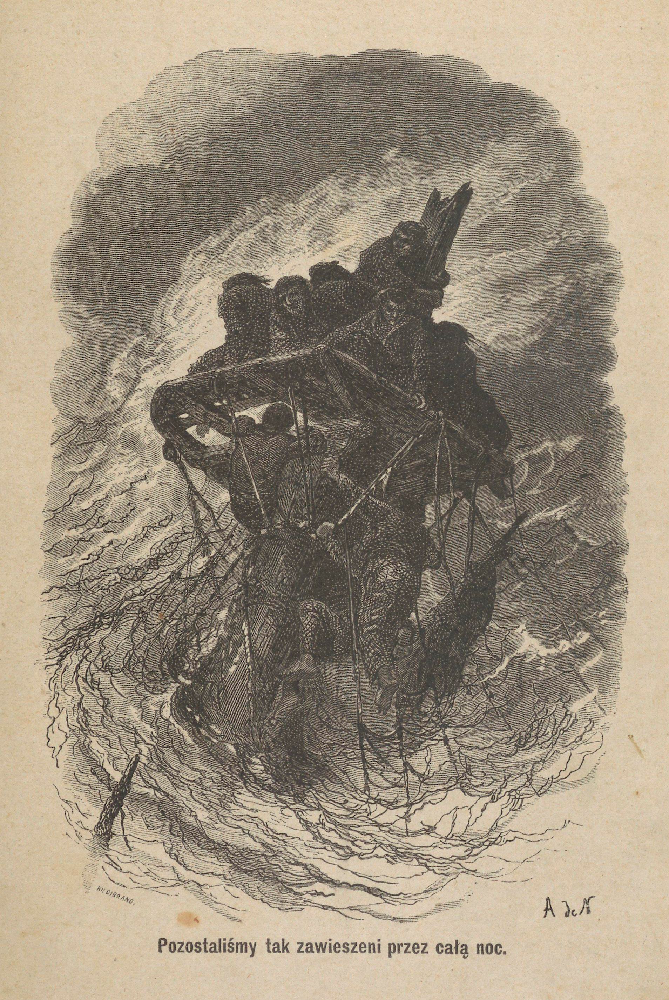
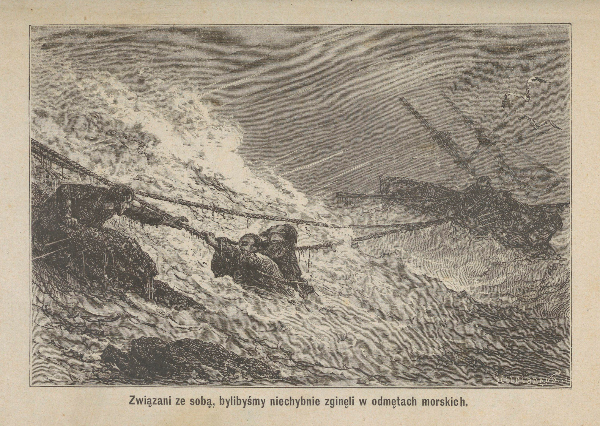
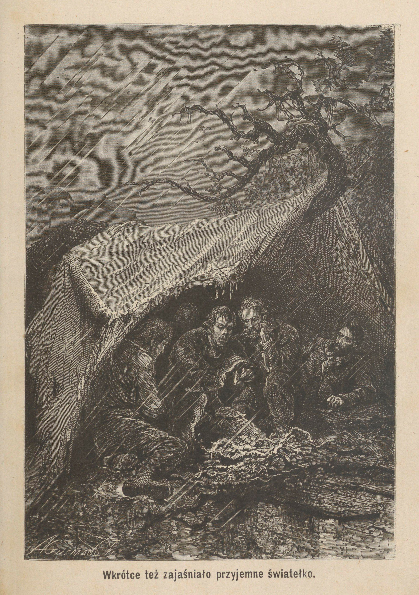
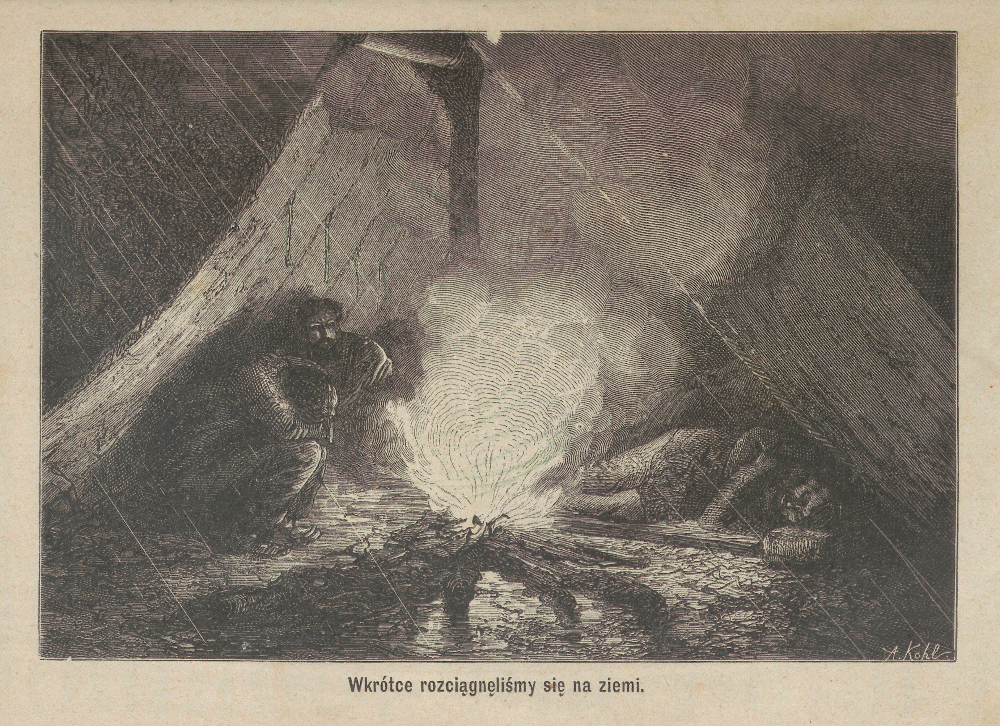
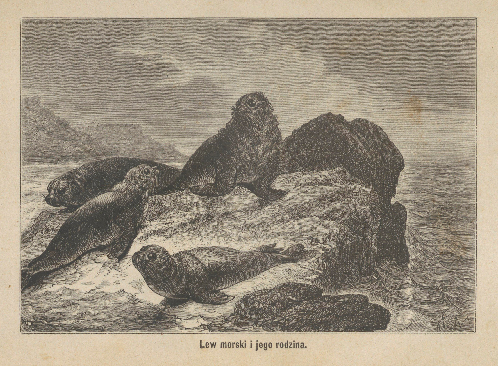
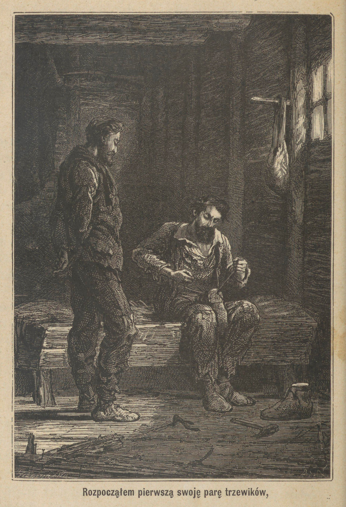
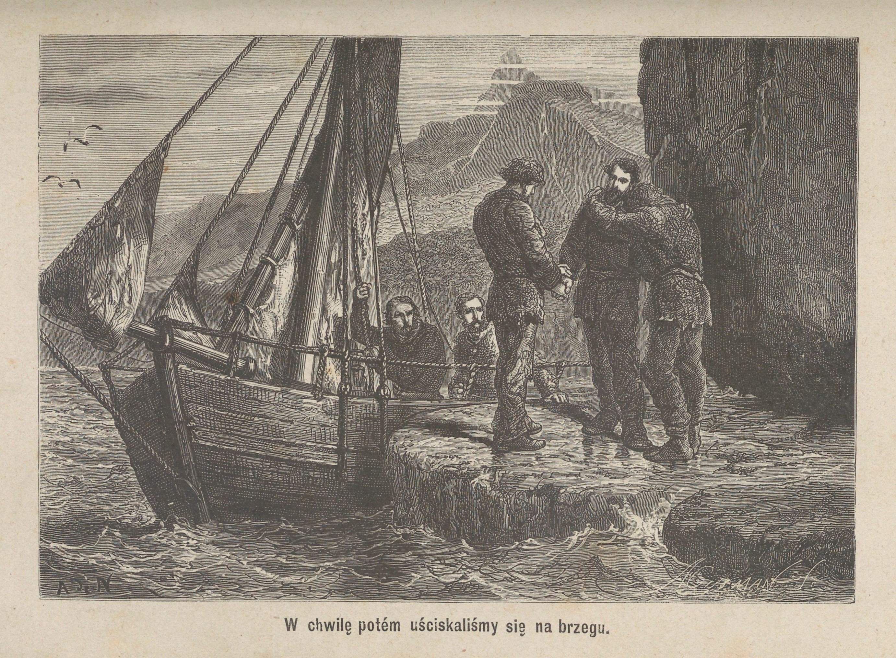
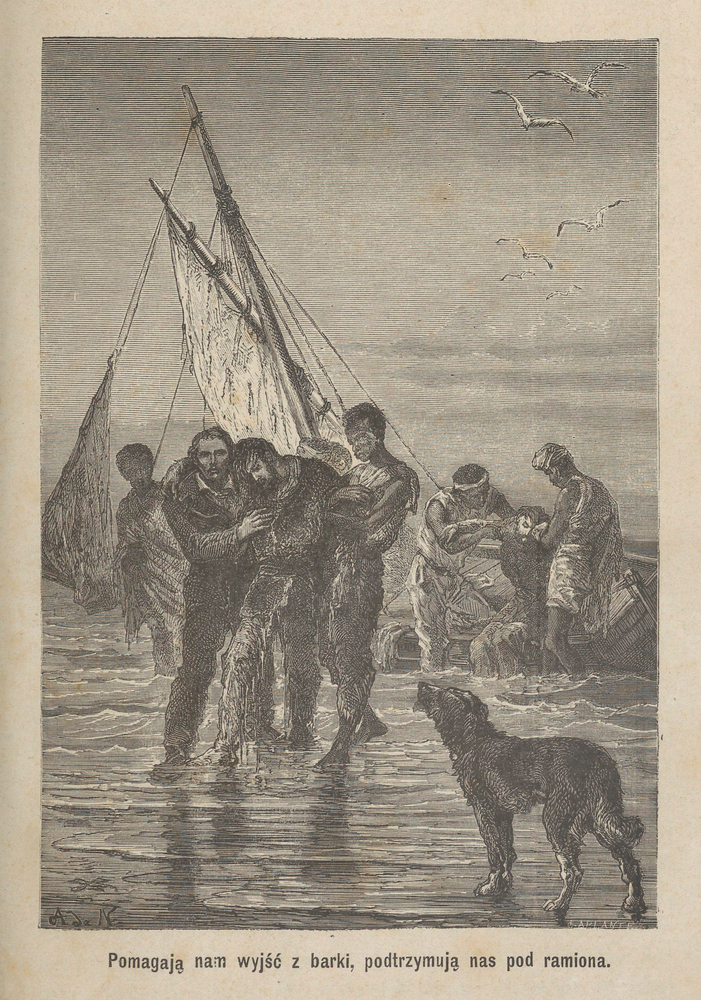
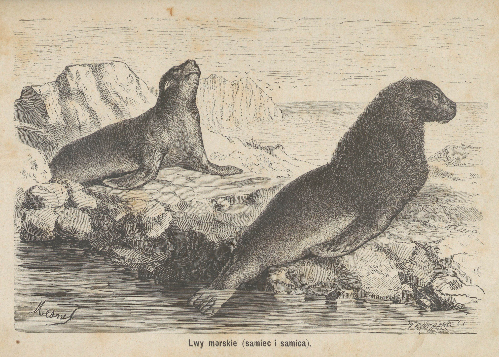

<!-- page 8 -->

<!-- page 12 -->

<!-- page 27 -->

<!-- page 49 -->

<!-- page 63 -->

<!-- page 69 -->

<!-- page 76 -->

<!-- page 95 -->

<!-- page 107 -->

<!-- page 132 -->

<!-- page 135 -->

<!-- page 162 -->

<!-- page 173 -->

<!-- page 180 -->

<!-- page 190 -->

<!-- page 215 -->

<!-- page 220 -->

<!-- page 223 -->

<!-- page 258 -->
